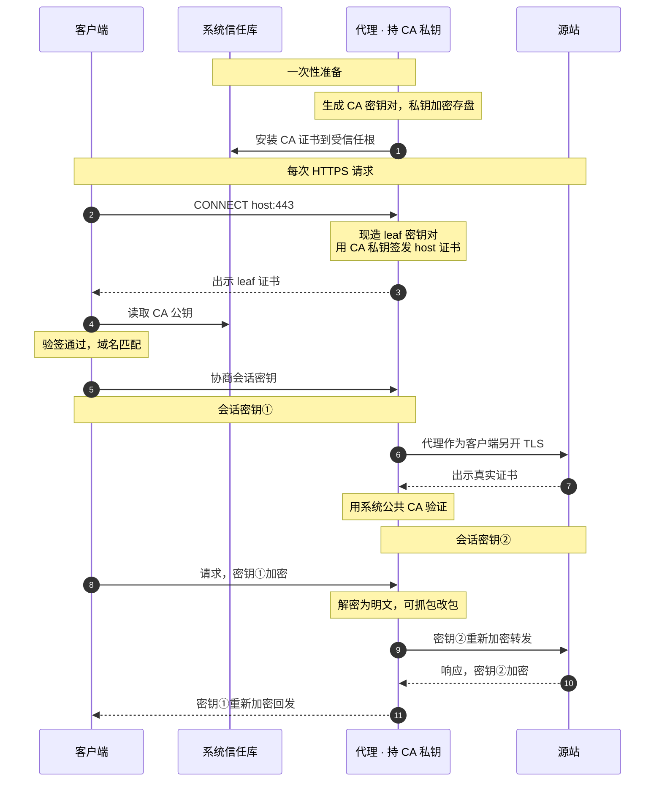
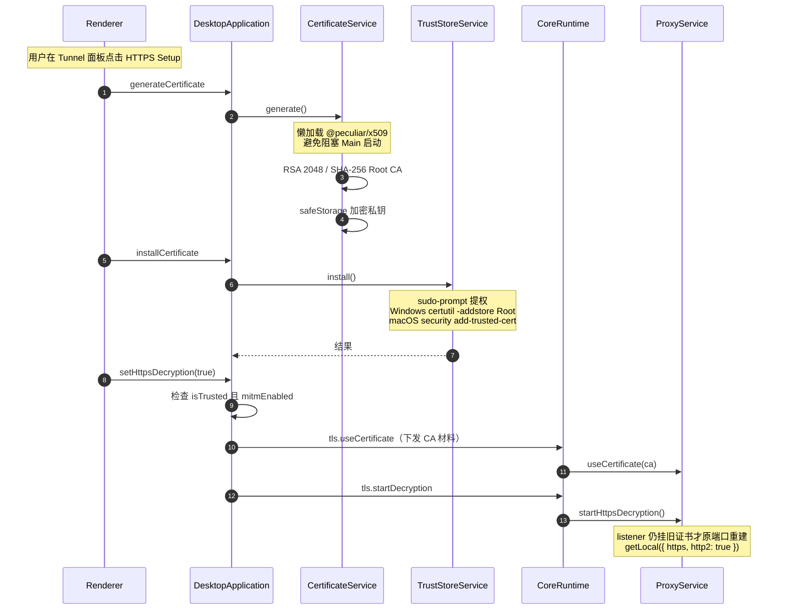
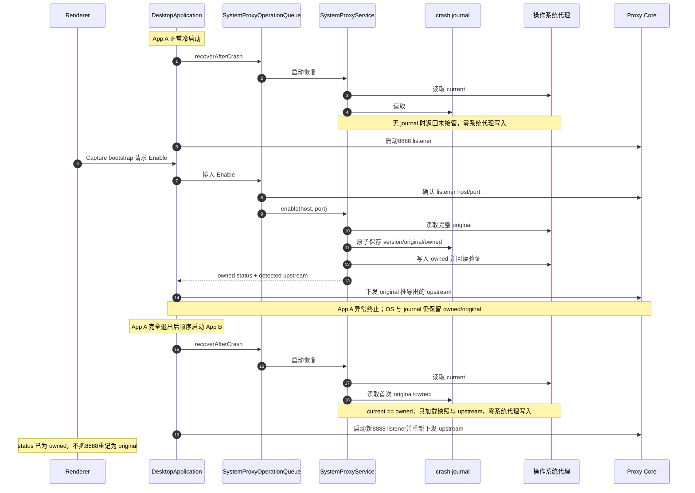
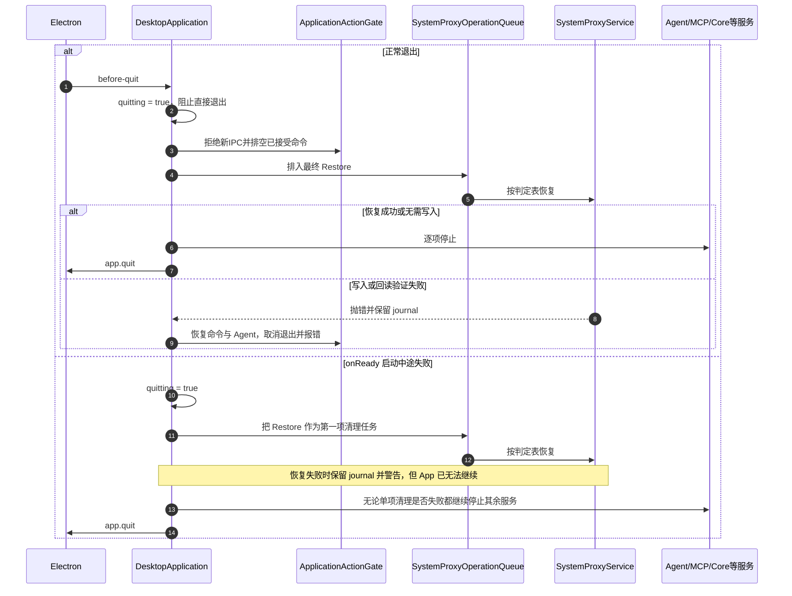
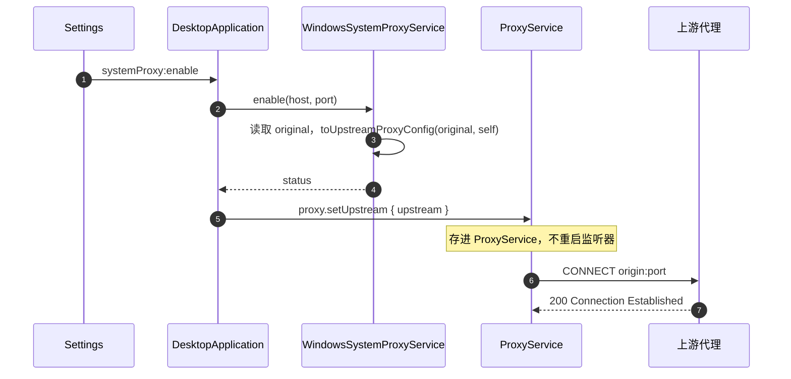
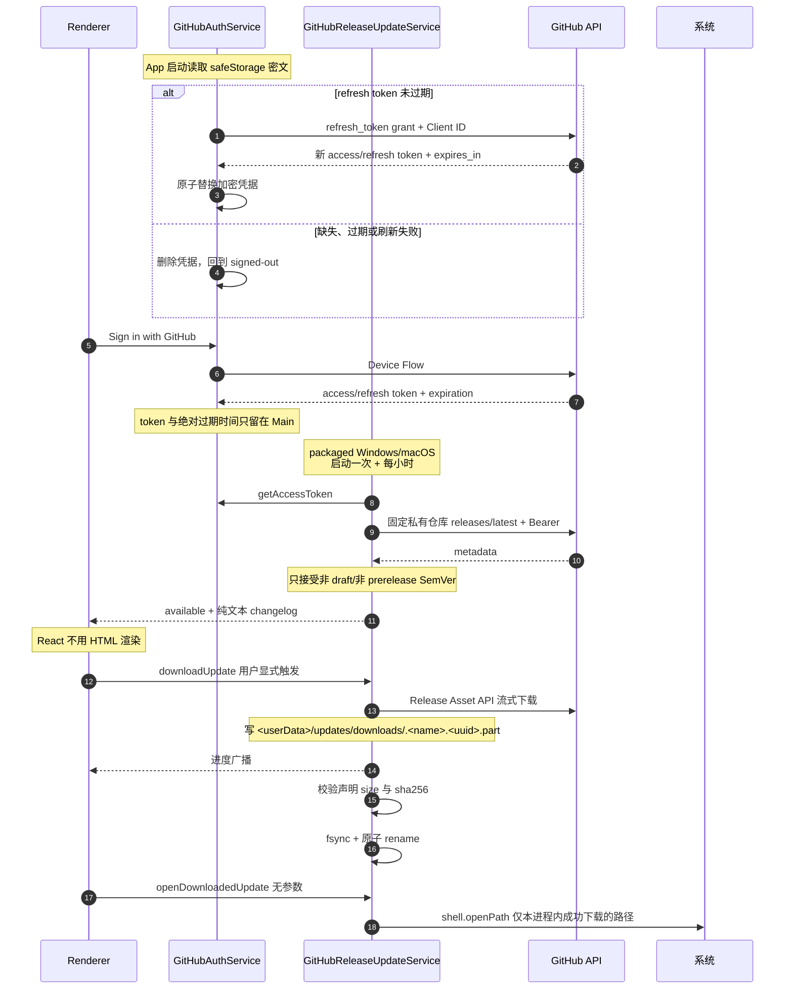
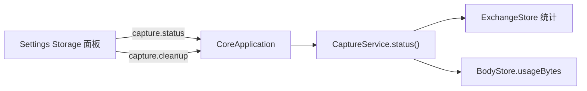

# Feature: Settings

> 最后更新：2026-09-03
> Main 模块：`apps/desktop/src/main/certificates/`、`system-proxy/`、`updates/`
> Core 模块：`apps/proxy-core/src/proxy-core/capture/entry.ts`
> Renderer 模块：`apps/desktop/src/renderer/features/settings/`

## 1. 职责与边界

Settings 聚合所有需要**操作系统权限**或**跨会话持久化**的配置。

| 子域 | 归属进程 | 内容 |
| --- | --- | --- |
| 证书与 MITM | Main | CA 生成、信任库安装、解密开关、不安全例外 |
| 系统代理 | Main | 接管、恢复、紧急修复、ownership 展示 |
| 更新 | Main | 检查、changelog、手动下载、打开安装器 |
| 存储 | Core | 用量状态、清理 |
| 语言、主题与导出隐私 | Main + Renderer | Main管理设置请求；Renderer应用15种语言、4套主题和3项默认值并保存到localStorage |
| Agent | Main + Renderer | Provider/Credential、持久化Chat、Streaming、Usage、恢复与24项Tool capability双列配置均已实现 |

**核心边界：所有 OS 级操作只在 Main。** Core 不读写系统设置，Renderer 只表达意图。

Settings rail 的最后访问 section 由 App shell 持有。切换到 Capture / Rules / Composer / Diagnostics
不会重置该值，返回 Settings 时仍打开离开前的 section；TLS compatibility、Proxy readiness 等明确的
跨 feature 跳转可以覆盖它，直接打开对应目标 section。面板内未提交的瞬态 dialog 不跨 feature 保留。

Settings rail 的每项都是原生 button，当前项必须通过 `aria-current="page"` 暴露，不以 CSS class 或翻译文案作为状态契约。
真实 Electron `settings.navigation` 从 Certificates 默认态开始，逐项操作九个 section，并用键盘 Enter 激活 Agent；在离开 Settings
后通过普通 workspace 导航返回，证明最后 section 未被 remount 重置。显式 TLS 跳转的覆盖语义由
`capture.navigate-tls-passthrough` 独立验证；两条 workflow 都必须保留 trace、语言无关 DOM 状态、
Main/Core PID、8888 释放与 `gracefulDestroyVerified=true` 证据。

当前 `settings.navigation` 已取得 `aria-current` 与 Agent 原生 button 语义缺失的 Red，再取得真实 Electron Green：九个 section 的
`aria-current` 唯一，App Containers 经 Capture 往返保持，TLS passthrough 经 Rules、Composer、
Diagnostics 往返保持；显式 TLS 跳转继续由 `capture.navigate-tls-passthrough` 验收。Proxy readiness
入口与 TLS 入口一样在 App shell 先覆盖目标 section 再切换 workspace，不为测试注入 readiness 状态。

Capture 的 TLS tunnel Inspector 允许从已确认的`TLS passthrough`连接跳到当前配置项。跳转前读取
TLS passthrough settings，并从当前host的所有覆盖项中选择最具体pattern：exact优先，其次选择suffix
最长的leading wildcard；没有覆盖项时不伪造目标。App一次性切到Settings / TLS passthrough并携带该
pattern，列表加载后将目标滚入可见区域，以accent背景和边框高亮3秒；重复跳转重新计时。高亮只是
Renderer瞬态导航反馈，不写workspace、不进入URL，也不由Main/Core持有。

### 1.1 语言、主题与导出隐私Tool

- `settings_set_language`接受`{ language }`，只允许既有15个语言ID；`settings_set_theme`接受`{ theme }`，只允许`warm/light/ember/dark`。
    - 不增加`auto/system`等模式，不改变首次启动的系统语言匹配、默认主题或现有`localStorage`键。
    - UI与Tool共用明确的Main方法，不在Tool里执行JavaScript、写Renderer Store或直接访问存储。
- `settings_set_export_privacy_defaults`要求显式提供`maskAuthorization`、`maskCookies`、`warnBeforeUnmasked`三个boolean。
    - 只改变后续导出的默认值，不修改已经打开的导出草稿、运行中的任务或既有文件；Archive仍保留完整原生存档。
    - UI单项Switch继续只改变自己的字段，连续操作不能因异步确认丢掉另一个字段。
- Main通过有类型的Preload请求关联一次设置操作，Renderer常驻订阅应用并确认；界面导航不决定是否接收变更。
    - Main处理参数校验、取消、Renderer退出及完成通知；结果只含已应用设置，不含存储路径、请求内部ID或任意错误内容。
    - `UiPreferencesService`登记请求；`UiPreferencesActions`常驻订阅，串行领取并应用，成功写入原localStorage后确认，Main再广播给其他Renderer。
    - 不新建配置文件、双写副本或迁移路径。App只把语言/主题映射到DOM，不再晚于确认重复写存储；持久化失败返回安全失败响应。
    - Deny与预取消无写入；未开始的请求被取消后不能迟到应用。已开始提交的设置完成原操作，不用取消回滚用户状态。
- 三项均为独立Settings change，Agent/MCP各自授权并遵守Ask/Auto。
    - 先取得executor和真实Electron缺失Tool Red；新增Main生命周期与Renderer应用逻辑先由产品测试锁定目标行为。
    - 语言变更在专属`settings.tools.language`验证；主题与隐私在`settings.tools.preferences`验证，其他workflow不为定位控件切换语言。
    - 最终验收覆盖UI原入口、当前已挂载界面、取消/失败、双列撤权、重启持久化和零重放；设置操作不修改系统代理或证书配置。

<a id="ui-preferences-acceptance"></a>
### 1.2 偏好Tool验收（2026-09-07）

- 前置结果：executor21项缺失Tool Red，日志为TEMP下`interceptor-settings-preferences-executor-red-20260907.log`。
    - 真实语言/偏好两条workflow在`5e4fbc31`构建上discovery Red，证据`interceptor-settings-preferences-e2e-red-20260907-203104`；Main/Core `6352/27056`、`37204/20232`均正常退出并恢复宿主。
    - Main测试先于Service创建；首次因模块不存在没有执行任何用例，不能把该日志当作29项行为Red。实现后生命周期29/29。
    - Renderer原Privacy入口未调用Main而Red；新增Actions测试初始模块缺失。摘要3项Red后53/53；保存确认另5项Red后Renderer应用10/10，与Privacy2项和Main合计41/41。
    - 对应日志为`interceptor-ui-preferences-owner-red-20260907.log`、`interceptor-ui-preferences-renderer-red-20260907.log`、`interceptor-settings-preferences-summary-red-20260907.log`、`interceptor-preferences-persistence-red-20260907.log`。
- 五条关联真实流程5/5（2.0分钟），证据`interceptor-preferences-related-green-20260907-210510`。
    - 包含语言、主题/隐私、Settings双列授权、MCP Browser与MCP Desktop；十代Main/Core全部`gracefulDestroyVerified=true`。
    - Settings授权三代为`12772/4696`、`9308/30292`、`4360/23364`；MCP Browser为`43212/27372`；MCP Desktop为`6540/44540`、`13236/24084`。
    - 偏好两代为`8228/36200`、`16740/12028`；语言为`6020/44436`、`41780/16864`。Main/Core/Worker退出、8888释放、完整WinINet/journal恢复。
- 保存确认修正后两条目标流程再跑2/2（52.3秒），最终证据`interceptor-preferences-persistence-green-20260907-211527`。
    - 偏好Main/Core `20840/34860`、`25464/28872`；语言`38236/34080`、`42568/18792`，四代正常销毁及宿主恢复通过。
    - 原Sidebar/Privacy UI、Agent/MCP Ask Deny/Allow/Auto、已挂载界面、连续单字段修改、HAR已开草稿遮罩不变/下次读取新默认值、撤权、重启持久化与Model零重放通过。
    - 语言只在专属流程中改变；两条流程都通过原UI恢复初始偏好。`preferences.json`只保存公开Tool名称和布尔结论。
- 全workspace typecheck、Desktop707/707、Tools347/347、MCP32/32通过。
    - 偏好明暗12视图72 targets、共用TLS fixture16视图96 targets、Settings目录6视图76 targets合计244/244，0 missing/flagged，最大0.6px。
    - 报告位于TEMP，前缀`interceptor-preferences-final-parity-20260907-211811`、`interceptor-preferences-settings-parity-20260907-212106`；保留旧全量parity报告，不扩充设计工具测试。
    - 三项设置生成12张审批/完成设计图；Settings筛选目录2张有实际变化，其余重新生成图保持不变。
- Windows package、artifact audit（1,294 files / 392,925,601 bytes）、packaged smoke1/1（41.5秒）通过。
    - 日志`interceptor-preferences-package-20260907.log`、`interceptor-preferences-artifact-audit-20260907.log`；smoke证据`interceptor-preferences-smoke-20260907-211651`。
    - 新增7个窄Preload API均列入安全白名单；设置请求/确认不注册为业务Tool，只有三项明确设置命令对外。
    - 依赖及锁文件未变，复用`interceptor-har-delivery-production-audit-20260907.json`零漏洞结果，不声称本轮重新查询。
- 本组后代码58/73、完整自动验收54/73；Settings代码15/26、完整11/26，registry/recipe58项、116个开关，Developer人工结论0/58。
    - TLS清理、证书/AppContainer特权步骤、Updates和macOS独立原生验收仍未完成，不由上述结果替代。

## 2. 证书与 HTTPS MITM

### Certificates面板parity场景

- 当前字体修复：设计Google Fonts实际使用的7份Inter WOFF2与现有`@fontsource-variable/inter@5.2.8`文件SHA256全部相同，差异不是字体二进制，而是设计按400/450/500/600/700逐个注册，产品原为100–900连续范围。Renderer现在用现有依赖资源注册同一离散字重，并以Inter为UI字体；无新依赖/外部字体请求，JetBrains Mono、控件字重声明、字号、尺寸和gap/padding不变。源文件比对在TEMP `interceptor-inter-source-20260914/source.json`；真实字体注册前置Red见`interceptor-inter-weights-20260914-e2e-red`。当前398场景合并结果中的Certificates与AppContainer字体目标均无flag，文件为`interceptor-ui-delivery-20260914-evidence/parity-current.json`；不以headless替代真实验收。
- 2026-09-15恢复后的同一Settings workflow1/1（20.7s）：五个字重、真实loadedFaces=1、35个本地Inter URL及全部九section/键盘/往返通过；Main/Core `10628/38856`正常退出，trace及宿主guard齐全。证据TEMP `interceptor-ui-acceptance-20260915-settings`。当前package/audit与smoke1/1（36.7s）通过，ASAR复核35声明/7资源，前缀`interceptor-acceptance-20260915-*`；无签名证书的17个文件按规则标unsigned。
- 2026-09-14首次最终运行的URL断言误包含其他字体合法`data:`资源，修正为Inter后当日因暂停未复跑；Main/Core `17424/12864`正常退出，原失败仍保留于TEMP `interceptor-inter-weights-20260914-e2e-green`，不因目录名改写历史结果。
- 2026-09-11旧`settings`场景补正常Toggle sidebar与Certificates导航，解决expanded/collapsed导致的160px差异；旧`light/shell-v2/settings.png`不存在，改为复用已有明暗`settings/framed.png`，不生成或修改基准。
- 明暗各10 matched、0 missing、2 flagged；`MITM active`与`Show in file manager`仍各约1px位置差，继续报告。像素对比由n/a恢复为约1.46%/1.45%，证书fixture字段、说明和图标的既有差异不冒充产品已修复。
- 产品、证书/系统状态、fake数据与设计稿未改；只运行受影响parity和脚本语法检查，不增加工具自身测试或重复证书E2E。TEMP证据前缀`interceptor-settings-certificates-20260911`；[工作项报告](../../commit-changes/202609111558_ui_parity_progress.html#settings-certificates)记录范围与遗留。
- 2026-09-11历史DOM诊断：标题文字宽90.375/89.40625px、Show in file manager按钮宽178.359375/177.734375px；两侧字体都加载成功，gap9/7px和padding14px一致。当时按注册家族称为静态Inter与Inter Variable，2026-09-14已通过文件hash进一步定位为离散/连续字重匹配差异，不能据旧名称推断字体文件不同。原始集合与边界在TEMP `interceptor-certificates-geometry-20260911.json`，不做margin或固定宽度补偿。

### 2.1 三对密钥

| 密钥对 | 持有者 | 用途 |
| --- | --- | --- |
| CA 密钥对 | 本应用生成 | 私钥签发 leaf，公钥装信任库验签 |
| leaf 密钥对 | Mockttp 按 host 现造并缓存 | 与客户端的会话 |
| 源站真实密钥对 | 真实网站 | 代理与源站的会话 |

**CA 私钥经 `safeStorage`（DPAPI/Keychain）加密存盘，只在 Main 与 Core 内存中流转，绝不进 Renderer、日志或导出。**

### 2.2 握手时序



> 密钥交换细节：TLS 1.2 + RSA 时客户端用 leaf 公钥加密预主密钥、代理用 leaf 私钥解密；TLS 1.3 / ECDHE 时会话密钥由临时 DH 生成（前向保密），leaf 私钥只用来签握手、客户端用 leaf 公钥验签。**两种情况下客户端信任 leaf 都取决于用信任库里的 CA 公钥验签成功。**

### 2.3 启用流程



**证书与解密开关正交**：`tls.useCertificate` 只记录当前可用的 CA 材料，`tls.startDecryption` /
`tls.stopDecryption` 只切换是否 MITM。停止解密时全部 host 退回隧道、证书永不出示，因此
卸载信任或删除 CA 都不必立刻换 listener。Main 侧只有 CA 已安装信任**且** `mitmEnabled` 开启时
才发 `tls.startDecryption`，否则发 `tls.stopDecryption`。

Main 启动时先从 Core 读回 `tls.getDecryptionPreference`，再按「CA 已信任 且 用户开启」决定是否真的
解密。持久化的是**用户意图**，不是运行态：`tls.saveDecryptionPreference` 只在用户拨开关时写，
CA 不可用而发出的 `tls.stopDecryption` 不会擦掉它。

**信任库是 local-machine 而非 current-user**，因此本机全部用户与进程（含浏览器）统一信任。`TrustStoreService` 用 `@vscode/sudo-prompt` 提权执行安装/卸载，检测则不需提权：

| 操作 | Windows | macOS |
| --- | --- | --- |
| 安装 | `certutil -addstore -f Root`（去掉 `-user`） | `security add-trusted-cert -d -r trustRoot -k /Library/Keychains/System.keychain` |
| 检测 | `certutil -verifystore Root <sha1>` | `security find-certificate -a -p`精确匹配SHA-1后，`security verify-cert -p basic -L`查询根CA的系统信任链结果 |

按 SHA-1 thumbprint 精确定位；`execFile` 不经 shell。注入 `ElevatedRunner`（默认 `sudoPromptRunner`）+ `CommandRunner` 便于 mock 单测。

macOS只将匹配的公开证书经stdin交给系统验证，不生成临时证书文件、不传入`-r`强制信任锚点、不读取私钥；未安装或系统评估拒绝均不报告trusted。此处检查根CA的基本系统信任，不以CA本身代替服务器叶证书执行SSL域名/用途验证，真实HTTPS握手仍需相应workflow验收。2026-09-16存在即信任的原用例1 Red/8 Green，补齐匹配和评估契约后3 Red/8 Green，证据`/tmp/interceptor-macos-trust-20260916-unit{,-contract}-red.log`；最终原生/E2E结果待补。

### 2.4 窄 API

#### macOS trust授权续验（待最终验收）

2026-09-18取消信任后的新增CA清理已实现，代码/开发E2E通过，待最新生产smoke：Main在调用helper导入前只读保存该公开CA是否已存在的事实；inventory失败时不导入或请求信任。admin trust拒绝/取消后，只撤销本次新导入的相同DER/SHA-256证书，不删除安装前已有的CA，不通过root重新申请信任。原信任错误仍返回；清理失败同时保留两项错误，不把半完成状态报告成功。Windows certutil流程保持不变。对应真实`settings.certificates.cancel-trust`以产品Generate/Install、原生Cancel、完整Root集合恢复和正常Close验收，不用测试侧删除证书替代产品回滚。

- 产品unit6 Red后18/18，相关回归207 passed/2 Windows native skipped和Desktop类型通过。真实前置Red在`/tmp/interceptor-macos-trust-cancel-20260918-e2e-red/`，原生取消完成后多出本轮证书；最终相同流程在`/tmp/interceptor-macos-trust-cancel-20260918-e2e-green/`1/1（5.8秒），Root前后哈希完全相同，Main10805/Core10812正常退出，8888/代理/admin trust恢复。
- 最新package及audit通过；生产App身份改变后需用户核准，最新smoke未运行。取消路径Green不替代成功安装/解密TLS的人工授权验收，不覆盖本轮基线内的历史残留CA或root卸载/失败rollback。

- 2026-09-16真实`capture.scenarios.tls`失败于`ca:install`：系统钥匙串已增加本轮CA，但`SecTrustSettingsSetTrustSettings`返回`The authorization was denied since no user interaction was possible`。新查询正确判断未信任，不能把CA存在当作Install成功；真实H1/H2解密步骤未运行。
- 证据`/tmp/interceptor-macos-tls-trust-20260916/`保留trace、Main错误及Main/Core `72930/72936`退出metadata。原生TLS清理因未出现Uninstall控件失败；该CA随后由用户按精确指纹删除，续作只读核对原两张系统证书集合一致、无测试进程/journal、8888可bind。旧宿主guard记录的代理快照差异仍作为该轮失败保留，不能由后续无8888指向替代完整快照恢复证据。
- 本轮修复假设：普通用户进程直接调用`security add-trusted-cert`，由Security框架请求admin trust认证，避免sudo-prompt产生的root shell无法交互；系统信任范围仍为admin/System Keychain，不写授权数据库、不降到user trust、不静默fallback。Windows install/uninstall/verify命令不变。先取对应unit Red，再用同一真实TLS workflow验收，不以命令mock代替原生结果。
- 普通用户单步尝试的真实结果：`/tmp/interceptor-macos-tls-trust-20260916-native-authorization/`精确失败于`SecCertificateAddToKeychain: Write permissions error`，没有留下新系统CA；Main/Core `84004/84011`正常退出且宿主guard通过。这证明导入钥匙串和写admin trust必须分别使用合适的身份；不是为失败保留fallback。
- 当前待验证实现：`installMacosCertificate()`先提权`security add-certificates -k System.keychain`，失败立即返回；成功后以登录用户执行不带`-k`的`security add-trusted-cert -d -r trustRoot`，只请求admin trust。Apple SecurityTool公开实现明确`-k`为可选的证书导入步骤；不带`-k`不会再次写钥匙串。任一步失败都不得报告安装成功。
- 两阶段安装后真实TLS workflow1/1（32.9秒）、Main/Core `89075/89080`正常退出，证据`/tmp/interceptor-macos-tls-trust-20260916-two-phase/`。追加只读验收发现Uninstall删了证书但遗留本轮admin trust，不能据此宣布完整证书恢复；该条记录按公开指纹/签发者/时间精确恢复，恢复前后plist保存在`interceptor-trust-recovery-20260916-Mvwwr5`临时目录，不改授权规则或用户其他信任项。
- 补充卸载目标：精确读取目标公开CA，先以登录用户执行`remove-trusted-cert -d`清理admin trust，成功后才提权删除钥匙串证书；trust移除失败时保留证书并返回错误。TLS workflow同时保存前后trust快照并比较，不再只靠证书集合判断恢复。

`getCertificateStatus`、`generateCertificate`、`installCertificate`、`uninstallCertificate`、`deleteCertificate`、`revealCertificate`、`viewCertificate`、`openCertificateManager`、`getInsecureHosts`、`setInsecureHosts`、`setHttpsDecryption`。

Main 组装的 `CertificateInfo` 含 `path` 与 `mitmEnabled`，**私钥不出 Main**。

## 3. 系统代理

### 3.1 参与者、快照与不变量

| 参与者 | 负责什么 | 不负责什么 |
| --- | --- | --- |
| Renderer | 通过窄 Desktop API 请求 Enable、Restore 和只读 Status | 不访问 WinINet、SystemConfiguration 或 journal |
| `DesktopApplication`（Main） | 产品内唯一的系统代理流程编排者；决定何时恢复、何时退出，并同步 Core upstream 与 Renderer 状态 | 不把代理快照写入日志或发给 Renderer |
| `SystemProxyOperationQueue`（Main 内存） | 按调用先后顺序执行启动恢复、Enable、Restore、Core 故障恢复与退出恢复 | 不保存 PID，不写磁盘，不是跨进程锁 |
| 平台 `SystemProxyService` | 读取 `current`、比较完整快照、调用 native helper 写入并回读验证 | 不管理 Core 生命周期或 Renderer |
| Proxy Core UtilityProcess | 监听 `127.0.0.1:8888`，接收 Main 下发的 upstream 并转发流量 | 不读取或修改系统代理，不读 journal |
| crash journal | 保存崩溃恢复需要的 `version/original/owned` | 不保存 owner、PID、启动时间、instance ID 或阶段状态 |
| 操作系统 | 保存当前实际生效的代理配置 `current` | 不知道哪个 App “拥有”代理 |

三个比较值的含义：

| 值 | 产生时间 | 内容 |
| --- | --- | --- |
| `original` | Interceptor 接管前 | Windows 为 flags、Proxy Server、Bypass、PAC、Auto Detect 等完整 WinINet 快照；macOS 为全部活动 network service 的完整代理字典 |
| `owned` | 写系统代理前 | 根据 `original` 计算出的 Interceptor loopback 配置，目标为当前 Core listener |
| `current` | 每次恢复判定时 | Main 通过平台 helper 当场读取的操作系统实际配置 |

文档中的 `current == owned`、`current == original` 都表示完整快照逐字段相等，不表示 PID、进程或文件的所有权。

Windows journal 固定为 `%LOCALAPPDATA%/Interceptor/system-proxy/journal.json`，不随 Electron
`userData`、开发模式、packaged App 或 E2E `--user-data-dir` 改变；macOS journal 位于当前
`userData/system-proxy/journal.json`。两平台都先把临时文件完整写入并同步，再原子 rename。
产品前提是同一时间只运行一个 Interceptor App，不处理两个 App 的竞争。

### 3.2 生命周期流程

#### 正常启动与崩溃重启



#### 正常退出与启动失败



正常退出可以在代理恢复失败后继续运行，因此取消退出且不先停止 Core；启动失败表示 App 已经无法继续，
所以即使代理恢复失败也会保留 journal、警告用户并继续销毁其余服务。这是两条流程最重要的差异。

Core 从 `running` 进入 `unresponsive/restarting` 时，Main 只把一个自动 Restore 排入同一队列；重复状态通知
不会重复排队。用户 Enable/Restore、启动恢复、Core 故障恢复和退出恢复严格 FIFO，前一项结束后下一项才读取
新的 `current`。单项失败不堵塞后续；`quitting=true` 后不再接受新的 Core 故障恢复。该队列只解决单 Main
进程内事件交错，不提供多 App 互斥。

所有启动恢复、用户 Restore、Core 故障恢复和退出恢复最终使用同一判定表：

| 当场比较结果 | 启动 `recoverAfterCrash()` | Restore、Core 故障或退出 |
| --- | --- | --- |
| 无 journal | 返回未接管，零系统代理写入 | 若内存也无快照则返回未接管，零系统代理写入 |
| `current == owned` | 加载 `original/owned`，保留 journal，零系统代理写入 | 写回 `original`，回读验证成功后删除 journal |
| `current == original` | 只删除已完成使命的 journal | 只删除 journal，不重复写 `original` |
| `current` 与两者都不同 | 视为用户或外部程序已修改；零系统代理写入并删除失效 journal | 同样零系统代理写入并删除失效 journal，报告 `externally-modified` |
| helper 写入或回读验证失败 | 抛错；不把恢复当作成功 | 抛错并保留 journal；正常退出因此取消，启动失败清理则继续退出 |

#### 当前验证边界

| 流程 | 当前证据 | 结论 |
| --- | --- | --- |
| Windows 首次接管、App A 强杀、App B 跨 profile 加载 `current == owned`、B 正常退出恢复首次 `original` | 真实 Electron `settings.system-proxy.crash-recovery` | 已取得 Red/Green 与完整销毁证据 |
| Windows journal 恢复后的 CA、MITM、TLS 用户配置跨进程保持 | 真实 Electron `settings.proxy-mitm.persistence` | 已取得 Green 与完整销毁证据 |
| `current == original`、外部修改零写入、恢复失败保留 journal | Windows/macOS Service unit 与 journal integration | owning边界已完成；外部程序改写不是产品用户flow，不用测试脚本改WinINet冒充E2E |
| 启动失败先恢复代理再清理其他服务 | `application-shutdown` unit | 属无法由正常用户路径稳定制造的故障分支，不用故障注入冒充 E2E |
| Promise 队列严格串行且前序失败不阻塞后续 | `operation-queue` unit + 真实Electron `application.lifecycle.core-restart` | 队列unit Green；Core故障后的重新接管及第二次故障与Close竞争Green |
| Core 异常退出后的自动 Restore 与新 Core 生命周期 | 真实Electron `application.lifecycle.core-restart` | Retrospective Red与当前Green、真实请求、两代PID及完整销毁证据已取得 |
| macOS 三态 journal 与多 network service 恢复 | macOS Service unit、journal integration；Windows package 不执行 Swift helper | 待真实 macOS Electron、Authorization 与系统副作用证据 |

Windows系统代理崩溃恢复已完成：跨profile App crash/relaunch、Core-only crash/restart、第二次Core故障与正常退出竞争均有真实Electron证据；不可由正常产品路径制造的边界保留在owning unit/integration。macOS实机验收独立跟踪。

**窄 Desktop API**：`getSystemProxyStatus`、`enableSystemProxy`、`restoreSystemProxy`。Main 日志不包含 snapshot。

### 3.3 平台实现

| 平台 | 机制 |
| --- | --- |
| Windows | `windows/helper.cs`，当前用户 WinINet per-connection API，读写 flags/Proxy Server/Bypass/PAC URL/Auto Detect，广播 settings changed |
| macOS | `macos/helper.swift`，Authorization Services + SystemConfiguration，枚举当前 Network Set 全部活动 service，单 session 内 set/commit/apply |

只允许 loopback listener。

#### macOS 同包原生服务

Main首次启动部署同包helper，代理和System Keychain导入/删除已接入常驻服务，Windows不变。真实TLS、同构建多代复用、Core故障和App crash/relaunch已有Green与恢复证据；这不代表全部macOS workflow、独立系统权限或卸载恢复均完成，具体阶段见Handover。

- 配置明确`protocolVersion`、`socketPath`、`clientUserId`、`clientExecutablePath`和精确`cdhash` requirement；配置和endpoint目录必须由服务账户拥有且不能被其他用户写入，root运行还检查整个父目录链。
- 本地Unix socket通过内核`LOCAL_PEERTOKEN`读取audit token；校验实际peer用户、`SecCodeCheckValidity`、静态代码和固定可执行文件路径，不接收客户端自报身份，不维护私钥或Apple付费身份。
- App鉴权递归验证内嵌代码、资源与全部架构；真实签名fixture在仅修改内嵌资源、Main CDHash不变时取得Red，递归校验后9/9 Green。此证据不代替正式App运行时身份与安装路径验证。
- 协议为单连接单条newline JSON，校验协议版本和严格字段集合；`status`返回服务进程ID、是否root、客户端写资格和当前实际能力。未知命令、额外字段、未核准进程都明确拒绝。
- 证书目标命令`certificate.import / certificate.remove`仅接受`parameters: { certificate, sha256 }`，certificate为公开X.509 DER的base64，sha256为64位大写十六进制。原生侧核对编码、大小、指纹和Interceptor自颁发主题，固定System.keychain；不接受路径、私钥、任意keychain或按模糊名称删除。
- Main继续拥有CA生成、私钥safeStorage和TLS同步。系统证书导入/删除改走已安装helper；admin trust添加/移除仍用登录用户上下文的Security命令，信任失败不报成功，移除trust失败不删除证书。helper导入不等于受信任，不能替代系统独立授权；改后复跑真实TLS证书集合与admin trust完整恢复。
- 普通`system-proxy.read`保留内核进程、UID、canonical路径与精确CDHash检查，不需要特权的公开查询不再扫描整包资源；`status`和所有写命令仍严格校验完整App资源、内嵌代码及运行时。该区分用于避免只读查询排队拖延代理退出恢复，不能让篡改App获得写资格。
- Recording就绪：Core重启时`CaptureStatus.recording=true`只说明Core正在记录，Renderer等支持平台的系统代理实际owned且未ownershipLost才显示Recording。迟到查询不能覆盖Stop、代理失权或Core代际变化；事件测试2 Red后7/7、Capture unit79/79，真实Core故障及App crash/relaunch 2/2 Green，证据`/tmp/interceptor-helper-fault-recovery-20260917-ready/`。先前真实失败明确记录了“Recording开启但owned尚未生效”，不以journal预写当作代理已接管。
- 代理命令：`system-proxy.read`无参数，返回全部活动network service的原始快照；`system-proxy.replace`仅接收`parameters: { expectedSnapshot, replacementSnapshot }`，两个快照均为`{ services: [{ id, name, settings }] }`，不接收路径、shell或Authorization凭据。协议帧上限为256KiB以容纳双快照，过大数据明确拒绝，不截断或省略服务。
- 条件写入代码：只在原生进程已具备root权限且客户端是核准的完整App时执行；在同一`SCPreferencesLock`事务内读取current、按完整快照比较expected、commit/apply并回读replacement。普通权限返回`authorization-required`，快照冲突返回`snapshot-conflict`，不新建Authorization窗口、不覆盖外部修改。Main仍唯一持有journal和业务接管/退出恢复编排，服务不保存第二份original。读取及普通权限拒绝已真实验证；root事务、冲突和回读仍待授权验收。
- 写入前另校验实际SecCode的Hardened Runtime、动态有效状态及未被调试状态，拒绝DYLD环境注入、get-task-allow和关闭执行页保护的entitlements。本机Node具备这些危险权限，其typed写入已验证返回`unauthorized-client`；临时Node核准仅用于读取测试。新ad-hoc App已启用Hardened Runtime并静态验签，实际包内helper19/19通过；完整App启动与受保护安装位置仍需验收，不能用通用解释器或旧产物绕过此门槛。
- 服务重启检查已取得SIGKILL残留端点Red，修复后保留活跃socket和普通文件、恢复崩溃残留；快速断连曾导致SIGPIPE，服务进程忽略该信号后相同检查Green。19项原生通信/鉴权/生命周期集成、11项原代理/journal及Desktop类型通过，未安装服务或修改系统代理/CA。
- Native集成在普通用户的私有临时目录运行服务和带ad-hoc签名的测试客户端，直接验证正常/拒绝路径，不注册LaunchDaemon，不操作系统代理、CA或授权规则，也不是替换产品来运行E2E。
- 正式安装必须固定管理员核准的App构建及完整调用链。读通道测试中的原生客户端身份不能自动成为代理/证书写权限；Main的资源完整性、进程身份、服务安装与业务写操作需要在下一步分别验证后再接入。

#### macOS 首次启动部署 Helper（进行中）

##### 开发与生产双入口（2026-09-18）

- 用户已确认本机开发和业务E2E共用一个常驻helper；开发入口信任获准的本机UID，不绑定项目源码、App构建CDHash、Electron签名或调试状态。首次部署确认后，HMR、rs、Main/Core重编译、新profile及下一条workflow均复用，不重装或重复申请开发授权。
- 同一个原生服务提供两个本地socket：生产使用`service.sock`及`service.json`，开发使用`development.sock`及`development.json`。开发配置仅记录`protocolVersion / socketPath / clientUserId`，由root保护；生产配置保留精确App路径/CDHash及完整运行时检查。请求不能自报环境来改变当前socket的鉴权。
- 两入口共用固定代理/公开证书协议与条件写入实现，不接收任意shell或私钥。开发授权明确允许该UID的本地程序使用这些能力，不宣称隔离同用户恶意代码；其他UID、损坏或可写配置仍拒绝。证书admin trust保持独立权限。
- Main按真实`app.isPackaged`选择入口：未打包的Forge与业务E2E走开发入口，签名产物走生产入口；无测试专用产品参数。helper仅在自身配套组件改变或缺失时更新，开发App重新构建不改变部署身份；安装另一入口不删除既有授权。
- 开发首次授权将同一份已验签helper复制到当前用户的私有系统临时目录（目录0700、文件0500）后执行固定授权命令，成功/取消/失败均清除；root阶段仍复制到root私有暂存目录并核对预先读取的helper CDHash。避免authd无法读取Desktop源码目录中的原生代码身份，不复制App或仓库、不改系统隐私权限或node_modules。
- 验收：部署unit、原生开发准入与生产拒绝、Main分派、授权暂存均先取得目标Red；最终相关204 passed/2 Windows native skipped与类型通过。真实开发前置启动日志为`/tmp/interceptor-development-helper-startup-20260918-red/`的`invalid-request`；开发两轮四代复用2/2在`/tmp/interceptor-dual-entry-development-e2e-20260918-staged/`，全部正常退出。实际npm start的HMR、rs、Main/Core inspector和恢复证据在`/private/tmp/interceptor-dual-entry-20260918-TUf3n3/`；rs前通过Settings恢复代理，未将其描述为SIGTERM期间零中断证明。
- 2026-09-18生产package与audit通过，开发授权已存在时packaged smoke1/1在`/tmp/interceptor-dual-entry-production-smoke-20260918-final/`；实装服务仍拒绝生产socket上的通用Node，开发socket接受获准UID。开发/生产配置互不覆盖，helper字节/inode复用；Main/Core/Worker退出、8888释放、完整代理/证书/admin trust恢复到本轮基线。全量macOS workflow、历史CA残留和root卸载/rollback不由本结果替代，详细阶段见Handover。
- 2026-09-19阶段提交前已同步`8d153821`并排除暂停的弹窗动画/独立package骨架：227 passed、2 Windows native skipped及Desktop类型通过；Core恢复、helper复用、上游存储/标题/正文相关6条真实E2E全通过。重新package/audit为1487文件、339450724字节，`/tmp/interceptor-stage-sync-20260919-production-smoke/`1/1（2.5分钟）；用户本轮开启的完整代理、公开CA/admin trust精确恢复，helper字节/inode和开发授权未变。详细命令及范围见[Handover Verification](../HANDOVER.md#verification)，不把同步前65条结果提升为同步后全量通过。

- App留在用户原位置，helper随App打包；Main首次启动在代理恢复/接管前调用`MacosHelperDeploymentService.ensureInstalled()`，缺失或本次App配套身份改变才请求一次系统管理员授权。后续启动只读核对并复用；不要求`.pkg`、不移动或更改App所有权，不下载独立helper。
- 只将原生组件部署到`/Library/PrivilegedHelperTools/com.zhxmt.interceptor.platform-capabilities`，配置和socket位于`/Library/Application Support/Interceptor/PlatformHelper/`。配置由root拥有且不可被其他用户写入，记录实际登录UID、App canonical路径及精确CDHash；launchd服务与配套helper一起更新。
- 授权后先在root私有暂存目录复制单个helper并核验精确签名，再执行固定`install-helper`。原生实现再次核验App/同包helper，按文件事务替换并注册服务；失败恢复原组件，不执行旧一次性写入路径。
- `deployment-status`只读返回`missing / outdated / ready / stopped / invalid`；损坏/未知状态不触发覆盖安装，取消不重试。`status`将服务root权限与`clientAuthorizedForWrites`分别表达，运行中App须通过内核身份、完整签名与Hardened Runtime校验，不以root拥有整个App代替鉴权。
- 原生`uninstall-helper`仅在用户明确批准的root操作中移除固定组件，不删除App、profile或CA；先经App恢复代理并清理本次CA/trust。不能将组件读写unit/integration当作真实首次启动/E2E验收。
- Main接入、开发/生产启动与`settings.helper-startup`的最新真实证据见上方双入口验收；root卸载/失败rollback和其余完整macOS流程仍待验。整App `.pkg`路线已撤除，历史测试事实保留在Handover，不能作为本流程证据。

#### macOS 首轮原生验收

- 2026-09-15在macOS x64首次运行真实`settings.navigation`，当前Desktop目录中的helper在`AuthorizationCreate`返回`-60008`。同一SHA-256原生探测在Desktop失败、在`/tmp`成功；签名和detached对照不能单独解决。E2E现通过已有运行目录配置准备非Desktop编译产物，未改Windows启动路径或产品授权策略。
- 非Desktop产物的同一workflow暴露`SystemConfiguration commit failed`；Main/Core `20488/20494`正常退出，宿主guard未报告代理或journal残留。前置失败证据在`/tmp/interceptor-macos-staged-e2e-20260915/`，不把此前下载或目录问题当作产品Red。
- 修复目标：`AuthorizationRef`覆盖`SCPreferences`的完整写入、commit、apply和回读，不在创建preferences后提前释放。既有macOS Service/journal 11/11基线通过；Swift原生问题由真实workflow验证，不以fake runner测试代替系统授权证据。最终Green及package/audit/smoke仍待取得。

#### Proxy面板parity场景

- 2026-09-11只修改`settings-proxy`明暗验收配置：通过正常Toggle sidebar先展开侧栏，与设计的expanded状态一致；Listener地址限定到Address行，不再误配侧栏或Current configuration的重复端点。
- 浅色原13目标有12个flag，主要是160px侧栏状态差异与地址误配；最终明暗各13/13 matched、0 missing/flagged、最大0.9px，像素差约1.25%/1.23%。深色补齐与浅色相同的检查目标，不放宽阈值。
- 产品、设计稿、PNG基准、fake数据与完整parity报告均未改；直接运行受影响场景和脚本语法检查，没有新增工具自身测试，也不重复运行系统代理业务E2E。
- TEMP前缀`interceptor-settings-proxy-20260911`保存前后JSON/Markdown、Renderer/diff与日志；[工作项报告](../../commit-changes/202609111558_ui_parity_progress.html#settings-proxy)说明实际范围。其他Settings与Shell差异独立保留。

### 3.4 上游代理链式转发 [已实现，仅 Windows]

接管系统代理后所有流量都进 Interceptor，若仍直连源站，必须经公司 PAC、VPN 或认证代理才能出网的环境会在接管期间**完全断网**。因此接管前读到的配置会原样接到上游。



转换规则（`windows/system-proxy-upstream.ts`，纯函数 + 14 项单测）：

| 原配置 | 上游 `proxyUrl` |
| --- | --- |
| PAC 脚本（`PROXY_TYPE_AUTO_PROXY_URL` + `pacUrl`） | `pac+<pacUrl>`，PAC 求值交给 Mockttp 内置的 `pac-proxy-agent` |
| 显式代理 `host:port` | `http://host:port` |
| 分方案列表 `http=a;https=b` | 取 https，缺失回退 http |
| 仅 `socks=host:port` | `socks5://host:port` |
| 仅 Auto Detect（WPAD） | 无（没有可传给 proxy-agent 的 URL），按直连处理 |

`bypassList` 转成 curl 风格 `noProxy`；Windows 专有的 `<local>` 展开为 `localhost` / `127.0.0.1`。**不能展开出裸 `::1`**：`matchesNoProxy` 按 `host:port` 切分候选项，裸 IPv6 会被切成空 host，而空 host 匹配一切，结果是每个请求都判定为 bypass，上游形同虚设。

`toUpstreamAuthority(upstream)` 从同一份配置里取出 `host:port`（丢弃凭据）供状态栏展示。

#### 三条出网路径都必须接上游

上游不是一个开关，而是三条彼此独立的代码路径，漏掉任何一条，对应流量就会绕过公司代理直连：

| 流量 | 出网点 | 接上游的方式 |
| --- | --- | --- |
| MITM 已解密的 HTTP/HTTPS | Mockttp 规则 | `thenPassThrough({ proxyConfig })` |
| MITM 未解密的 TLS 直通（`tlsInterceptOnly` 未命中） | Mockttp `passthroughSocket` | `passthroughProxyConfig`，见下 |
| WebSocket 转发 | `websocket-bridge.ts` 的 `ws` 客户端 | `HttpsProxyAgent`，命中 `matchesNoProxy` 时不注入 |

Mockttp 的 `passthroughSocket` 把 `net.connect(port, host)` 写死，`proxyConfig` 完全不参与，因此**只要关闭 MITM，全部 HTTPS 都绕过上游**。`patches/mockttp+4.5.0.patch` 为它补一条 `passthroughProxyConfig` 路径：用 proxy-agent 家族建立 CONNECT 隧道，再把客户端连接与隧道对接。改动是纯增量的——`passthroughSocket` 自身保持同步、原有直连分支一行未动，只有配置了上游才转入新的异步分支。PAC 上游需要一个请求桩才能选出正确的 agent，桩的 `upgrade` 头固定为 `websocket`，`PacProxyAgent` 才会选隧道模式而不是明文转发。

#### bypass 要双向维护

- **读**：接管前的 `bypassList` 转成 `noProxy` 下发 Core，命中则直连不进上游。
- **写**：接管时写回系统的 bypass 必须并入 `localhost` / `127.*` / `[::1]` / `<local>`（`withRequiredBypass`），否则本机与内网流量被推进代理。`<local>` 不匹配 IP 字面量，所以三条都要显式列出；`::1` 必须带方括号，裸写会让 `InternetSetPerConnectionOption` 整体写入失败。
- **AVD / Dev Box**：Windows owned bypass 不注入产品域名。拒绝 MITM 的 gateway 应由 Core per-host TLS passthrough 处理，使流量仍经过 Capture 并保留 tunnel metadata；默认 passthrough 列表为空。

#### 上游不可达时自动降级

上游代理进程退出（用户关掉 Clash 之类）后，Interceptor 仍指着一个死端口，全部流量立刻失败。`UpstreamProbe` 在接管期间每 `UPSTREAM_PROBE_INTERVAL_MS`（1s）对上游 `host:port` 做一次 `UPSTREAM_PROBE_TIMEOUT_MS`（500ms）的 TCP 连接：

- 探到不可达：清空 Core 的上游改为直连，Capture 状态栏的 `upstream host:port` 转黄并给出提示。
- 探到恢复：重新下发上游，状态栏复原。

只在状态翻转时才下发与广播，稳态下单次探测约 90µs。PAC 上游没有单一 `host:port` 可探，不纳入监控。状态经 `system-proxy:status-changed` 主动推给 Renderer（`SystemProxyStatus.upstreamProxy` / `upstreamReachable`），状态栏据此显示 `upstream host:port` 或 `direct`。

三个边界条件：

- **绝不把自己当上游**。崩溃残留会让系统代理仍指向 `127.0.0.1:8888`，此时接管前读到的"原有配置"就是我们自己，直接视为无上游，否则形成无限自环。
- **`proxyConfig` 用回调而非固定值**。Mockttp 每次请求求值，因此切换上游不需要重注册规则或重启监听器。
- **Core 重启后必须重新下发**。上游保存在 Core 进程内，`onCoreProcessReady` 与 TLS 材料一同重新下发，否则重启即断网。

Clash 等本机代理应在 Interceptor 接管前启动并启用系统代理，Interceptor 才能把它的 loopback 地址读作上游。若 Clash 在 Interceptor 已 owned 后启动并主动改写 WinINet，guarded ownership 会按外部修改处理并进入 ownership lost；两边不会反复抢写系统设置。

实测（`proxy/tests/integration/upstream.test.ts` / `proxy/tests/integration/websocket-upstream.test.ts`，真实上游代理 + 真实源站）：无上游时直连、配置后经上游 CONNECT 隧道、切换即时生效、`noProxy` 命中时绕过上游、MITM 关闭时直通流量仍走上游隧道、上游不可达时仍正常关闭隧道记录、WebSocket 经上游握手。Mockttp 经上游时统一用 CONNECT 隧道，即使目标是明文 HTTP。

2026-09-09补充现有HTTP Basic能力的本地集成覆盖，未修改产品行为：

- HTTP、HTTPS passthrough、HTTPS MITM和WebSocketBridge均通过带userinfo的`proxyUrl`向上游CONNECT发送Basic认证，包含密码中的URL转义字符。
- HTTP和WebSocket在缺失或错误凭据时被上游拒绝，源站未收到请求，没有直连回退；`noProxy`命中时仍直连且不携带上游认证头。
- 成功认证的源站请求与Capture记录未包含上游凭据；没有连接公司网络、修改WinINet或安装系统证书。
- 两份既有集成测试共22/22 Green（新增10例），Core typecheck通过；这是Node loopback网络验证，真实Electron E2E和浏览器运行均为0，不代表SSO或用户凭据配置流程已验证。
- TEMP证据：`interceptor-upstream-basic-local-green-20260909-230438.zip`，SHA256 `61E4AC2244F12FB0ACC50555F9BB78198C160E53EE2E9CB78AAC8AA6FFC29F9E`；包含三份运行日志、类型结果与四份源码hash。

### 3.5 Windows AppContainer 与 TLS passthrough [已实现，待真实 Windows App 验收]

Windows owned `ProxyOverride` 不再加入 `*.wvd.microsoft.com`，避免 RDP gateway 完全跳过
Interceptor。拒绝 MITM 的 host 改由 Mockttp TLS passthrough 建立原始 tunnel。

Windows App 实测存在两个独立边界：

1. `Microsoft.AAD.BrokerPlugin` 无 loopback exemption 时，WAM token/authorize 请求在 Windows
    网络隔离层失败，无法稳定到达 8888；仅靠 Mockttp host 名单无效。
2. WVD gateway 进入 MITM 后客户端主动 reset；应在 Mockttp 内走原始 TLS tunnel，而不是长期留在
    system `ProxyOverride`。

产品流程是：Settings 通过官方 Network Isolation API 枚举 AppContainer 与 SID，让用户显式开启
loopback exemption；Core 通过 Mockttp `tlsPassthrough` 管理持久化 host patterns；TLS 错误按 TLS
generation + host 去重并广播。App 壳按规范化 host 累积事件，无论当前工作区都显示一个可滚动列表
dialog。dialog 为每个 host 列出多层级候选（精确 host + 逐级父域 wildcard，最宽只到二级域，
不提供 `*.com` 这种一次放掉整个后缀的选项），精确 host 默认勾选、wildcard 默认不选；
哪一级安全取决于站点，产品不替用户判断，只把候选摆出来。主按钮以一次 revision replace 批量
保存未被现有 wildcard 覆盖的 pattern，并导航到
TLS Settings。Store 同时推进 settings change sequence，使已经挂载的 TLS 面板立即重读，旧请求晚返回
也不能覆盖新名单。默认列表为空，WVD badge 只是建议，不会自动保存。
三者的完整证据、技术方案、文件级改动和收益/代价见
[backlog/research.md](../backlog/research.md) § 3.3。`design-vite` 已提供两组独立 Settings 页面、
AppContainer 搜索/刷新/单项开关与 UAC 确认、TLS host pattern 管理、全局兼容性 dialog、invalid / empty 状态，
产品代码与 light / dark visual parity 场景均已实现。Mockttp patch 让 `tlsPassthrough` 接受 getter，
名单每连接求值，因此**保存即对新连接生效**，既不重建共享 listener也不需要重启；在途连接不受
影响。增加后删除、删除后加回、顺序或大小写变化同样不需要任何额外动作。真实 Windows App 登录与 RDP 行为仍需
人工验收。

AppContainer 面板同时提供单项开关、`Enable all` 与对称的 `Disable all`。两个批量命令各自先显示
目标数量、系统范围和后果明确的确认 dialog，再分别发送一条 `enableAllAppContainers()` 或
`disableAllAppContainers()` Preload 意图；Main 每次只启动一次提权 helper。Enable all 将当前枚举的全部
AppContainer SID 与已有 exemption 并集，Disable all 只从已有 exemption 中移除当前枚举 SID；两者都保留
当前枚举之外的既有 exemption，并在一次写回后读回校验。Renderer 不循环调用单项命令，避免多次 UAC 和
中途只成功一部分的状态，也不允许批量启用成为不可逆操作。

真实验收先保存初始完整集合，再执行 Enable→check→Disable→check，最后只通过正式单项 UI恢复初始
enabled SID，并要求最终集合 hash 精确相同。当前证据为 `1→138→0→1`，恢复前后 hash 相同。工具栏两个
批量按钮是不可压缩单行命令；真实 E2E 同时验证 `white-space: nowrap`、28px 盒高与内容无溢出。

AppContainer 列表保持 Main 按名称提供的原始相对顺序，只在 Renderer 做一层稳定分组：所有
`exempt=true` 项置于 `exempt=false` 项之前，同组内不重排。搜索在该稳定分组之后执行，因此过滤结果必须是
完整列表的有序子序列，清空搜索后恢复同一顺序。`settings.app-containers.ordering` 使用真实 Windows helper
只读枚举，通过公共 SID 行 automation ID 与 `data-exempt` 状态验证 DOM 顺序；它不切换 exemption、不触发 UAC，
并必须保留过滤前后 JSON、Main/Core PID、8888 释放与 `gracefulDestroyVerified=true` 证据。

真实 Windows 验收发现 `NetworkIsolationEnumAppContainers` 会为不同用户返回同一 AppContainer SID 的多条
记录；公开 package identity 相同，但 `userSid`、working directory 或 binaries 不同。exemption 命令和 UI
身份都只以 AppContainer SID 为目标，因此 native helper 在枚举边界按 SID 保留一个稳定代表；Main 仍拒绝
任何重复 SID，防止 helper 回归。当前 package helper 为 `138/138` 唯一 SID，真实 Renderer 为
`1 enabled / 137 disabled`，搜索缩小和清空恢复均保持排序；整个只读 flow 不修改 exemption。

现场复核（2026-08-07）：Workspace revision 8 已持久化 4 个 host，Core `tls.reconfigured` 在重启后
记录 `passthroughHosts: 4`，证明保存与应用均成功。重启后不再出现 `www.wvd.microsoft.com` TLS 错误；
后续只有 `aadcdn.msauth.net` / `fonts.gstatic.com` 的低置信 reset，因此“登录成功但 gateway 仍报错”
不能继续归因于这 4 项未生效，需要按新 dialog 收集下一批实际失败 host 或排查非 TLS 层。

#### AppContainer列表行高

- 2026-09-13列表头当前实现：列表头两段文字使用父flex/align-items:center和自然行高，修正继承Shell压缩行高造成的SID说明少1.328125px及后续布局差；不改名称15px、包名14px、推荐标签20px或exemption。设计同时修正隐藏empty节点导致末行`:last-child`失效的1px底边框，只匹配`.appcontainer-list .srow:has(+ .appcontainer-empty)`。
- 只读ordering的排序unit前后2/2，Desktop/design-vite类型通过；真实前置Red为列表头12.915px而非normal（Main/Core `24924/30172`），最终同一workflow1/1（15.6s，`35780/18948`），真实枚举、enabled-first、SID搜索及清空恢复同跑，未改exemption。Red/Green均正常销毁且trace保留；当前列表明暗32/32 parity，无missing/flagged。
- TEMP前缀`interceptor-ui-parity-20260913-appcontainer-head-*`保留unit、parity、类型、prepare与真实E2E；设计末边框影响的明暗10张既有场景按同尺寸同步，hash清单为`interceptor-ui-parity-20260913-settings-border-synced.json`。报告新增一组真实列表头近景，原93图保持，95图及1320/390检查通过；中文画面变化很小，未把盒高变化伪造为字形居中改善。
- 2026-09-13无窗口追加核对：历史名称字宽差0.953125px按原始值小于1px门槛，不再因先舍入为1而误标；阈值没有放宽。四个批量弹窗剩余8个flag另行保留，Continue按钮及文字的同宽差为1.0625px，Cancel为0.25px，累积影响右对齐位置；实测fontSize/fontWeight/letterSpacing/padding/gap/borderWidth一致，不改宽度补偿。TEMP `interceptor-ui-parity-20260913-app-container-button-metrics`保存实框和文字Range对照。

- `AppContainerPanel`名称使用既有设计15px行高、包名14px行高；包名原15px使四行列表累计增高，底部说明偏移3.8px。推荐标签恢复20px框，通过inline-flex双轴居中，不用padding或位移定位文字；12.5px名称、11.5px包名、10.5px推荐标签字号及横向gap保持。
- 排序/搜索unit基线与修改后均2/2，Desktop typecheck通过。2026-09-12明暗列表与四个批量确认弹窗共52 matched、0 missing、4 flagged；列表高度与底部说明已匹配，四个弹窗20/20无flag。不能把剩余字体差异算通过。
- 四个flag是明暗两组名称字宽及相邻推荐标签位置：静态Inter为171.96875px，Renderer Inter Variable为171.015625px，差0.953125px。两边字号12.5px、字重550、行高15px及字距相同，实际FontFace均loaded；没有字体加载失败，不擅自换字体或加偏移。设计CSS首选Inter Variable但实际下载的是Inter，验证必须按完整字体列表，不只检查第一项。
- 浏览器明暗搜索缩小/空结果/清空恢复、单项与批量Cancel均通过，豁免写入调用0次；推荐标签与名称中心差0px、文字Range与标签框中心差0.5px。没有运行真实Electron、Windows helper、UAC或修改系统exemption。
- 同一item报告54张内嵌图片，原52张保持；名称/推荐标签/包名局部前后图已查看，1320/390宽度无溢出、全部展开。设计源码和既有PNG未变，一次性检查脚本已删除。TEMP `interceptor-app-containers-20260912-{before,package,rows,final}.{md,json}`、`-review/evidence.json`保存逐步测量、字体事实和浏览器结果；六场景最终像素均值1.06%，不代表全页像素一致。
- 2026-09-12恢复授权后只读`app-container-ordering.workflow.ts`与正文/媒体/TLS导航同组4/4（52.7s），相关unit33/33；真实排序、搜索、名称/包名/推荐标签和rowLayouts通过，不修改系统exemption。Main/Core43056/38856正常销毁，8888/WinINet/journal恢复；trace/metadata及同名log位于TEMP `interceptor-e2e-resumed-20260912-body-settings`。暂停期前置E2E缺口及四个字体flag仍保留。

非E2E复验：

```powershell
npm run test --workspace @interceptor/desktop -- src/renderer/features/settings/tests/unit/app-container-ordering.test.ts
npm run typecheck --workspace @interceptor/desktop
node apps/desktop/tests/visual-parity/parity.mjs --view=settings-app-containers --out-dir="$env:TEMP/interceptor-app-container-review-shots" --report="$env:TEMP/interceptor-app-container-review.md" --result-json="$env:TEMP/interceptor-app-container-review.json"
```

深色使用`settings-app-containers-dark`与独立输出名。真实E2E复验：

```powershell
npm run e2e:prepare-local --workspace @interceptor/desktop
node node_modules/@playwright/test/cli.js test --config=apps/desktop/tests/e2e-workflow-tests/playwright.config.ts apps/desktop/tests/e2e-workflow-tests/workflows/settings/app-container-ordering.workflow.ts --reporter=line --output="$env:TEMP/interceptor-app-container-e2e"
```

#### TLS列表与兼容性弹窗行高

- `TlsPassthroughPanel`沿用现有设计的host/说明14px行高、文字组2px gap和20px推荐标签框；标签以flex双轴居中。说明选择器收窄为`.hostCopy > span`，不再覆盖推荐标签再提高优先级抵消。字号、66px最小行高、图标及保存行为不变。
- `TlsCompatibilityDialog`仅给`.hostCopy > code`补自然行高，消除主host每行少约0.9px、第三行累计提前1.7px；候选项、复选框、264px滚动列表与Not now/保存流程保持。
- 2026-09-12 TLS Renderer unit前后18/18、Desktop typecheck通过；明暗列表、弹窗、添加后列表及Capture跳转共7场景44/44 matched、0 missing/flagged、最大0.9px，像素均值0.82%。两个Capture跳转场景无专属PNG，像素仍为n/a，不把几何结果当像素验收。
- 直接浏览器明暗验证标签框与host中心差0px、文字与框0.5px；非法输入零保存，fake Preload添加/删除各一次后恢复原wildcard，弹窗滚轮scrollTop达到94px，全不选时禁用、重新选择后启用、Not now零保存。没有运行真实TLS、系统代理、CA、UAC或E2E。
- 连续场景首次42 matched/2 design missing：设计adapter的`syncTlsRows()`直接移除/克隆行，使后续React高亮节点丢失。仅重置`tlsPatterns`仍未解决；parity显式设置wildcard，并在上一场景声明`tlsPatterns`后重建设计页，同序列44/44。未改产品、设计adapter或基准，也未新增工具自身测试。
- 同一item报告58张内嵌图、原54张保持，1320/390宽度图片与红框已查看，全部展开且无溢出。TEMP `interceptor-tls-{rows,dialog}-20260912-{before,after}`、`interceptor-tls-layout-20260912-page-isolated.{md,json}`与`interceptor-tls-layout-20260912-review/evidence.json`保留证据；一次性脚本已删除。初次浏览器断言把计算`flex`误当作非`inline-flex`，改按blockification规则检查实际双轴居中后通过，不算产品Red。
- 2026-09-12恢复授权后`capture.navigate-tls-passthrough`与正文/媒体/AppContainer同组4/4（52.7s），相关unit33/33；真实Capture跳转、target行高/gap及原持久化断言通过。Main/Core13656/3184正常销毁，CA/Root和8888/WinINet/journal恢复；trace/metadata及同名log位于TEMP `interceptor-e2e-resumed-20260912-body-settings`。暂停期前置E2E缺口仍保留。
- 新增[兼容性workflow](../../apps/desktop/tests/e2e-workflow-tests/workflows/settings/tls-compatibility.workflow.ts)：客户端CONNECT到本流程loopback origin，以自产多级`.test`域名作为SNI，只信任另一份独立CA，六次真实`SELF_SIGNED_CERT_IN_CHAIN`经Core/Main事件触发弹窗，不依赖外部DNS或注入Store。五host默认精确项、父域wildcard默认未选、264px列表wheel/Home/End、全取消禁用、精确host/wildcard批量保存及后续Not now零添加均通过，origin应用字节0。
- 首轮既有行为1/1（17.3s，Main/Core13940/39212）及18/18 unit基线后，仅增加列表/行/候选/保存公共automation ID；布局和业务不变。ID版18/18、Desktop类型与真实1/1（23.6s，3600/41668），明暗/添加后三场景24/24、最大0.6px、像素均值0.62%。显式保存JSON后的最终真实1/1（27.6s，14788/41168），三代均正常销毁并恢复CA/Root/8888/WinINet/journal。
- TEMP `interceptor-tls-compatibility-20260912-evidence`及同名log含最终`tls-compatibility.json`、选择截图、trace与metadata；早期`-first`/`-ids`、unit/typecheck/parity结果分别保留。`testInfo.attach({ body })`在line reporter下没有独立JSON，最终改为UTF-8文件并以path附加；未新增验收工具自身测试。暂停期行高前置E2E缺口保留，Inventory仍planned，不以最终Green补造历史Red。

非E2E复验：

```powershell
npm run test --workspace @interceptor/desktop -- src/renderer/features/settings/tests/unit/tlsCompatibilityStore.test.ts
npm run typecheck --workspace @interceptor/desktop
node apps/desktop/tests/visual-parity/parity.mjs --view=settings-tls-passthrough --out-dir="$env:TEMP/interceptor-tls-layout-review-shots" --report="$env:TEMP/interceptor-tls-layout-review.md" --result-json="$env:TEMP/interceptor-tls-layout-review.json"
```

其余场景为`settings-tls-passthrough-dark`、`tls-compatibility-dialog`及其`-dark`、`tls-compatibility-dialog-add`、`capture-tls-passthrough-target`及其`-dark`，使用独立输出名。真实列表导航E2E复验：

```powershell
npm run e2e:prepare-local --workspace @interceptor/desktop
node node_modules/@playwright/test/cli.js test --config=apps/desktop/tests/e2e-workflow-tests/playwright.config.ts apps/desktop/tests/e2e-workflow-tests/workflows/capture/navigate-tls-passthrough.workflow.ts --reporter=line --output="$env:TEMP/interceptor-tls-layout-e2e"
node node_modules/@playwright/test/cli.js test --config=apps/desktop/tests/e2e-workflow-tests/playwright.config.ts workflows/settings/tls-compatibility.workflow.ts --reporter=line --output="$env:TEMP/interceptor-tls-compatibility-e2e"
```

### 3.6 已知兼容风险

macOS 尚未接入上游检测：快照按网络服务分开存，多服务（Wi-Fi / 以太网 / VPN）可能各自配不同代理，需先定义合并语义。

覆盖范围限制：Windows 只接管 WinINet，自带网络栈、WinHTTP、Java、curl、容器、WSL 可能不走 Capture。`<local>` bypass 会让 localhost 绕过。

上游配置自动沿用系统原有代理或PAC；现有HTTP Basic转发能力及本地验证范围见§3.4。产品没有独立的代理账号密码设置，WinINet快照也不提供凭据。

### 3.7 Proxy 与 MITM 跨进程恢复契约

系统代理 ownership 与 TLS 用户配置使用两种不同的恢复语义：

- Windows 系统代理 journal 在异常退出后保留首次 `original/owned`。产品只支持同一时间一个 App；下次 Main 在创建 Renderer 和 Core 前比较 `current`，等于 `owned` 时直接加载快照，等于 `original` 时清 journal，其他值保持零 WinINet 写入并清除失效 journal。正常退出时精确恢复首次 `original`。
- TLS passthrough、源站证书例外与 HTTPS 解密开关是跨会话用户配置。新 Core 从 `workspace.sqlite` 读回配置；Main 在 Core ready 后读回解密意图，并按「CA 仍受信任且用户开启」重新下发 CA 与解密状态。

真实 Electron 验收顺序运行两次 App 生命周期。第一代由正常 bootstrap 接管系统代理，再只能通过 Settings UI 生成并安装 CA、开启 MITM、添加 TLS passthrough 与源站例外，随后由测试环境异常终止。第二代启动必须在创建 Renderer/Core 前消费共享 journal，并在不改写 WinINet 的情况下加载同一 `original/owned`，最终 UI 仍是 Recording/owned。流程结束前必须通过 UI 删除测试配置、关闭 MITM、卸载并删除 CA，再验证两代 Main/Core 全退、8888 释放且系统代理等于首次 `original`。测试只在内存比较 OS 与 journal 快照，不把原始 proxy server、bypass 或 PAC 写入 trace、日志或附件，也不打开会渲染这些字段的 Proxy 面板。实际MITM数据面归`capture.protocols.with-mitm`验收，不由本workflow代替。

## 4. 更新

Updates仅保留现有产品UI和Main更新流程，不注册为Agent/MCP Tool，也不列入Tool开发计划。



**临时 private 阶段鉴权**：GitHub App Client ID 为公开配置，Device Flow 不嵌入 client secret/private key。GitHub App 只安装到 `zhxmt-xm/Interceptor`，权限为 `Contents: read-only`。App 必须保持 expiring user tokens 开启；OAuth 响应的 `expires_in` / `refresh_token_expires_in` 被换算为绝对时间，与 token 一起经 Electron `safeStorage` 加密保存。每次启动先刷新一次；运行期间只保留一个 timer，按最新 `accessTokenExpiresAt` 提前 5 分钟刷新，成功后用新过期时间重排。refresh token 缺失、过期或任意非退出刷新失败都删除登录态，等待用户重新授权；退出只取消 timer/请求，下次启动重新处理。

**安全校验**：SemVer、draft/prerelease、固定 `api.github.com/repos/zhxmt-xm/Interceptor`、asset ID/name/basename、平台扩展名、显式架构、声明 size、SHA-256。拒绝路径编码逃逸、外域、重复候选；Bearer token 不进入 Renderer、状态、日志、错误文本或安装包。

**Renderer 永远拿不到 URL 或 path。**

九态：`unsupported` / `authentication-required` / `idle` / `checking` / `available` / `downloading` / `downloaded` / `up-to-date` / `failed`。

`GitHubAuthStatus` 只含 state/login/device code/verification URI/expiration/message 等公开授权状态；`UpdateStatus` 只含 `supported` / `state` / `currentVersion` / `latestVersion` / `progress` / `downloadedBytes` / `totalBytes` / `releaseNotes` / `message` / `lastCheckedAt`。Preload 只暴露登录意图、公开 auth status，以及 update get/check/download/openDownloaded；没有 token getter。

**生命周期**：`DesktopApplication` 在创建窗口前恢复并刷新授权，再构造 updater；授权服务随后只按过期时间维护一个 refresh timer。授权布尔态变化会取消旧检查/下载并清除旧 Release 状态。状态分别经 `github-auth:status` 与 `update:status` 广播。退出时停止 Device Flow、token/update timers 与活动下载。packaged Renderer 始终从受保护 ASAR 经 `interceptor://app` 协议加载，**不存在远程代码覆盖层**。

**转 public**：这套登录仅服务当前 private 仓库阶段。开源后删除 `GitHubAuthService`、auth IPC/store/UI 与 `authentication-required`，updater 恢复匿名固定仓库请求；发布资产校验和手动下载流程保留。

### 更新通知按钮

- 2026-09-13登录入口修复：`UpdatesPanel`曾将`GithubOutlined`放入Button文字children，独立label引入后图文不再走7px icon间距，明暗登录按钮宽度少7.6px。现在同一GitHub图标通过共享icon参数传入，文字label保持纯文字；Button图标类型接受现有Lucide/Ant Design组件，装饰图标和spinner保留`aria-hidden`，授权方法与按钮尺寸不变。
- 前置调用测试2 Red；真实Settings首轮误将blockified的`flex`期待为`inline-flex`，该次不算产品Red。修正断言后精确Red于直接icon槽0/1，Main/Core `14968/41684`正常销毁。产品修复后Renderer47文件425/425、Desktop typecheck、同一Settings导航1/1（19.9s），Main/Core `23004/2728`正常销毁及trace/宿主恢复通过。登录明暗、通知Download/Open与Agent配置五场景64/64、无missing/flagged；没有点击登录或安装器，不代替GitHub真实授权。
- TEMP `interceptor-ui-parity-20260913-github-{icon-unit-red,icon-unit-final,slot-e2e-red,slot-e2e-green,slot-parity}*`保存前置、最终与截图。唯一HTML的`github-icon-slot-images`只展示这处独有调用的真实产品前后图，共享Button其他调用不重复；新图加入后总91图，原89图hash保持、1320/390布局与红框检查通过。
- 既有设计的通知动作按钮为32px高、水平padding 11px；Renderer原先使用Button默认34px和14px，使按钮宽出约6px并挤占标题空间。
- `Button`增加`size="compact"`，只定义这两项尺寸；`UpdateNotification`显式选择它。默认`md`和`sm`、12.5px字号、550字重、15px图标和7px gap保持，不在通知CSS覆盖共享组件样式。
- `available`仍调用`UpdateActions.download()`，`downloaded`仍调用`UpdateActions.openDownloaded()`；busy时禁用动作，Dismiss独立可用，其余状态不显示通知。没有新增IPC、下载或安装步骤。
- 当前对齐约定以用户后续明确的flex规则为准：button和独立label使用`inline-flex`与`align-items: center`，图标固定且不收缩，内容间距来自正常gap。以下字形/矩形中心数据仅为历史诊断，不再作为验收目标；不增加位移、独立行高或字体替换。
- 2026-09-11非E2E证据：通知两项尺寸选择先Red，同组10/10 Green、Desktop typecheck通过；available/downloaded明暗4场景64/64、0 missing/flagged、最大0.9px。四组通知按钮与外框、图标与按钮中心差均为0px；Settings普通动作仍34px，Dismiss后页面动作保持可见。
- 同一item报告加入两种通知的同尺寸浅色前后图，48张图片、原44张原样保留；1320/390宽度无横向溢出且对比全部展开。证据位于TEMP下`interceptor-update-notification-20260911-{unit-red.log,unit-green.log,typecheck.log,parity.md,parity.json,review/}`。
- 2026-09-12用户指出图标与文字未居中后补查：原检查仅包含按钮与图标外框，遗漏直接文本子项；英文Download可见文字约高1px。共享`Button`现在将文字放入独立flex label，并在button层使用双轴center，固定图标不收缩；通知调用方不补CSS，三档32/34/28px尺寸、字号与动作不变。
- 首轮直接Button测试先2项Red，再与通知行为共17/17 Green，Desktop类型通过。明暗Download/Open的图标盒与文字盒中心差0px，盒子组合左右留白12/12px、上下8.5/8.5px，原宽高保持；这些数值不代表可见字形居中。八个通知/弹窗/正文场景100 matched、0 missing，仅保留HTTPS Cancel约1px既有flag；按钮目标按完整可访问名称测控件，非按钮文字仍测原节点，不把新label span误当按钮尺寸。
- 2026-09-12该版构建真实正文/HTTPS TLS流程2/2（45.7s），Main/Core20144/2344、13768/41652均正常销毁，CA/Root、8888、WinINet和共享journal恢复通过。这证明共享按钮在这些真实调用处正常，不替代更新通知真实release下载及安装器打开验收。
- 同一[报告近景](../../commit-changes/202609111558_ui_parity_progress.html#button-content-alignment-images)补本次修正前后Download/Open实际截图，旧通知的两张改后图替换为当前组件，其他56张图保持，共62图在1320/390宽度加载/排版检查通过。TEMP `interceptor-update-button-centering-20260912*`保留原始四侧度量、单测、八场景parity和真实E2E证据，临时脚本已删除。
- 2026-09-12早期字形实验在完整Renderer截图的绝对坐标按DPR1/1.5/2检查白色图标/字形。当时normal版本的Download可见整组约右偏0.37–0.62px、下偏0.33–0.5px；Open文字下偏1.5–1.75px。去掉内层flex的临时对比没有改变像素。用户随后明确要求使用flex布局而非字形测量，这些数值不继续指导产品改动。
- 设计`.btn`没有独立行高覆盖；已删除此前给label加的`line-height: normal`，恢复从Button继承排版，未增加行高数值、margin、transform、基线对齐、文字裁剪或字体替换。DPR1.5/2下Open文字下偏减至1px/0.75px，但Download整组仍右偏0.45px/0.37px、下偏0.33px/0.5px；仍不算视觉问题完全解决。偏移方向询问只收到用户不在的自动答复，不视为允许更改既有设计约束。
- 该阶段20/20 Button/通知unit前后Green、Desktop类型、八场景100 matched/0 missing/仅旧Cancel 1 flag；该版bundle正文全屏/Copy/关闭重开真实1/1（21.9s），Main/Core42516/42800正常销毁及8888/WinINet/journal恢复。TEMP `interceptor-button-visible-center-20260912*`保存初始实测、两种无产品改动预览、最终继承版、单测/类型/parity/E2E及报告来源hash；这条真实流程不代替通知下载/安装。
- 该阶段报告64图：近景改前使用反馈时真实normal版本、改后使用继承版，通知两张改后图也同步更新；六张相关图以外的58张图片源保持，用户和其他会话的其他内容保留。1320/390加载、红框和全部展开状态已查看，一次性脚本已删除；不再用字形中心声明对齐结论。
- 下载行历史差异：设计保留隐藏的后续`.srow`，使当前可见末行仍有1px底边框；Renderer真实末行无边框，changelog因此提前约1.1px。2026-09-11直接测量15 matched、0 missing、2 flagged，证据为TEMP下`interceptor-updates-row-20260911.{md,json}`。
- 2026-09-13仅修设计的`.update-progress-row`，让这条可见末行遵守原有无底边框规则，不改产品行高、字体、间距、更新命令或进度条。现有下载态明暗headless parity 30/30，0 missing/flagged、最大原始几何差0.859375px；日志和JSON为TEMP `interceptor-ui-parity-20260913-update-last-row.*`。这只是设计/Renderer还原验证，不执行真实下载、安装或Electron E2E；[同一报告](../../commit-changes/202609111558_ui_parity_progress.html#updates-last-row-images)只展示实际设计前后图和边框变化。
- 两主题候选PNG已逐图对比后同步，`update-last-row-design-synced.json`保留前后hash和来源；同一HTML由97增至99图、97原图hash保持，宽1320/390下所有图片内嵌加载、红框和展开状态通过。全图对照中的页面角落栅格变化不归因于末行布局，报告只展示同坐标下载行与Release notes近景；设计typecheck通过。
- **待通知专属E2E**：现有[通知规格](../../apps/desktop/tests/e2e-workflow-tests/docs/settings-updates.md#settings-update-notification)仍planned，没有对应可执行workflow。真实available/downloaded需要packaged App、GitHub授权与可用的新release；条件满足后实施该规格并保存完整Main/Core/Worker、8888及WinINet/journal恢复证据，不能用fake Preload或其他按钮调用处E2E代替。暂停期没有前置E2E Red的缺口保留；共享Button当前布局、单测和受影响真实流程的结果见Handover，不再另设字形方向的人工待办。

非E2E复验命令：

```powershell
npm run test --workspace @interceptor/desktop -- src/renderer/features/settings/tests/unit/update-notification.test.ts
npm run typecheck --workspace @interceptor/desktop
node apps/desktop/tests/visual-parity/parity.mjs --view=settings-updates-available --out-dir="$env:TEMP/interceptor-update-notification-review-shots" --report="$env:TEMP/interceptor-update-notification-review.md" --result-json="$env:TEMP/interceptor-update-notification-review.json"
```

其余通知场景ID为`settings-updates-available-dark`、`settings-updates-downloaded`、`settings-updates-downloaded-dark`；分别使用独立输出名，保留各场景证据。

## 5. 存储状态



报表字段：`sessionCount`、`exchangeCount`、`bodyCount`、`databaseBytes`（Capture 无 SQLite 恒为 0）、`blobBytes`、`totalBytes`。

### Storage简化

- 2026-09-15用户确认，2026-09-16实现与验收完成。Settings / Storage标题右侧使用30px Refresh图标按钮及Tooltip，刷新时旋转图标并阻止重复操作；删除独立Refresh usage行和标题容量badge，不改为自动轮询，不增加预算、配额或保留期限输入。
- Usage只展示`blobBytes`一次，名称为`Captured body data`，明确包含内存与临时文件中的已保存正文。删除界面中恒为0的Capture database、重复的Response bodies和不准确的Total on disk；保留Session、Exchange、正文数量。`CaptureUsage`字段与Core命令不变，不把正文总量当Core RSS或磁盘占用，不影响Agent/MCP查询。
- Settings和Capture列表仍共用`clearCapture()`，清理请求记录、正文和选中详情；Settings保留二次确认，Cancel不调用清理。提示明确两个入口相同、已保存文件和录制状态不变。文件任务互斥、当前Session保留和系统代理恢复沿用原Core/Main行为，未新增正文专用清理或任务历史清理命令。
- `SettingsRow`只新增可选的第二行提示和局部className，普通调用方默认结构不变；Storage清理行可换行以容纳长翻译。15种语言同步正文用量、生命周期和清理说明，移除旧展示键。正式设计默认Storage入口使用已确认页面，补齐正常、确认、清空后和不可用四态的明暗截图。
- 前置Renderer三项Red分别对应重复用量、Refresh父容器和Clear说明；i18n必需键另有1 Red。真实前置Red发生于旧Refresh父元素为DIV而非HEADER，Main/Core `50796/17116`正常退出。TEMP `interceptor-storage-delivery-20260915-{unit-red,i18n-red,e2e-red}.log`和`-e2e-red/`保留原结果、截图、trace及metadata，不回滚补造证据。
- 最终Settings与i18n回归13文件84项通过，含Storage四项；Desktop/design-vite类型通过。当前真实`settings.storage.refresh-clear` 1/1（16.4s），Main/Core `17264/39820`正常退出，8888及WinINet/journal由宿主guard恢复；独立检查PID不存在且8888可重新bind。Refresh为30x30、右缘/垂直中心差均0；135 B正文在Cancel后保留，Settings和列表Clear后Exchange/Body/bytes均归零、Session保持1，Recording保持paused，新请求仍可捕获。
- 首次复验`-e2e-green/`点击仍为busy的Recording按钮而失败，`35864/11428`正常退出；workflow等待公共`aria-busy=false`后，同流程1/1（11.6s，`8040/24660`）通过。随后页头样式修正再以当前代码复跑上面的16.4s最终结果；不把目录名green当通过，也不将测试点击时序问题算产品Red。原始证据均在TEMP `interceptor-storage-delivery-20260915-*`，`current-evidence.json`汇总最终行为与产品前后图。
- Storage八态parity148/148、0 missing/flagged、最大0.859375px，像素差0.7633%至0.8559%；共享Row的Proxy相邻页13/13、0 missing/flagged。正式新增8张Storage图，其余457张SHA256保持。TEMP `interceptor-storage-delivery-20260915-parity/{pixels,neighbor,responsive,shots-synced,fonts}.json`保存明细；960x720的英文、中文、德语和俄语产品页面确认按钮可达、无横向溢出，Cancel不改数据。字体下载失败时仅在验证浏览器提供现有产品WOFF2与离散字重注册，未修改仓库字体或用户审阅HTML。
- 本项仅Renderer、文案和验收/设计代码，不涉及runtime dependency、Main/Core职责或打包资源，因此未重复package/audit/smoke；局部结果不代表全workspace回归，也不覆盖仍暂缓的正常GOAWAY、HTTP wire及容量策略。产品前后改动见[Storage提交说明](../../commit-changes/202609160046_ui_settings_storage-simplification.html)。早期设计预览证据`interceptor-storage-simple-20260915/preview.json`与`interceptor-storage-simplified-20260915.json`仍保留，不作为当前产品验收替代。

**已知缺口 [改造中]**：当前没有内存、磁盘与 session 生命周期策略。大量小于阈值的正文全部驻内存，事件队列未 ack 时无上限。需提供用量观测与明确的清理建议，且不得静默丢数据。

## 6. 语言与主题

| 项 | 实现 |
| --- | --- |
| 语言 | 15 种完整本地 catalog，英语默认与回退 |
| 同步范围 | Ant Design `ConfigProvider.locale`、`html lang`、`localStorage`、`Intl` 格式 |
| Main 同步 | 当前未实现；Desktop API没有语言intent，原生文件Dialog不接收Renderer语言设置 |
| 主题 | light / warm / dark / ember 四套时段主题 |
| 驱动 | `theme/theme.ts` ConfigProvider token + `:root[data-theme]` CSS 变量 |

若以后把语言开放为Tool，先增加正式typed intent；Main仍不得因此暴露路径或通用IPC。

## 7. Agent

`Settings > Agent` 是全局Agent配置的唯一入口。阶段1已实现`Configured models`、Provider Add/Edit/Test/Save/
Remove与新Chat默认Model；Provider registry和API Key由Main内`AgentRuntime`经`safeStorage`加密，Renderer只见
脱敏snapshot。

下一阶段在同一Settings section增加两个独立区域：

- `Tool capabilities`：从`packages/interceptor-tools/`已实现registry渲染；每行提供Agent与MCP两个Switch，
    默认全部开启，关闭后只停止向对应入口注册；
- `Execution mode`：Agent按Session、MCP按Client选择`ask`或`auto`，默认`ask`。query Tool开启后直接执行，
    change Tool才读取该模式。

页面不显示架构目录中尚未实现的Tool。完整名称、状态和逐项顺序见
[tool-capabilities.md](tool-capabilities.md)；Provider/Session/Tool Loop所有权见[agent.md](agent.md)，MCP接入见
[mcp.md](mcp.md)。

### 7.1 Settings 只读 Tool 契约（已实现）

本工作项接入六项 query：`settings_get_core_process_status`、`settings_get_system_proxy_status`、
`settings_get_certificate_status`、`settings_get_tls_insecure_hosts`、`settings_get_tls_passthrough`、
`settings_list_app_containers`。六项共用唯一 registry，归 `settings` capability，均只接受空对象；
Agent 与 MCP 默认开放，独立开关立即控制披露与执行，query 不进入 Ask 审批。

- Core 进程状态、系统代理、证书与 AppContainer 查询复用 Main 的正式 owner；TLS 名单复用现有 Core 查询。
    Main 查询不得为接入 Tool 下沉到 Core，也不得扩大 Renderer API 或调用通用 IPC。
- Core 状态只描述进程生命周期，不把 `running` 解释为 listener、TLS 或上游健康。
- 结果只包含公开状态、公开证书身份、配置 host 与 AppContainer SID/名称/豁免状态；不得包含私钥、
    本机文件路径、完整系统代理快照、上游凭据或原生 helper 原始输出。错误同样经过脱敏。
- 查询不得生成或安装证书、修改代理/TLS/豁免、写入配置、打开原生窗口或触发 UAC；AppContainer
    的平台支持状态沿用正式产品契约，不伪造跨平台能力。
- Main 与 Core 共用原始 `AbortSignal`；已取消的调用不得再进入 owner，退出沿现有 Action Gate 与
    Agent/MCP 取消链路排空。关闭 Tool 后的新调用返回 `unknown_tool`，不触达 owner。
- Settings 增加来自 registry 的第六个 feature 分组；名称、query 类型、说明、Agent/MCP 双开关与
    Transcript 摘要同步设计稿、15 种语言、截图及 parity，不维护第二份能力清单。

验证顺序固定为 owning executor/adapter unit Red → `settings.tools.readonly` 真实 Electron Red →
实现 → 同组 unit Green → 同一 workflow Green。真实流程先经 UI 产生 TLS 配置并查询六项，再分别
撤销 Agent/MCP 权限，正常退出重启检查持久化和零重放；证据必须包含查询前后设置不变、脱敏审计、
Main/Core/Worker 销毁、8888 释放、完整 WinINet 与共享 journal 恢复。详见
[Settings E2E 契约](../../apps/desktop/tests/e2e-workflow-tests/docs/settings-updates.md#settings-tools-readonly)。

### 7.2 系统代理 Tool 契约（已实现）

`settings_enable_system_proxy`与`settings_restore_system_proxy`是两个独立change意图，只接受空对象。
UI与Tool共用Main正式编排、SystemProxyOperationQueue和三字段journal；不接收Model提供的host、port、
proxy snapshot或路径，不改变冷启动自动接管。

- Enable先确认Core listener可用，再接管系统代理、同步检测到的upstream与探活；Restore按现有ownership
    比较恢复首次original并同步直连状态。未owned或外部修改仍返回正式`restored/reason`，不反抢系统设置。
- Ask执行前以公开supported/enabled/owned生成动态影响；Deny不执行写命令。Auto只省略应用审批，保留
    OS权限。Agent/MCP开关分别控制披露与执行，关闭后旧披露不能绕过授权。
- 结果沿用只读Tool的状态白名单；Restore额外返回`restored`与可选`reason`。审批、结果、错误、日志及
    trace不记录完整WinINet、代理地址/凭据、bypass或PAC。
- 排队尚未开始的操作可取消且不得写OS；开始OS变更后必须完成正式原子编排，不能在半途留下代理与Core
    upstream不一致。退出仍先排空已接受操作，再执行最终Restore。
- 验收通过真实Agent Ask Deny/Allow与Auto切换；比较完整WinINet与首次journal original只在内存中进行。
    真正的Restore之后再Enable必须沿同一产品路径重建journal，不测试注入代理配置。

执行顺序为unit/integration Red → `settings.tools.system-proxy`真实Electron Red → 实现 → 同组Green。
验证两项逐一撤权、恢复结果摘要、正常退出与同profile重启Model零重放、Main/Core/Worker销毁、8888释放、
完整宿主副作用恢复。已有只读六项workflow作为共享Main host和授权回归。

<a id="tls-tool-acceptance"></a>
### 7.3 TLS 配置与解密 Tool 契约（真实E2E已完成）

- 2026-09-08最终复验：`settings.tools.tls`真实Electron workflow `1/1` Green（30.2s）。
    - 测试经正式UI自动生成、安装、卸载和删除CA；测试前后LocalMachine Root指纹集合完全一致，旧残留CA已不存在。
    - 两代Main/Core为`11608/44884`、`34820/2212`，均`gracefulDestroyVerified=true`；宿主guard验证WinINet/journal和全部注册进程恢复，8888释放，profile删除。
    - 四项Ask/Auto、名单规范化、revision冲突、挂载面板刷新、意图/实际解密状态、撤权及重启零重放均通过。
- Green trace、两代metadata及日志已归档至TEMP下`interceptor-tls-final-e2e-20260908-160438.zip`。
- 本轮只修正workflow的Windows盘符正则边界，避免把schema URL的`https://`误判为本地路径；初轮断言失败不是产品Red，证据在TEMP下`interceptor-tls-discovery-failure-20260908-160436.zip`。
- 产品代码、依赖和设计未改，复用此前仍适用的unit/integration、parity和package/audit/smoke结果；完整Tool自动验收更新为58/69，Settings为15/26。

历史恢复过程：

2026-09-05实现与聚焦测试已完成，按用户要求保存未闭环进度。最终真实workflow业务断言通过，但Certificates刷新期间
清理跳过Uninstall，残留本轮CA `8F5FD8BF6D49BE746862522F6AC616583ED152BB`。fixture未依据实际测试失败状态
保留profile，误删了测试材料；该旧残留已于2026-09-08由Developer通过
`certutil -delstore Root 8F5FD8BF6D49BE746862522F6AC616583ED152BB`清除，其他旧证书未改动。
原失败trace与两代metadata仍保留在TEMP下`interceptor-tls-cleanup-failure-preserved`。
此前已修复清理等待条件与profile保留判定：fixture使用Playwright实际失败/超时/中断状态，9/9 unit通过；
清理按本轮证书指纹和真实信任状态等待Uninstall/Delete，不再用瞬时不可见跳过。TLS executor32/32、
Desktop485/485、Tools142/142、Core TLS integration12/12、全workspace typecheck、design interaction71/71、
明暗parity96/96、Windows package/audit/smoke通过；当时未完成的最终CA清理及销毁验收现已由上述真实Green闭环。

四项独立change意图为`settings_replace_tls_insecure_hosts`、`settings_replace_tls_passthrough`、
`settings_enable_https_decryption`、`settings_disable_https_decryption`。前两项只接受完整`hosts`数组，
passthrough额外要求`expectedRevision`；空数组仅表示清空该名单，不表示停用解密。后两项只接受空对象。

- 修改统一经Main正式意图进入Core持久化和即时生效；host规范化及passthrough乐观并发由现有Core owner
    决定。Tool边界拒绝多余字段、非字符串名单和非法revision，不开放路径或任意RPC。
- Main必须在passthrough成功后重读缓存；四项成功后发布窄`tls:settings-changed`事件，使已挂载的证书与
    passthrough面板重读正式查询。UI和Tool复用同一意图，不能各自维护第二套配置或伪造TLS错误事件。
- 解密启用只保存用户意图，实际生效仍要求CA已生成且受信任；不为Tool自动生成或安装CA。返回公开证书
    身份及`mitmEnabled`，并复用Core正式启停返回的`decrypting`，两者不得混淆。停用不删除证书或更改信任库。
- Ask展示当前/目标名单数量和解密状态，Deny不写配置；Auto只省略应用审批。取消在持久变更前拒绝，
    已开始的配置持久化必须完成Core同步，不能留下Main缓存/用户意图和Core不一致。
- 返回值沿正式查询形状，错误不泄露路径或私钥；revision冲突必须显式保留`conflict`，不覆盖新版本。
- unit/integration Red → `settings.tools.tls`真实Electron Red → 实现 → 同组Green。E2E经UI产生CA，
    必要时完成真实OS授权，并在finally经UI移除信任和删除测试CA；证书工作项本身仍独立交付。
    需验证四项Ask/Auto、已挂载UI刷新、host规范化、stale revision、撤权、重启配置恢复及Model零重放，
    最后验证CA信任、WinINet、journal、进程和8888全部恢复。

<a id="certificate-tool-acceptance"></a>
### 7.4 证书 Tool 契约（保留七项Tool，管理员MMC原生验收排除）

- 2026-09-09：六项证书生命周期/查看已完成真实Agent/MCP、Explorer/Viewer关窗与双代恢复；Manager实现、逻辑测试与UI/parity保留，管理员MMC原生验收按用户明确要求排除，不再阻塞。
    - `settings.tools.certificates`为1/1 Green（54.2s，Runner总计55.9s）；两代Main/Core为`47704/19820`、`35384/17472`，均`gracefulDestroyVerified=true`。
    - 六项Agent/MCP成功调用、各六次Deny、受信任重生成拒绝、四次原生窗口打开/关闭、十二项入口撤权及重启Model请求增量0通过。
    - 完整Root指纹集合恢复，测试CA信任和材料自动清理；WinINet/journal恢复、8888释放、成功profile删除，无MMC残留。
    - trace、两代metadata与日志归档在TEMP下`interceptor-certificates-six-e2e-green-20260909-002441.zip`，SHA-256为`B7939C70D90485DB94E61BB943BBD520C4E00CAF7393AE3E92A2DF9261F401EC`。
    - 关窗时保持置顶直到确认句柄消失，再在finally释放；旧实现过早释放置顶。空目录Explorer三次连续验证及上述真实流程均通过，一次性脚本已删除。
- 七项registry、Main命令与IPC共用方法已接线；此前owner50/50、摘要64/64、Tools431/431、Desktop721/721、MCP32/32与全workspace类型结果仍适用，本轮Desktop typecheck再次通过。
    - 前置unit日志在TEMP下`interceptor-certificates-owner-red-20260908.log`；真实Red证据在`interceptor-certificates-discovery-red-20260908.zip`。
    - Explorer与系统证书查看器已在真实Agent流程打开、鼠标关闭并验证句柄消失；Win11 Explorer未暴露`AutomationId="Close"`，驱动使用系统标题栏Close几何，按本轮句柄/进程代际确认所有权，不依赖证书文件在清理后仍存在。
    - MMC的标题栏查询返回Win32 `5`（Access denied），窗口enabled但关闭按钮坐标全0；单独Manager真实调用同样复现，日志在TEMP下`interceptor-certificates-mmc-inspection-20260908.log`。需要具备目标窗口访问权限的E2E Runner，不能绕过权限或跳过原生窗口验收。
    - 窗口与CA清理分别执行；六项已完成最终恢复。旧Manager脚本在关窗失败后未执行后续MCP及双代重启；2026-09-09用户确认按下方Manager专属范围调整，原失败证据保留，不计入已完成验收。
    - 七项摘要经历7条Red后Green，三条窗口请求文案经历3条Red后15语言完整；与AppContainer合并后的摘要64/64、Tools431/431、Desktop721/721、MCP32/32及全workspace typecheck通过。
    - 证书专项parity28 views / 168 targets全部匹配、0 missing/flagged、最大0.5px；其中六项为24 views / 144 targets。此前Windows package、artifact audit及smoke仍适用，产品和设计未再变化；这些结果不替代Manager独立E2E。
- 七项均为`change`，只接受空对象，拒绝路径、证书字节、私钥、指纹覆盖或任意外部程序参数；不增加Preload API。

| Tool | Main命令与共用方法 | 结果 |
| --- | --- | --- |
| `settings_generate_certificate` | `settings.certificate.generate` / `generateCertificate()` | 公开证书状态 |
| `settings_install_certificate` | `settings.certificate.install` / `installCertificate()` | 公开证书状态 |
| `settings_uninstall_certificate` | `settings.certificate.uninstall` / `uninstallCertificate()` | 公开证书状态 |
| `settings_delete_certificate` | `settings.certificate.delete` / `deleteCertificate()` | 公开证书状态 |
| `settings_reveal_certificate` | `settings.certificate.reveal` / `revealCertificate()` | `{ requested: true }` |
| `settings_view_certificate` | `settings.certificate.view` / `viewCertificate()` | `{ requested: true }` |
| `settings_open_certificate_manager` | `settings.certificate-manager.open` / `openCertificateManager()` | `{ requested: true }` |

- 公开证书状态固定为`present/trusted/supported/mitmEnabled/fingerprint/subject/createdAt/expiresAt`；不返回`path`、私钥或helper输出。
- IPC、Agent与MCP调用同一个Main业务方法；四项状态操作完成后同步Core并广播既有`tlsSettingsChanged`，已挂载Certificates面板必须即时更新。
- Generate与UI保持一致：受信任时拒绝重新生成，旧身份和信任不变；未受信任时允许生成或重新生成，不自动安装、不改解密意图。
- Install要求证书已生成，不隐式生成；Uninstall只移除当前profile的证书信任；Delete在仍受信任时先卸载，再删除本地材料，避免孤立信任。
- Reveal/View要求当前证书存在；Manager不依赖当前CA。三项只请求正式系统窗口，`requested`不冒充已完成窗口交互或信任修改。
- Generate与Delete标记为destructive；七项均不开放任意网络或程序执行。Ask摘要只使用操作名和公开状态，Deny、审批前取消及撤权不产生副作用。
- Windows UAC或macOS Authorization沿产品现有路径；不改授权策略。开始写入前检查取消，已开始的操作完成Core同步与通知，不伪造回滚成功。
- `settings.tools.certificates`六项生命周期/查看继续保留Agent/MCP、Ask/Auto、撤权、重启零重放及完整CA/宿主恢复的真实E2E；Manager仅排除下方明确的管理员MMC原生验收，不改变其他功能门禁。

<a id="certificate-manager-acceptance"></a>
#### Manager验收范围（2026-09-09用户明确排除管理员MMC）

- 职责仅为通过`openCertificateManager()`请求打开外部系统管理器；Windows为`certmgr.msc`，macOS为Keychain Access。`{ requested: true }`表示启动请求成功，不表示读写证书或窗口清理成功。
- 单元/集成测试覆盖空参数与非法输入、Agent/MCP授权和审批、撤权、取消、共用Main方法调用、启动错误与安全返回值。
- 不做需要管理员权限的MMC原生打开、关闭和进程清理验收；不再要求“至少一次”或管理员终端。删除`settings.tools.certificate-manager`原生workflow及专用辅助代码，不测试MMC内部功能。
- Manager Tool、Main/IPC/Agent/MCP调用、UI摘要、语言、设计/parity及Playground recipe全部保留。其他六项证书完整真实E2E，以及通用Agent/MCP授权、取消、持久化和重启测试全部保留。
- MMC原生专项是用户明确排除项，不记为passed，也不再作为blocked或交付前置条件；不能把其余逻辑测试改称MMC真实E2E通过。
- 生产保持`asInvoker`，不修改UAC或token、不自动提权，不增加人工等待模式；取消的是测试要求，不是产品打开系统管理器的行为。
- 2026-09-09相关逻辑回归通过：证书owner50/50、MCP专项及registry31/31、Agent适配器22/22、动态授权10/10、Session审批/Auto/取消与持久化integration36/36；Tools、MCP、Desktop typecheck通过。MCP新增11项Manager适配器用例，Agent新增Manager发现/撤权用例；历史发现缺失的Red和其他六项真实E2E证据保持。
- 删除MMC专项后，六项真实E2E复跑1/1 Green：两代Main/Core `14248/2888`、`39644/4212`均正常销毁，CA/Root/WinINet/journal恢复，8888释放、MMC无残留。证据为TEMP下`interceptor-certificates-keep-six-green-20260909-142011.zip`，SHA256 `C433C0B4A6A61821F3A437FF22740F6E3F30CDD3784ACBB41CD899A700BC3F7B`。
- 按用户约定范围，Tool主线69/69已验证：68项保留真实E2E，Manager原生专项排除；用户后续自行查看，不另列人工验收待办或交付门禁。逻辑日志在TEMP下`interceptor-manager-logic-20260909.log`、`interceptor-manager-focused-regression-20260909.log`和`interceptor-manager-session-approval-20260909.log`。
- 历史权限证据保留：Runner为Medium（8192）、MMC为High（12288），UIAccess=0；归档`interceptor-manager-integrity-evidence-20260909-132627.zip`及`interceptor-certificates-mmc-access-denied-20260908.zip`不代表新的通过结果。旧MMC进程`26600`随后已退出，旧CA残留已通过正式UI恢复，详见前一节历史证据。

<a id="app-container-tool-acceptance"></a>
### 7.5 AppContainer Tool 契约（自动验收完成）

- 四项均为独立`change`，复用`AppContainerService`及现有helper，不改Windows权限策略。

| Tool | Main命令 | 参数 |
| --- | --- | --- |
| `settings_enable_app_container` | `settings.app-container.enable` | `{ appContainerSid: string }` |
| `settings_disable_app_container` | `settings.app-container.disable` | `{ appContainerSid: string }` |
| `settings_enable_all_app_containers` | `settings.app-containers.enable-all` | `{}` |
| `settings_disable_all_app_containers` | `settings.app-containers.disable-all` | `{}` |

- 单项SID必须是`S-1-15-2-...`数字子项格式；拒绝非容器SID、任意命令或额外`enabled`字段。启用/停用不是同一条Tool的boolean参数。
- Tool返回`{ supported, containers: [{ appContainerSid, packageFamilyName, displayName, exempt }] }`，不返回helper路径、原始完整exemption集合、binaries或workingDirectory。
- IPC、Agent和MCP调用同一Main方法；Main完成后统一发`app-container:changed`，所有已挂载面板重读正式列表，不只刷新调用方弹窗。
- Ask展示目标数、当前已豁免数及允许访问全部本机loopback、退出后仍保留的影响；Deny、审批前取消和撤权不请求UAC、不写OS。
- Auto只省略应用内审批，仍经正式原生授权。开始写入前检查取消，写入开始后完成helper读回与状态通知，不伪造撤销。
- 批量启停各调用一次helper，保留当前枚举之外的既有SID；单项只修改所选SID。系统状态必须由真实workflow在finally经产品UI恢复到测试前完整集合。
- 实施门禁：owner unit Red、真实`settings.tools.app-containers` Red后实现；Green覆盖Agent/MCP四项、挂载UI、Ask/Auto、撤权与重启零重放、完整exemption/WinINet/journal/进程恢复。

#### 验收证据（2026-09-08）

- 前置owner34/34 Red，真实workflow精确Red于缺少四项Tool；日志分别在TEMP下`interceptor-app-container-owner-red-20260908.log`及`interceptor-app-container-e2e-red-20260908.log`，真实证据归档`interceptor-app-container-discovery-red-20260908.zip`。
- 同组owner34/34 Green，摘要新增4条Red后64/64 Green；当前Tools431/431、Desktop721/721、MCP32/32、全workspace typecheck及Playground Browser5/5通过。
- 最终真实workflow与原批量UI、排序、Settings只读、TLS、全局授权、MCP Browser/Desktop合计8/8 Green。
    - AppContainer两代Main/Core为`49008/19980`、`16136/46764`；8条流程共14代均`gracefulDestroyVerified=true`。
    - 四项Agent/MCP分别覆盖Ask Deny/Allow及Auto、原生授权、单项/批量范围、即时面板同步和数量摘要；两列撤权独立、重启Model增量0。
    - 初始及最终完整exemption集合hash一致，枚举外既有SID保留；WinINet/journal恢复、8888释放，成功profile删除。
    - 归档在TEMP下`interceptor-settings-tools-final-e2e-20260908.zip`，SHA-256为`CA646E05D6C3C0D4F096E5C573331E0AEA21579C4286A538524BDDC6B2D0B7D7`。
- 新Tool parity16 views / 96 targets全匹配、0 missing/flagged、最大0.5px；能力表及Settings查询明暗4 views / 66 targets全匹配、0px。
    - 原面板与批量确认一并复跑；面板保留原报告中相同的明暗各5项flagged、最大3.8px，批量确认0 missing/flagged。未修改CSS，不把既有视觉债务改记为通过。
    - 图片及结构化报告在TEMP下`interceptor-app-container-parity-20260908`与`interceptor-settings-capability-parity-20260908`；16张AppContainer图已提交，两张含Manager行的Settings目录图仍留在worktree，随Manager工作项处理。
- Windows package、artifact audit（1,294 files / 392,939,357 bytes）、production audit 0漏洞与packaged smoke1/1通过；新增`onAppContainersChanged`已进入Preload精确白名单。
- 初轮Auto因长Chat与模拟Provider回复未完成失败；改为经真实UI创建独立Auto Chat并重新discovery，同流程Green，未改变产品上下文限制。该失败不是产品Red。
- 上述8条于2026-09-08在69项registry的worktree验证，记录不代表当时已提交69项。2026-09-09六项证书已独立取得Green，仅Manager仍有MMC权限阻塞；AppContainer Green不替代Manager、人工矩阵或Capture39项的验收。

## 8. 安全边界汇总

| 边界 | 保证 |
| --- | --- |
| CA 私钥 | 只在 Main 与 Core 内存，safeStorage 加密存盘 |
| 文件路径 | 只在 Main 与 Core 之间，Renderer 无 path/readFile/writeFile |
| 更新 URL | 只在 Main，Renderer 无法提交任意 URL |
| 系统代理 | 只在 Main，guarded 写入，日志不含 snapshot |
| Renderer origin | 生产固定 `interceptor://app/index.html` |
| Fuses | Electron 九项 strict 锁定 |

## 8. 已知风险

- Root CA 安装到 local-machine 信任库会影响本机全部用户与进程，安装提示必须明确范围。
- 证书 pinning、mTLS、独立 trust store 的应用会拒绝 MITM，需要 per-host passthrough。
- QUIC/HTTP3 不在当前捕获范围。
- Start/Stop decrypting 会重启 listener，可能中断活动下载、WebSocket、SSE、gRPC。
- `ignoreHostHttpsErrors` 会关闭指定 origin 的证书校验，必须逐 host 明示且避免通配。
- 强杀或 OS crash 会让系统代理暂时停在 8888，直到 journal recovery 或紧急修复。

## 9. 验收要点

- [ ] CA 私钥不出现在 Renderer、日志、导出、packaged smoke 的 API 白名单中。
- [x] Windows App A强杀后，跨profile App B加载首次`original/owned`，正常退出恢复宿主并完整销毁。
- [x] Windows外部程序改写代理后保持零系统写入并清除失效journal，由owning unit/integration验证。
- [x] Windows Core故障自动Restore、重新接管及第二次故障与Close竞争的真实Electron证据。
- [ ] macOS真实Electron crash/relaunch、Authorization与系统副作用恢复证据。
- [ ] 更新下载的 SHA-256 与 size 校验失败时不保留文件。
- [ ] 15 种语言切换后无页面溢出，持久化生效。
- [ ] 存在 PAC 或上游代理时 Enable 有明确提示而非静默断网。
