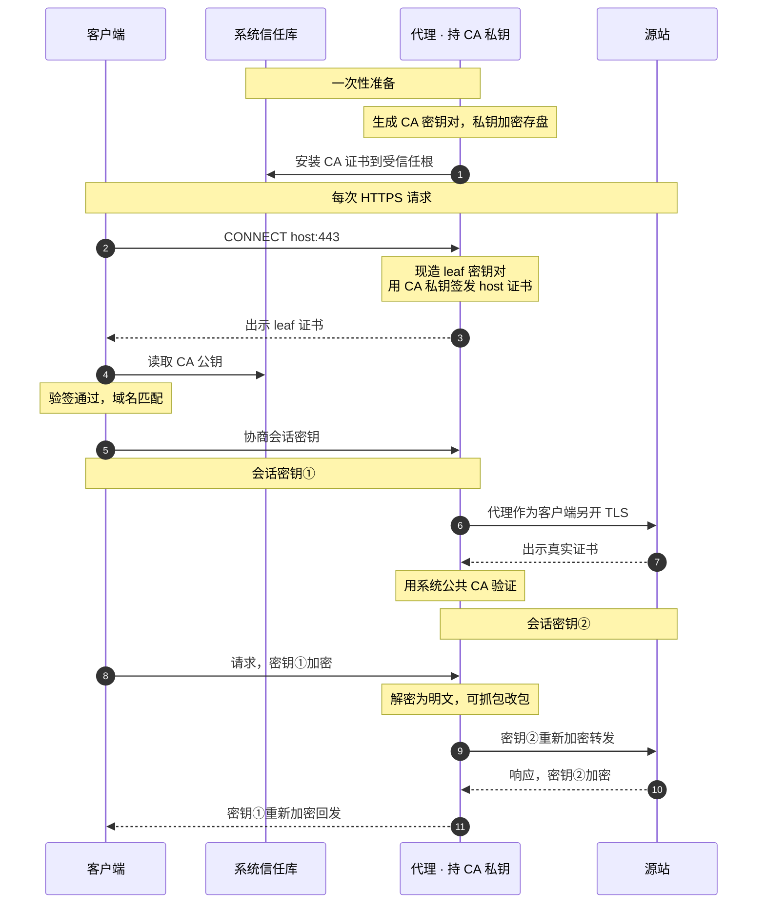
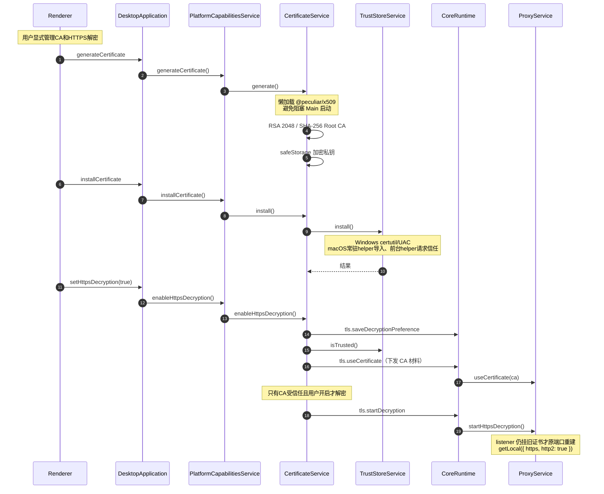
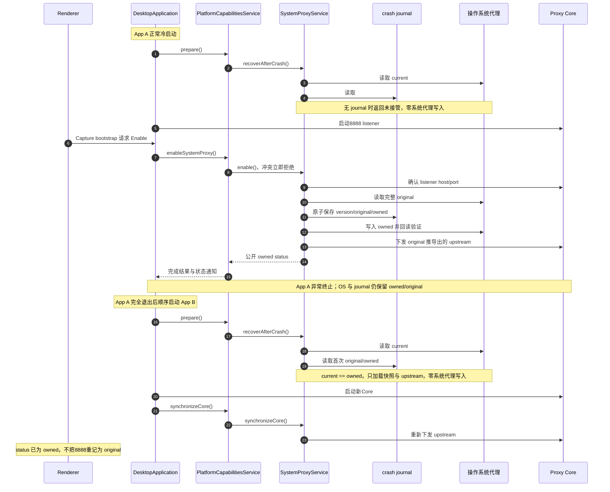
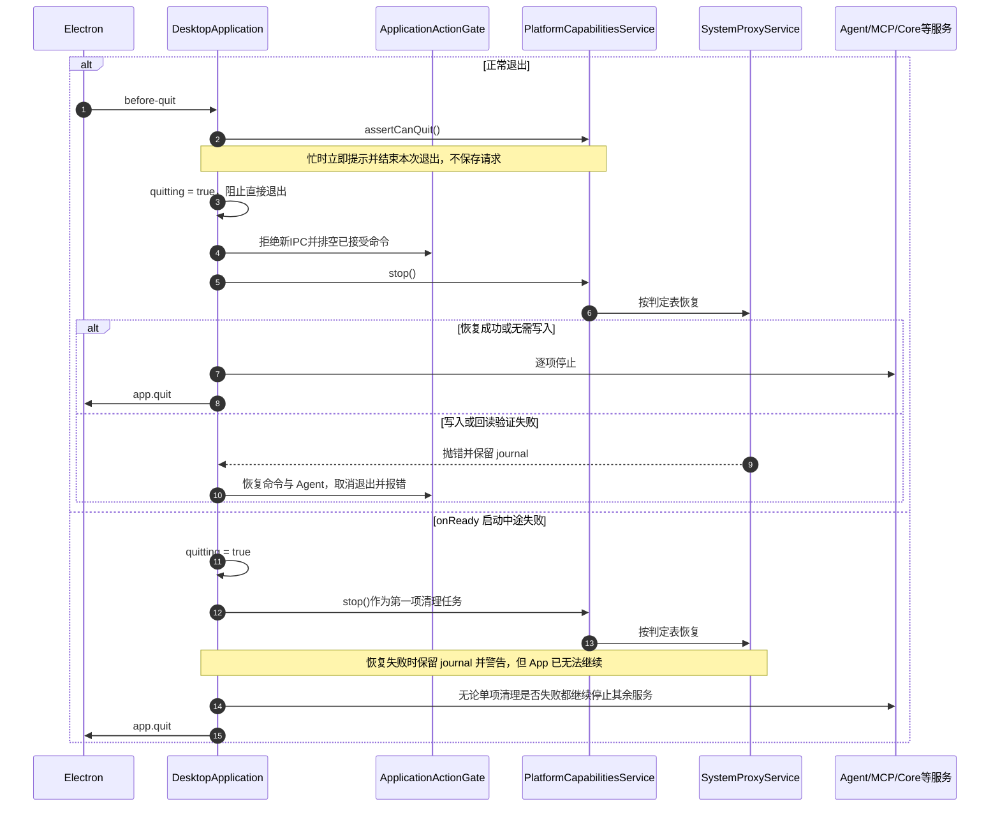
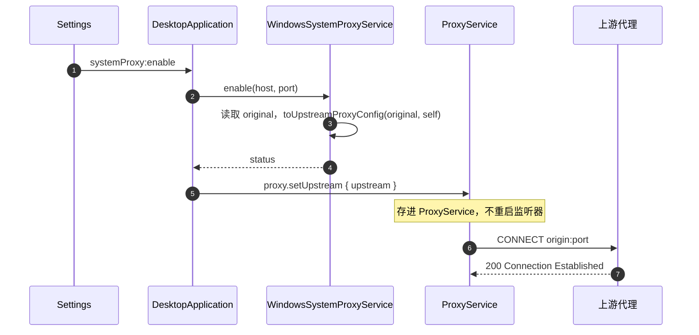
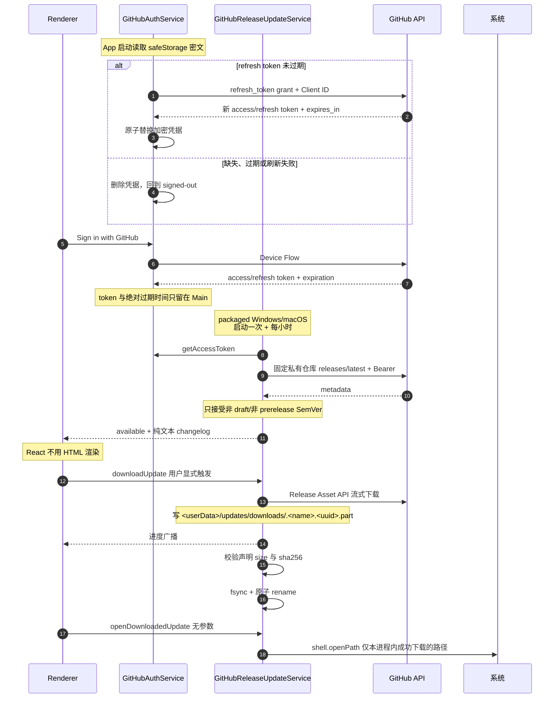
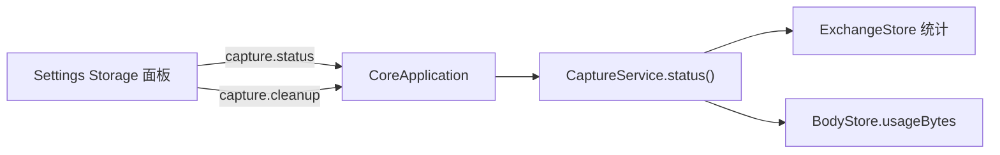

# Feature: Settings

> Main 模块：`apps/desktop/src/main/platform-capabilities/`、`updates/`
> Core 模块：`apps/proxy-core/src/proxy-core/capture/entry.ts`
> Renderer 模块：`apps/desktop/src/renderer/features/settings/`

## 1. 职责与边界

Settings 聚合所有需要**操作系统权限**或**跨会话持久化**的配置。

| 子域 | 归属进程 | 内容 |
| --- | --- | --- |
| 证书与 MITM | Main | CA 生成、信任库安装、解密开关、不安全例外 |
| 系统代理 | Main | 接管、恢复、紧急修复、ownership 展示 |
| 更新 | Main | 检查、changelog、手动下载、打开安装器 |
| 存储 | Core | 用量状态、清理 |
| 语言、主题与导出隐私 | Main + Renderer | Main管理设置请求；Renderer应用15种语言、4套主题和3项默认值并保存到localStorage |
| Agent | Main + Renderer | Provider/Credential、持久化Chat、Streaming、Usage、恢复与Tool capability双列配置 |

**核心边界：所有 OS 级操作只在 Main。** Core 不读写系统设置，Renderer 只表达意图。

Settings rail 的最后访问 section 由 App shell 持有。切换到 Capture / Rules / Composer / Diagnostics
不会重置该值，返回 Settings 时仍打开离开前的 section；TLS compatibility、Proxy readiness 等明确的
跨 feature 跳转可以覆盖它，直接打开对应目标 section。面板内未提交的瞬态 dialog 不跨 feature 保留。

Settings rail 的每项都是原生 button，当前项必须通过 `aria-current="page"` 暴露，不以 CSS class 或翻译文案作为状态契约。
Proxy readiness与TLS入口在App shell先设置目标section，再切换workspace。

Capture 的 TLS tunnel Inspector 允许从已确认的`TLS passthrough`连接跳到当前配置项。跳转前读取
TLS passthrough settings，并从当前host的所有覆盖项中选择最具体pattern：exact优先，其次选择suffix
最长的leading wildcard；没有覆盖项时不伪造目标。App一次性切到Settings / TLS passthrough并携带该
pattern，列表加载后将目标滚入可见区域，以accent背景和边框高亮3秒；重复跳转重新计时。高亮只是
Renderer瞬态导航反馈，不写workspace、不进入URL，也不由Main/Core持有。

### 1.1 语言、主题与导出隐私Tool

- `settings_set_language`接受`{ language }`，只允许既有15个语言ID；`settings_set_theme`接受`{ theme }`，只允许`warm/light/ember/dark`。
    - 不增加`auto/system`等模式，不改变首次启动的系统语言匹配、默认主题或现有`localStorage`键。
    - UI与Tool共用明确的Main方法，不在Tool里执行JavaScript、写Renderer Store或直接访问存储。
- `settings_set_export_privacy_defaults`要求显式提供`maskAuthorization`、`maskCookies`、`warnBeforeUnmasked`三个boolean。
    - 只改变后续导出的默认值，不修改已经打开的导出草稿、运行中的任务或既有文件；Archive仍保留完整原生存档。
    - UI单项Switch继续只改变自己的字段，连续操作不能因异步确认丢掉另一个字段。
- Main通过有类型的Preload请求关联一次设置操作，Renderer常驻订阅应用并确认；界面导航不决定是否接收变更。
    - Main处理参数校验、取消、Renderer退出及完成通知；结果只含已应用设置，不含存储路径、请求内部ID或任意错误内容。
    - `UiPreferencesService`登记请求；`UiPreferencesActions`常驻订阅，串行领取并应用，成功写入原localStorage后确认，Main再广播给其他Renderer。
    - 不新建配置文件、双写副本或迁移路径。App只把语言/主题映射到DOM，不再晚于确认重复写存储；持久化失败返回安全失败响应。
    - Deny与预取消无写入；未开始的请求被取消后不能迟到应用。已开始提交的设置完成原操作，不用取消回滚用户状态。
- 三项均为独立Settings change，Agent/MCP各自授权并遵守Ask/Auto。

历史前置测试、关联流程和产物范围见[偏好Tool验证记录](#settings-preferences-history)；当前契约不由旧阶段Tool数量限定。

## 2. 证书与 HTTPS MITM

证书面板使用Renderer的Inter字体，按400/450/500/600/700离散字重注册已有本地资源，不增加外部字体请求；其余排版沿用[Renderer规范](../platform/renderer.md)和[设计系统](../../design-vite/design-system.md)。

### 2.1 三对密钥

| 密钥对 | 持有者 | 用途 |
| --- | --- | --- |
| CA 密钥对 | 本应用生成 | 私钥签发 leaf，公钥装信任库验签 |
| leaf 密钥对 | Mockttp 按 host 现造并缓存 | 与客户端的会话 |
| 源站真实密钥对 | 真实网站 | 代理与源站的会话 |

**CA 私钥经 `safeStorage`（DPAPI/Keychain）加密存盘，只在 Main 与 Core 内存中流转，绝不进 Renderer、日志或导出。**

### 2.2 握手时序

> 密钥交换细节：TLS 1.2 + RSA 时客户端用 leaf 公钥加密预主密钥、代理用 leaf 私钥解密；TLS 1.3 / ECDHE 时会话密钥由临时 DH 生成（前向保密），leaf 私钥只用来签握手、客户端用 leaf 公钥验签。**两种情况下客户端信任 leaf 都取决于用信任库里的 CA 公钥验签成功。**

### 2.3 启用流程

**证书与解密开关正交**：`tls.useCertificate` 只记录当前可用的 CA 材料，`tls.startDecryption` /
`tls.stopDecryption` 只切换是否 MITM。停止解密时全部 host 退回隧道、证书永不出示，因此
卸载信任或删除 CA 都不必立刻换 listener。CertificateService只有CA已安装信任**且** `mitmEnabled`开启时
才发 `tls.startDecryption`，否则发 `tls.stopDecryption`。

CertificateService从Core读回`tls.getDecryptionPreference`，再按「CA已信任且用户开启」决定是否真的
解密。持久化的是**用户意图**，不是运行态：`tls.saveDecryptionPreference` 只在用户拨开关时写，
CA 不可用而发出的 `tls.stopDecryption` 不会擦掉它。

源站证书例外的增加和撤销必须从下一笔请求生效，包括启动时已加载共享CA、从未转发过HTTP的listener。`ProxyService.replaceInsecureHosts()`需替换整组HTTP转发规则，不追加等待首笔匹配的旧规则；不重启listener、不清Capture会话、不改WebSocket规则。

信任作用于Windows LocalMachine Root或macOS System Keychain/admin trust。Windows通过共用`commandRunner.runElevated()`执行固定certutil命令，macOS通过native helper分开执行公开证书存取和系统信任确认；检测不需提权。

| 操作 | Windows | macOS |
| --- | --- | --- |
| 安装 | `certutil -addstore -f Root`（不带`-user`） | 常驻helper导入System Keychain，再由普通用户前台helper请求admin trust |
| 检测 | `certutil -verifystore Root <sha1>` | `security find-certificate -a -p`精确匹配SHA-1后，`security verify-cert -p basic -L`查询根CA的系统信任链结果 |

按SHA-1 thumbprint精确定位；只读命令通过`execFile`传递固定参数，不经shell。

macOS只将匹配的公开证书经stdin交给系统验证，不生成临时证书文件、不传入`-r`强制信任锚点、不读取私钥；未安装或系统评估拒绝均不报告trusted。此处检查根CA的基本系统信任，不以CA本身代替服务器叶证书执行SSL域名/用途验证，真实HTTPS握手仍需相应workflow验收。

浏览器验收必须使用默认HTTPS校验访问真实Proxy listener，并核对叶证书由当前共享CA签名。Playground协议客户端的`rejectUnauthorized: false`仅用于协议流量，不构成浏览器信任证据；`capture.scenarios.tls`使用`/playground/tls/browser-trust`固定本地响应，保存Edge security state、证书错误及公开指纹。

### 2.4 窄 API

#### macOS 信任入口

- 代理与公开CA导入/删除使用常驻root服务；trust/untrust由同一helper的普通用户前台入口执行。CA生成和私钥加密属于Main中的CertificateService，私钥不交helper。
- `certificate.trust`与`certificate.untrust`的stdin参数为`{ certificate: <公开DER base64>, sha256: <大写SHA-256> }`，回复为`{ sha256, trusted: true | false }`；不接受路径、私钥、任意命令或调用方指定的信任域。
- 前台helper在登录用户GUI会话中调用`SecTrustSettingsSetTrustSettings`/`SecTrustSettingsRemoveTrustSettings`，只修改`.admin`并回读；系统确认由用户处理。这些API不接收`AuthorizationRef`，[系统实现](https://github.com/apple-oss-distributions/Security/blob/main/OSX/libsecurity_keychain/lib/TrustSettings.cpp)为信任写入单独创建授权，不能复用helper安装授权。
- CertificateService先核对目标CA是否已存在，再经helper导入和授信。明确拒绝或取消只撤回此次新增的精确DER；已有CA与结果未知的CA保持，回滚失败同时报告。卸载先撤销信任，成功后才删除公开证书。
- 不修改SIP、授权规则或用户信任域，不提供后台root自动授信、版本兼容或失败回退分支。

#### CA与profile生命周期

- 首窗顺序：App首窗和启动页先显示，再调用`PlatformCapabilitiesService.prepare()`准备系统组件/证书。平台对象通知`platform/certificate`，Main通过`startup:get-stage`及`startup:stage-changed`转发，全部服务可用后发布`ready`。Renderer `ApplicationStartup`准备期间仅挂载BootScreen及窗口控制，ready后才挂载业务订阅；迟到查询不得使进度倒退。Main在ready前拒绝业务IPC；helper、证书或代理操作忙时拒绝本次退出并提示当前操作，不保存延后退出。平台API不接受`AbortSignal`，已开始的操作完整收尾。Core/listener/自动接管顺序与MITM意图保持。
- 材料为`root-cert.pem`、safeStorage加密的`root-key.enc`、`ca-meta.json`。Windows路径为`%LOCALAPPDATA%/Interceptor/certificates`；macOS路径为`~/Library/Application Support/Interceptor Platform/certificates`，均独立于默认及自定义profile。
- 启动顺序：安装安全Renderer协议与IPC → 显示启动页 → 准备原生组件 → 加载系统代理恢复记录 → 检查共享材料及精确指纹的真实信任 → 缺失才生成、未信任才安装/授信 → 其余Main服务/Core准备 → Renderer业务页面。只在App启动做初始化，Core重启与普通退出不重复授信或删除。
- 已生成且受信任：不改文件、不调用安装、不重复系统确认。已有未信任：保留同一CA，只走原系统安装/授权，之后回读真实信任，仍未信任则报错。残缺、损坏、指纹/密钥不匹配、无法解密或过期材料保留并报错，不隐式换CA；取消/失败沿Main启动失败路径恢复代理并退出。新目录0700、材料0600；私钥仍仅以safeStorage密文保存。
- `CertificateService`属于Main进程中的平台模块，统一拥有材料、加密、内部TrustStore、MITM意图和Core配置同步。Main只持有一个`PlatformCapabilitiesService`，直接调用业务方法并接收结果/error和状态通知，不持有各module实例。私钥只在Main/Core内存，不交root helper。Windows保留certutil/UAC，macOS保留前台helper系统确认；MITM开关仍按profile且不因CA初始化自动开启。
- 现有Generate/Regenerate、Uninstall、Delete作用于共享CA；仍须显式用户操作，受信任时不能直接Regenerate。Uninstall保留本地材料，Delete先撤销信任再删材料；下次启动按缺失步骤初始化。普通退出和普通业务workflow不能撤销/删除共享CA。
- 不迁移或复制旧profile材料，不增加测试专用路径/开关，不分发跨用户共用私钥。业务配置、凭据和Tool授权仍隔离，测试不放宽零seed要求。
- 删除已退出App的业务profile不删除或改写共享CA。共享启动workflow须在真实删除测试profile后再次核对公开指纹、三份文件的size/mtime和系统信任，不能只靠目录不同或退出前的查询推断。
- 专项验收只清理本轮由产品首次创建的共享CA；已存在的共享CA不作为破坏性测试输入。普通协议workflow以已通过产品初始化的CA为基线，保持指纹/信任和材料不变；初次初始化与后续复用分别保存证据。

#### 证书操作

`getCertificateStatus`、`generateCertificate`、`installCertificate`、`uninstallCertificate`、`deleteCertificate`、`revealCertificate`、`viewCertificate`、`openCertificateManager`、`getInsecureHosts`、`setInsecureHosts`、`setHttpsDecryption`。

macOS View：固定前台`certificate.view`只接公开DER与SHA-256，使用系统`SFCertificatePanel`显示详情，`SFCertificateView`关闭信任编辑。面板真正显示后才回复requested，普通用户运行且不经root socket；调用App退出时关闭。Windows继续原系统证书查看方式。View不负责导入、安装或trust，不能把只读查看变成第二条授权写入路径。

### 平台模块操作互斥

- platform-capabilities中的证书、系统代理、AppContainer和helper部署模块分别管理自己的在途状态和互斥；Main只持有一个readonly平台对象，直接调用方法，处理error并转发通知，不实现平台步骤或保存组内busy状态。ApplicationActionGate只管理通用命令接收与退出收尾，不维护全量平台操作表；也不把该表原样搬到PlatformCapabilitiesService。
- 证书材料与TrustStore属于同一证书模块；PlatformCapabilitiesService对外提供证书业务方法，内部唯一CertificateService完成生成/加密、安装、回滚、撤销、删除和Core同步。各module实例private，不暴露给Main；材料存在与系统受信任仍是独立事实，私钥不交helper。
- helper只执行固定原生操作并回复结果，保留鉴权、参数校验、原子写入和回读，不增加业务队列。共享系统确认及维护资源只做必要的跨组协调，不重复存储各组状态。
- macOS常驻helper同步服务Main的启动与系统操作，launchd使用`ProcessType=Interactive`，不能按无人等待的`Background`任务限制CPU和I/O；Unix socket不具备Adaptive所需的XPC activity。完整App资源、内嵌代码、全部架构和运行时校验及客户端30秒期限保持，不用缓存、跳过校验或延长期限替代调度修正。部署及生产验收证据见[Handover](../HANDOVER.md#verification)。
- 部署发现与准入分开：`deployment-status`只比较组件部署、应用签名身份和主可执行文件，不是授权结论；正常启动仍必须通过常驻helper的完整资源/内嵌代码/全部架构及运行时检查才进入证书阶段。`inspect-application`、请求安装和root安装继续完整验证，不因部署发现结果而跳过验证；不得缓存历史信任结果。
- 不排队。冲突立即返回`operation_in_progress`和当前操作标识；UI沿用现有提示并显示本地化操作名，Agent/MCP返回相同原因。被拒绝的请求不触发helper、写文件或Core变更，也不在当前操作结束后自动执行。
- 证书组包括启动补齐、生成/重生成、安装/授信、撤销/卸载、删除、回滚、MITM启停和Core证书同步。操作开始前由模块占用，保护覆盖材料、系统信任、回读和Core同步；module使用注入的CoreRuntime，通知回调不承担业务步骤，内部调用不再次争抢同组。
- 系统代理组包括接管、恢复、journal恢复、归属状态更新和上游结果应用；探测可并行，提交时检查当前配置与Core代际。Windows AppContainer单项/批量写入共用一组，因为底层写整份豁免名单。
- 不同组可以并行。helper维护与使用该helper的操作互斥；需要原生确认的操作之间互斥，冲突在产生写入前返回。只读查询不长期占用修改组，不能用中间状态决策后续写入。
- 平台API不接受外部AbortSignal。Agent/MCP在进入Main业务前检查取消；调用开始后等待平台操作完成或失败收尾，调用方停止等待不解除模块占用。helper超时/断线同样不证明原生写入已停止；未取得明确结束或可靠核验前保留冲突状态，不自动重试。启动与退出的必要依赖是单次操作内部顺序，不是保存用户请求的队列。
- helper部署前的`deployment-status / development-deployment-status / inspect-application / inspect-helper`只读检查不产生系统写入；命令结束后报告不可用、非法回复或拒绝时，必须保留错误并释放准备占用，不能把这些失败记为未知写入、永久阻止Quit。`system-proxy.read-effective`完整回复的value非法时，同样标明completed及只读operation。真正已发出的写入按原请求结束证据收尾，不能用普通status解除。
- 用户退出会打断系统写入时拒绝本次退出并提示，不等任务完成后自动退出；允许退出后先阻止新修改、恢复代理，再停止Core。Core故障恢复与失败回滚是必要收尾，不因普通冲突而丢弃。

#### 失联写入收尾契约

- 仅`system-proxy.replace`、`certificate.import`、`certificate.remove`在已发送后超时、断线或无法关联回复时，typed client发起一次只读`request.get-completion`，参数为`{ requestId: <原请求ID> }`，查询自身使用新的envelope requestId。正常成功、正式失败回复、只读失败和未发送请求不增加查询。
- 结果为`{ requestId, state: "completed", operation }`或`{ requestId, state: "unknown" }`。原ID和原操作都匹配才证明调用已结束，不证明系统状态符合预期；仍返回原失败，由Certificate/SystemProxy既有业务收尾回读、同步Core和发布通知后释放占用。
- helper在发送终态回复前记录结束元数据，生产/开发socket互不读取对方记录；每个实例只保留最近128个写请求ID及操作名，不保存参数、结果正文或授权结论。查无记录、实例重启、记录淘汰、非法回复及查询失败均不能解锁，也不能自动重放写入。
- 原请求与确认请求分别遵守既有30秒传输期限；确认属于失败收尾，期间原业务保持占用。前台信任进程的异常结束不属于socket记录，不能凭无关记录或普通status解除。
- 安装CA的import失联后若已确认结束，且安装前不存在该精确CA，在请求trust之前撤回本次可能新增的公开证书；已有CA、未发送或未确认的import不删。内部`requestSent`与`executionState`分别表达是否发出帧和是否结束，原错误与回滚错误都保留。

#### 失联写入验收证据

以下为2026-09-25恢复验收前的证据，前缀为`/tmp/interceptor-item4-20260925-`；新产物的最终结果见下方“第4项恢复验收”。故障帧与断连由真实Unix socket/native集成验证，模块回读、回滚及Quit占用由所属业务测试验证；不将这些结果冒充真实UI触发了故障。

| 范围 | 结果 | 证据后缀 |
| --- | --- | --- |
| 实现前基线 | 原传输与证书/代理占用100/100；签名包正常helper复用和代理恢复2/2 | `completion-baseline.json`、`ui-baseline.json`及目录 |
| 目标Red | 结束记录、原ID/操作关联、超时/断线及CA回滚23项Red；复核发现未发送import不应触发回滚，再取得1项目标Red | `completion-final-red.json`、`unsent-import-red.json` |
| 当前代码回归 | 全平台312通过、2项Windows native跳过；包含原生实际断连、128条记录淘汰、重启/端点隔离、鉴权、30秒时钟边界、等待确认及未知结果不解锁。新CA/已有CA/未发送/未确认的行为分别覆盖 | `platform-verified.json`；Desktop及workspace类型检查通过 |
| 新包静态与首次授权 | package、artifact audit与严格deep/strict/all-architectures签名通过；首次授权未完成后只取消所属窗口并正常恢复宿主，该次不算运行验收通过 | `component-current.json`、`artifact.json` |
| 当前新包运行 | 正常App授权后实装helper与包内一致，生产入口ready；组件复用/共享CA/跨profile恢复3条、Agent/MCP代理入口2条真实E2E及smoke 1/1。九代App已退出（含1代预定crash），完整代理恢复，日常CA指纹、文件元数据与信任保持，无journal、8888释放 | `approval-current.json`、`production-lifecycle-final.json`、`tools-proxy.json`、`production-smoke.json`、`production-host.json`及对应目录 |
| 窗口准备失败与修正 | 首次3条运行中共享CA通过，随后System Events未暴露新Main窗口，业务未开始；经真实Close恢复后，fixture只显示/前置该测试Main，再按原尺寸断言准备窗口。不改产品UI或尺寸，复跑3/3 | `production-lifecycle.json`、`window-recovery.json`、`production-lifecycle-final.json` |

22:35暂停时该产物已执行部分证书专项，但当时未全部通过；这些历史失败不改写为Green：

| 范围 | 结果及边界 | 证据后缀 |
| --- | --- | --- |
| 产品清理与直接生命周期 | 原日常CA经产品Uninstall/Delete清理，其余Root保持；cancel-trust 1/1与两张不同CA的helper-trust 1/1通过，取消/安装/撤销/删除走真实UI | `ca-reset.json`、`ca-e2e.json`（首条Green，第二条fixture竞态失败）、`helper-trust-final.json` |
| 授权驱动 | 已修正helper退出与窗口/Renderer更新之间的采样竞态；首次初始化只在识别本轮helper及certificate阶段原生窗口后单独等待人工确认，Playwright独立fixture预算不扩大首窗/普通启动/产品请求期限 | helper-trust修正后Green；`startup-fixture-regression.json`非交互2/2，新增人工等待分支尚待实际运行 |
| 证书Tools未通过 | 首例在120秒首次授信准备中超时，未进入业务正文，后一条未运行；授权晚于准备期限后App启动，恢复时只处理本轮自产CA | `tools-ca-final.json`、`ca-remaining.json`及目录；不得标为Tool功能Green |
| 当前日常CA与宿主 | 已取消本轮未完成的撤销，将产品正常生成并已受信任的`B705FBDEF2397E85DAE3605550B916A0EA946ED6`保留为新日常CA；其他Root未变，App与helper子进程退出，完整代理恢复、无journal、8888释放 | `daily-ca-current.json`；旧`3C2E…`仅为历史基线 |
| 真实失联收尾 | 后续非交互启动两次发生原生代理写请求30秒超时；第一次资源校验33.610秒，已确认服务实际为Interactive。typed client取得原请求完成证据，保留timeout并标completed，业务允许正常Close恢复；这不是普通启动Green，也不归因为人工授权 | `startup-wait-final.json`、`startup-wait-rerun.json`及Main日志/trace，`real-timeout-native.log`；资源验证尾延迟未解决 |

#### 启动完整资源校验的进程隔离

- 本轮恢复时同一已部署helper再次出现31.304秒完整资源校验；授权采样中主线程等待Security资源任务，资源线程主要停留在可执行文件扫描后的`free_medium → madvise`。新root进程同包校验2.29秒，连续六次完整验证2.2–2.9秒；用户级Interactive、QoS和串行对照未证明能解决常驻进程问题，不据此修改调度或验证内容。
- 当前实现：常驻helper继续核验socket audit身份、固定App路径和运行时保护；每次需要完整资源校验时启动同一受保护helper的只读`verify-code-signature <absolute-code-path> <cdhash-requirement>`子进程。子进程只执行原Security API的身份、strict、nested、all-architectures及no-network检查，正常退出码0才可继续；失败或异常退出拒绝请求，不将CLI开放为socket命令。
- 原请求保持占用，完成记录必须晚于校验子进程退出及真实系统写入收尾；30秒期限、128条结束记录边界、不重放、Windows与开发UID入口不变，不保存签名或信任缓存。此改动隔离已观测到的长期进程校验慢路径，不声称已证明macOS内存分配器的内部缺陷或覆盖所有长期负载。

#### 第4项恢复验收（2026-09-26）

证据前缀为`/tmp/interceptor-item4-resume-20260925-`，日期保留首次恢复时的命名；JSON与同名目录中的trace、metadata及日志对应同一签名包，不与旧包数量相加。

| 范围 | 结果及边界 | 证据后缀 |
| --- | --- | --- |
| 前置与失败定位 | 原生/证书/操作占用基线120/120；真实生产启动在完整校验31.304秒时超时，采样轮另有33.617秒。新只读入口与嵌套资源验证2项Red后才改native实现 | `native-baseline.json`、`startup-baseline.json`、`startup-sample.json`、`helper-active.sample.txt`、`sampled-native.log`、`signature-worker-red.json` |
| 最终代码与类型 | 平台315通过、2项Windows native跳过；覆盖校验进程缺失/非零退出、错误身份、嵌套资源修改、结束记录及CA回滚。全workspace类型通过，最终fixture/测试改动后Desktop类型再通过 | `signature-worker-green.json`、`signature-failures-green.json`、`final-platform.json`、`typecheck.log` |
| 新包与组件 | package、artifact audit（1487文件/339505825字节）、deep/strict/all-architectures签名通过；正常产品授权更新helper，包内与实装一致 | `package.log`、`artifact-audit.log`、`new-helper-startup.json`、`final-host.json` |
| 生产共同路径 | helper复用1/1；共享CA、跨profile crash recovery、MCP代理冲突、Agent代理Ask/Auto/撤权/重启4/4；所有App代际退出，既有CA和完整系统代理保持 | `new-helper-startup.json`、`production-regression.json`及目录 |
| 证书正向 | 两张不同CA直接Install/Uninstall/Delete、Agent/MCP六项证书操作与四次原生Reveal/View关窗、TLS意图/实际解密/撤权/重启3/3；首次人工授权及relaunch等待均实际执行 | `certificates-positive.json`及目录 |
| 取消与占用 | 直接cancel-trust 1/1，首次启动取消/同CA重启1/1，并发Quit/MCP Delete/UI Delete拒绝且不重放1/1；每条均清理自产CA并恢复完整宿主 | `certificates-cancel-conflict.json`中的首条、`startup-cancel.json`、`certificate-conflict-ordered.json`及目录 |
| 失败与恢复 | 原并发用例等待旧提示消失时Install已完成，Quit前提消失，不能记为产品busy Red。首轮留下的精确自产CA经产品恢复；后两轮前提断言失败但清理成功。调整为先验证Quit新提示，再验证两种Delete，保留原取消/材料/恢复断言 | `certificates-cancel-conflict.json`第二条、`certificate-conflict-final.json`、`certificate-conflict-confirmed.json`、`conflict-recovery-daily-remove.json` |
| 校验耗时 | 同一新常驻helper保留约一小时期间，已保存并去重的60次生产完整校验837–1714ms，均低于原30秒期限；不是整个App启动耗时，也不把系统未保留的info日志当成已采集事件 | `observed-verification.log`、`final-host.json` |
| 最终产物与宿主 | packaged smoke 1/1及已有截图矩阵通过；正常启动重建日常CA并授信，其他3张Root/admin trust保持，完整代理恢复、App/Core/Worker全退、仅常驻helper保留，无journal、8888释放 | `final-smoke.json`、`daily-restore.json`及trace、`final-host.json` |
| 工具边界 | 尝试让人工确认等待300秒，但授权提前完成，该次实际为共享CA初始化/复用1/1；不能声称触发了driver的300秒超时自动取消catch分支。产品真实取消及回滚已由上面两条专项覆盖 | `startup-manual-timeout.json`及目录；该catch分支未覆盖 |

最终日常CA为`D74D4BFB3C3708511A755AC6CD905840B464B255`；旧`B705…`与失败自产`54B224…`均已按精确身份经产品清理，不能继续作为当前日常CA。最终ASAR SHA-256为`359f44ea97cff9eee47cdf46eb8b23aa9eeafd7cb5e1e9021878c4d4e16ae6b4`；包内与实装helper SHA-256均为`21e129c9395239b52d647cd7d1c33531a790b08c02837ae58e1af3c2f73cc260`。

该阶段以`d6debb2e`提交，保留已推送的`0033f9ab`，未amend；接手的6处修改随15文件一起审阅交付。[原报告](../../commit-changes/202609241020_main_ca_unknown-write-boundary.html)保留CA内容，后续正文继续使用同一文件。平台基线`218295b0`对应[平台报告](../../commit-changes/202609240135_main_shared-ca_startup.html)，工作区checkpoint对应[独立报告](../../commit-changes/202609240150_docs_workspace_progress.html)；GitHub候选四图仍在后者，不覆盖平台报告。

CA证据持久根目录为`/Users/zhxmt/.copilot/session-state/df17625e-cb60-4ece-a735-8d703667fab6/files`。`item4-acceptance-summary.json`核对12次成功运行、11条不同workflow的trace和每代退出；`item4-acceptance-20260926.tar.gz`的SHA-256为`ba3f9ee81b6aae05a96d6bfdb69fba76fbe2ffff0cf46d87bd8c0e9e0d9937f8`，包含原始Red、失败、Green及恢复。历史`16CEB8D0990CCC29FA7313B7F85F1167B227C26C`、`3C2E5F2AC71BDB4E82AA47AA49E79276D3EACDD5`、`B705FBDEF2397E85DAE3605550B916A0EA946ED6`和`54B224ABC1D2C88BBDB2B43396A5EBC4DC8B023C`均不是当前清理目标。

此前journal/launchd调度阶段的37.4秒完整校验超过30秒；只读对照为Background26.99秒、普通6.27秒，不反推旧14:09缺失的时序。实际launchd Red后改用Interactive并经用户部署，平台262通过/2 Windows native跳过、package/audit/严格签名、生产helper 1/1及smoke1/1通过。另有profile删除重建journal、service增删时Restore/跨代Recover零覆盖的37/37及Desktop类型通过；VPN/TUN、动态网络切换和ClashX未验，不能由这些结果代替。

Certificate module组装的`CertificateInfo`含`path`与`mitmEnabled`，不含私钥；解密材料只经内部Core RPC发送。

#### 部署发现性能验收

第3项本轮证据前缀为`/tmp/interceptor-startup-performance-20260924-`；仅部署发现的耗时对照，不代表整个App启动耗时。

| 范围 | 结果 | 证据后缀 |
| --- | --- | --- |
| native边界与回归 | 新目标1 Red/12 Green后，部署/安装、服务端资源与运行时校验及平台调用方共109/109；主可执行文件篡改仍拒绝，资源篡改仍阻止完整检查和请求安装 | `native-red.json`、`native-green.json` |
| 同一签名App对照 | ASAR保持`78878acc97489b8c9234d7ea6e9173eadb5c43e5133bacb25ca478bd9e97fa2f`；三次检查的中位数2993ms→17ms，状态均为ready，没有替换实装服务或缓存信任 | `before.json`、`after.json` |
| 新包静态检查 | Swift构建、Desktop类型、package、audit（1487文件/339493468字节）及严格deep/strict/all-architectures签名通过 | 本轮构建/audit命令输出 |
| 部署前失败 | 当时新helper为`3b9005da50dd776414c9c3c725a7cc8ab6934efefc98e7b66f85d6e85fd50d61`、实装为旧`18590483b88049c8e1298bdc1f3e98418e8dafb9757ba17e2e73797f8035b86d`，production为outdated；E2E停在组件准备，未启动Core，1失败/1未运行。完整代理、CA和端口恢复；此历史失败不改为Green | `production-e2e.json`及目录、`deployment-blocker.json` |
| 当前生产验收 | 新helper已通过正常App授权部署，包内与实装SHA-256相同，production为ready；生产helper复用/共享CA E2E 2/2、packaged smoke 1/1。四代Main/Core正常退出，CA指纹及三份材料元数据未变，完整代理恢复、无journal、8888释放 | `production-final.json`及目录、`smoke-final.json`及目录、`production-host.json` |

本次新helper的生产结果已独立取得，不复用下文旧产物的Green。组件核准与正常关闭的记录在`/tmp/interceptor-component-resume-20260924-current.json`；未更改日常CA、安装权限、服务端完整准入或产品30秒期限。原启动实现的历史前置E2E缺口继续单独披露，不以本次结果补造。

第3项本轮收尾范围为当前版本的启动顺序、CA准备/取消、组件发现性能、生产运行及退出恢复，上述证据覆盖该范围。原实现之前的E2E记录缺失作为历史实施过程缺口保留，不把当前Green标注成历史前置Red，也不将其混作当前版本尚未执行的测试。

## 3. 系统代理

### 3.1 参与者、快照与不变量

| 参与者 | 负责什么 | 不负责什么 |
| --- | --- | --- |
| Renderer | 通过窄 Desktop API 请求 Enable、Restore 和只读 Status | 不访问 WinINet、SystemConfiguration 或 journal |
| `DesktopApplication`（Main） | 调用唯一PlatformCapabilitiesService，捕获error并转发状态，管理App/Core生命周期 | 不管理平台module实例、操作状态、upstream或恢复步骤 |
| `PlatformCapabilitiesService` | 私有组装各module，提供完整业务方法和启动/退出入口 | 不维护集中平台操作表或用户请求队列 |
| 平台 `SystemProxyService` | 拥有操作状态、listener检查、upstream同步/探活及必要恢复；所属Windows/macOS实现比较完整快照并执行native写入/回读 | 不启动或停止Core进程，不访问Renderer |
| Proxy Core UtilityProcess | 监听 `127.0.0.1:8888`，接收 Main 下发的 upstream 并转发流量 | 不读取或修改系统代理，不读 journal |
| crash journal | 保存崩溃恢复需要的 `version/original/owned` | 不保存 owner、PID、启动时间、instance ID 或阶段状态 |
| 操作系统 | 保存当前实际生效的代理配置 `current` | 不知道哪个 App “拥有”代理 |

三个比较值的含义：

| 值 | 产生时间 | 内容 |
| --- | --- | --- |
| `original` | Interceptor 接管前 | Windows 为 flags、Proxy Server、Bypass、PAC、Auto Detect 等完整 WinINet 快照；macOS 为全部活动 network service 的完整代理字典 |
| `owned` | 写系统代理前 | 根据 `original` 计算出的 Interceptor loopback 配置，目标为当前 Core listener |
| `current` | 每次恢复判定时 | Main 通过平台 helper 当场读取的操作系统实际配置 |

文档中的 `current == owned`、`current == original` 都表示完整快照逐字段相等，不表示 PID、进程或文件的所有权。
network service的增加或删除也属于完整快照的外部变化；恢复与跨代journal加载都不得只比较仍存在的service或覆盖新配置。状态机测试不等于VPN/TUN、ClashX或真实切网验收。

Windows journal 固定为 `%LOCALAPPDATA%/Interceptor/system-proxy/journal.json`，不随 Electron
`userData`、开发模式、packaged App 或 E2E `--user-data-dir` 改变；macOS journal 为
`~/Library/Application Support/Interceptor Platform/system-proxy/journal.json`，也避开默认profile。两平台都先把临时文件完整写入并同步，再原子 rename。
产品前提是同一时间只运行一个 Interceptor App，不处理两个 App 的竞争。

启动用户级journal路径前必须确认旧实例已正常退出、系统代理已恢复、没有待处理旧journal；不能遗弃仍拥有OS代理的恢复记录。不增加旧profile迁移或回退读取，Windows原路径、原生命令和`version/original/owned`契约保持。

### 3.2 生命周期流程

#### 正常启动与崩溃重启

#### 正常退出与启动失败

正常退出可以在代理恢复失败后继续运行，因此取消退出且不先停止 Core；启动失败表示 App 已经无法继续，
所以即使代理恢复失败也会保留 journal、警告用户并继续销毁其余服务。这是两条流程最重要的差异。

Core状态通知经PlatformCapabilitiesService交给SystemProxyService；从`running`进入`unresponsive/restarting`时，
module合并一份必要Restore，等待已开始的操作明确结算后恢复。用户Enable/Restore发生冲突时立即拒绝，不保存、
不重试、不延后执行。恢复前仍当场读取完整`current`；原生结果不确定时不能仅凭Promise失败释放占用。
这些状态仅协调单Main进程，产品仍要求同一时间只运行一个App。

所有启动恢复、用户 Restore、Core 故障恢复和退出恢复最终使用同一判定表：

| 当场比较结果 | 启动 `recoverAfterCrash()` | Restore、Core 故障或退出 |
| --- | --- | --- |
| 无 journal | 返回未接管，零系统代理写入 | 若内存也无快照则返回未接管，零系统代理写入 |
| `current == owned` | 加载 `original/owned`，保留 journal，零系统代理写入 | 写回 `original`，回读验证成功后删除 journal |
| `current == original` | 只删除已完成使命的 journal | 只删除 journal，不重复写 `original` |
| `current` 与两者都不同 | 视为用户或外部程序已修改；零系统代理写入并删除失效 journal | 同样零系统代理写入并删除失效 journal，报告 `externally-modified` |
| helper 写入或回读验证失败 | 抛错；不把恢复当作成功 | 抛错并保留 journal；正常退出因此取消，启动失败清理则继续退出 |

**窄 Desktop API**：`getSystemProxyStatus`、`enableSystemProxy`、`restoreSystemProxy`。Main 日志不包含 snapshot。

### 3.3 平台实现

| 平台 | 机制 |
| --- | --- |
| Windows | `windows/helper.cs`，当前用户 WinINet per-connection API，读写 flags/Proxy Server/Bypass/PAC URL/Auto Detect，广播 settings changed |
| macOS | `macos/helper.swift`，Authorization Services + SystemConfiguration，枚举当前 Network Set 全部活动 service，单 session 内 set/commit/apply |

只允许 loopback listener。

#### macOS 同包原生服务

Main通过同包helper执行macOS代理和System Keychain公开证书操作。

- 配置明确`protocolVersion`、`socketPath`、`clientUserId`、`clientExecutablePath`和精确`cdhash` requirement；配置和endpoint目录必须由服务账户拥有且不能被其他用户写入，root运行还检查整个父目录链。
- 本地Unix socket通过内核`LOCAL_PEERTOKEN`读取audit token；校验实际peer用户、`SecCodeCheckValidity`、静态代码和固定可执行文件路径，不接收客户端自报身份，不维护私钥或Apple付费身份。
- 协议为单连接单条newline JSON，校验协议版本和严格字段集合；`status`返回服务进程ID、是否root、客户端写资格和当前实际能力。未知命令、额外字段、未核准进程都明确拒绝。
- 证书目标命令`certificate.import / certificate.remove`仅接受`parameters: { certificate, sha256 }`，certificate为公开X.509 DER的base64，sha256为64位大写十六进制。原生侧核对编码、大小、指纹和Interceptor自颁发主题，固定System.keychain；不接受路径、私钥、任意keychain或按模糊名称删除。
- Main进程中的CertificateService拥有CA生成、私钥safeStorage和TLS同步。公开证书导入/删除使用常驻helper，admin trust添加/移除使用普通用户前台helper；信任失败不报成功，移除trust失败不删除证书。helper导入不等于受信任，不能替代系统独立授权。
- 普通`system-proxy.read`保留内核进程、UID、canonical路径与精确CDHash检查，不需要特权的公开查询不再扫描整包资源；`status`和所有写命令仍严格校验完整App资源、内嵌代码及运行时。该区分用于避免只读查询排队拖延代理退出恢复，不能让篡改App获得写资格。
- Recording就绪：Core重启时`CaptureStatus.recording=true`只说明Core正在记录，Renderer等支持平台的系统代理实际owned且未ownershipLost才显示Recording。迟到状态不能覆盖Stop、代理失权或Core代际变化，journal预写不代表代理已接管。
- 代理命令：`system-proxy.read`无参数，返回全部活动network service的原始快照；`system-proxy.replace`仅接收`parameters: { expectedSnapshot, replacementSnapshot }`，两个快照均为`{ services: [{ id, name, settings }] }`，不接收路径、shell或Authorization凭据。协议帧上限为256KiB以容纳双快照，过大数据明确拒绝，不截断或省略服务。
- 条件写入只在原生进程具备root权限且客户端通过所选入口的鉴权时执行；在同一`SCPreferencesLock`事务内读取current、比较完整expected快照、commit/apply并回读replacement。普通权限返回`authorization-required`，快照冲突返回`snapshot-conflict`，不新建Authorization窗口、不覆盖外部修改。SystemProxyService持有journal和恢复流程，helper不保存第二份original。
- 生产入口在写入前校验实际SecCode的Hardened Runtime、动态有效状态及未被调试状态，拒绝DYLD环境注入、get-task-allow和关闭执行页保护的entitlements。只读客户端身份不能自动取得写权限。
- 服务重启只清理崩溃遗留的自有socket，保留活跃socket和普通文件；忽略SIGPIPE，避免客户端断连终止服务。

#### macOS 首次启动部署 Helper

##### 开发与生产双入口

- 本机开发和业务E2E共用一个常驻helper；开发入口信任获准的本机UID，不绑定项目源码、App构建CDHash、Electron签名或调试状态。首次部署确认后，HMR、rs、Main/Core重编译、新profile均复用，不重装或重复申请开发授权。
- 同一个原生服务提供两个本地socket：生产使用`service.sock`及`service.json`，开发使用`development.sock`及`development.json`。开发配置仅记录`protocolVersion / socketPath / clientUserId`，由root保护；生产配置保留精确App路径/CDHash及完整运行时检查。请求不能自报环境来改变当前socket的鉴权。
- 两入口共用固定代理/公开证书协议与条件写入实现，不接收任意shell或私钥。开发授权明确允许该UID的本地程序使用这些能力，不宣称隔离同用户恶意代码；其他UID、损坏或可写配置仍拒绝。证书admin trust保持独立权限。
- Main按真实`app.isPackaged`选择入口：未打包的Forge与业务E2E走开发入口，签名产物走生产入口；无测试专用产品参数。helper仅在自身配套组件改变或缺失时更新，开发App重新构建不改变部署身份；安装另一入口不删除既有授权。
- 开发首次授权将同一份已验签helper复制到当前用户的私有系统临时目录（目录0700、文件0500）后执行固定授权命令，成功/取消/失败均清除；root阶段仍复制到root私有暂存目录并核对预先读取的helper CDHash。避免authd无法读取Desktop源码目录中的原生代码身份，不复制App或仓库、不改系统隐私权限或node_modules。

- App留在用户原位置，helper随App打包；平台prepare在代理恢复/接管前检查helper部署，缺失或所选入口的配套身份改变才请求系统管理员授权。后续启动只读核对并复用；不要求`.pkg`、不移动或更改App所有权，不下载独立helper。
- 只将原生组件部署到`/Library/PrivilegedHelperTools/com.zhxmt.interceptor.platform-capabilities`，配置和socket位于`/Library/Application Support/Interceptor/PlatformHelper/`。配置由root拥有且不可被其他用户写入，记录实际登录UID、App canonical路径及精确CDHash；launchd服务与配套helper一起更新。
- 授权后先在root私有暂存目录复制单个helper并核验精确签名，再执行固定`install-helper`。原生实现再次核验App/同包helper，按文件事务替换并注册服务；失败恢复原组件，不执行旧一次性写入路径。
- `deployment-status`只读返回`missing / outdated / ready / stopped / invalid`；损坏/未知状态不触发覆盖安装，取消不重试。`status`将服务root权限与`clientAuthorizedForWrites`分别表达，运行中App须通过内核身份、完整签名与Hardened Runtime校验，不以root拥有整个App代替鉴权。
- 原生`uninstall-helper`仅在用户明确批准的root操作中移除固定组件，不删除App、profile或CA；卸载前先经App恢复代理。

### 3.4 上游代理链式转发

接管系统代理后所有流量都进 Interceptor，若仍直连源站，必须经公司 PAC、VPN 或认证代理才能出网的环境会在接管期间**完全断网**。因此接管前读到的配置会原样接到上游。

转换规则（`windows/system-proxy-upstream.ts`）：

| 原配置 | 上游 `proxyUrl` |
| --- | --- |
| PAC 脚本（`PROXY_TYPE_AUTO_PROXY_URL` + `pacUrl`） | `pac+<pacUrl>`，PAC 求值交给 Mockttp 内置的 `pac-proxy-agent` |
| 显式代理 `host:port` | `http://host:port` |
| 分方案列表 `http=a;https=b` | 取 https，缺失回退 http |
| 仅 `socks=host:port` | `socks5://host:port` |
| 仅 Auto Detect（WPAD） | 无（没有可传给 proxy-agent 的 URL），按直连处理 |

`bypassList` 转成 curl 风格 `noProxy`；Windows 专有的 `<local>` 展开为 `localhost` / `127.0.0.1`。**不能展开出裸 `::1`**：`matchesNoProxy` 按 `host:port` 切分候选项，裸 IPv6 会被切成空 host，而空 host 匹配一切，结果是每个请求都判定为 bypass，上游形同虚设。

`toUpstreamAuthority(upstream)` 从同一份配置里取出 `host:port`（丢弃凭据）供状态栏展示。

#### 三条出网路径都必须接上游

上游不是一个开关，而是三条彼此独立的代码路径，漏掉任何一条，对应流量就会绕过公司代理直连：

| 流量 | 出网点 | 接上游的方式 |
| --- | --- | --- |
| MITM 已解密的 HTTP/HTTPS | Mockttp 规则 | `thenPassThrough({ proxyConfig })` |
| MITM 未解密的 TLS 直通（`tlsInterceptOnly` 未命中） | Mockttp `passthroughSocket` | `passthroughProxyConfig`，见下 |
| WebSocket 转发 | `websocket-bridge.ts` 的 `ws` 客户端 | `HttpsProxyAgent`，命中 `matchesNoProxy` 时不注入 |

Mockttp 的 `passthroughSocket` 把 `net.connect(port, host)` 写死，`proxyConfig` 完全不参与，因此**只要关闭 MITM，全部 HTTPS 都绕过上游**。`patches/mockttp+4.5.0.patch` 为它补一条 `passthroughProxyConfig` 路径：用 proxy-agent 家族建立 CONNECT 隧道，再把客户端连接与隧道对接。改动是纯增量的——`passthroughSocket` 自身保持同步、原有直连分支一行未动，只有配置了上游才转入新的异步分支。PAC 上游需要一个请求桩才能选出正确的 agent，桩的 `upgrade` 头固定为 `websocket`，`PacProxyAgent` 才会选隧道模式而不是明文转发。

#### bypass 要双向维护

- **读**：接管前的 `bypassList` 转成 `noProxy` 下发 Core，命中则直连不进上游。
- **写**：接管时写回系统的 bypass 必须并入 `localhost` / `127.*` / `[::1]` / `<local>`（`withRequiredBypass`），否则本机与内网流量被推进代理。`<local>` 不匹配 IP 字面量，所以三条都要显式列出；`::1` 必须带方括号，裸写会让 `InternetSetPerConnectionOption` 整体写入失败。
- **AVD / Dev Box**：Windows owned bypass 不注入产品域名。拒绝 MITM 的 gateway 应由 Core per-host TLS passthrough 处理，使流量仍经过 Capture 并保留 tunnel metadata；默认 passthrough 列表为空。

#### 上游不可达时自动降级

上游代理进程退出（用户关掉 Clash 之类）后，Interceptor 仍指着一个死端口，全部流量立刻失败。`UpstreamProbe` 在接管期间每 `UPSTREAM_PROBE_INTERVAL_MS`（1s）对上游 `host:port` 做一次 `UPSTREAM_PROBE_TIMEOUT_MS`（500ms）的 TCP 连接：

- 探到不可达：清空 Core 的上游改为直连，Capture 状态栏的 `upstream host:port` 转黄并给出提示。
- 探到恢复：重新下发上游，状态栏复原。

只在状态翻转时才下发与广播。PAC 上游没有单一 `host:port` 可探，不纳入监控。状态经 `system-proxy:status-changed` 主动推给 Renderer（`SystemProxyStatus.upstreamProxy` / `upstreamReachable`），状态栏据此显示 `upstream host:port` 或 `direct`。

三个边界条件：

- **绝不把自己当上游**。崩溃残留会让系统代理仍指向 `127.0.0.1:8888`，此时接管前读到的"原有配置"就是我们自己，直接视为无上游，否则形成无限自环。
- **`proxyConfig` 用回调而非固定值**。Mockttp 每次请求求值，因此切换上游不需要重注册规则或重启监听器。
- **Core 重启后必须重新下发**。上游保存在 Core 进程内，`onCoreProcessReady` 与 TLS 材料一同重新下发，否则重启即断网。

Clash 等本机代理应在 Interceptor 接管前启动并启用系统代理，Interceptor 才能把它的 loopback 地址读作上游。若 Clash 在 Interceptor 已 owned 后启动并主动改写 WinINet，guarded ownership 会按外部修改处理并进入 ownership lost；两边不会反复抢写系统设置。

Mockttp经上游时统一使用CONNECT隧道，包括目标为明文HTTP的请求。

- HTTP、HTTPS passthrough、HTTPS MITM和WebSocketBridge均通过带userinfo的`proxyUrl`向上游CONNECT发送Basic认证，包含密码中的URL转义字符。
- HTTP和WebSocket在缺失或错误凭据时被上游拒绝，源站未收到请求，没有直连回退；`noProxy`命中时仍直连且不携带上游认证头。
- 上游凭据不进入源站请求或Capture记录。

### 3.5 Windows AppContainer 与 TLS passthrough

Windows owned `ProxyOverride` 不再加入 `*.wvd.microsoft.com`，避免 RDP gateway 完全跳过
Interceptor。拒绝 MITM 的 host 改由 Mockttp TLS passthrough 建立原始 tunnel。

Windows App有两个独立的网络边界：

1. `Microsoft.AAD.BrokerPlugin` 无 loopback exemption 时，WAM token/authorize 请求在 Windows
    网络隔离层失败，无法稳定到达 8888；仅靠 Mockttp host 名单无效。
2. WVD gateway 进入 MITM 后客户端主动 reset；应在 Mockttp 内走原始 TLS tunnel，而不是长期留在
    system `ProxyOverride`。

产品流程是：Settings 通过官方 Network Isolation API 枚举 AppContainer 与 SID，让用户显式开启
loopback exemption；Core 通过 Mockttp `tlsPassthrough` 管理持久化 host patterns；TLS 错误按 TLS
generation + host 去重并广播。App 壳按规范化 host 累积事件，无论当前工作区都显示一个可滚动列表
dialog。dialog 为每个 host 列出多层级候选（精确 host + 逐级父域 wildcard，最宽只到二级域，
不提供 `*.com` 这种一次放掉整个后缀的选项），精确 host 默认勾选、wildcard 默认不选；
哪一级安全取决于站点，产品不替用户判断，只把候选摆出来。主按钮以一次 revision replace 批量
保存未被现有 wildcard 覆盖的 pattern，并导航到
TLS Settings。Store 同时推进 settings change sequence，使已经挂载的 TLS 面板立即重读，旧请求晚返回
也不能覆盖新名单。默认列表为空，WVD badge 只是建议，不会自动保存。
技术选型见[backlog/research.md](../backlog/research.md) § 3.3。Mockttp的`tlsPassthrough`接受getter，
名单每连接求值，因此**保存即对新连接生效**，既不重建共享 listener也不需要重启；在途连接不受
影响。增加后删除、删除后加回、顺序或大小写变化同样不需要额外动作。

AppContainer 面板同时提供单项开关、`Enable all` 与对称的 `Disable all`。两个批量命令各自先显示
目标数量、系统范围和后果明确的确认 dialog，再分别发送一条 `enableAllAppContainers()` 或
`disableAllAppContainers()` Preload 意图；Main 每次只启动一次提权 helper。Enable all 将当前枚举的全部
AppContainer SID 与已有 exemption 并集，Disable all 只从已有 exemption 中移除当前枚举 SID；两者都保留
当前枚举之外的既有 exemption，并在一次写回后读回校验。Renderer 不循环调用单项命令，避免多次 UAC 和
中途只成功一部分的状态，也不允许批量启用成为不可逆操作。

工具栏的两个批量按钮为不可压缩的单行命令，28px盒高，内容不得溢出。

AppContainer 列表保持 Main 按名称提供的原始相对顺序，只在 Renderer 做一层稳定分组：所有
`exempt=true` 项置于 `exempt=false` 项之前，同组内不重排。搜索在该稳定分组之后执行，因此过滤结果必须是
完整列表的有序子序列，清空搜索后恢复同一顺序。

`NetworkIsolationEnumAppContainers`可以为不同用户返回同一AppContainer SID的多条
记录；公开 package identity 相同，但 `userSid`、working directory 或 binaries 不同。exemption 命令和 UI
身份都只以 AppContainer SID 为目标，因此 native helper 在枚举边界按 SID 保留一个稳定代表；Main 仍拒绝
重复SID。

#### AppContainer列表行高

- 列表头由父flex容器设置`align-items: center`，文字使用自然行高。
- 名称字号12.5px、行高15px；包名字号11.5px、行高14px；推荐标签字号10.5px、框高20px，通过inline-flex双轴居中，不用位移补偿。

#### TLS列表与兼容性弹窗行高

- `TlsPassthroughPanel`的host/说明行高14px、文字组gap为2px、推荐标签框高20px，标签以flex双轴居中；行最小高度66px，说明样式只作用于`.hostCopy > span`。
- `TlsCompatibilityDialog`的`.hostCopy > code`使用自然行高，候选列表高度264px并可滚动；精确host默认勾选、wildcard默认不选，全不选时禁止保存，Not now不写配置。

### 3.6 已知兼容风险

macOS接管前读取系统生效代理，并通过`detectedUpstream()`下发Core。各network service的完整快照只用于恢复，不任意合并Wi-Fi、以太网和VPN的配置。

#### macOS生效上游

- helper提供只读`system-proxy.read-effective`，无参数，返回`SCDynamicStoreCopyProxies`的生效代理字典；不从network service顺序猜测上游。
- 接管前读取原生效配置；全部service的`original/owned`仍用于条件恢复，不把上游选择写回原系统快照。
- journal保存接管前生效配置，崩溃重启保持原上游；Windows journal与命令不变。
- macOS用Mockttp公开`withProtocol()`区分HTTP/HTTPS，WebSocket按配置复用现有PAC/SOCKS agent；Windows单规则及单上游WebSocket路径不变，不修改第三方patch。
- 同一固定上游沿用探活；不同协议上游及PAC不使用单一探活结论，避免一条路失败就把全部请求改为直连。
- macOS下发`{ httpProxyUrl, httpsProxyUrl, exceptions, excludeSimpleHostnames }`；单个协议的`null`明确表示该协议直连。Windows原`{ proxyUrl, noProxy }`契约保持。
- macOS journal只保存`original / owned / effectiveProxies`；不含`version`，不保留旧实现、兼容读取或迁移。切换前确认宿主没有未恢复journal。
- macOS上游先经URL规范化，再用Node `BlockList`检查回环地址与listener端口；拒绝回环简写/IPv6映射造成自环，其他端口的本地代理保留。
- 只有Auto Detect而无PAC URL、无效代理地址或不支持的PAC scheme，在写系统代理前拒绝，不能当作直连成功。

覆盖范围限制：Windows 只接管 WinINet，自带网络栈、WinHTTP、Java、curl、容器、WSL 可能不走 Capture。`<local>` bypass 会让 localhost 绕过。

上游配置自动沿用系统原有代理或PAC，HTTP Basic转发规则见§3.4。产品没有独立的代理账号密码设置，WinINet快照也不提供凭据。

### 3.7 Proxy 与 MITM 跨进程恢复契约

系统代理 ownership 与 TLS 用户配置使用两种不同的恢复语义：

- Windows系统代理journal在异常退出后保留首次`original/owned`。产品只支持同一时间一个App；平台准备阶段比较`current`，等于`owned`时加载快照，等于`original`时清journal，其他值保持零WinINet写入并清除失效journal。正常退出时精确恢复首次`original`。
- TLS passthrough、源站证书例外与 HTTPS 解密开关是跨会话用户配置。新 Core 从 `workspace.sqlite` 读回配置；Main 在 Core ready 后读回解密意图，并按「CA 仍受信任且用户开启」重新下发 CA 与解密状态。

原始proxy server、bypass、PAC和完整journal快照不写入trace、日志或导出附件。

## 4. 更新

Updates仅保留现有产品UI和Main更新流程，不注册为Agent/MCP Tool，也不列入Tool开发计划。

**更新鉴权**：GitHub App Client ID为公开配置，Device Flow不嵌入client secret/private key。GitHub App仅授权固定仓库的`Contents: read-only`。OAuth响应的`expires_in`/`refresh_token_expires_in`被换算为绝对时间，与token一起经Electron safeStorage加密保存。每次启动先刷新一次；运行期间只保留一个timer，按最新`accessTokenExpiresAt`提前5分钟刷新，成功后重排。refresh token缺失、过期或非退出刷新失败都会清除登录态；退出只取消timer和请求。

**安全校验**：SemVer、draft/prerelease、固定 `api.github.com/repos/zhxmt-xm/Interceptor`、asset ID/name/basename、平台扩展名、显式架构、声明 size、SHA-256。拒绝路径编码逃逸、外域、重复候选；Bearer token 不进入 Renderer、状态、日志、错误文本或安装包。

**Renderer 永远拿不到 URL 或 path。**

九态：`unsupported` / `authentication-required` / `idle` / `checking` / `available` / `downloading` / `downloaded` / `up-to-date` / `failed`。

`GitHubAuthStatus` 只含 state/login/device code/verification URI/expiration/message 等公开授权状态；`UpdateStatus` 只含 `supported` / `state` / `currentVersion` / `latestVersion` / `progress` / `downloadedBytes` / `totalBytes` / `releaseNotes` / `message` / `lastCheckedAt`。Preload 只暴露登录意图、公开 auth status，以及 update get/check/download/openDownloaded；没有 token getter。

**生命周期**：`DesktopApplication`初始化授权服务和updater，授权服务按过期时间维护一个refresh timer。授权布尔态变化会取消旧检查/下载并清除旧Release状态，经`github-auth:status`与`update:status`广播。退出时停止Device Flow、token/update timers和活动下载。packaged Renderer从受保护ASAR经`interceptor://app`加载，不存在远程代码覆盖层。

### 与当前实现的差异

无登录候选仅存在于`design-vite`的`updatesWithoutSignIn`状态：删除Updates顶部GitHub access整组，Version/Delivery自然上移，移除Private及账号授权文案，保留原检查/下载/打开按钮。产品仍使用上述GitHubAuthService及`authentication-required`状态；正式设计确认前不删除OAuth、凭据管理或更新门槛，不改变个人Git/CI配置、远端仓库可见性和固定更新来源。

### 更新通知按钮

- `UpdatesPanel`通过共享Button的icon参数传入GitHub图标，label只放文字；装饰图标和spinner使用`aria-hidden`。
- `UpdateNotification`使用`Button size="compact"`：高32px、水平padding为11px；字号12.5px、字重550、图标15px、gap为7px，不在通知CSS覆盖共享按钮样式。
- `available`仍调用`UpdateActions.download()`，`downloaded`仍调用`UpdateActions.openDownloaded()`；busy时禁用动作，Dismiss独立可用，其余状态不显示通知。没有新增IPC、下载或安装步骤。
- button和独立label使用`inline-flex`与`align-items: center`；图标固定且不收缩，内容间距来自gap，不以字形测量、位移或独立行高补偿。

## 5. 存储状态

报表字段：`sessionCount`、`exchangeCount`、`bodyCount`、`databaseBytes`（Capture 无 SQLite 恒为 0）、`blobBytes`、`totalBytes`。

### Storage面板

- 标题右侧使用30px Refresh图标按钮及Tooltip，刷新时旋转并阻止重复操作；不自动轮询，不提供预算、配额或保留期限输入。
- Usage只展示一次`blobBytes`，名称为`Captured body data`，包含内存与临时文件中的已保存正文；另外显示Session、Exchange和正文数量，不把正文总量称为Core RSS或磁盘占用。
- Settings与Capture列表共用`clearCapture()`，清理请求记录、正文和选中详情；Settings二次确认，Cancel不清理，已保存文件、当前Session及录制状态保持。文件任务互斥和系统代理恢复遵守Core/Main的同一业务规则。
- Storage清理行可换行并显示第二行提示，适应不同语言的完整说明。

历史布局、真实清理及产物验证边界见[Settings UI验证记录](#settings-ui-validation-history)。

Capture没有全局内存/磁盘配额；小正文驻内存，未确认事件队列没有总容量上限，不以静默丢弃数据控制用量。

## 6. 语言与主题

| 项 | 实现 |
| --- | --- |
| 语言 | 15 种完整本地 catalog，英语默认与回退 |
| 同步范围 | Ant Design `ConfigProvider.locale`、`html lang`、`localStorage`、`Intl` 格式 |
| Main 同步 | UiPreferencesService通过语义单一的intent请求Renderer应用、保存并确认 |
| 主题 | light / warm / dark / ember 四套时段主题 |
| 驱动 | `theme/theme.ts` ConfigProvider token + `:root[data-theme]` CSS 变量 |

语言设置不开放路径或通用IPC。

## 7. Agent

`Settings > Agent`是全局Agent配置的唯一入口，提供`Configured models`、Provider Add/Edit/Test/Save/
Remove与新Chat默认Model；Provider registry和API Key由Main内`AgentRuntime`经`safeStorage`加密，Renderer只见
脱敏snapshot。

能力与执行策略分别配置：

- `Tool capabilities`：从`packages/interceptor-tools/`已实现registry渲染；每行提供Agent与MCP两个Switch，
    默认全部开启，关闭后只停止向对应入口注册；
- `Execution mode`：Agent按Session、MCP按Client选择`ask`或`auto`，默认`ask`。query Tool开启后直接执行，
    change Tool才读取该模式。

页面只显示可执行registry中的Tool。完整名称与契约见
[tool-capabilities.md](tool-capabilities.md)；Provider/Session/Tool Loop所有权见[agent.md](agent.md)，MCP接入见
[mcp.md](mcp.md)。

### 7.1 Settings 只读 Tool 契约

提供六项query：`settings_get_core_process_status`、`settings_get_system_proxy_status`、
`settings_get_certificate_status`、`settings_get_tls_insecure_hosts`、`settings_get_tls_passthrough`、
`settings_list_app_containers`。六项共用唯一 registry，归 `settings` capability，均只接受空对象；
Agent 与 MCP 默认开放，独立开关立即控制披露与执行，query 不进入 Ask 审批。

- Core 进程状态、系统代理、证书与 AppContainer 查询复用 Main 的正式 owner；TLS 名单复用现有 Core 查询。
    Main 查询不得为接入 Tool 下沉到 Core，也不得扩大 Renderer API 或调用通用 IPC。
- Core 状态只描述进程生命周期，不把 `running` 解释为 listener、TLS 或上游健康。
- 结果只包含公开状态、公开证书身份、配置 host 与 AppContainer SID/名称/豁免状态；不得包含私钥、
    本机文件路径、完整系统代理快照、上游凭据或原生 helper 原始输出。错误同样经过脱敏。
- 查询不得生成或安装证书、修改代理/TLS/豁免、写入配置、打开原生窗口或触发 UAC；AppContainer
    的平台支持状态沿用正式产品契约，不伪造跨平台能力。
- Main在调用前检查Agent/MCP的`AbortSignal`，已取消请求不进入owner；Core业务仍使用自己的取消契约，
    Platform Capabilities不接收signal，已开始操作完整收尾。关闭Tool后的新调用返回`unknown_tool`，不触达owner。
- Settings 增加来自 registry 的第六个 feature 分组；名称、query 类型、说明、Agent/MCP 双开关与
    Transcript 摘要同步设计稿、15 种语言、截图及 parity，不维护第二份能力清单。

### 7.2 系统代理 Tool 契约

`settings_enable_system_proxy`与`settings_restore_system_proxy`是两个独立change意图，只接受空对象。
UI与Tool经Main调用同一PlatformCapabilitiesService方法，由SystemProxyService完成流程；不接收Model提供的host、
port、proxy snapshot或路径，不改变冷启动自动接管，Windows/macOS journal格式保持各自现有契约。

- Enable先确认Core listener可用，再接管系统代理、同步检测到的upstream与探活；Restore按现有ownership
    比较恢复首次original并同步直连状态。未owned或外部修改仍返回正式`restored/reason`，不反抢系统设置。
- Ask执行前以公开supported/enabled/owned生成动态影响；Deny不执行写命令。Auto只省略应用审批，保留
    OS权限。Agent/MCP开关分别控制披露与执行，关闭后旧披露不能绕过授权。
- 结果沿用只读Tool的状态白名单；Restore额外返回`restored`与可选`reason`。审批、结果、错误、日志及
    trace不记录完整WinINet、代理地址/凭据、bypass或PAC。
- 不保留排队请求；冲突立即返回`operation_in_progress`及当前操作。调用前取消不得进入平台，开始后必须完成
    正式流程，不能在半途留下代理与Core upstream不一致。忙时拒绝本次退出；允许退出后最终Restore在停止Core前完成。
- Restore之后再次Enable沿同一产品路径重建journal。

### 7.3 TLS 配置与解密 Tool 契约

四项独立change意图为`settings_replace_tls_insecure_hosts`、`settings_replace_tls_passthrough`、
`settings_enable_https_decryption`、`settings_disable_https_decryption`。前两项只接受完整`hosts`数组，
passthrough额外要求`expectedRevision`；空数组仅表示清空该名单，不表示停用解密。后两项只接受空对象。

- 修改统一经Main正式意图进入Core持久化和即时生效；host规范化及passthrough乐观并发由现有Core owner
    决定。Tool边界拒绝多余字段、非字符串名单和非法revision，不开放路径或任意RPC。
- Main必须在passthrough成功后重读缓存；四项成功后发布窄`tls:settings-changed`事件，使已挂载的证书与
    passthrough面板重读正式查询。UI和Tool复用同一意图，不能各自维护第二套配置或伪造TLS错误事件。
- 解密启用只保存用户意图，实际生效仍要求CA已生成且受信任；不为Tool自动生成或安装CA。返回公开证书
    身份及`mitmEnabled`，并复用Core正式启停返回的`decrypting`，两者不得混淆。停用不删除证书或更改信任库。
- Ask展示当前/目标名单数量和解密状态，Deny不写配置；Auto只省略应用审批。取消在持久变更前拒绝，
    已开始的配置持久化必须完成Core同步，不能留下Main缓存/用户意图和Core不一致。
- 返回值沿正式查询形状，错误不泄露路径或私钥；revision冲突必须显式保留`conflict`，不覆盖新版本。

### 7.4 证书 Tool 契约

七项均为`change`，只接受空对象，拒绝路径、证书字节、私钥、指纹覆盖或任意外部程序参数。

| Tool | Main命令与共用方法 | 结果 |
| --- | --- | --- |
| `settings_generate_certificate` | `settings.certificate.generate` / `generateCertificate()` | 公开证书状态 |
| `settings_install_certificate` | `settings.certificate.install` / `installCertificate()` | 公开证书状态 |
| `settings_uninstall_certificate` | `settings.certificate.uninstall` / `uninstallCertificate()` | 公开证书状态 |
| `settings_delete_certificate` | `settings.certificate.delete` / `deleteCertificate()` | 公开证书状态 |
| `settings_reveal_certificate` | `settings.certificate.reveal` / `revealCertificate()` | `{ requested: true }` |
| `settings_view_certificate` | `settings.certificate.view` / `viewCertificate()` | `{ requested: true }` |
| `settings_open_certificate_manager` | `settings.certificate-manager.open` / `openCertificateManager()` | `{ requested: true }` |

- 公开证书状态固定为`present/trusted/supported/mitmEnabled/fingerprint/subject/createdAt/expiresAt`；不返回`path`、私钥或helper输出。
- IPC、Agent与MCP调用同一个Main业务方法；四项状态操作完成后同步Core并广播既有`tlsSettingsChanged`，已挂载Certificates面板必须即时更新。
- Generate与UI保持一致：受信任时拒绝重新生成，旧身份和信任不变；未受信任时允许生成或重新生成，不自动安装、不改解密意图。
- Install要求证书已生成，不隐式生成；Uninstall只移除当前共享CA的信任；Delete在仍受信任时先卸载，再删除本地材料，避免孤立信任。
- Reveal/View要求当前证书存在；Manager不依赖当前CA。三项只请求正式系统窗口，`requested`不冒充已完成窗口交互或信任修改。
- Generate与Delete标记为destructive；七项均不开放任意网络或程序执行。Ask摘要只使用操作名和公开状态，Deny、审批前取消及撤权不产生副作用。
- Windows UAC或macOS Authorization沿产品现有路径；不改授权策略。开始写入前检查取消，已开始的操作完成Core同步与通知，不伪造回滚成功。

#### 系统证书管理器

- 职责仅为通过`openCertificateManager()`请求打开外部系统管理器；Windows为`certmgr.msc`，macOS为Keychain Access。`{ requested: true }`表示启动请求成功，不表示读写证书或窗口清理成功。
- 生产保持`asInvoker`，不修改UAC或token、不自动提权；管理器中的后续操作由用户直接控制。
- 用户于2026-09-09明确排除需要管理员权限的MMC原生打开、关闭和进程清理专项，不再要求管理员终端或“至少一次”实操。Tool、Main/IPC/Agent/MCP接线、逻辑测试、UI/parity与recipe保留；排除不是passed，也不再作为该专项的blocked门禁。
- 其他六项证书真实E2E、Reveal/View原生关窗及通用授权、取消、持久化和重启检查不变。逻辑回归、UIPI失败及排除范围已由[Manager规格](../../apps/desktop/tests/e2e-workflow-tests/docs/settings-updates.md#settings-tools-certificate-manager)承接。

### 7.5 AppContainer Tool 契约

- 四项均为独立`change`，复用`AppContainerService`及现有helper，不改Windows权限策略。

| Tool | Main命令 | 参数 |
| --- | --- | --- |
| `settings_enable_app_container` | `settings.app-container.enable` | `{ appContainerSid: string }` |
| `settings_disable_app_container` | `settings.app-container.disable` | `{ appContainerSid: string }` |
| `settings_enable_all_app_containers` | `settings.app-containers.enable-all` | `{}` |
| `settings_disable_all_app_containers` | `settings.app-containers.disable-all` | `{}` |

- 单项SID必须是`S-1-15-2-...`数字子项格式；拒绝非容器SID、任意命令或额外`enabled`字段。启用/停用不是同一条Tool的boolean参数。
- Tool返回`{ supported, containers: [{ appContainerSid, packageFamilyName, displayName, exempt }] }`，不返回helper路径、原始完整exemption集合、binaries或workingDirectory。
- IPC、Agent和MCP调用同一Main方法；Main完成后统一发`app-container:changed`，所有已挂载面板重读正式列表，不只刷新调用方弹窗。
- Ask展示目标数、当前已豁免数及允许访问全部本机loopback、退出后仍保留的影响；Deny、审批前取消和撤权不请求UAC、不写OS。
- Auto只省略应用内审批，仍经正式原生授权。开始写入前检查取消，写入开始后完成helper读回与状态通知，不伪造撤销。
- 批量启停各调用一次helper，保留当前枚举之外的既有SID；单项只修改所选SID。系统状态必须由真实workflow在finally经产品UI恢复到测试前完整集合。

## 8. 安全边界汇总

| 边界 | 保证 |
| --- | --- |
| CA 私钥 | 只在 Main 与 Core 内存，safeStorage 加密存盘 |
| 文件路径 | Main/Core负责本地文件访问，Renderer只有窄API公开字段，不能调用通用readFile/writeFile |
| 更新 URL | 只在 Main，Renderer 无法提交任意 URL |
| 系统代理 | 只在 Main，guarded 写入，日志不含 snapshot |
| Renderer origin | 生产固定 `interceptor://app/index.html` |
| Fuses | Electron 九项 strict 锁定 |

## 9. 已知风险

- Root CA 安装到 local-machine 信任库会影响本机全部用户与进程，安装提示必须明确范围。
- 证书 pinning、mTLS、独立 trust store 的应用会拒绝 MITM，需要 per-host passthrough。
- QUIC/HTTP3 不在当前捕获范围。
- 更换CA可能要求在原端口重建listener，中断活动下载、WebSocket、SSE或gRPC；仅切换解密开关不必更换listener。
- `ignoreHostHttpsErrors` 会关闭指定 origin 的证书校验，必须逐 host 明示且避免通配。
- 强杀或 OS crash 会让系统代理暂时停在 8888，直到 journal recovery 或紧急修复。

## 10. 验收要点

- CA 私钥不出现在 Renderer、日志、导出、packaged smoke 的 API 白名单中。
- Windows App A强杀后，跨profile App B加载首次`original/owned`，正常退出恢复宿主并完整销毁。
- Windows外部程序改写代理后保持零系统写入并清除失效journal，由owning unit/integration验证。
- Windows Core故障自动Restore、重新接管及第二次故障与Close竞争的真实Electron证据。
- macOS真实Electron crash/relaunch、Authorization与系统副作用恢复证据。
- 更新下载的 SHA-256 与 size 校验失败时不保留文件。
- 15 种语言切换后无页面溢出，持久化生效。
- 存在 PAC 或上游代理时 Enable 有明确提示而非静默断网。

## 11. 平台验收证据

这里保存详细证据与历史失败边界；当前未完成任务只在[Handover](../HANDOVER.md)维护。不同产物、平台和测试层的结果不相加，不把旧Green或fixture失败当作新流程的前置证据。

### 当前可复用结果

| 范围 | 已验证事实 | 证据 |
| --- | --- | --- |
| CA服务归属 | Main仅持有readonly平台对象，材料/Trust Store、模块状态、Core同步、upstream和图标缓存归各module；相关类型、平台回归、真实E2E及产物检查覆盖已迁移调用方 | 下方平台前置与回归证据；原第1项已关闭，不包含独立package迁移或Windows实机 |
| 共享CA与profile | 两代fresh profile复用同一CA，真实删除第二代profile后公开指纹、size/mtime、信任及Root集合保持；两代正常退出，8888与journal恢复 | `/tmp/interceptor-item2-20260924-unlocked-e2e.json`、`unlocked-host.json`及同名trace目录 |
| 首次启动与取消 | 首次生成/授权/复用1/1；启动取消1/1，首代无Core、Quit即时拒绝、次代同CA正常授信且无冲突提示；两代trace与正常退出齐全 | `/tmp/interceptor-item3-20260924-first-ca-startup.json`、`startup-cancel-final.json`、`startup-cancel-host.json`；历史前置E2E缺口不补造 |
| 显式CA生命周期 | 取消回滚与两轮不同CA安装/撤销/删除2/2；其他Root/admin trust恢复，测试材料清理，Main/Core退出及8888释放 | `/tmp/interceptor-item4-20260924-certificate-lifecycle.json`及目录；`/tmp/interceptor-items2-7-20260924-pause.json` |
| helper与journal | helper跨启动复用、跨profile crash recovery 2/2；文件集成与service增减零覆盖37/37 | `/tmp/interceptor-item5-20260924-unlocked-e2e.json`、`baseline.json`（32/32）、`journal-green.json`、`journal-final.json`（37/37） |
| 定向回归 | 第2项73/73，第3项45/45，第4项54通过/46条过滤；解锁后原生与占用同组100/100，原签名用例在15秒原期限内通过 | `/tmp/interceptor-item2-20260924-baseline.json`；`/tmp/interceptor-item3-20260924-startup-green.json`；`/tmp/interceptor-item4-20260924-{target-green,unlocked-native-read,unlocked-group}.json`；各组有重叠 |
| 已验macOS基线 | 产品源码对应`b5101f5a`，这是部署发现优化前的包；package、audit与deep/strict/all-architectures签名通过，当时生产身份已获核准，实装helper为Interactive | `/tmp/interceptor-item7-20260924-artifact.json`；audit为1487文件、339493308字节。不覆盖第3项本轮新helper |
| 已验smoke基线 | 同一旧包在文件日志修正后及最终版本均1/1，保留既有截图矩阵；日常CA保持、完整代理恢复、App全退、journal删除、8888释放 | `/tmp/interceptor-item7-20260924-{persistent-log-smoke,final-smoke,persistent-log-host}.json`；独立复核`/tmp/interceptor-resume-20260924-current.json`；新helper需重跑 |
| 当前parity | 406/406无missing/flagged：402项源码未变结果复用，4个Tunnel场景重跑；32目标最大差0.8px，8份前后PNG字节一致。只修重复文案定位，产品/设计/阈值不变 | `/tmp/interceptor-item7-20260924-{tunnel-before,tunnel-after,parity-current}.json`；原80–80.75px差异不是HTTPS弹窗问题 |
| 类型与相关UI | 8个workspace类型通过，HTTPS弹窗/退出单测9/9；最新fixture修改后Desktop typecheck通过 | `npm run typecheck`；`/tmp/interceptor-workspace-checkpoint-20260924-ui-unit.json` |
| Updates候选 | 4张1600×900浅/深色前后图，Inter/JetBrains Mono实际字重已加载，检查/下载交互达到available/downloaded；未改正式shots或产品OAuth | `/tmp/interceptor-item6-20260924-design/evidence.json`；设计未确认，不算产品实现 |

上表同一单元格中未写目录的文件与首个文件同前缀；带花括号的是各个独立文件，不是一次合并运行。以下是9月24日基线产物身份，不是第4项恢复后的最终包或当前日常CA；最新身份见“第4项恢复验收”：

- ASAR SHA-256：`78878acc97489b8c9234d7ea6e9173eadb5c43e5133bacb25ca478bd9e97fa2f`。
- helper SHA-256：`18590483b88049c8e1298bdc1f3e98418e8dafb9757ba17e2e73797f8035b86d`，包内与实装相同。
- 日常CA：`3C2E5F2AC71BDB4E82AA47AA49E79276D3EACDD5`。原CA `16CEB8D0990CCC29FA7313B7F85F1167B227C26C`经用户明确授权，由产品Uninstall/Delete清理；其他3张System Root不变。空材料基线在`/tmp/interceptor-approved-ca-reset-20260924-current.json`，新CA正常生成、授信和退出保留在`/tmp/interceptor-daily-ca-20260924-current.json`。

### 历史基线与前置证据

以下是当时的范围，不代表当前仍存在同一阻塞，也不覆盖后续代码。

| 范围 | 原始结果与边界 | 证据位置 |
| --- | --- | --- |
| 原整轮基线 | 当时E2E为73/87 Green，14条未执行：Windows AppContainer 3、Certificate/TLS 5、外部上游/ClashX 2、暂停Bilibili/HTTPS弹窗2、gRPC长正文/Execute edited 2。原parity只覆盖305/406；Body/Archive隔离复验通过，但首次偶发超时未根治 | `/tmp/interceptor-platform-final-20260923-`下`workflow-inventory.json`、`parity-combined.json`、`parity-batch-300.json`、`package.json` |
| 原整轮代码检查 | macOS适用Desktop/Tools/MCP/Agent与类型通过；Core有2项framing失败，5个Windows文件窗口fixture在macOS失败并排除，2项Windows native跳过，均不算通过 | 同上前缀的`{desktop,desktop-macos,core,core-paths}.json` |
| 平台前置检查 | module、完成状态、授权互斥、维护与布局的原Red保留；启动准备失败不等于产品目标Red | `/tmp/interceptor-platform-{modules,completion,authorization,maintenance,layout}-20260923-*`；`/tmp/interceptor-daily-ca-ready-20260923-MhBXIZ/` |
| 工作区checkpoint | 全workspace类型与9项UI/退出单测通过；两次历史重写只调整报告和Handover，产品/测试/配置源码不变。12份保护文件与7份stash均保留 | `/tmp/interceptor-workspace-checkpoint-20260924-ui-unit.json`；`/tmp/interceptor-macos-resource-check-20260922-preserved.json`；`/tmp/interceptor-commit-rewrite-20260924.json` |

以下文件共享前缀`/tmp/interceptor-platform-resume-20260923-`：

这一组早期产物来自保留工作区，不等于独立item提交树；当时暂停的HTTPS弹窗修改尚未纳入对应提交。旧产物通过不能自动覆盖后续提交或新的授权专项。

| 范围 | 原始结果与边界 | 文件后缀 |
| --- | --- | --- |
| 只读部署检查 | 8项目标Red，修正后262通过/2 Windows native跳过；共享CA/helper复用、原生View及跨profile journal四条Green，七代退出/端口/当时日常CA保留 | `inspection-red.json`、`inspection-green.json`、`platform-e2e-green.json`及目录、`host-check.json` |
| 旧包授权与超时 | `package.json`是授权前快照；人工启动/Close核准和恢复不代替workflow。名称含green的生产重跑实际失败，完整资源校验37.4秒超出30秒；不反推缺耗时日志的历史14:09失败 | `package.json`、`approved-startup.*`、`approved-close.json`、`production-helper-green/`、`production-timeout.log` |
| 调度修正 | 实际Background断言Red；同一签名API只读对照Background26.99秒、普通6.27秒，不算E2E。改Interactive后回归262/2 skip、生产helper 1/1、smoke 1/1，进程/代理/CA恢复 | `signature-{background,foreground}.jsonl`、`launchd-policy-red.json`、`qos-regression.json`、`qos-production-helper.json`、`qos-smoke-ui.json`、`qos-package.json`、`final-host-check.json` |
| 生效代理解析 | null/array/string完整只读回复3项Red；串行265通过/2 Windows native跳过。并发首跑264通过/1失败/2跳过，失败为UpstreamProbe的10ms网络断言，未放宽期限 | `effective-read-payload-red.json`、`effective-read-serial-green.json`；名称含green的`effective-read-green.json`实际有失败 |
| 原完整parity | 406场景已执行，当时402通过、4个Tunnel同文案目标错量；产品/设计未改，后续只修测量范围 | `parity-complete.json`；旧报告宽1600/480、图片/红框检查为`report-preview.json` |

### 必须保留的失败与恢复边界

| 范围 | 失败事实与恢复 | 证据 |
| --- | --- | --- |
| 显示与锁屏 | 旧1536×875不能满足真实1600×900；Main85537未启动Core/listener并已退出，但trace保存ENOENT。后续已解锁/调整显示，旧失败不改为Green | `/tmp/interceptor-platform-resume-20260923-window-probe-recovery.json`及原workflow输出 |
| 共享CA窗口准备 | 锁屏时System Events没有测试窗口，未进入删除profile断言；经真实Close恢复完整代理、5个进程、journal、8888及当时CA。problems工具30分钟无响应，后用Desktop typecheck通过，不计产品失败 | `/tmp/interceptor-item2-20260924-{e2e,host-recovered}.json`及`e2e/`；原保留profile为`/var/folders/h5/jmc6085s1gb9cgqszq8qtc_00000gn/T/interceptor-e2e-workflow/21931-YQyyLi` |
| 启动取消fixture | 两次失败分别是System Events窗口索引和原生错误提示未确认；后来改WindowServer只读窗口检查与精确Main原生Enter，原失败不算产品Red | `/tmp/interceptor-item3-20260924-{startup-cancel,startup-cancel-fixed,startup-cancel-recovery,startup-cancel-fixed-recovery}.json` |
| 原生读取超时 | 原同组99通过/1失败；单独Node签名用例仍超15秒，afterEach超过10秒，无测试helper残留。解锁后原期限及同组复验通过，不能倒推前次失败原因 | `/tmp/interceptor-item4-20260924-{unknown-outcome-green,native-read-retry,unlocked-native-read,unlocked-group}.json` |
| 锁屏前置 | 两个真实入口在spawn前分别180ms、48ms拒绝，未进入产品步骤，不算Green；未启动App或改代理/CA | `/tmp/interceptor-item7-20260924-{e2e-preflight,smoke-preflight,preflight-host}.json` |
| smoke断管 | 原Core新PID/running的15秒断言先超时；runner结束后保留App的console.error遇EPIPE。仅在完整代理确认恢复后强制清理5个测试进程，不能记正常退出。后续macOS文件日志、错误合并和35秒等待修正，不改产品30秒/Windows15秒 | `/tmp/interceptor-item7-20260924-{resume-smoke,epipe-safe-cleanup,persistent-log-smoke,final-smoke,persistent-log-host}.json` |
| 组件准备耗时 | 已有17次helper资源校验中位5335ms、最大13733ms；peer中位1ms。deployment-status也完整扫描，优化未实施，不用缓存、跳过校验或延长期限冒充解决 | `/tmp/interceptor-startup-verification-20260924.log` |

Windows、特殊VPN/TUN、动态切网、ClashX、真实更新下载/打开安装器及未知写入解除仍按各自工作项处理。当前macOS包验收通过不等于正式tag release或这些范围通过；新代码/环境影响结果时，按[测试分层](../platform/testing.md)重验。

### 压缩前历史证据的适用范围

以下从`218295b0`恢复独有验证事实和证据标识，只描述记录当时的代码、产物与宿主。本轮没有重跑历史命令或重新校验旧归档；TEMP名称保留原平台口径，不能据目录名含green判断结果，也不能据旧CA指纹执行当前清理。现行共享CA、模块互斥、前台信任入口及第4项恢复证据保持上文较新契约。

九section导航及语义Red、Windows AppContainer去重/排序与`1→138→0→1`批量恢复，已分别完整保留在[导航规格](../../apps/desktop/tests/e2e-workflow-tests/docs/settings-updates.md#settings-navigation)、[排序规格](../../apps/desktop/tests/e2e-workflow-tests/docs/settings-updates.md#settings-app-containers-ordering)、[批量规格](../../apps/desktop/tests/e2e-workflow-tests/docs/settings-updates.md#settings-app-containers-bulk-access)，不另抄流程。Tool主线69/68历史范围与首批门禁在[能力目录验证记录](tool-capabilities.md#tool-validation-history)；Windows结果不代表本轮macOS或后续Windows实机复验。

#### 偏好Tool（2026-09-07）

原UI、Agent/MCP、连续单字段保存、HAR已开草稿隔离、重启零重放和最后两条真实流程的各代退出，已由[语言规格](../../apps/desktop/tests/e2e-workflow-tests/docs/settings-updates.md#settings-tools-language)与[偏好规格](../../apps/desktop/tests/e2e-workflow-tests/docs/settings-updates.md#settings-tools-preferences)承接。额外门禁如下：

- executor21项缺失Tool Red；Main首次因Service模块不存在而没有执行用例，不能说成29项行为Red，之后生命周期29/29。Renderer旧Privacy未调用Main的Red与新Actions模块缺失分开记录；摘要3 Red后53/53、保存确认5 Red后应用10/10，与Privacy和Main合计41/41。
    - TEMP日志：`interceptor-settings-preferences-executor-red-20260907.log`、`interceptor-ui-preferences-owner-red-20260907.log`、`interceptor-ui-preferences-renderer-red-20260907.log`、`interceptor-settings-preferences-summary-red-20260907.log`、`interceptor-preferences-persistence-red-20260907.log`。
- 语言、偏好、双列授权、MCP Browser/Desktop关联5/5（2.0分钟），十代正常销毁、8888和完整WinINet/journal恢复；TEMP `interceptor-preferences-related-green-20260907-210510`。保存确认修正后目标2/2（52.3秒），`interceptor-preferences-persistence-green-20260907-211527`；不把两次重叠运行相加。
- 全workspace类型、Desktop707/707、Tools347/347、MCP32/32；偏好72、TLS fixture96、Settings目录76共244/244 targets，0 missing/flagged、最大0.6px。TEMP `interceptor-preferences-final-parity-20260907-211811`、`interceptor-preferences-settings-parity-20260907-212106`；12张偏好审批/完成图新增，Settings两张目录图有实际变化。
- Windows package、audit1,294文件/392,925,601字节、smoke1/1（41.5秒）；日志`interceptor-preferences-{package,artifact-audit}-20260907.log`，smoke `interceptor-preferences-smoke-20260907-211651`。7个窄Preload API进入白名单；请求/确认并非业务Tool。
    - 依赖及锁文件未变，复用`interceptor-har-delivery-production-audit-20260907.json`的零漏洞结果，不算重新查询。该阶段代码58/73、完整54/73，Settings代码15/26、完整11/26，116个开关；不由此覆盖当时TLS清理、特权证书/AppContainer或macOS原生流程。

#### Windows证书与AppContainer Tool（2026-09-08～09）

六项证书真实调用/原生关窗、两次完整Green、Manager149项逻辑及UIPI边界、AppContainer八条关联流程/十四代恢复，分别由[证书规格](../../apps/desktop/tests/e2e-workflow-tests/docs/settings-updates.md#settings-tools-certificates)、[Manager规格](../../apps/desktop/tests/e2e-workflow-tests/docs/settings-updates.md#settings-tools-certificate-manager)、[AppContainer规格](../../apps/desktop/tests/e2e-workflow-tests/docs/settings-updates.md#settings-tools-app-containers)承接；这里只补原规格未收录的门禁与归档身份。

| 范围 | 独有历史事实 | TEMP证据 |
| --- | --- | --- |
| 证书七项 | owner50/50；摘要7 Red及窗口请求文案3 Red后覆盖15语言。与AppContainer合并后摘要64/64、Tools431/431、Desktop721/721、MCP32/32及全workspace类型通过；未新增Preload API | `interceptor-certificates-owner-red-20260908.log`、`interceptor-certificates-discovery-red-20260908.zip` |
| 证书parity与归档 | 七项28 views/168 targets全匹配、最大0.5px，其中六项24 views/144 targets。六项54.2秒Green归档SHA-256为`B7939C70D90485DB94E61BB943BBD520C4E00CAF7393AE3E92A2DF9261F401EC`；不代表MMC原生Green | `interceptor-certificates-six-e2e-green-20260909-002441.zip`；后续keep-six归档及其hash已在规格保留 |
| Manager历史权限 | Runner Medium=8192、MMC High=12288、UIAccess=0；窗口enabled但Close坐标全0、Win32 5。旧MMC PID26600随后退出，旧CA经正式UI恢复；不恢复被用户排除的专项 | `interceptor-certificates-mmc-inspection-20260908.log`、`interceptor-manager-integrity-evidence-20260909-132627.zip`；原access-denied归档在规格 |
| AppContainer前置 | owner34项Red→34/34，摘要4 Red→64/64；Playground Browser5/5。四项真实discovery Red不是初次Auto Chat未完成的fixture失败；后者经真实新Chat/discovery重跑，未放宽产品上下文限制 | `interceptor-app-container-owner-red-20260908.log`、`interceptor-app-container-e2e-red-20260908.log`、`interceptor-app-container-discovery-red-20260908.zip` |
| AppContainer产物 | 8/8关联归档SHA-256为`CA646E05D6C3C0D4F096E5C573331E0AEA21579C4286A538524BDDC6B2D0B7D7`。Windows audit1,294文件/392,939,357字节、production audit0、smoke1/1；`onAppContainersChanged`进入白名单 | `interceptor-settings-tools-final-e2e-20260908.zip` |
| AppContainer视觉范围 | 新Tool16 views/96 targets最大0.5px、能力表/查询4 views/66 targets为0px；原面板明暗各5个flag、最大3.8px，批量弹窗无flag，不把旧字体/行高差记Green。16张新图已提交；当时两张含Manager的目录图仍在工作区，69项工作区验收不等于当时已提交69项 | `interceptor-app-container-parity-20260908`、`interceptor-settings-capability-parity-20260908` |

TLS旧清理失败的trace和两代metadata另存TEMP `interceptor-tls-cleanup-failure-preserved`；2026-09-05旧profile被误删与9月8日精确清除残留CA、最终1/1的完整事实已在TLS规格，不恢复管理员清理命令为当前操作。

#### Settings UI历史验证

当前布局仍按正文契约和设计稿；历史字体、字形与矩形测量不再作为新的对齐目标，不恢复位移补偿。真实通知下载/打开安装器不能由下列fake Preload、parity或其他Button调用处的E2E代替。

| 日期/位置 | 历史事实与未覆盖范围 | 证据位置 |
| --- | --- | --- |
| 2026-09-11 Certificates/Proxy | 只修验收侧expanded sidebar与重复端点定位，不改产品/设计/基准。Certificates明暗各10 matched、0 missing、2 flagged，像素约1.46%/1.45%；原缺失`light/shell-v2/settings.png`改用已有framed图。Proxy由浅色13目标12 flag到两主题各13/13、最大0.9px，像素1.25%/1.23% | TEMP `interceptor-settings-certificates-20260911*`、`interceptor-settings-proxy-20260911*`；[同一历史报告](../../commit-changes/202609111558_ui_parity_progress.html#settings-certificates) |
| 2026-09-11～15 字体归因 | 旧标题宽90.375/89.40625px、Reveal按钮宽178.359375/177.734375px，两侧均已加载字体；不能据“静态/Variable”名称断言二进制不同。9月14日7份WOFF2与已装`@fontsource-variable/inter@5.2.8`逐份SHA-256相同，根因是离散400/450/500/600/700与连续100–900注册差别 | TEMP `interceptor-certificates-geometry-20260911.json`、`interceptor-inter-source-20260914/source.json`；真实字体Red、误含其他字体data URL的失败及9月15日1/1（20.7秒）已在导航规格 |
| 2026-09-15 字体产物 | 398场景合并结果中Certificates/AppContainer字体目标无flag；package/audit与smoke1/1（36.7秒），ASAR复核35声明/7资源。17个无证书签名文件按规则标unsigned，不冒充Developer ID或正式发布 | TEMP `interceptor-ui-delivery-20260914-evidence/parity-current.json`、`interceptor-acceptance-20260915-*` |
| 2026-09-12 AppContainer行 | 排序unit前后2/2、Desktop类型；六场景52 matched/0 missing/4 flagged，列表高度/底部说明与四弹窗20/20匹配。名称宽差0.953125px（171.96875/171.015625），不是字体未加载。浏览器搜索/清空/Cancel零exemption写入，不算原生UAC验收 | TEMP `interceptor-app-containers-20260912-{before,package,rows,final}.{md,json}`、`interceptor-app-containers-20260912-review/evidence.json`；平均像素1.06%非全页一致 |
| 2026-09-12～13 AppContainer真实与表头 | 9月12日排序与正文/媒体/TLS同组4/4（52.7秒）、unit33/33；暂停期布局前置E2E缺口保留。9月13日表头真实Red为12.915px而非normal，修复后1/1（15.6秒）、列表32/32、类型通过，未改exemption。原0.953125px不应先舍入1再flag；四个批量弹窗另有8 flag，Continue宽差1.0625px、Cancel0.25px，不做宽度补偿 | TEMP `interceptor-e2e-resumed-20260912-body-settings`、`interceptor-ui-parity-20260913-appcontainer-head-*`、`interceptor-ui-parity-20260913-settings-border-synced.json`（10张设计末边框图）、`interceptor-ui-parity-20260913-app-container-button-metrics` |
| 2026-09-12 TLS行与弹窗 | unit18/18、类型、七场景44/44最大0.9px、平均像素0.82%；两个Capture跳转无专属PNG，像素n/a。首轮42 matched/2 design missing来自跨场景DOM改动；重建设计页后同序列通过，未改产品或阈值。浏览器滚轮到94px、非法输入/Not now零保存仅为fake Preload结果 | TEMP `interceptor-tls-{rows,dialog}-20260912-{before,after}`、`interceptor-tls-layout-20260912-page-isolated.{md,json}`、`interceptor-tls-layout-20260912-review/evidence.json` |
| 2026-09-12 TLS真实兼容性 | 六次真实`SELF_SIGNED_CERT_IN_CHAIN`、五host精确项、wildcard默认未选、264px列表wheel/Home/End及保存/Not now，origin应用字节0。原流程1/1（17.3秒），加公共ID后1/1（23.6秒），显式JSON文件最终1/1（27.6秒）；三代均正常退出并恢复CA/Root/代理/journal/8888。line reporter的内存attach无独立JSON，最终改UTF-8文件path附件；不补造暂停期行高前置Red | TEMP `interceptor-tls-compatibility-20260912-evidence`及同名log、早期`-first`/`-ids`；ID版unit18/18、parity24/24最大0.6px、平均像素0.62% |
| 2026-09-11～12 通知Button | compact尺寸2 Red→10/10，四场景64/64最大0.9px；独立label2 Red→17/17，八场景100 matched/0 missing、仅旧HTTPS Cancel约1px flag。正文/TLS真实2/2（45.7秒）及继承行高版正文1/1（21.9秒）正常退出/恢复，但不是通知下载验收；继承版unit20/20 | TEMP `interceptor-update-notification-20260911-{unit-red.log,unit-green.log,typecheck.log,parity.md,parity.json,review/}`、`interceptor-update-button-centering-20260912*`、`interceptor-button-visible-center-20260912*` |
| 2026-09-13 GitHub图标槽/下载末行 | GitHub图标原在label内，按钮窄约7.6px；调用2项unit Red，真实Red为直接icon槽0/1，首次blockification断言不是产品Red。修复后Renderer425/425、导航1/1（19.9秒）、五场景64/64及类型通过，未点击登录。设计下载末行多1px边框曾使changelog提前约1.1px（15 matched/2 flagged）；仅修设计末行后两主题30/30、最大0.859375px，未执行真实下载 | TEMP `interceptor-ui-parity-20260913-github-{icon-unit-red,icon-unit-final,slot-e2e-red,slot-e2e-green,slot-parity}*`、`interceptor-updates-row-20260911.{md,json}`、`interceptor-ui-parity-20260913-update-last-row.*`、`update-last-row-design-synced.json` |
| 2026-09-15～16 Storage | 9月15日设计获确认；业务Red、84项Green、135 B/Session/Recording语义、busy点击失败和最终真实1/1（16.4秒）已由Storage规格承接。补充八态148/148最大0.859375px、像素0.7633%～0.8559%，共享Row邻页13/13；960×720英/中/德/俄按钮可达、无横向溢出、Cancel不改数据 | TEMP `interceptor-storage-delivery-20260915-parity/{pixels,neighbor,responsive,shots-synced,fonts}.json`；8张新增图、457张无关图hash保持。设计预览`interceptor-storage-simple-20260915/preview.json`、`interceptor-storage-simplified-20260915.json`不是产品验收 |

上述UI历史报告的图片与红框均曾按1320/390宽度展开检查；原报告保留独立截图来源，不能把之后的布局替换成当时画面。Storage只改Renderer/文案/设计验收，未重复package/audit/smoke，不外推全workspace、GOAWAY或HTTP wire；当时字体下载失败仅在验证浏览器使用已有WOFF2，没有修改产品资源。原Button字形DPR实验已被用户的flex规则取代，不据其偏移数值继续改产品。

Storage前置日志为TEMP `interceptor-storage-delivery-20260915-{unit-red,i18n-red,e2e-red}.log`；同前缀其他失败/Green和`current-evidence.json`仍按各次运行区分，不由最终CSS版结果覆盖。

#### 上游与Windows恢复的历史边界

- Windows崩溃后跨profile加载首次original/owned、Core重启与第二次故障/Close竞争已有真实Red/Green；完整步骤与退出在[crash-recovery](../../apps/desktop/tests/e2e-workflow-tests/docs/settings-updates.md#settings-system-proxy-crash-recovery)、[MITM持久化](../../apps/desktop/tests/e2e-workflow-tests/docs/settings-updates.md#settings-proxy-mitm-persistence)及[Application规格](../../apps/desktop/tests/e2e-workflow-tests/docs/application-shell.md#application-lifecycle-core-restart)。外部改写零写入、恢复失败留journal、启动失败恢复顺序属于owner测试，不是脚本改系统配置造出的E2E。
- 2026-09-09 HTTP Basic本地集成22/22（新增10例）、Core typecheck：HTTP、HTTPS passthrough/MITM、WebSocket CONNECT、URL转义密码、错误/缺失凭据拒绝且origin零到达、noProxy直连不携带认证、源站/Capture无凭据泄漏。没有接公司网络、改WinINet或安装CA，真实Electron及浏览器运行均为0，不代表SSO或用户凭据配置流程。
    - TEMP `interceptor-upstream-basic-local-green-20260909-230438.zip`，SHA-256 `61E4AC2244F12FB0ACC50555F9BB78198C160E53EE2E9CB78AAC8AA6FFC29F9E`；含三份日志、类型结果和四份源码hash。
- 更早Windows转换函数14项unit与真实上游/源站集成覆盖直连、CONNECT、即时切换、noProxy、MITM关闭、不可达隧道收尾及WS握手。原文记单次稳态探测约90µs，未给独立基准方法/归档，不将其写成当前性能保证；PAC无单一端点，不纳入该探活。
- 2026-08-07 Windows App现场：workspace revision8保存4个host，重启后Core `tls.reconfigured`记录`passthroughHosts: 4`，不再出现`www.wvd.microsoft.com` TLS错误；仅有`aadcdn.msauth.net`/`fonts.gstatic.com`低置信reset，不能继续归因于那4项未生效，也不证明RDP/gateway完整通过。
- 旧TODO综合基线曾记录package/audit/smoke、337项unit及54个parity view通过；BYD参数对比与大唐EV首载/刷新为200、无`ERR_HTTP2_PROTOCOL_ERROR`。原文未给独立日期、产物身份或证据路径，保留为历史报告事实，不作当前复用结论，也不恢复旧1 MiB/CodeMirror 320px设计。

#### macOS早期系统边界（2026-09-15～17）

当前为同包helper双入口；旧一次性授权、整App `.pkg`和临时签名方案均只是历史。下表中的通过不等于Developer ID、公证、root卸载/失败rollback或Windows原生验收。

| 范围 | 历史结果与风险 | 证据 |
| --- | --- | --- |
| Desktop路径与授权寿命 | 同SHA-256 helper在Desktop的`AuthorizationCreate`为-60008、`/tmp`为0，签名/detached未单独解决。非Desktop产物又复现`SystemConfiguration commit failed`；AuthorizationRef延续到commit/apply/回读后，导航最终1/1（17.1秒）。原Service/journal11/11，平台/guard66通过、1 Windows native skip | `/tmp/interceptor-macos-first-e2e-20260915-installed/`、`interceptor-macos-staged-e2e-20260915/`、`interceptor-macos-authorization-lifetime-20260915/`、`interceptor-macos-navigation-20260916-platform/`（后面三个同为`/tmp/`） |
| 人工超时与恢复 | 授权寿命轮当时未完成退出；另一次setup300秒超时的graceful/abrupt均false。后续只读确认进程退出及current==journal.original后清journal，不把恢复补记为正常退出。retry曾误断言Windows专属Search，暂停后由获准恢复还原完整代理；不是产品Red | `/tmp/interceptor-macos-navigation-20260916/`、`/tmp/interceptor-macos-navigation-20260916-retry/`；原profiles `29421-hKNwfm`、`36231-0YHLuH` |
| 网络权限边界 | `system.preferences`/`system.preferences.network`的shared成功不能替代真正写入right；`system.services.systemconfiguration.network`依赖`authenticate-admin-nonshared`（shared=false、timeout=30），新AuthorizationRef禁止交互返回-60007。未采用macOS手动接管来绕过统一流程 | `218295b0`本节原生查询记录；原文未提供独立日志路径，不补造 |
| CA存在不等于信任 | 2026-09-16旧用例1 Red/8 Green，契约补齐3 Red/8 Green后11/11；真实系统可信根/新CA查询2/2。root授信失败时CA已经导入，新查询仍正确判未信任，H1/H2业务未执行；用户精确删除后证书集合恢复不消除该轮代理快照差异 | `/tmp/interceptor-macos-trust-20260916-unit{,-contract}-red.log`、`/tmp/interceptor-macos-tls-trust-20260916/` |
| 两阶段历史安装/清理 | 普通用户直接导入失败于`SecCertificateAddToKeychain: Write permissions error`；提权导入/用户trust后TLS1/1（32.9秒）却遗留admin trust。追加先撤trust再删证书后真实27.7秒Red→29.3秒Green，证书24/24、相关101通过/1 native skip，完整CA/admin trust/代理/journal/8888恢复 | `/tmp/interceptor-macos-tls-trust-20260916-{native-authorization,two-phase}/`、TEMP `interceptor-trust-recovery-20260916-Mvwwr5`、`/tmp/interceptor-macos-trust-20260916-cleanup-{red,green}/`；这些不是当前Main写trust路径 |
| ad-hoc启动与签名 | `Interceptor-2026-09-16-183244.ips`中Main18037在80ms内DYLD中止，deep/strict验签通过仍不能证明启动。旧关闭Hardened Runtime方案2 Red→6/6后smoke1/1（41.1秒），后来为写鉴权重新启用runtime，仅App使用JIT/disable-library-validation，不开放DYLD注入、调试或执行页保护例外 | `/tmp/interceptor-macos-packaged-smoke-20260916-listener/`；两次早期audit均1487文件/339207153字节，后续runtime产物339306648字节，flags=0x10002。配置1 Red→6/6、包内helper19/19：`/tmp/interceptor-macos-packaged-helper-20260916-green.json` |
| 原生窗口未到达 | 改真实窗口尺寸后的smoke在代理授权处受阻，未进入尺寸断言；仅确认代理未接管后取消本轮helper35764/Main35750，进程/journal/8888及原CA/admin trust恢复。旧viewport smoke不能替代该版真实窗口Green | `/tmp/interceptor-macos-packaged-smoke-20260916-native-window/` |
| 原生服务准入 | `serve`旧入口拒绝是有效Red，路径/Foundation归一错误不是。服务5/5→typed客户端8/8；代理协议2 Red；资源篡改、JSON布尔版本、残留socket、危险客户端先Red，快速断连SIGPIPE修复后native19/19、加journal30/30，调用方138通过/2 native skip。仅普通权限临时目录，不代表root写入或安装 | `/tmp/interceptor-macos-service-20260916-red-valid.log`、`/tmp/interceptor-macos-service-proxy-20260916-red.log`、`/tmp/interceptor-macos-helper-20260916-green.json`；其余原生Red仅有当时终端记录，没有独立文件 |
| 已撤除整App安装 | 安装入口2 Red、卸载入口真实Red；2秒冷启动超时不算产品Red。相关148通过/2 native skip、包内安装4项+服务19项=23/23；旧`.pkg`展开4417条BOM，App audit1487文件/339348168字节。4安装测试只含3个普通权限拒绝及签名/篡改，未证明root安装/升级/rollback/卸载 | `/tmp/interceptor-macos-installation-20260917-red.json`、`/tmp/interceptor-macos-installer-20260917-green.json`、`/tmp/interceptor-macos-installer-packaged-helper-20260917-green.json`；旧`apps/desktop/out/installers/Interceptor-0.1.0-darwin-x64.pkg`及命令已撤除，不提供复用入口 |
| `.pkg`宿主边界 | open Installer未取得成功；当时固定App、LaunchDaemon、链接、收据均不存在，完整代理/两张CA/admin trust保持。AppleDouble目录元数据误报修正不放宽真实payload或权限；不能把无安装副作用解释为后续helper未安装 | `/private/tmp/interceptor-installed-lifecycle-20260917-90Z69E/baseline.json` |
| 首次helper部署 | 部署unit4 Red→6/6、helper-only4 Red→4/4、原位置App鉴权2 Red；Main/代理4 Red后相关48/48。真实missing→ready前置Red21.7秒；无ACL的ENOENT及umask077修正后实际部署root保护组件，App未移动。旧5秒握手超时加原生延迟Red后改30秒，最终两代复用1/1约4分钟 | `/tmp/interceptor-helper-startup-20260917-{red,green,retry,diagnostics,handshake}/`；前两次失败日志不足，不能倒推原因。最终helper25225、两代Main/Core正常退出且完整宿主恢复 |
| CA接入/稳定复用 | 公开DER/SHA-256协议/typed/TrustStore4 Red后调用方162通过/2 native skip；TLS/helper两条2/2（2.5分钟）。旧每次代理只读全包扫描9–18秒导致复用300秒失败，不能记两条Green；改只读准入分层后磁盘签名native23/23、两轮四代复用2/2（2.2分钟） | `/tmp/interceptor-macos-cert-helper-20260917-{green.json,e2e/}`、`/tmp/interceptor-macos-helper-and-tls-20260917-baseline/`、`/tmp/interceptor-helper-reuse-20260917-disk-validation/`；写操作完整资源/运行时验证未取消 |
| Recording与退出 | 真实Core故障暴露recording=true但代理未owned；2 Red→readiness7/7、Capture79/79，Core故障/App crash-relaunch2/2（58.2/53.4秒），旧/新journal及首次original保持。Main/Capture/guard469通过/2 native skip；最终TLS/helper2/2及同构建smoke1/1 | `/tmp/interceptor-helper-fault-recovery-20260917-ready/`、`/tmp/interceptor-helper-main-capture-20260917-green.json`、`/tmp/interceptor-helper-final-flows-20260917/`、`/tmp/interceptor-helper-final-smoke-20260917/`；audit1487文件/339420635字节 |
| 首轮smoke/焦点 | 旧10秒窗口等待失败在业务前；macOS有限等待后smoke1/1（1.2分钟）。固定前台request-installation的11项检查通过，但焦点/TLS/helper组合2 passed/1 failed（第二代代理写超时），不是全Green | `/tmp/interceptor-helper-packaged-smoke-20260917{,-native-ready}/`、`/tmp/interceptor-macos-dialog-focus-20260917-green/`；旧prepare标准命令导航1/1（43.6秒）在`/tmp/interceptor-macos-prepare-entry-20260917/`，不恢复该旧打包启动方式 |

#### macOS开发复用与整轮边界（2026-09-18～19）

开发入口信任获准UID、生产入口严格验签的现行边界见§3.3。旧运行间有源码和产物变化，下面的小组Green不与65条整轮或9月23日73条相加。

| 范围 | 历史结果与边界 | 证据 |
| --- | --- | --- |
| 双入口与签名 | 部署2 Red→9/9、Main分派1 Red→7/7、native开发准入5/部署4/缺生产App隔离1 Red后38/38，先196通过/2 skip；授权暂存2 Red后27/27，最终204通过/2 skip。Forge重签identifier/entitlements曾改变helper身份，2 Red→6/6后共用固定identifier/空entitlements；两socket不互相覆盖 | `/tmp/interceptor-development-platform-regression-20260918-green.json`、`/tmp/interceptor-dual-entry-regression-20260918-green.json`；真实开发invalid-request/路径失败/四代复用已在helper-startup规格 |
| Forge/HMR/rs | 实际npm start、Main/Core inspector、HMR及rs均验证；HMR只触mtime、内容/timeOrigin不变。rs前先由Settings Restore，不声称SIGTERM期间零中断；清理脚本多行PID变NaN后独立确认全部App/端口/journal与完整宿主恢复 | `/private/tmp/interceptor-dual-entry-20260918-TUf3n3/{baseline,forge-first,forge-cleanup}.json`及两份trace；旧CA基线相等不证明历史残留已清理 |
| 双入口生产 | 生产socket拒绝通用Node、开发socket接受获准UID，helper字节/inode复用；早期audit1487文件/339449696字节，最终339450136字节，production smoke1/1（1.3分钟）。开发授权已存在不放宽生产准入 | `/tmp/interceptor-dual-entry-production-smoke-20260918{,-final}/`、`final-dual-entry.json`；helper CDHash `e9a3a417458f59d294f9ccc34adcb3be03c6c95f`仅为当时身份 |
| 65条整轮 | 79条发现清单中65/65（22.0分钟），0 unexpected/skipped/flaky；14未计入：9条成功授信相关、3条Windows AppContainer、Bilibili及暂停HTTPS弹窗各1。92份正常退出metadata、完整代理/CA/admin trust回到TUf3n3基线；不是macOS全套完成 | `/tmp/interceptor-macos-final-20260918/`、`/tmp/interceptor-macos-final-20260918-results.json`、`host-lifecycle-evidence.json` |
| crash证据缺口 | 同profile第二代清理曾删掉第一代私有日志；crash时立即落证据后独立1/1（6.7秒），首代abrupt=true/graceful=false、次代相反。新证据不能补造原整轮缺失的首代metadata | `/tmp/interceptor-macos-final-crash-evidence-20260918/`；Main/Core `60452/60460`、`60486/60493` |
| 日常无授权组 | Agent11/11（3.4分钟）、MCP/语言/偏好4/4（1.4分钟）、只读Settings1/1（24秒）、HTTP/encoding/Pause/Playground4/4（50.8秒）、Rules/helper2/2（22.6秒）、WS Close1/1（8.6秒）；只读Settings明确macOS AppContainer unsupported | `/tmp/interceptor-macos-{agent,mcp-preferences,settings-readonly,http-playground,rules-helper,websocket-close}-20260918/` |
| 协议/窗口分派 | H2/gRPC2/2（4.8分钟/28.6秒）、系统代理Tool1/1（16.3秒）；Agent首窗1600×900与body-fill1600×800独立互斥项目2/2（14.7秒），不以整套800高度冒充Agent契约 | `/tmp/interceptor-macos-h2-grpc-20260918-development/`、`/tmp/interceptor-macos-tools-system-proxy-20260918/`、`/tmp/interceptor-macos-window-projects-20260918/`、`host-restoration.json` |
| 分派回归 | 旧四份共同协议workflow保持原文，Windows超时/快照/恢复断言不变；最终导航1/1（7.8秒）、Core/App恢复及Proxy Tool3/3（30.2秒），既有Windows/guard25/25及类型通过。此前剩余Capture/Rules/Composer11/11（1.6分钟）是独立范围 | `/tmp/interceptor-macos-platform-fixtures-navigation-20260918-file-log/`、`/tmp/interceptor-macos-platform-fixtures-final-proxy-20260918/`、`final-host-and-workflow-check.json`、`/tmp/interceptor-macos-capture-rules-composer-20260918-remaining/` |
| 原生文件通过组 | 媒体Save1/1（17.5秒）核对WAV/MP4字节；Collection Import1/1（42.7秒）、Body Export1/1（43秒）、Collection Transfer1/1（1.3分钟）、Rules传输3/3（2.9分钟）、Archive/HAR/Diagnostics3/3（3.1分钟）、Rules正文2/2（47秒）、大正文Save26.6秒 | `/tmp/interceptor-macos-native-media-save-20260918-process-click/`、`/tmp/interceptor-macos-native-collection-import-20260918-direct-fields/`、`/tmp/interceptor-macos-native-body-collection-20260918/`、`/tmp/interceptor-macos-native-collection-transfer-20260918-ready/`、`/tmp/interceptor-macos-native-rules-transfer-20260918/`、`/tmp/interceptor-macos-native-archive-har-diagnostics-20260918/`、`/tmp/interceptor-macos-native-rules-body-20260918/` |
| 文件/模式失败边界 | 媒体四轮Save失败含名为green的目录，JXA坐标click -1700后按系统API改目标process才通过；Collection全列表遍历6.4分钟失败后真实Escape/Close恢复。批量MCP三轮超时在Auto尚未持久化时发出，等待公开mode/busy后同流程1/1（24.6秒），没有延长期限 | `/tmp/interceptor-macos-native-media-save-20260918{,-identifiers,-paste,-green}/`、`/tmp/interceptor-macos-native-collection-import-20260918-full-name/recovery.json`、`/tmp/interceptor-macos-breakpoints-mcp-20260918-{resumed,locations,callsite,mode-ready}/`；原批量失败亦在`/tmp/interceptor-macos-breakpoints-20260918/` |
| 原生退出 | Command+W只关窗口导致fixture失败，Main40654经真实Command+Q恢复，未强杀listener。修正退出键后128 MiB导出running期间退出/取消/清理/重启零重放1/1（53.7秒） | `/tmp/interceptor-macos-native-jobs-body-rules-20260918/`、`/tmp/interceptor-macos-native-transfer-jobs-20260918-app-quit/` |
| 超时不等于恢复 | 9月17日WS正文断言通过但收尾触120秒总预算，仍failed；macOS总预算对齐300秒后1/1（2分钟），Windows/单步期限未动。gRPC授信/清理及恢复拒绝轮failed，H2未执行；旧guard先杀App再请求一次性恢复会留下死代理，后改为恢复未确认时保留App/listener/profile | `/tmp/interceptor-macos-capture-protocols-20260917/`、`/tmp/interceptor-macos-websocket-20260917-green/`、`/tmp/interceptor-macos-h2-grpc-20260917/`；历史profile `32175-ssENu1`只读current==original和直连HTTPS200不算拒绝路径Green |
| EPIPE应急恢复 | TLS等待授权后runner退出关闭日志pipe，Main反复EPIPE阻断Close；只在精确profile `52677-m1rki0`的current==owned且original==基线时经已部署helper条件恢复，精确撤回自产CA后终止所属进程。不是正常退出或E2E Green，随后改私有文件日志 | `/tmp/interceptor-macos-platform-fixtures-navigation-20260918/emergency-recovery.json`；旧自产CA `28BA18C641D072FEEB40067B1E82D9AAB9EF44CB`不是当前清理目标 |
| 再次授权超时 | 最终TLS再跑5分钟仍未获确认；仅取消所属SecurityAgent79011，Main78898/Core78905自行退出，移除本轮已导入未信任CA后完整恢复，不算TLS Green | `/tmp/interceptor-macos-platform-fixtures-tls-20260918-resumed/{recovery-after-cancel,certificate-recovery}.json`；profile `78895-dcPAyX`、CA `6AB5ACBA1DD4691AF8E060D896A676050FC8E3CF`均仅历史身份 |
| 9月19日准确树同步 | 基线`8d153821`，排除暂停动画/package骨架；227通过/2 native skip，相关六条真实6/6（58.1秒），取消专项1/1（6.7秒）。Capture/深色/not-ready三场景89/89最大0.5px，像素2.57%/2.56%/0.44%；不称同步后全65条复验 | `/tmp/interceptor-stage-sync-20260919-{regression.json,e2e/,certificate-cancel/,parity/}`、`/tmp/interceptor-stage-sync-20260919-{capture,capture-dark,proxy-not-ready}.{json,md}`；旧保护暂存`5baff56271c2cef02b0ad7646719c2013f49c899`只记录历史，不要求apply |
| 同步生产/宿主 | audit1487文件/339450724字节、smoke1/1（2.5分钟）；用户新开启的代理是新基线，不能复用旧关闭态。完整代理保持开启、CA/admin trust不变、App/8888清理、helper inode/字节/开发授权保持；生产只更新App身份 | `/private/tmp/interceptor-stage-sync-20260919-os9ici/{baseline,final-host-state}.json`、`/tmp/interceptor-stage-sync-20260919-production-smoke/`、`/tmp/interceptor-stage-sync-20260919-report-{1320,390,product}.png`；规格Inventory131/132核对仅属于当时版本 |

此前取消回滚的unit6 Red→18/18与真实Red/Green已在证书取消规格保存；其余调用方207通过/2 native skip及audit1487文件/339450638字节见`/tmp/interceptor-macos-trust-cancel-20260918-regression-green.json`。9月19日该包smoke先因System Events未暴露窗口失败（41秒），等待本轮窗口后1/1（53.3秒），分别为`/tmp/interceptor-macos-trust-cancel-production-smoke-20260919{,-window-ready}/`，不把首次失败记Green。Windows文件Dialog旧unit在macOS为1通过/5被平台保护拒绝，不代表Windows通过。

#### macOS生效上游与外部兼容（2026-09-19～20）

当前选择生效上游而非合并各service；只有Auto Detect无PAC时macOS拒绝接管、Windows直连的区别保持。下表的ClashX基础链式Green不消除动态切网、VPN/TUN或外部改写缺口。

| 范围 | 历史结果 | 证据 |
| --- | --- | --- |
| 配置/持久化/防自环 | 接管/journal目标Red后25/25；journal无version兼容分支。地址规范化7 Red后32/32；native只读入口1 Red后37/37；Core平台隔离36/36覆盖HTTP/HTTPS/PAC/绕过/WS，Windows分支回归 | `/tmp/interceptor-macos-upstream-20260919-{matrix-red,journal-red,unversioned-red,platform-green,native-red,native-green,platform-isolation-red,platform-isolation-green}.json`；`/tmp/interceptor-macos-upstream-20260920-loopback-{red,green}.json` |
| 基础真实链式 | 外部上游同流程直连Red→Green（5.6秒）；Core/App/helper恢复3/3（25.5秒），Main探活调度保持原条件后64/64及恢复3/3（23.1秒）。HTTP/WS/Proxy Tools/ClashX无授权调用方4/4（2.1分钟） | `/tmp/interceptor-macos-upstream-20260919-e2e-{red,green}/`、`/tmp/interceptor-macos-upstream-20260919-{recovery,current-recovery,no-auth}/`及同前缀`{recovery,current-recovery,no-auth}-results.json` |
| 同期原生证书与View | 开发成功/撤销两CA1/1（20.3秒）、取消1/1（6.4秒）；Finder真实Generate→MCP Reveal→精确路径/关窗1/1（9秒）。旧View仅启动Keychain Access且无可归属窗口，不算Green，不等于当前SFCertificatePanel | `/tmp/interceptor-macos-helper-trust-20260919-{success-current,cancel-current}/`；`/tmp/interceptor-macos-certificate-external-20260919{,-path,-reveal-final}/`、`/tmp/interceptor-macos-certificate-external-20260919-final-host.json` |
| 回归与生产 | Desktop235通过/2 native skip、Core107/107、两workspace类型；防自环版audit1487文件/339464010字节、smoke1/1（59.4秒）。同产物生产授信/撤销/取消2/2已由证书规格承接 | `/tmp/interceptor-macos-upstream-20260919-{desktop,proxy}-regression.json`、`/tmp/interceptor-macos-upstream-20260920-production-smoke/` |
| 授信协议范围 | TLS/H2/gRPC3/3（6.7分钟），只占计划9条中的3条、0 skip/flaky。其余6条的旧Agent discovery清单失败不是产品Red；不能把三条外推为九条 | `/tmp/interceptor-macos-tls-protocols-20260920/`及`results.json`、`/tmp/interceptor-macos-upstream-20260919-tls-six/`及`tls-six-results.json` |
| 宿主与外部菜单 | 原系统HTTP/HTTPS上游`:7890`且ClashX保持；完整配置/CA不变、App/前台helper为0、8888释放。外部菜单三轮-1728或开关未变，未进入产品保护断言；失败后恢复不算该场景Green | 私有`interceptor-macos-upstream-20260919-WBByJe/{proxy-baseline,final-host-readonly}.json`、`/tmp/interceptor-macos-upstream-20260919-final-host.json`、`/tmp/interceptor-macos-upstream-20260919-external-change{,-settled,-menu-ready}/`、`/tmp/interceptor-macos-upstream-20260919-external-change-final-host.json` |
| 历史CA归属 | 当时仅清点到1张未信任CA，标准/保留profile未匹配，未删除；不将该旧归属缺口当作当前日常CA，也不授权按旧指纹清理 | `/tmp/interceptor-macos-upstream-20260919-certificate-{inventory,ownership}.json`；历史SHA-1 `36F31B09FEF8A85584EA063633C00B11964001EF` |

#### 已放弃的macOS自动trust路径（2026-09-19～21）

当前只保留普通用户前台helper的独立系统确认，不保留后台自动trust、临时授权规则或兼容回退。以下失败解释为什么不能承诺复用安装授权、静默授信或按macOS大版本推断权限；不是当前待实现方案。

| 历史范围 | 事实与限制 | 证据 |
| --- | --- | --- |
| root API假设证伪 | Main改helper的unit1/native2/前台CLI2 Red及真实Main直调security Red后，首版后台50/50、调用方210通过/2 skip、audit1487文件/339451640字节、smoke1/1（1.3分钟）仍不能证明授信。真实/有效UID0的helper17625返回-60007，产品撤回新增CA，证书集相同；不关闭SIP、改trust域或授权库 | `/tmp/interceptor-macos-helper-trust-20260919-{unit-red,native-red,foreground-red}.json`、`/tmp/interceptor-macos-helper-trust-20260919-{e2e-red,production-smoke,e2e-production}/` |
| 前台版本独立门禁 | 同组77/77、相关217通过/2 skip、类型/Swift及audit1487文件/339457604字节；foreground smoke在Renderer前120秒等核准超时，未到业务，不能复用后台版smoke。只读最终文件仅证明CA集合/App/端口，不冒充另一次完整代理/admin trust比较 | `/tmp/interceptor-macos-helper-trust-20260919-{foreground-green,final-regression,final-host-readonly}.json`、`/tmp/interceptor-macos-helper-trust-20260919-foreground-smoke/`；之后成功/取消结果按各自产物记录 |
| 系统规则事实 | macOS15.8/SIP enabled，`com.apple.trust-settings.admin`要求entitlement或authenticate-admin（allow-root=false、timeout=0）；公开trust API不接AuthorizationRef。UID501同值回写-60005，规则不变；这次不是root实测 | `/tmp/interceptor-trust-rule-compatibility-20260920.json`、`/tmp/interceptor-trust-rule-probe-20260920{,-authd}.json` |
| 源码核对边界 | Apple发行清单中的13.0/14.0未见后续硬编码保护；15.0在root判断前拒绝该right，26.0还读取内置规则。只是源码矩阵，不是13/14/15/26四平台实机结果或小版本保证 | [13.0](https://github.com/apple-oss-distributions/Security/blob/e4ea024c9bbd3bfda30ec6df270bfb4c7438d1a9/OSX/authd/server.c)、[14.0](https://github.com/apple-oss-distributions/Security/blob/ef677c3d667a44e1737c1b0245e9ed04d11c51c1/OSX/authd/server.c)、[15.0](https://github.com/apple-oss-distributions/Security/blob/3dab46a11f45f2ffdbd70e2127cc5a8ce4a1f222/OSX/authd/server.m)、[26.0](https://github.com/apple-oss-distributions/Security/blob/db15acbe6a7f257a859ad9a3bb86097bfe0679d9/OSX/authd/engine.m) |
| 自动规则原测试 | client6 Red→6 Green、隔离恢复8 Red→14/14、不确定结果8 Red→8 Green；最终270通过/2 Windows native skip（native44、恢复15、trust27），安装/恢复入口25/25。真实前置只验证旧流程缺回退日志；单测不证明旧系统自动成功或真实异常恢复 | `/tmp/interceptor-macos-automatic-trust-20260920-{client,transaction,uncertain}-{red,green}.json`、`-desktop-final-green.json`；真实前置E2E在取消规格 |
| 不同包不可混用 | 自动方案audit依次1487文件/339499075字节、未知结果防护后339499929字节；前者production smoke和后者resume均在Renderer前120秒核准等待失败，后者首次最终smoke未运行。准确22文件checkpoint排除19暂停项后audit339499911字节，未再跑新E2E/smoke | `/tmp/interceptor-macos-automatic-trust-20260920-{production-smoke,resume-KTYw7z}/`、`/tmp/interceptor-macos-auto-trust-checkpoint-20260920-aiEFuE/`；暂停项当时保存在`f2875e79`，不作为恢复指令 |
| 获准a7b02a2c后的结果 | 两入口ready、包内/实装一致且smoke1/1；证书组1 passed/1 failed：取消回滚通过，成功首张CA已授信但Uninstall后15秒等待Install超时，清理遇页面关闭。最终完整代理/Root/admin trust/授权规则恢复，仍不是完整Green | `/tmp/interceptor-user-approval-20260920-yFRvez/{approved-host-restored,smoke-results,certificate-results,certificate-rule-attempts}.json` |
| 真正root直连实验 | 不经Main/前台回退，UID0/PID876的AuthorizationRightSet仅调用一次即-60005，authd明确禁止修改right，trust回复authorization-required；不是成功修改再还原。原规则逐字节、admin trust及完整代理保持，精确测试公开CA已删、无恢复记录/窗口、8888释放 | `/tmp/interceptor-direct-root-trust-20260920-5GiIq0/{host-before,result,native-rule-denial}.json`；非E2E，不证明自动授信成功 |
| 系统窗口观测纠正 | 两次smoke由System Events报visible/frontmost=false且120秒失败；AXRaise请求不证明显示成功。后续LaunchServices轮CGWindow为onscreen=true/alpha=1/layer=1000，AppKit active=true/hidden=false，而System Events仍false；采样停在AuthorizationCreate等待认证，不据此倒推前两次可见、锁屏或产品死锁 | `/tmp/interceptor-macos-authorization-window-20260920-VaMrUU/`、`/tmp/interceptor-launchservices-20260920-CAaJKz/`；仅取消本轮唯一窗口并正常恢复，诊断不是smoke/E2E Green |
| 删除自动分支 | 3 Red→native37/37、trust26/26；准确排除19暂停项后247通过/2 Windows native skip、类型/Swift、workflow发现2项，package/audit1487文件/339464410字节。仅macOS撤销等待15→120秒，Windows与产品期限不变；当时新helper未获部署，最终E2E/smoke未运行 | `/tmp/interceptor-remove-automatic-trust-20260921-{red,green,desktop-green,artifact,preserved}.json`及`-e2e-red-results.json`；真实前置Red已由取消规格承接。新helper当时为`4499f58281efd3ac968f423f1885a1f83a56c9125217a6b0fd49ce1f2344d7f0`，不是当前实装身份 |

自动规则历史方案虽曾保存root私有恢复记录、只排除created/modified比较语义并拒绝覆盖外部修改，仍存在全机并发窗口；结果不确定时不能盲删可能已信任的CA，也不能把规则恢复成功等同于证书写入成功。该方案及专用代码已删除，13/14自动成功未获实机证据，不重新列兼容目标。9月21日删除分支的验证改为比较包含created/modified的完整规则；更晚第4项结果不能替换上述任何失败。

#### 平台归属整理的旧验证（2026-09-19）

原39文件聚合前后各119通过/2 native skip，统一entry/平台trust/移除Electron依赖后122通过/2 skip，Main聚合回归357通过/2 skip；原生产物名/路径不变，构建与类型通过。随后证书实现、错误及9项integration迁入平台模块，迁移前后同组各70/70，证据为`/tmp/interceptor-platform-ownership-20260919-{baseline,relocation-check}.json`。这些只是当时无行为变更的调用方基线，不代表新原生授权或package门禁；macOS应用归属/图标未接入，不能据旧Core README宣称支持。

#### Core依赖与Main启动的早期观测

`218295b0`中的发布文档记载：内联`ws`时Core bundle约283 KB，首代Electron UtilityProcess在entry顶层前停于`starting`；external后约159 KB并正常ready/heartbeat。隔离随包`node_modules`中的`mockttp`加载后进入running，原记录的`npm audit --omit=dev`为0漏洞。

同一历史说明还保留Main外部依赖顶层`require`会阻塞packaged Main/CDP、懒加载后CDP与Preload smoke正常的观察。原文未给这组独立日期、产物hash或归档路径，不能将数字作为当前大小/性能基线，也不能以静态打包成功代替真实启动。当前依赖和签名规则仍以[发布文档](../platform/release.md)为准。

#### Shell验收对象修正（2026-09-11）

- 深色Settings/Diagnostics以正确侧栏状态、Certificates入口及DOM Range测量标题后10/10、最大0.9px。Diagnostics原2 missing、标题1253.9px误测消除；像素约1.27%/1.45%，不是业务区域或整套parity Green。证据前缀`interceptor-shell-scenes-20260911`。
- 后续Composer/浅色Diagnostics两场景10/10最大0.9px；Rules按完整状态项与7px圆点测量后两场景6/6最大0.1px，原13px差属于测量对象不一致。证据`interceptor-parity-{shell-followup,rules-status}-20260911*`。
- 未改产品Shell、全局样式、tokens或设计基准，旧Shell Rules缺PNG仍为像素n/a，不伪造通过。对应历史变化见[Shell报告](../../commit-changes/202609111558_ui_parity_progress.html#shell-scenes)，报告不是新验证。

#### 早期共享UI截图范围

`218295b0`的Renderer文档记录六视图、双主题、900×600与四语言状态共42张截图，没有页面级溢出；原文未给独立日期、归档或逐图矩阵，不据总数推断所有组合均已验收。Agent阶段1的36 views/248 targets及其真实流程已在[Agent历史验证](agent.md#agent-stage1-history)承接，不与42张截图相加。

#### 5-view分批的历史依据

原测试文档记录：146-view完整运行使用10–20 view批次时出现过高内存峰值，后续page/context被浏览器关闭；改用每批5 view独立Edge进程控制峰值，不改变单场景状态、断言或像素算法。原文未给独立日期/报告路径，不将其泛化为所有机器固定容量或当前性能保证，也不扩充为测试工具自身的测试。
