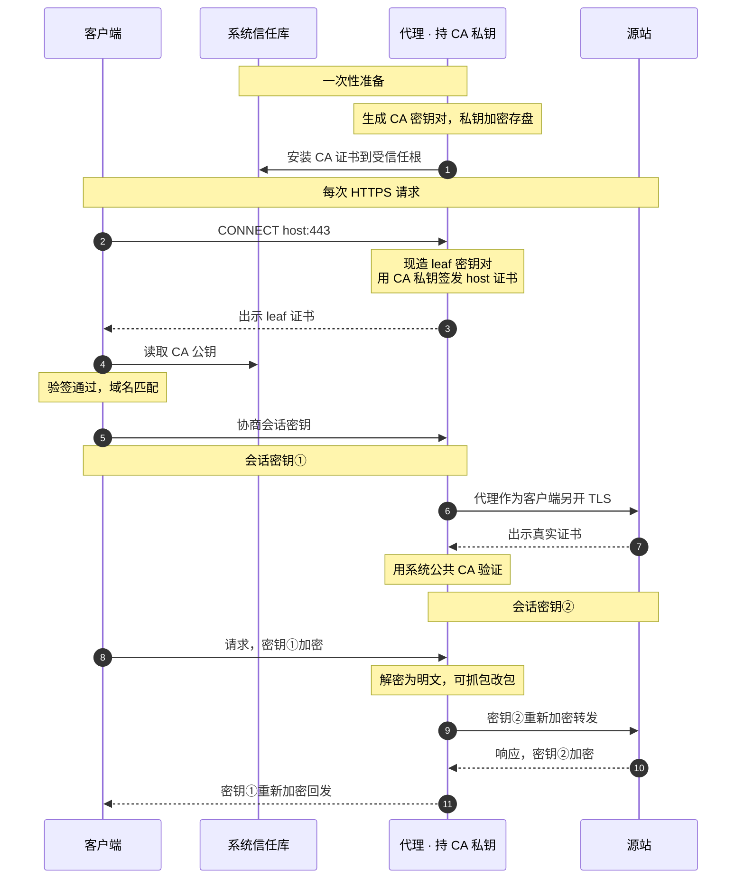
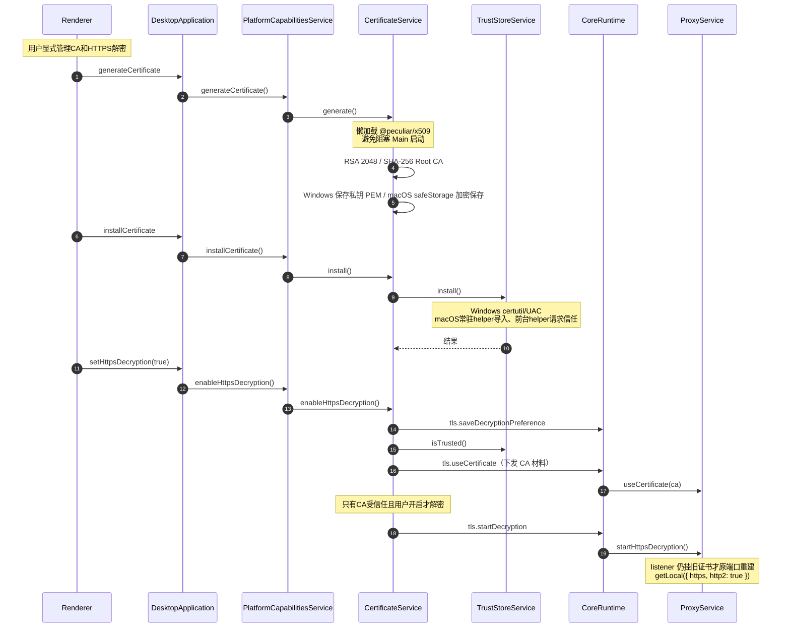

> 返回 [Settings 索引](README.md)

## 2. 证书与 HTTPS MITM

证书面板沿用Renderer的 `--font-ui`（本地 Noto Sans SC，数字与汉字同源），不增加外部字体请求；其余排版沿用[Renderer规范](../../platform/renderer.md)和[设计系统](../../../design-vite/design-system/README.md)。

### 2.1 三对密钥

| 密钥对 | 持有者 | 用途 |
| --- | --- | --- |
| CA 密钥对 | 本应用生成 | 私钥签发 leaf，公钥装信任库验签 |
| leaf 密钥对 | Mockttp 按 host 现造并缓存 | 与客户端的会话 |
| 源站真实密钥对 | 真实网站 | 代理与源站的会话 |

**CA私钥不进Renderer、日志或普通证书导出。Windows按用户共享目录保存PEM文件，macOS保持原safeStorage加密方式。**

#### Windows跨profile私钥保存

- Windows将`root-key.pem`与公开证书、元数据放在同一用户共享目录，私钥不额外加密，不依赖Electron profile中的`Local State`。不使用公共目录、网络共享、PowerShell加解密或另一套密钥服务。
- 同一系统用户的开发版、打包版及不同profile共用这套CA；换profile或删除profile不换CA，不同机器/系统用户不随安装包共享私钥。
- macOS继续使用Keychain支持的`safeStorage`保存`root-key.enc`；Agent/MCP各自profile内的凭据格式不变。
- 残缺、损坏或密钥不匹配仍显式失败并保留材料，不隐式重生成CA；不读取旧profile或迁移旧密文。首次启动只在材料全部不存在时生成。
- 以同一真实workflow证明两代fresh profile保留同一CA身份、材料size/mtime和信任；第二代profile删除后材料及信任仍正确。故障恢复不作为该workflow的Green。
- HTTPS解密还要求Core已经加载实际CA；没有CA时`tls.startDecryption`必须显式失败并保持不解密，不能出示仅供TLS分流器内部使用的临时身份。fresh profile的Workspace自行创建数据库父目录，不依赖Capture异步初始化，以免启动时TLS偏好读取失败而遗漏CA同步。

### 2.2 握手时序

> 密钥交换细节：TLS 1.2 + RSA 时客户端用 leaf 公钥加密预主密钥、代理用 leaf 私钥解密；TLS 1.3 / ECDHE 时会话密钥由临时 DH 生成（前向保密），leaf 私钥只用来签握手、客户端用 leaf 公钥验签。**两种情况下客户端信任 leaf 都取决于用信任库里的 CA 公钥验签成功。**

### 2.3 启用流程

**证书与解密开关正交**：`tls.useCertificate` 只记录当前可用的 CA 材料，`tls.startDecryption` /
`tls.stopDecryption` 只切换是否 MITM。停止解密时全部 host 退回隧道、证书永不出示，因此
卸载信任或删除 CA 都不必立刻换 listener。CertificateService只有CA已安装信任**且** `mitmEnabled`开启时
才发 `tls.startDecryption`，否则发 `tls.stopDecryption`。

CertificateService从Core读回`tls.getDecryptionPreference`，再按「CA已信任且用户开启」决定是否真的
解密。持久化的是**用户意图**，不是运行态：`tls.saveDecryptionPreference` 只在用户拨开关时写，
CA 不可用而发出的 `tls.stopDecryption` 不会擦掉它。

源站证书例外的增加和撤销必须从下一笔请求生效，包括启动时已加载共享CA、从未转发过HTTP的listener。`ProxyService.replaceInsecureHosts()`需替换整组HTTP转发规则，不追加等待首笔匹配的旧规则；不重启listener、不清Capture会话、不改WebSocket规则。

信任作用于Windows LocalMachine Root或macOS System Keychain/admin trust。Windows通过共用`commandRunner.runElevated()`执行固定certutil命令，macOS通过native helper分开执行公开证书存取和系统信任确认；检测不需提权。

| 操作 | Windows | macOS |
| --- | --- | --- |
| 安装 | `certutil -addstore -f Root`（不带`-user`） | 常驻helper导入System Keychain，再由普通用户前台helper请求admin trust |
| 检测 | `certutil -verifystore Root <sha1>` | `security find-certificate -a -p`精确匹配SHA-1后，`security verify-cert -p basic -L`查询根CA的系统信任链结果 |

按SHA-1 thumbprint精确定位；只读命令通过`execFile`传递固定参数，不经shell。

macOS只将匹配的公开证书经stdin交给系统验证，不生成临时证书文件、不传入`-r`强制信任锚点、不读取私钥；未安装或系统评估拒绝均不报告trusted。此处检查根CA的基本系统信任，不以CA本身代替服务器叶证书执行SSL域名/用途验证，真实HTTPS握手仍需相应workflow验收。

浏览器验收必须使用默认HTTPS校验访问真实Proxy listener，并核对叶证书由当前共享CA签名。Playground协议客户端的`rejectUnauthorized: false`仅用于协议流量，不构成浏览器信任证据；`capture.scenarios.tls`使用`/playground/tls/browser-trust`固定本地响应，保存Edge security state、证书错误及公开指纹。

### 2.4 窄 API

#### macOS 信任入口

- 代理与公开CA导入/删除使用常驻root服务；trust/untrust由同一helper的普通用户前台入口执行。CA生成和私钥加密属于Main中的CertificateService，私钥不交helper。
- `certificate.trust`与`certificate.untrust`的stdin参数为`{ certificate: <公开DER base64>, sha256: <大写SHA-256> }`，回复为`{ sha256, trusted: true | false }`；不接受路径、私钥、任意命令或调用方指定的信任域。
- 前台helper在登录用户GUI会话中调用`SecTrustSettingsSetTrustSettings`/`SecTrustSettingsRemoveTrustSettings`，只修改`.admin`并回读；系统确认由用户处理。这些API不接收`AuthorizationRef`，[系统实现](https://github.com/apple-oss-distributions/Security/blob/main/OSX/libsecurity_keychain/lib/TrustSettings.cpp)为信任写入单独创建授权，不能复用helper安装授权。
- CertificateService先核对目标CA是否已存在，再经helper导入和授信。明确拒绝或取消只撤回此次新增的精确DER；已有CA与结果未知的CA保持，回滚失败同时报告。卸载先撤销信任，成功后才删除公开证书。
- 不修改SIP、授权规则或用户信任域，不提供后台root自动授信、版本兼容或失败回退分支。
- 不能假定root身份可以代替admin trust授权；不尝试修改`com.apple.trust-settings.admin`来绕过系统确认。

#### CA与profile生命周期

- 首窗顺序：App首窗和启动页先显示，再调用`PlatformCapabilitiesService.prepare()`准备系统组件/证书。平台对象通知`platform/certificate`，Main通过`startup:get-stage`及`startup:stage-changed`转发，全部服务可用后发布`ready`。Renderer `ApplicationStartup`准备期间仅挂载BootScreen及窗口控制，ready后才挂载业务订阅；迟到查询不得使进度倒退。Main在ready前拒绝业务IPC；helper、证书或代理操作忙时拒绝本次退出并提示当前操作，不保存延后退出。平台API不接受`AbortSignal`，已开始的操作完整收尾。Core/listener/自动接管顺序与MITM意图保持。
- 材料为公开的`root-cert.pem`、`ca-meta.json`及私钥文件：Windows为不额外加密的`root-key.pem`，macOS为safeStorage加密的`root-key.enc`。Windows路径为`%LOCALAPPDATA%/Interceptor/certificates`；macOS路径为`~/Library/Application Support/Interceptor Platform/certificates`，均独立于默认及自定义profile。
- 启动顺序：安装安全Renderer协议与IPC → 显示启动页 → 准备原生组件 → 加载系统代理恢复记录 → 检查共享材料及精确指纹的真实信任 → 缺失才生成、未信任才安装/授信 → 其余Main服务/Core准备 → Renderer业务页面。只在App启动做初始化，Core重启与普通退出不重复授信或删除。
- 已生成且受信任：不改文件、不调用安装、不重复系统确认。已有未信任：保留同一CA，只走原系统安装/授权，之后回读真实信任，仍未信任则报错。残缺、损坏、指纹/密钥不匹配、无法解密或过期材料保留并报错，不隐式换CA；取消/失败沿Main启动失败路径恢复代理并退出。Windows沿用当前用户目录权限，不能将0700/0600的POSIX模式当作Windows ACL证明；macOS保留新目录0700、材料0600。
- `CertificateService`属于Main进程中的平台模块，统一拥有材料、内部TrustStore、MITM意图和Core配置同步。Main只持有一个`PlatformCapabilitiesService`，直接调用业务方法并接收结果/error和状态通知，不持有各module实例。私钥读取后只交Main/Core，不交root helper、Renderer或额外加解密进程。Windows保留certutil/UAC，macOS保留前台helper系统确认；MITM开关仍按profile且不因CA初始化自动开启。
- 现有Generate/Regenerate、Uninstall、Delete作用于共享CA；仍须显式用户操作，受信任时不能直接Regenerate。Uninstall保留本地材料，Delete先撤销信任再删材料；下次启动按缺失步骤初始化。普通退出和普通业务workflow不能撤销/删除共享CA。
- 不迁移或复制旧profile材料，不增加测试专用路径/开关，不分发跨用户共用私钥。业务配置、凭据和Tool授权仍隔离，测试不放宽零seed要求。
- 删除已退出App的业务profile不删除或改写共享CA。共享启动workflow须在真实删除测试profile后再次核对公开指纹、三份文件的size/mtime和系统信任，不能只靠目录不同或退出前的查询推断。
- 专项验收只清理本轮由产品首次创建的共享CA；已存在的共享CA不作为破坏性测试输入。普通协议workflow以已通过产品初始化的CA为基线，保持指纹/信任和材料不变；初次初始化与后续复用分别保存证据。

#### 证书操作

`getCertificateStatus`、`generateCertificate`、`installCertificate`、`uninstallCertificate`、`deleteCertificate`、`revealCertificate`、`viewCertificate`、`openCertificateManager`、`getInsecureHosts`、`setInsecureHosts`、`setHttpsDecryption`。

macOS View：固定前台`certificate.view`只接公开DER与SHA-256，使用系统`SFCertificatePanel`显示详情，`SFCertificateView`关闭信任编辑。面板真正显示后才回复requested，普通用户运行且不经root socket；调用App退出时关闭。Windows继续原系统证书查看方式。View不负责导入、安装或trust，不能把只读查看变成第二条授权写入路径。

### 平台模块操作互斥

- platform-capabilities中的证书、系统代理、AppContainer和helper部署模块分别管理自己的在途状态和互斥；Main只持有一个readonly平台对象，直接调用方法，处理error并转发通知，不实现平台步骤或保存组内busy状态。ApplicationActionGate只管理通用命令接收与退出收尾，不维护全量平台操作表；也不把该表原样搬到PlatformCapabilitiesService。
- 证书材料与TrustStore属于同一证书模块；PlatformCapabilitiesService对外提供证书业务方法，内部唯一CertificateService完成生成/加密、安装、回滚、撤销、删除和Core同步。各module实例private，不暴露给Main；材料存在与系统受信任仍是独立事实，私钥不交helper。
- helper只执行固定原生操作并回复结果，保留鉴权、参数校验、原子写入和回读，不增加业务队列。共享系统确认及维护资源只做必要的跨组协调，不重复存储各组状态。
- macOS常驻helper同步服务Main的启动与系统操作，launchd使用`ProcessType=Interactive`，不能按无人等待的`Background`任务限制CPU和I/O；Unix socket不具备Adaptive所需的XPC activity。完整App资源、内嵌代码、全部架构和运行时校验及客户端30秒期限保持，不用缓存、跳过校验或延长期限替代调度修正。
- 部署发现与准入分开：`deployment-status`只比较组件部署、应用签名身份和主可执行文件，不是授权结论；正常启动仍必须通过常驻helper的完整资源/内嵌代码/全部架构及运行时检查才进入证书阶段。`inspect-application`、请求安装和root安装继续完整验证，不因部署发现结果而跳过验证；不得缓存历史信任结果。
- 不排队。冲突立即返回`operation_in_progress`和当前操作标识；UI沿用现有提示并显示本地化操作名，Agent/MCP返回相同原因。被拒绝的请求不触发helper、写文件或Core变更，也不在当前操作结束后自动执行。
- 证书组包括启动补齐、生成/重生成、安装/授信、撤销/卸载、删除、回滚、MITM启停和Core证书同步。操作开始前由模块占用，保护覆盖材料、系统信任、回读和Core同步；module使用Main注入的typed `requestCore`回调，不能导入CoreRuntime或Electron，通知回调不承担业务步骤，内部调用不再次争抢同组。
- 系统代理组包括接管、恢复、journal恢复、归属状态更新和上游结果应用；探测可并行，提交时检查当前配置与Core代际。Windows AppContainer单项/批量写入共用一组，因为底层写整份豁免名单。
- 不同组可以并行。helper维护与使用该helper的操作互斥；需要原生确认的操作之间互斥，冲突在产生写入前返回。只读查询不长期占用修改组，不能用中间状态决策后续写入。
- 平台API不接受外部AbortSignal。Agent/MCP在进入Main业务前检查取消；调用开始后等待平台操作完成或失败收尾，调用方停止等待不解除模块占用。helper超时/断线同样不证明原生写入已停止；未取得明确结束或可靠核验前保留冲突状态，不自动重试。启动与退出的必要依赖是单次操作内部顺序，不是保存用户请求的队列。
- helper部署前的`deployment-status / development-deployment-status / inspect-application / inspect-helper`只读检查不产生系统写入；命令结束后报告不可用、非法回复或拒绝时，必须保留错误并释放准备占用，不能把这些失败记为未知写入、永久阻止Quit。`system-proxy.read-effective`完整回复的value非法时，同样标明completed及只读operation。真正已发出的写入按原请求结束证据收尾，不能用普通status解除。
- 用户退出会打断系统写入时拒绝本次退出并提示，不等任务完成后自动退出；允许退出后先阻止新修改、恢复代理，再停止Core。Core故障恢复与失败回滚是必要收尾，不因普通冲突而丢弃。

#### 失联写入收尾契约

- 仅`system-proxy.replace`、`certificate.import`、`certificate.remove`在已发送后超时、断线或无法关联回复时，typed client发起一次只读`request.get-completion`，参数为`{ requestId: <原请求ID> }`，查询自身使用新的envelope requestId。正常成功、正式失败回复、只读失败和未发送请求不增加查询。
- 结果为`{ requestId, state: "completed", operation }`或`{ requestId, state: "unknown" }`。原ID和原操作都匹配才证明调用已结束，不证明系统状态符合预期；仍返回原失败，由Certificate/SystemProxy既有业务收尾回读、同步Core和发布通知后释放占用。
- helper在发送终态回复前记录结束元数据，生产/开发socket互不读取对方记录；每个实例只保留最近128个写请求ID及操作名，不保存参数、结果正文或授权结论。查无记录、实例重启、记录淘汰、非法回复及查询失败均不能解锁，也不能自动重放写入。
- 原请求与确认请求分别遵守既有30秒传输期限；确认属于失败收尾，期间原业务保持占用。前台信任进程的异常结束不属于socket记录，不能凭无关记录或普通status解除。
- 安装CA的import失联后若已确认结束，且安装前不存在该精确CA，在请求trust之前撤回本次可能新增的公开证书；已有CA、未发送或未确认的import不删。内部`requestSent`与`executionState`分别表达是否发出帧和是否结束，原错误与回滚错误都保留。

#### 启动完整资源校验的进程隔离

- 常驻helper核验socket audit身份、固定App路径和运行时保护；每次完整资源校验启动同一受保护helper的只读`verify-code-signature <absolute-code-path> <cdhash-requirement>`子进程，避免长期进程的校验慢路径。
- 子进程执行原Security API的身份、strict、nested、all-architectures及no-network检查，正常退出码0才可继续；失败或异常退出拒绝请求，不将CLI开放为socket命令。
- 原请求保持占用，完成记录晚于校验子进程退出及真实系统写入收尾；30秒期限、128条结束记录、不重放、Windows与开发UID入口不变，不保存签名或信任缓存。

Certificate module组装的`CertificateInfo`含`path`与`mitmEnabled`，不含私钥；解密材料只经内部Core RPC发送。
