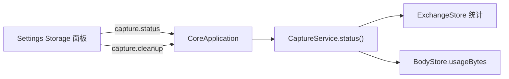

> 返回 [Settings 索引](README.md)

## 5. 存储状态

报表字段：`sessionCount`、`exchangeCount`、`bodyCount`、`databaseBytes`（Capture 无 SQLite 恒为 0）、`blobBytes`、`totalBytes`。

### Storage面板

- 标题右侧使用30px Refresh图标按钮及Tooltip，刷新时旋转并阻止重复操作；不自动轮询，不提供预算、配额或保留期限输入。
- Usage只展示一次`blobBytes`，名称为`Captured body data`，包含内存与临时文件中的已保存正文；另外显示Session、Exchange和正文数量，不把正文总量称为Core RSS或磁盘占用。
- Settings与Capture列表共用`clearCapture()`，清理请求记录、正文和选中详情；Settings二次确认，Cancel不清理，已保存文件、当前Session及录制状态保持。文件任务互斥和系统代理恢复遵守Core/Main的同一业务规则。
- Storage清理行可换行并显示第二行提示，适应不同语言的完整说明。

Capture没有全局内存/磁盘配额；小正文驻内存，未确认事件队列没有总容量上限，不以静默丢弃数据控制用量。
