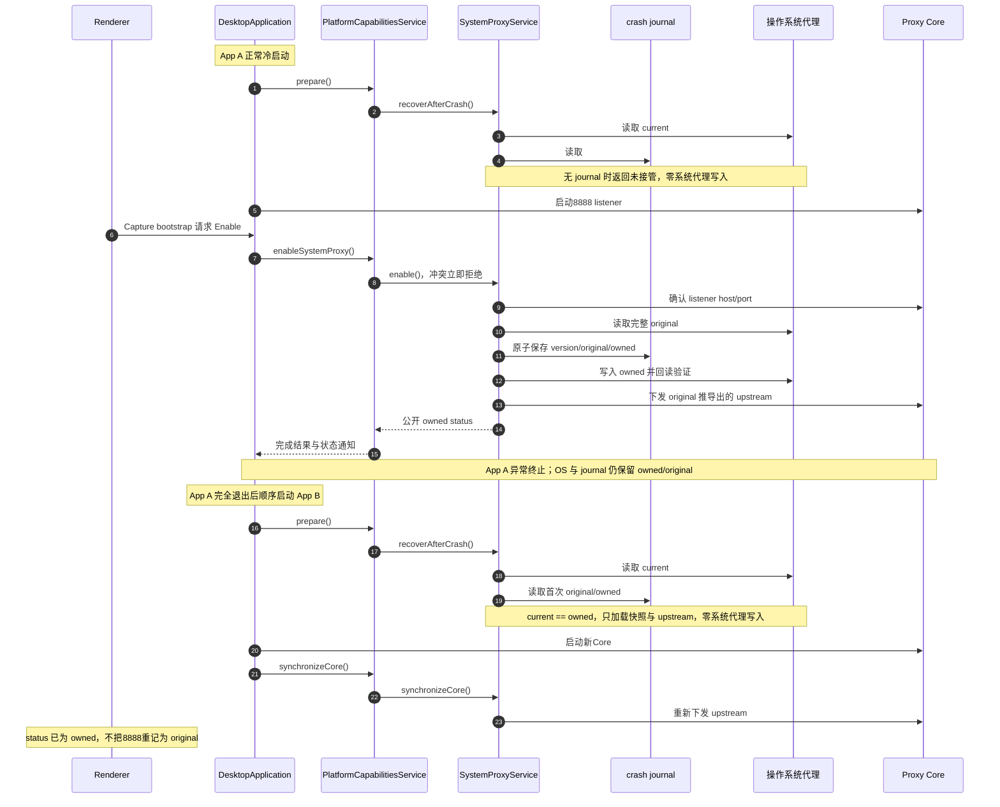
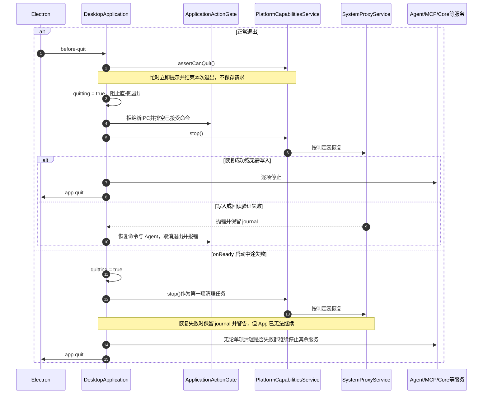

> 返回 [Settings 索引](README.md)

## 3. 系统代理

### 3.1 参与者、快照与不变量

| 参与者 | 负责什么 | 不负责什么 |
| --- | --- | --- |
| Renderer | 通过窄 Desktop API 请求 Enable、Restore 和只读 Status | 不访问 WinINet、SystemConfiguration 或 journal |
| `DesktopApplication`（Main） | 调用唯一PlatformCapabilitiesService，捕获error并转发状态，管理App/Core生命周期 | 不管理平台module实例、操作状态、upstream或恢复步骤 |
| `PlatformCapabilitiesService` | 私有组装各module，提供完整业务方法和启动/退出入口 | 不维护集中平台操作表或用户请求队列 |
| 平台 `SystemProxyService` | 拥有操作状态、listener检查、upstream同步/探活及必要恢复；所属Windows/macOS实现比较完整快照并执行native写入/回读 | 不启动或停止Core进程，不访问Renderer |
| Proxy Core UtilityProcess | 监听 `127.0.0.1:8888`，接收 Main 下发的 upstream 并转发流量 | 不读取或修改系统代理，不读 journal |
| crash journal | 保存崩溃恢复需要的 `version/original/owned` | 不保存 owner、PID、启动时间、instance ID 或阶段状态 |
| 操作系统 | 保存当前实际生效的代理配置 `current` | 不知道哪个 App “拥有”代理 |

三个比较值的含义：

| 值 | 产生时间 | 内容 |
| --- | --- | --- |
| `original` | Interceptor 接管前 | Windows 为 flags、Proxy Server、Bypass、PAC、Auto Detect 等完整 WinINet 快照；macOS 为全部活动 network service 的完整代理字典 |
| `owned` | 写系统代理前 | 根据 `original` 计算出的 Interceptor loopback 配置，目标为当前 Core listener |
| `current` | 每次恢复判定时 | Main 通过平台 helper 当场读取的操作系统实际配置 |

文档中的 `current == owned`、`current == original` 都表示完整快照逐字段相等，不表示 PID、进程或文件的所有权。
network service的增加或删除也属于完整快照的外部变化；恢复与跨代journal加载都不得只比较仍存在的service或覆盖新配置。ClashX系统代理的真实改写、App退出及跨profile恢复由独立用户流程验收，不以状态机测试代替。

Windows journal 固定为 `%LOCALAPPDATA%/Interceptor/system-proxy/journal.json`，不随 Electron
`userData`、开发模式、packaged App 或 E2E `--user-data-dir` 改变；macOS journal 为
`~/Library/Application Support/Interceptor Platform/system-proxy/journal.json`，也避开默认profile。两平台都先把临时文件完整写入并同步，再原子 rename。
产品前提是同一时间只运行一个 Interceptor App，不处理两个 App 的竞争。

启动用户级journal路径前必须确认旧实例已正常退出、系统代理已恢复、没有待处理旧journal；不能遗弃仍拥有OS代理的恢复记录。不增加旧profile迁移或回退读取，Windows原路径、原生命令和`version/original/owned`契约保持。

### 3.2 生命周期流程

#### 正常启动与崩溃重启

#### 正常退出与启动失败

正常退出可以在代理恢复失败后继续运行，因此取消退出且不先停止 Core；启动失败表示 App 已经无法继续，
所以即使代理恢复失败也会保留 journal、警告用户并继续销毁其余服务。这是两条流程最重要的差异。

Core状态通知经PlatformCapabilitiesService交给SystemProxyService；从`running`进入`unresponsive/restarting`时，
module合并一份必要Restore，等待已开始的操作明确结算后恢复。用户Enable/Restore发生冲突时立即拒绝，不保存、
不重试、不延后执行。恢复前仍当场读取完整`current`；原生结果不确定时不能仅凭Promise失败释放占用。
这些状态仅协调单Main进程，产品仍要求同一时间只运行一个App。

所有启动恢复、用户 Restore、Core 故障恢复和退出恢复最终使用同一判定表：

| 当场比较结果 | 启动 `recoverAfterCrash()` | Restore、Core 故障或退出 |
| --- | --- | --- |
| 无 journal | 返回未接管，零系统代理写入 | 若内存也无快照则返回未接管，零系统代理写入 |
| `current == owned` | 加载 `original/owned`，保留 journal，零系统代理写入 | 写回 `original`，回读验证成功后删除 journal |
| `current == original` | 只删除已完成使命的 journal | 只删除 journal，不重复写 `original` |
| `current` 与两者都不同 | 视为用户或外部程序已修改；零系统代理写入并删除失效 journal | 同样零系统代理写入并删除失效 journal，报告 `externally-modified` |
| helper 写入或回读验证失败 | 抛错；不把恢复当作成功 | 抛错并保留 journal；正常退出因此取消，启动失败清理则继续退出 |

**窄 Desktop API**：`getSystemProxyStatus`、`enableSystemProxy`、`restoreSystemProxy`。Main 日志不包含 snapshot。
