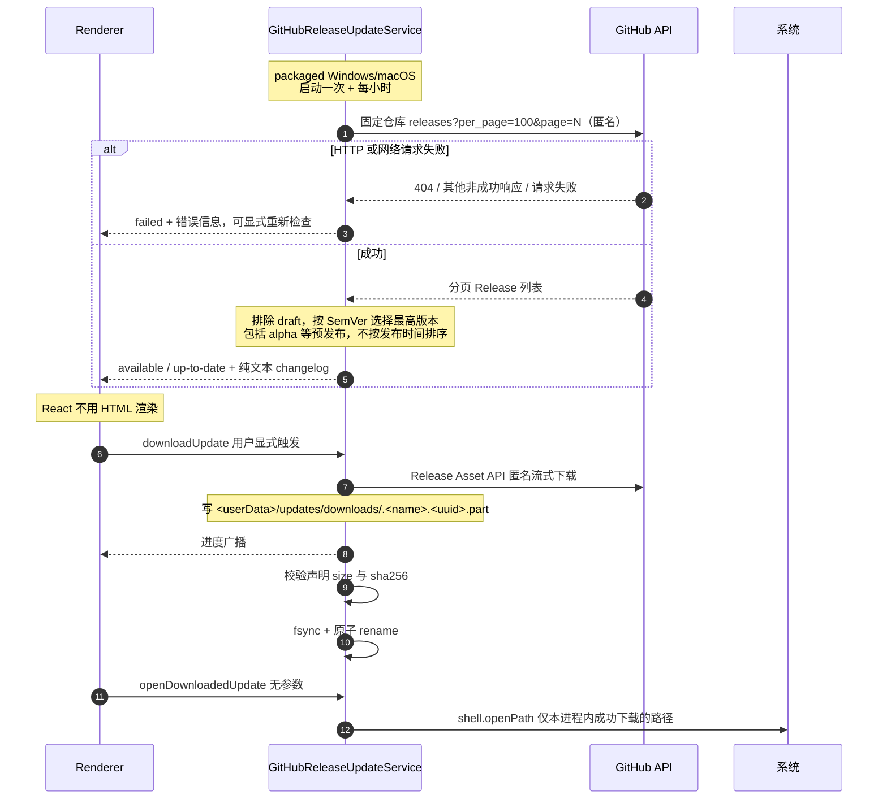

> 返回 [Settings 索引](README.md)

## 4. 更新

Updates仅保留现有产品UI和Main更新流程，不注册为Agent/MCP Tool，也不列入Tool开发计划。

**匿名请求**：产品不包含GitHub登录、Device Flow、Client ID、token读取/刷新/持久化或授权状态。检查和下载使用固定来源，`credentials: omit`且不发送`Authorization`；个人Git/CI凭据和仓库可见性不变。HTTP 404、其他非成功响应或网络错误均进入`failed`，不显示无更新或要求登录；失败后可从现有Check按钮显式重试。

**版本选择**：匿名读取固定仓库的全部 Release 分页，每页100项；非数组响应或任一页请求失败均进入`failed`，不把部分列表当作完整结果。忽略draft和无效SemVer tag，接受已发布的正式版及alpha等预发布。去除tag开头的`v`后按SemVer比较，选择最高版本；例如`0.1.1-alpha.10 > 0.1.1-alpha.2`、`0.1.1 > 0.1.1-alpha.10`，发布时间与列表位置不改变结果。没有有效版本时进入`failed`；最高版本只有比当前版本新才进入`available`，相同或更旧均为`up-to-date`，不提供降级。

**安全校验**：所选Release的draft/prerelease字段、纯文本notes、固定 `api.github.com/repos/zhxmt-xm/Interceptor`、asset ID/name/basename、平台扩展名、显式架构、声明 size、SHA-256。最高版本缺少受支持安装包或校验失败时进入`failed`，不回退到更旧Release。拒绝路径编码逃逸、外域、重复候选；用户只能打开本进程内完整校验并原子保存成功的安装包。

**Renderer 永远拿不到 URL 或 path。**

八态：`unsupported` / `idle` / `checking` / `available` / `downloading` / `downloaded` / `up-to-date` / `failed`。

`UpdateStatus`只含`supported` / `state` / `currentVersion` / `latestVersion` / `progress` / `downloadedBytes` / `totalBytes` / `releaseNotes` / `message` / `lastCheckedAt`。Preload保留`getUpdateStatus`、`checkForUpdates`、`downloadUpdate`、`openDownloadedUpdate`及`onUpdateStatusChange`，没有GitHub账号API。

**生命周期**：`DesktopApplication`初始化updater并广播`update:status`；packaged Windows/macOS启动一次检查，此后每小时检查，正在下载或已下载时不自动覆盖结果。退出停止timer并取消检查/下载，已取消请求的迟到响应不能发布新状态或保留安装器，临时`.part`清理。未打包目标为`unsupported`。packaged Renderer从受保护ASAR经`interceptor://app`加载，不存在远程代码覆盖层。

**UI**：Updates从Version开始，Delivery保留固定来源、检查/下载策略、进度和显式Check/Download/Open installer，GitHub access、Private及账号文案已移除。已安装版本标记为Installed，版本策略说明包含alpha。公开`settings.updates.status`只反映`data-state`、`data-supported`、`data-last-checked-at`、`data-current-version`和`data-latest-version`，不增加业务接口；检查/下载进度另由`settings.updates.progress`暴露`data-state`、`data-progress`、`data-downloaded-bytes`和`data-total-bytes`。Main safeStorage仍用于macOS CA及Agent/MCP凭据；macOS Keychain访问许可不是GitHub登录。

### 更新通知按钮

- `UpdatesPanel`通过共享Button的icon参数传入RefreshCw、Download和ExternalLink图标，label只放文字；装饰图标和spinner使用`aria-hidden`。
- `UpdateNotification`使用`Button size="compact"`：高32px、水平padding为11px；字号12.5px、字重550、图标15px、gap为7px，不在通知CSS覆盖共享按钮样式。
- `available`仍调用`UpdateActions.download()`，`downloaded`仍调用`UpdateActions.openDownloaded()`；busy时禁用动作，Dismiss独立可用，其余状态不显示通知。没有新增IPC、下载或安装步骤。`downloading`属于不显示通知的状态，因此busy禁用由组件测试覆盖；通知根`settings.update-notification`带`data-state`，动作和Dismiss分别为`settings.update-notification.action`与`settings.update-notification.dismiss`。
- button和独立label使用`inline-flex`与`align-items: center`；图标固定且不收缩，内容间距来自gap，不以字形测量、位移或独立行高补偿。
