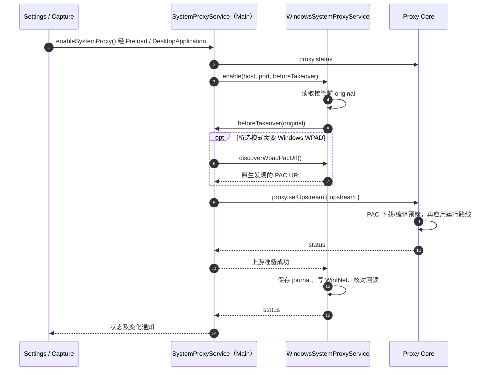

> 返回 [Settings 索引](README.md)

### 3.4 上游代理链式转发

#### 可选上游配置（与当前实现的差异）

Main提供System、Direct、Manual、PAC和WPAD五种上游模式，Settings与Capture快捷入口调用同一业务。
macOS WPAD使用系统DNS解析和缓存的DHCP 252 URL，不主动发送DHCP发现请求；Windows通过WinHTTP完成DHCP/DNS发现。
Windows显式WPAD及System仅Auto Detect、无启用的显式代理/PAC时均调用原生发现；发现失败保留旧配置和路线。

**已实现的发送适配**

- 仅修改现有Mockttp patch，不替换Mockttp或代理库，不修改PAC/HTTP Agent源码。
  使用已有最终目标与headers，在创建Node请求前完成适配，不能在正文已发送后重放或改写请求缓存。
- Mockttp共用的HTTP/1.x出站构造使用小写字段名；单个值保存string，同名多个值按原顺序保存string数组。
  空字符串、相同的重复值和未知字段保留；使用无原型对象，不通用join、不覆盖、不去重、不修改源raw列表。
  原始字段先经过Node名字/值校验，不用大小写转换掩盖非法输入。
- `setDefaultHeaders:false`与正文/framing契约保持。Cookie数组由Node按`; `发送；
  `Set-Cookie`多行、认证挑战、CL/TE、Host及H2转换仍由所属发送层处理，不新增自动修正或后值优先策略。
  H1线上名字小写及同名行归组，但不允许字段值丢失、正文变化或真实目标错误。
- 原始Capture、编辑器、Rules、响应头路径和WS/H2发送选择不重写；
  共用转换helper若修正空值/特殊键，必须回归原有使用方，不能只验PAC。
- 未解密TLS传给PAC的判断目标必须是`https://<实际authority>/`，保留CONNECT端口与IPv6表示；
  保持`secureEndpoint:false`让业务TLS字节原样透传，不从不可见内容猜业务path，不改raw隧道语义。
  IPv6在TLS主机URL模式匹配时也使用方括号，传给实际socket的host不加括号，避免因匹配失败误入解密分支。
- 普通PAC求值通过Mockttp内对公开`getResolver()`的适配补上实际端口，原请求path和Agent认证注入顺序不变；
  含目标端口的Agent缓存不得串用另一目标端口。PAC按每个新HTTP请求求值，不能复用先前DIRECT socket跳过新路线；
  只关闭PAC请求结束后的空闲socket复用，固定上游的keep-alive策略和已开始的响应/长连接不改变。
- 以同一输入直发与经Interceptor后的源站method、目标/path/query、字段值、
  正文bytes及实际上游路径作对照；H1字段名大小写与必要的逐跳字段变化单独说明，不泛化为忽略所有header差异。
- 普通PAC非默认端口、多目标与IPv6有独立协议验收。对象化本身不证明任意异常Host输入、
  PAC候选间代理认证等组合均已覆盖；不将未验边界宣称为全部解决，也不追加未经授权的Agent补丁。

**HTTP/PAC兼容处理**：既有raw-header数组不会建立HTTP Agent读取的Node字段表，
曾导致Host回退与重建时丢头；上游背景见[httptoolkit/mockttp#194](https://github.com/httptoolkit/mockttp/issues/194)。
现在由Mockttp在创建H1请求前提交无原型多值对象，字段名小写，字段值与空值保留；
不修改HTTP Agent，也不将HTTP代理转成CONNECT来绕过。

**TLS/PAC兼容处理**：保留原始隧道的`secureEndpoint:false`，但给PAC的请求stub明确使用真实HTTPS authority；
IPv6在主机匹配的URL中加括号，实际socket host保持原值。普通PAC的端口由Mockttp内的
`TargetPortPacProxyAgent.getResolver()`调用原库公开求值接口前恢复，不改实际请求path或用户PAC。
原代理库继续拥有连接、候选类型与脚本编译；没有运行时覆盖其prototype或改写其源码。

| `mode` | 保存字段 | 含义 |
| --- | --- | --- |
| `system` | 仅`mode` | 默认沿用接管前系统配置；不能把Interceptor写入的8888当作原上游 |
| `direct` | 仅`mode` | Core直连目标；不停止Capture，不恢复或改写系统代理 |
| `manual` | `protocol: http / https / socks5`、`host: string`、`port: integer(1..65535)` | 用户明确指定上游，不接受Host中的scheme、路径或凭据 |
| `pac` | `url: string` | HTTP/HTTPS PAC URL，不接受内嵌凭据或本地文件scheme |
| `wpad` | 仅`mode` | 从当前网络发现PAC；未发现或解析失败明确报错，不静默改成DIRECT |

- 配置复用`WorkspaceService`的`upstream_proxy_settings`单行文档，默认`{ mode: 'system' }`；
  Capture Clear、Recording暂停及Core重启均不删除。系统代理journal仍只承担原系统配置恢复，不保存编辑草稿或用发现结果覆盖`original`。
- Renderer的`getUpstreamSettings()`读取已保存配置及当前状态；
  `applyUpstreamSettings(settings)`通过Main唯一业务方法校验、解析上游并应用。
  Core内部`upstream.getSettings`读偏好，`upstream.applySettings { settings, upstream }`
  在候选运行配置可用后保存偏好并切换后续转发；原内部`proxy.setUpstream`继续承担代际同步，不隐式保存偏好。
- Apply前，选择与填写仅改Renderer草稿；Apply成功才更新Current route及Capture状态栏。
  失败不保存坏配置、不改为其他模式；当前配置和错误分开显示。操作状态、实际路线和可达性使用独立字段，不用`null`暗示正在发现。
  System模式在接管前发现WPAD失败也须保留发现错误；失败收尾不调用`proxy.setUpstream(null)`，
  不把尚未解析的路线公布为Direct成功。
- Main主动通知两个入口重读同一状态；不依赖某个弹窗独占刷新。
  窗口间或应用／恢复并发由同一平台操作互斥拒绝，不排队重放。
- 系统Restore只还原操作系统配置，不清空独立的Core上游；显式连入listener的客户端仍使用已选路线。
  崩溃恢复先加载所有权快照，Core就绪后才读取上游偏好和解析WPAD，不在恢复journal时提前推定路线。
  Core ready初始化屏障期间RPC已经可用、状态仍为`starting`；Main须在屏障内完成运行路由下发，
  不能以尚未公开`running`为由跳过已有listener的配置。没有listener时，Capture bootstrap在启动listener后
  仍调用同一个`enableSystemProxy()`；系统已owned仅表示OS归属，不代表新Core已配置上游。
  Main在owned分支应用当前路线但不重复写系统配置。进入`running`后通知Renderer显示已配置的路线。
- Settings新增独立Upstream proxy；Capture右下角按钮打开锚点浮层。
  Open in Settings保留草稿并定位该区域；Cancel/Discard不写持久化。
  `Current route`的标签、图标和值由拥有该行的flex/inline-flex容器统一`align-items: center`。
- 切换只影响后续新发起的请求，不关闭在途请求或既有长连接；
  固定上游不可达时明确显示失败，不把可达性探针的失败转换为未选择的直连。
  PAC/WPAD显示按请求选路，不能用一个固定地址代表全部出口。
- 正常退出、Core故障和下次启动恢复继续比较真实`current/original/owned`；
  用户选择上游不改变系统快照恢复语义。WPAD系统实验仍需独立回滚保护与授权。

接管后，遵循系统代理的应用将请求交给Interceptor。原有HTTP/SOCKS代理或PAC需要继续作为上游，否则可能绕过指定代理或导致访问失败。Main读取接管前的生效代理配置并交给Core使用；系统路由不由该配置转换过程修改。

转换规则（`windows/system-proxy-upstream.ts`）：

| 原配置 | 上游 `proxyUrl` |
| --- | --- |
| PAC 脚本（`PROXY_TYPE_AUTO_PROXY_URL` + `pacUrl`） | `pac+<pacUrl>`，PAC 求值交给 Mockttp 内置的 `pac-proxy-agent` |
| 显式代理 `host:port` | `http://host:port` |
| 分方案列表 `http=a;https=b` | 取 https，缺失回退 http |
| 仅 `socks=host:port` | `socks5://host:port` |
| 仅 Auto Detect（WPAD） | Windows先用WinHTTP发现，再把临时PAC URL交给转换器得到`pac+<url>`；发现失败报错，不按直连处理 |

`bypassList` 转成 curl 风格 `noProxy`；Windows 专有的 `<local>` 展开为 `localhost` / `127.0.0.1`。**不能展开出裸 `::1`**：`matchesNoProxy` 按 `host:port` 切分候选项，裸 IPv6 会被切成空 host，而空 host 匹配一切，结果是每个请求都判定为 bypass，上游形同虚设。

`toUpstreamAuthority(upstream)` 从同一份配置里取出 `host:port`（丢弃凭据）供状态栏展示。
