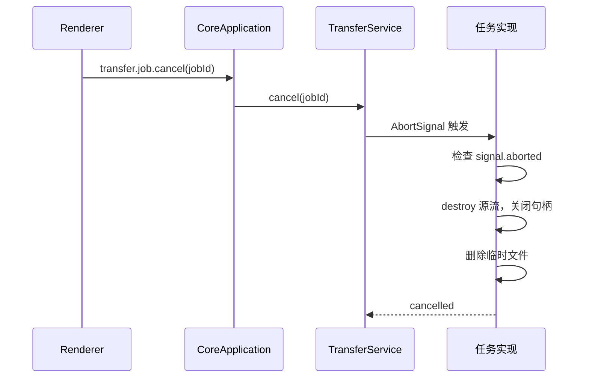
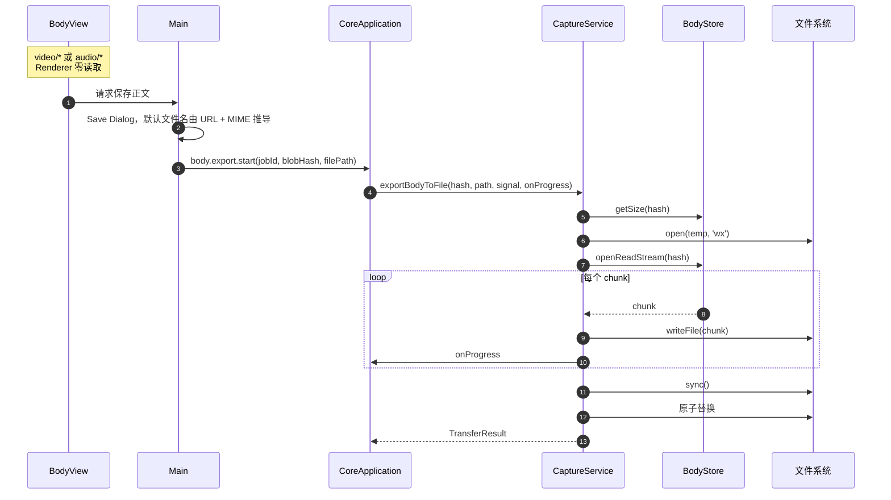
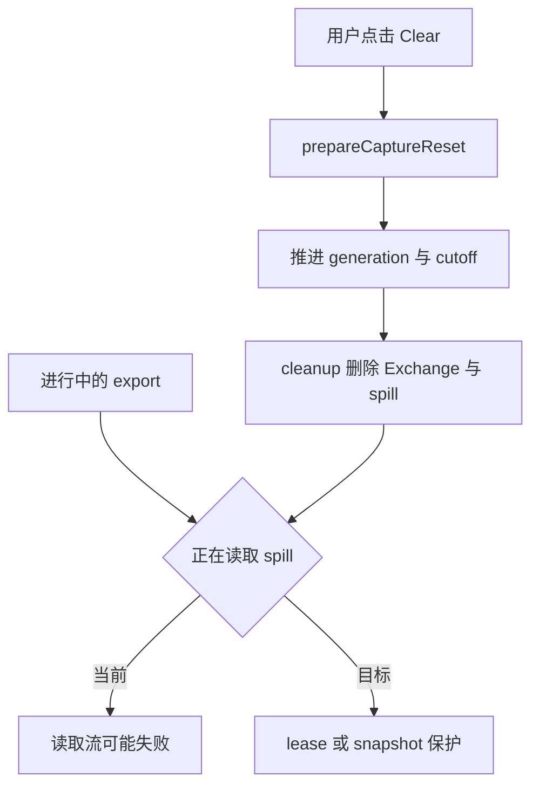

# Feature: Transfer

> 最后更新：2026-07-26
> Core 模块：`apps/proxy-core/src/proxy-core/transfer/`、`har/`、`archive/`、`capture/entry.ts`
> Renderer 入口：Capture 工作栏的 Import / Export 菜单

## 1. 职责与边界

Transfer 统一承载所有**异步文件任务**：HAR 交换、Native Archive 全保真存档、单个正文导出。

| 归属 | 内容 |
| --- | --- |
| Main 负责 | 系统 Save/Open Dialog，持有真实文件路径 |
| Core 负责 | 流式读写、进度上报、取消、原子替换 |
| Renderer 负责 | 触发意图、轮询快照、展示进度与取消 |

**路径边界**：真实文件路径**只在 Main 与 Core 之间流转**。Renderer 只拿到 basename、进度、状态、警告，永远没有 `path` / `readFile` / `writeFile`。

## 2. 四类任务

| 任务 | 命令 | 用途 |
| --- | --- | --- |
| HAR 导出 | `har.export.start` | 跨工具交换，标准 HAR 1.2 |
| HAR 导入 | `har.import.start` | 载入外部抓包 |
| Archive 导出 | `archive.export.start` | Interceptor 全保真存档 |
| Archive 导入 | `archive.import.start` | 恢复存档 |
| Body 导出 | `body.export.start` | 保存单个正文（大媒体主路径） |

统一由 `TransferService` 管理，共享 `transfer.job.get` / `transfer.job.cancel`。

任务**全部保留**不淘汰，每个任务持有独立的 `AbortController`；公开快照字段**不含绝对路径**。Core 关闭时先 `cancelAll()`。

## 3. 调用流程

### 3.1 通用任务生命周期


### 3.2 取消



**提交点语义 [改造中]**：Cancel 与最终 `fsync` + `rename` 之间存在竞态。必须定义提交点——一旦 rename 成功，任务不得再显示为 Cancelled。

### 3.3 Body 导出（大媒体主路径）



### 3.4 Capture Body导出Tool

`capture_export_body`只接受非空`exchangeId`与`bodyId`，身份来自当前Capture的正式查询结果；不接受
文件路径、建议文件名、MIME、编码或由Model指定的jobId。Main意图`capture.body.export`复用现有
Body保存入口与原生Save Dialog，不在Tool层读取正文或实现第二套文件写入。

- 这是独立的Capture change，遵守Agent/MCP双列授权及Ask/Auto。审批前只从Core读取并验证正文归属，
    影响说明只包含安全身份与存储字节数，不包含完整URL、正文、文件名或本机路径。
- Main在打开Save Dialog前验证当前Exchange与Body归属；选择目标后再次确认身份与Core代际仍有效，
    不在Clear或Core换代后猜测、重建或导出其他正文。默认文件名由UI/Main共用纯函数推导，不接受Model文件信息。
- Deny与预取消不打开Dialog、不创建任务；原生Cancel返回`{ started: false }`。Allow或Auto仍须经过真实
    Save Dialog；选定路径只留在Main/Core，按既有Body导出语义流式保存原始存储字节，不解码、不截断。
- 启动返回`{ started: true, job }`，job只投影现有安全任务字段。启动不等于完成；后续查询/取消复用
    `capture_get_transfer_job`与`capture_cancel_transfer_job`。取消Tool调用不能隐式取消已经接受的文件任务。
- Transcript复用`transferJob`与`exportCanceled`摘要，不回退为包含正文或文件信息的JSON。运行错误保持安全，
    不向Model、审批或Transcript透传文件系统路径与任意错误message。
- 已取得共享executor和真实`capture.tools.body-export`发现Red及同组Green；完整证据见§9.2。
    已启动导出与Clear的lease/snapshot，以及Cancel/rename提交点债务仍是独立欠账，不扩入本组。

## 4. 原子写入

所有导出遵循同一模式：

```text
1. 写入同目录临时文件（唯一后缀，'wx' 独占创建）
2. 全部写完后 fsync
3. 原子替换到目标路径
4. 失败时销毁流、关闭句柄、删除临时文件
```

**已修复**：四处导出（body / HAR / diagnostics / archive）均改为写临时文件 + `fsync` + **直接 `rename` 覆盖**。之前先 `rm(filePath)` 再 `rename(temp, filePath)` 会留下旧文件已删、新文件未就位的窗口，一旦 rename 因权限/磁盘/杀软失败，用户原文件就不可恢复。

## 5. 格式约定

### 5.1 HAR

| 项 | 策略 |
| --- | --- |
| 版本 | HAR 1.2 |
| 导出范围 | all / 当前 filter / 选中项 |
| 敏感数据 | 可选遮罩 Authorization、Cookie |
| 正文 | 可选 strip bodies |
| Headers | 只导出最终 wire headers，不含 Rule marker |
| 限制 | 不限制文件、entries、header、URL、body 大小 |

**已知风险 [改造中]**：导出当前按 chunk 读取后 `Buffer.concat` 成完整 body 再 base64 编码，大正文会造成 Core OOM。需改为流式编码写入。

**编排**：`har/entry.ts` 的 `HarService` 导出时按 `sessions.query` keyset 页枚举 ID，再逐条 detail / body range 转 HAR entry；导入先验证完整的不可信 JSON（`internal/document.ts` 的 `DocumentParser`），再建立隔离 Session、分批写 Blob/Exchange，**失败或取消按 Session cleanup 整体回滚**。

**映射与损失**：HTTP request/response/header/query/content/timings 与 text/base64 body 可互操作。压缩 Response 在导出时先按 gzip/deflate/br 解码，`bodySize` 保持**线上编码大小**，`content.size` / `compression` 表达解码后资源与压缩收益。

以下信息 **HAR 格式无法无损表达**，Core 与 UI 必须明确告警：HTTP/2 pseudo-header、trailer、WebSocket message、TLS 详情、rule history。需要这些内容就用 Native Archive。

不执行脚本/插件或远程内容；只保留 HAR 结构、base64 语法与可映射网络 scheme 的检查。

### 5.2 Native Archive

| 项 | 策略 |
| --- | --- |
| 容器 | 固定格式 ZIP |
| 内容 | 当前 `capture.sqlite` schema 的完整快照 |
| 保真 | `exchange.rule_ids`、`message_headers.rule_id` 完整 round-trip |
| Worker | 按需创建 `archive/worker/entry.cjs`，完成即退出 |
| 批次 | 100 条 Exchange 一批 |
| 校验 | 格式、路径、CRC、size、hash、SQLite 完整性 |

**限制**：不支持 ZIP64；不限制 entry 数、解压总量、压缩比（zip bomb 风险）；不保存完整历史 `RuleDefinition`。

**导出顺序不能变**：`ArchiveService.exportToFile` 先生成 `capture.sqlite` 快照 → 逐个流式写入引用的 Blob（`blobs/<sha256>`）→ **最后**写 `manifest.json`（format / appVersion / createdAt + 每个文件的 path / size / sha256）→ finalize → 原子 rename。manifest 写在最后，因为它要记录前面所有文件的真实 hash。

Archive、Workspace 与 Diagnostics 的 SQLite 均**直接创建当前表结构**，不保留 `user_version`、迁移步骤或旧数据库搬运路径。

### 5.3 快照语义

`createArchiveSnapshot(batchSize)` 在点击时捕获 Exchange 与 body hash 的时间切面。导出期间新增流量不进入本次存档。

## 6. 数据契约

```ts
interface TransferJobSnapshot {
  jobId: string;
  kind: 'har-export' | 'har-import' | 'archive-export' | 'archive-import' | 'body-export';
  fileName: string;              // 仅 basename
  state: 'running' | 'succeeded' | 'failed' | 'cancelled';
  processed: number;
  total: number | null;
  warnings: readonly string[];
  errorMessage?: string;
}
```

Renderer 全屏 Loading 在运行期间只提供 Cancel。

## 7. 与 Capture 的竞态



**已知缺陷 [改造中]**：Body save 不阻塞 Clear，Clear 删除 spill 时正在读取的 export stream 可能失败。需要建立 lease 或 snapshot 语义。

## 8. 与当前实现的差异

| 项 | 当前 | 目标 |
| --- | --- | --- |
| Body 原子替换 | `rm` + `rename` | 直接 `rename` 覆盖 |
| Cancel 提交点 | 无定义 | rename 成功后不可 cancel |
| Clear 与 export | 无保护 | lease 或 snapshot |
| HAR 导出正文 | `Buffer.concat` 完整 body | 流式编码 |
| Job 保留 | 永久保留所有终态 | UI 确认后清理或有限历史 |
| BodyView 反馈 | 只有 loading | 完整 Transfer UI（进度 / 取消 / 结果） |

## 9. 验收要点

### HAR Tool契约（已完成自动验收）

`capture_export_har`与`capture_import_har`分别复用Main的`capture.har.export`和`capture.har.import`，
两者都是独立Capture change，遵守Agent/MCP双列授权与Ask/Auto；不在Tool层解析HAR、读取正文或操作文件路径。

- Export明确要求`scope`与`redaction`。范围保留正式`all`、`filter`和非空`selected.exchangeIds`，各分支
    不接受混合字段；filter仅包含正式协议的host/method/status/mime/appName/search/protocol。
    三个布尔脱敏项authorization/cookies/bodies必须明确提供，不能用缺省参数表达未经说明的数据导出。
- Import参数为空，只有原生Open Dialog可以选择文件；导入沿用Core隔离Session追加和失败/取消回滚，
    不增加隐式Clear、覆盖模式、自动读取路径或文件内容输入。验收文件必须来自同一workflow的产品Export。
- 审批说明仅表达导入/导出意图、范围种类与计数、脱敏选择及原生Dialog要求；不提前打开Dialog，
    不读取本地文件或向审批注入任意文件内容。Deny和预取消不启动任务；原生Cancel返回`{ started: false }`。
- 选定目标后返回`{ started: true, job }`，job只含现有安全任务字段，任务身份由Main生成。任务启动不等于
    导入/导出完成，查询与取消复用正式Transfer Tool。路径、basename、任意message及warnings内容不进入Tool结果。
- 成功导入后的Capture刷新归业务owner：TransferService完成任务后由CoreApplication沿现有`event-batch`
    发布`captureImported`信号，Main/Preload转发，Renderer常驻管线重新查询summaries。失败或取消不通知；
    不依赖某个导入弹窗、Tool任务轮询或页面切换补齐副作用，不把导入当作Clear。
- 导入记录保留原始请求时间。Clear 后的新 Core 查询结果不能再按旧请求时间过滤；
    Clear 前发起的查询由 `syncRevision` 拒绝，迟到的实时事件仍由 `clearedBefore` 拒绝。
- 实现前取得executor与真实`capture.tools.har-transfer`discovery Red；最终真实流程覆盖Ask Deny/Allow、
    Agent/MCP Auto、Save/Open取消、同workflow导出再导入、范围/脱敏/正文校验、独立撤权、重启零重放及完整销毁。
    损坏文件与非法结构由HarService单测验证，不为E2E伪造业务文件；既有大正文内存与取消提交点债务不在本组扩展。

### 9.1 Capture任务Tool契约（已完成自动验收）

`capture_get_transfer_job`与`capture_cancel_transfer_job`分别复用正式`transfer.job.get`和
`transfer.job.cancel`，只接受非空`jobId`。任务身份来自本代Core的产品文件操作，不是本地路径或外部任务队列。
以下使用当前协议字段`id`与`completed`；上文旧示例中的`jobId/succeeded`不用于新的Tool contract。

- Get是无审批query；Cancel是独立change，遵守Agent/MCP双列授权和Ask/Auto，Deny/预取消不执行取消命令。
- Transcript共用紧凑任务摘要，先显示本地化状态与进度/警告数量，再显示jobId；不存在的任务有独立空结果，
    不回退为包含文件信息的JSON。真实workflow通过公共摘要类型、任务身份与状态属性验证，不依赖界面语言。
- 两项返回`{ job }`，未知或Core换代后不再存在的身份为`job:null`，不重建、重放或猜测其他任务。返回的job仅含
    `id/kind/state/processed/total/startedAt/completedAt/warningCount`，不包含文件名、路径、任意message或warnings内容。
- Cancel审批读取指定任务，只描述安全身份、种类、当前状态和进度；执行仍按同一jobId进入Core。
    运行中任务进入cancelled并触发原AbortSignal；completed/failed/cancelled任务保持原终态，重复取消幂等。
- Tool取消调用自身与取消文件任务是两种不同意图。执行前撤销Tool不能取消文件任务；已接受的正式取消按原路径
    完成，不由Agent/MCP建立额外worker或假任务。任务查询不影响记录流量或其他并行任务。
- 先取得executor缺失Tool Red及真实`capture.tools.transfer-jobs`发现Red，再接入实现；真实文件任务由产品导出
    创建，验证静默查询、Deny/Allow/Auto、运行中取消与输出清理、完成任务幂等、其他任务隔离和双代销毁。
    不用预造业务文件、state injection或仅终态取消代替运行中取消证据。

2026-09-07进度保存：executor17项、任务进度属性4项、摘要37项及Archive服务7项通过。
Archive最后Blob流和最后进度回调取消曾仍返回成功，两个真实文件Red后，snapshot/Blob流绑定AbortSignal，
manifest与rename前检查取消；关联Archive/Transfer23项通过，原目标保持、临时文件清理。异步rename提交点
竞态仍未完整定义，不把本次修复扩大为提交点验收。首次真实失败产物保留于TEMP下
`interceptor-transfer-jobs-e2e-first-failure`，该代不能记为graceful。

最终任务workflow1/1（49.7秒），Main/Core `38896/16496`、`42672/10272`均正常销毁，8888、WinINet与journal
恢复，产物在TEMP下`interceptor-transfer-summary-e2e-green`。新增六视图parity40/40、最大0.5px、0 missing/flagged；
旧Capture视图9/9。全workspace类型、Tools260/260、Playground67/67、设计交互69/69通过。Desktop全量596通过、
2个旧目录断言失败，修正后Agent相关21/21；MCP全量31通过、1个旧目录断言失败，修正后相关20/20。
Capture discovery与Settings双列授权关联真实流程已有Green。Diagnostics原生Cancel此前两次焦点失败，驱动补真实
输入框点击并保留所有权/焦点保护，6项unit与Diagnostics关联真实流程通过。进度保存时MCP Browser仍因旧48/50
数量断言失败，MCP Desktop未执行；用户要求停止重复回归，代码随`6a1679e2`保存。

2026-09-07交付收尾：两条MCP workflow更新为50项并明确断言两项Transfer Tool可发现，Browser/Desktop关联真实
E2E `2/2`（1.0分钟）。Main/Core `18380/31780`、`25100/19176`、`27328/7696`均
`gracefulDestroyVerified=true`；完整进程树、8888、WinINet与共享journal经宿主guard验证恢复。证据保存在TEMP下
`interceptor-transfer-delivery-mcp-20260907-130205`。本轮Desktop typecheck通过，未重复仍适用的既有Green。
当前Windows package与artifact audit通过（1,294 files / 392,903,421 bytes）；packaged smoke `1/1`（48.7秒），
证据在TEMP下`interceptor-transfer-delivery-smoke-20260907-130801`，构建和审计日志为
`interceptor-transfer-delivery-package-20260907.log`与`interceptor-transfer-delivery-artifact-audit-20260907.log`。
本轮线上production audit被Autopilot执行策略拦截，未重新执行；复用同日00:19的
`interceptor-diagnostics-production-audit.log`零漏洞结果。已核对相对`e9634c46`的锁文件、各workspace依赖清单、
npm配置及第三方补丁无变化；当前锁文件SHA-256为
`89E81A450D711A5B12378F10FAA4F205919D2A2A01B620BE630CD3B7EAF76399`。
本组自动验收闭环，registry/recipe为50项、Agent/MCP共100个开关，Developer人工结论仍为0/50；
Cancel与异步rename提交点竞态继续作为独立欠账，不声称本组已覆盖提交点之后的取消。

- [ ] 目标文件已存在、被占用、只读目录、磁盘满时旧文件永不丢失。
- [ ] rename 失败后临时文件可回收。
- [ ] Cancel 在提交点前后行为明确且一致。
- [ ] 超大正文 HAR 导出不 OOM。
- [ ] 恶意 Archive（zip bomb、超多 entry）有明确拒绝策略。
- [ ] Clear 与进行中导出并发时有确定结果，不静默损坏文件。
- [ ] Renderer 全程无法获得绝对路径。

### 9.2 Capture Body导出验收

2026-09-07本组自动验收闭环，代码与完整自动验收分别达到51/73和47/73；Developer人工结论仍为0/51。

- 前置证据：executor13项缺失Tool Red，日志`interceptor-body-export-executor-red-20260907.log`；真实discovery
    Red在`interceptor-body-export-e2e-red-confirmed-20260907`，Main/Core `22608/14492`正常销毁。
    首轮同一discovery失败因`maxFailures=1`附加提前停止报告，保留在`interceptor-body-export-e2e-red-20260907-135911`；
    确认轮仅取消提前停止限制，未改变业务断言。摘要另有5项`value`回退Red，日志`interceptor-body-export-summary-red-20260907.log`。
- 目标Green：`capture.tools.body-export` `1/1`（33.8秒），证据在TEMP下
    `interceptor-body-export-e2e-green-mode-20260907`。Main/Core `11352/34776`、`5696/10056`均
    `gracefulDestroyVerified=true`；trace脱敏、进程树销毁、8888释放、WinINet与共享journal恢复通过。
    真实文件证明2,097,815字节gzip响应按原编码完整保存、256字节请求正文及32,768字节独立响应正确，
    四次产品导出均校验长度/hash，原UI保存入口保持可用。Ask Deny/Allow、原生Cancel、Agent/MCP Auto、
    正文错配与Clear后身份拒绝、独立撤权、重启请求/文件/任务零重放均通过。
- 首次实现后流程因MCP模式异步保存未完成而没有原生Dialog，清理引出连接关闭错误；失败保留在
    `interceptor-body-export-e2e-green-20260907-140655`，不记Green。workflow改为等待公开`data-execution-mode`
    并同时等待MCP调用与原生操作后，同一流程通过；未改共享Dialog驱动或产品模式语义。
- 关联真实流程：Capture discovery、Settings双列授权、MCP Browser/Desktop `4/4`（1.6分钟），证据在
    `interceptor-body-export-adjacent-e2e-20260907-142551`。八代Main/Core依次为`17724/28940`、`14420/36092`、
    `30420/43348`、`24020/13064`、`8324/43300`、`5000/35248`、`29228/44320`、`8700/36904`，全部正常销毁并恢复宿主。
- 类型与测试：全workspace typecheck、Tools277/277（Body owner17项）、Desktop615/615（Main Body11项、摘要42项）、
    MCP32/32、Playground84/84、Runtime122/122、Protocol25/25通过；Core正文保存/原子导出integration6/6。
    默认文件名移动前后Capture Store均24/24；Desktop/MCP首次全量仅旧目录预期失败，已修正并复跑完整Green。
- 设计与parity：相关设计交互70/70；Body明暗六视图36/36 targets、最大0.5px，Settings四视图58/58、最大0.6px，
    均0 missing/flagged。报告位于`interceptor-body-export-parity-20260907`与
    `interceptor-body-export-settings-parity-20260907`。新增六张Body图、更新六张目录图，另外264张旧图SHA-256不变；
    原图备份在`interceptor-body-export-shots-before-20260907`，未覆盖仓库全量parity报告。
- 当前产物：Windows package、artifact audit（1,294 files / 392,907,153 bytes）、production audit实际查询0漏洞，
    packaged smoke `1/1`（49.2秒）通过，smoke证据在`interceptor-body-export-smoke-20260907-142942`。
    TEMP下`interceptor-body-export-package-20260907.log`、`interceptor-body-export-artifact-audit-20260907.log`与
    `interceptor-body-export-production-audit-20260907.json`保留对应日志；本轮未修改依赖、Preload API或Core命令。

本组结果只覆盖上述Body导出能力与依赖方，不替代并行Playground/fixture重构、TLS清理或长期文件任务竞态的验收。

<a id="har-tool-acceptance"></a>
### 9.3 HAR Tool验收

- 前置Red已保留在TEMP：
    - `interceptor-har-tools-executor-red-20260907.log`：33项因缺少两个HAR Tool失败。
    - `interceptor-har-tools-e2e-red-20260907`：真实discovery Red，Main/Core `28348/20048`正常退出。
    - `interceptor-har-tools-summary-red-20260907.log`：4项摘要回落到通用JSON。
    - `interceptor-har-import-signal-red-20260907.log`：缺少任务完成通知。
    - `interceptor-har-import-historical-rows-red-20260907.log`：Clear后当前查询误删历史时间的导入记录。
- 首次真实导入故障：Core已有记录，Renderer没有显示。
    - 原记录在`interceptor-har-tools-e2e-green-20260907-162943`，不算Green。
    - 修复由`captureImported`通知驱动常驻`useCaptureData`重新查询，不再由导入弹窗单独刷新。
    - `replaceAllRows`保留当前Core返回的历史记录；`syncRevision`仍拒绝旧查询，`clearedBefore`仍拒绝迟到实时事件。
- 最终目标流程：`capture.tools.har-transfer` 1/1（40.8秒）。
    - 证据目录：`interceptor-har-shared-entry-green-20260907`；两代Main/Core `33040/33692`、`40140/24544`。
    - 原始2条HTTP记录经真实Save导出，完整文本/二进制正文和Authorization/Cookie按选项保留或遮罩。
    - 验证all/filter/selected范围、strip bodies、Ask拒绝/允许、Auto、Save/Open取消和安全任务结果。
    - Agent首次导入2条、MCP追加后4条；IPC菜单导出4条并再次导入后6条，列表自动刷新。
    - 双列撤权独立，重启Model/origin/文件任务零重放；两代正常退出，8888、WinINet和journal恢复。
- 五条关联E2E：Capture discovery、Settings双列授权、MCP Browser/Desktop、Capture Clear，5/5（1.8分钟）。
    - 证据目录：`interceptor-har-adjacent-rerun-20260907-182534`。
    - 九代Main/Core：`37192/16888`、`26548/44780`、`12128/26472`、`32752/5024`、`11348/44228`、
        `25484/22272`、`36540/7992`、`22048/34376`、`28280/14724`，全部`gracefulDestroyVerified=true`。
- 类型与测试通过：
    - 全workspace typecheck，日志`interceptor-har-all-typecheck-20260907.log`。
    - Tools310/310；HAR owner33项、Main原生入口10项、摘要46项。
    - Desktop639/639、MCP32/32，日志`interceptor-har-tools-consumers-20260907.log`。
    - Core相关35/35，日志`interceptor-har-import-notification-tests-20260907.log`；历史时间修复后的Capture测试25/25。
- 设计验证通过：
    - 相关交互72/72，日志`interceptor-har-design-regression-20260907.log`。
    - HAR明暗12视图72/72 targets、0 missing/flagged、最大0.5px，报告`interceptor-har-parity-20260907`。
    - Settings明暗4视图58/58 targets、0 missing/flagged、最大0.6px，报告`interceptor-har-settings-parity-20260907`。
    - 新增HAR十二张设计图，更新当前目录截图；旧全量parity报告未覆盖。
- 当前Windows产物通过：
    - package：`interceptor-har-delivery-package-20260907.log`。
    - artifact audit：1,294 files / 392,912,120 bytes，日志`interceptor-har-delivery-artifact-audit-20260907.log`。
    - production audit：实际查询零漏洞，记录`interceptor-har-delivery-production-audit-20260907.json`。
    - packaged smoke：1/1（44.3秒），证据`interceptor-har-delivery-smoke-20260907-183906`；宿主guard确认退出恢复。
- 原有大正文HAR内存、Clear与运行中导出的lease/snapshot、Cancel/rename提交点仍未纳入本组验收。
- 当前registry/recipe为53项、106个开关；完整自动验收49/73，Developer人工结论仍为0/53。
