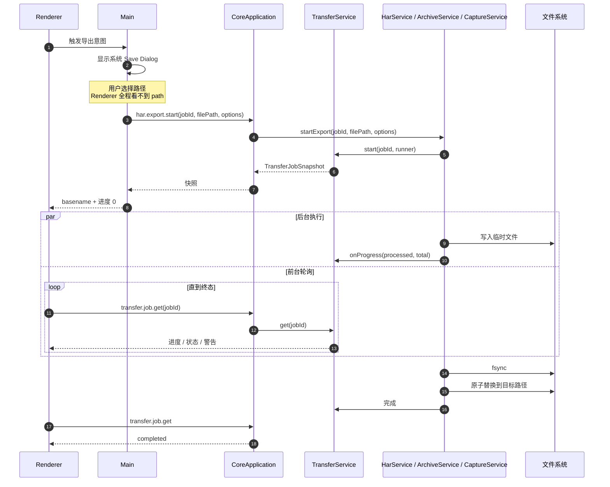
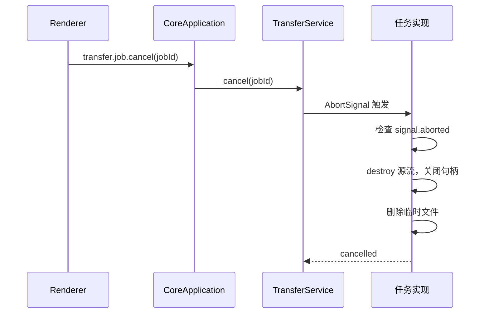
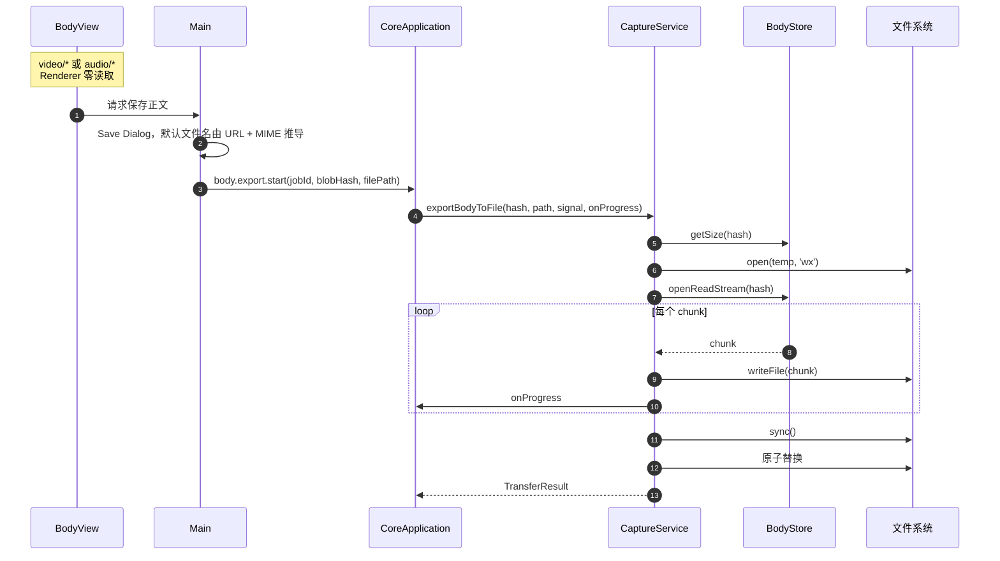

# Feature: Transfer

> Core 模块：`apps/proxy-core/src/proxy-core/transfer/`、`har/`、`archive/`、`capture/entry.ts`
> Renderer 入口：Capture 工作栏的 Import / Export 菜单

## 1. 职责与边界

Transfer 统一承载所有**异步文件任务**：HAR 交换、Native Archive 全保真存档、单个正文导出。

### 导出弹窗警示样式

- HAR限制说明与敏感数据警告使用独立警示区，padding为11px/13px、文字12px、图标15px。
- 说明与敏感警告分别使用黄色、红色状态；脱敏选项、Cancel和任务生命周期由业务控制，不由警示样式决定。

### Import与Export菜单条目

- `FileCommand`由flex容器设置`align-items: center`，依次排列图标、弹性名称和扩展名；菜单宽236px，Flyout内边距7px。
- 名称字号12.5px、字重520、行高16px；条目padding为9px/10px，扩展名padding为2px/6px并带背景和边框。高度包含实际边框，不以位移补偿居中。
- Import/Export分别打开HAR或Archive弹窗，菜单本身不读写文件。

| 归属 | 内容 |
| --- | --- |
| Main 负责 | 系统 Save/Open Dialog，持有真实文件路径 |
| Core 负责 | 流式读写、进度上报、取消、原子替换 |
| Renderer 负责 | 触发意图、轮询快照、展示进度与取消 |

**路径边界**：真实文件路径**只在 Main 与 Core 之间流转**。Renderer 只拿到 basename、进度、状态、警告，永远没有 `path` / `readFile` / `writeFile`。

## 2. 任务类型

| 任务 | 命令 | 用途 |
| --- | --- | --- |
| HAR 导出 | `har.export.start` | 跨工具交换，标准 HAR 1.2 |
| HAR 导入 | `har.import.start` | 载入外部抓包 |
| Archive 导出 | `archive.export.start` | Interceptor 全保真存档 |
| Archive 导入 | `archive.import.start` | 恢复存档 |
| Body 导出 | `body.export.start` | 保存单个正文（大媒体主路径） |
| Diagnostics导出 | `diagnostics.export.start` | 脱敏JSONL记录 |

统一由 `TransferService` 管理，共享 `transfer.job.get` / `transfer.job.cancel`。

任务**全部保留**不淘汰，每个任务持有独立的 `AbortController`；公开快照字段**不含绝对路径**。Core 关闭时先 `cancelAll()`。

`TransferService`以`pendingTransfersById`跟踪尚未结束的操作。`cancelAll()`发出取消后等待实际操作和清理完成，包括已收到取消但仍在释放句柄的任务。`CoreApplication.shutdown()`同时启动传输取消和Proxy停止，等待两者后才释放Capture并发送`stopped`。

## 3. 调用流程

### 3.1 通用任务生命周期



### 3.2 取消



**提交点语义**：Cancel只发出取消请求，`transfer.job.cancel`等待目标任务实际结束后返回原有`TransferJobSnapshot`，不在清理完成前提前返回cancelled。等待期间仍为running，不新增公开状态；操作成功返回表示保存/导入已提交，最终为completed并保留完成通知，即使取消信号已发出。操作抛出该任务取消原因或AbortError并清理后才返回cancelled，真实文件错误仍为failed。Body/HAR在关闭输出句柄后、最终rename前检查取消；Archive原有检查保留。一旦rename成功不得删除正式文件或因迟到取消改记Cancelled。

Cancel命令返回`transfer.job`，等待目标任务的最终结果，不引入第二套公开状态或取消Updates下载。

#### Clear与文件任务

Capture文件任务（Body导出、HAR/Archive导入导出）尚未结束时，`capture.cleanup`由Core返回`conflict`及`retryable: true`，在调用Proxy reset、清空事件队列和删除Capture之前拒绝。拒绝不取消文件任务，不改变录制/转发，也不删除已经保存的文件；任务实际清理结束后才解除限制。Clear先开始时，`captureCleanupInProgress`在整个清理期间阻止新Capture文件任务及重复Clear，`finally`在成功或失败后释放。该限制对UI、Agent和MCP共用的Core命令一致，不依赖Renderer遮罩。Diagnostics导出不读取Capture，不属于这组互斥范围。

### 3.3 Body 导出（大媒体主路径）



### 3.4 Capture Body导出Tool

`capture_export_body`只接受非空`exchangeId`与`bodyId`，身份来自当前Capture的正式查询结果；不接受
文件路径、建议文件名、MIME、编码或由Model指定的jobId。Main意图`capture.body.export`复用现有
Body保存入口与原生Save Dialog，不在Tool层读取正文或实现第二套文件写入。

- Main共享保存方法：IPC与Tool都调用`startBodyExport`，只维护一份原生Dialog、取消和文件任务流程。
    - UI传入已有正文引用，继续支持HTTP、WebSocket、gRPC和断点原文。
    - Tool传入Exchange正文身份，保留对话框前后的归属与Core代际检查。
    - 两种正文目标用明确的`kind`区分，不靠调用来源或缺失字段猜测，不改变Preload API。

- 这是独立的Capture change，遵守Agent/MCP双列授权及Ask/Auto。审批前只从Core读取并验证正文归属，
    影响说明只包含安全身份与存储字节数，不包含完整URL、正文、文件名或本机路径。
- Main在打开Save Dialog前验证当前Exchange与Body归属；选择目标后再次确认身份与Core代际仍有效，
    不在Clear或Core换代后猜测、重建或导出其他正文。默认文件名由UI/Main共用纯函数推导，不接受Model文件信息。
- Deny与预取消不打开Dialog、不创建任务；原生Cancel返回`{ started: false }`。Allow或Auto仍须经过真实
    Save Dialog；选定路径只留在Main/Core，按既有Body导出语义流式保存原始存储字节，不解码、不截断。
- 启动返回`{ started: true, job }`，job只投影现有安全任务字段。启动不等于完成；后续查询/取消复用
    `capture_get_transfer_job`与`capture_cancel_transfer_job`。取消Tool调用不能隐式取消已经接受的文件任务。
- Transcript复用`transferJob`与`exportCanceled`摘要，不回退为包含正文或文件信息的JSON。运行错误保持安全，
    不向Model、审批或Transcript透传文件系统路径与任意错误message。

<a id="archive-tool-acceptance"></a>
### 3.5 Capture Archive Tool

- `capture_export_archive`与`capture_import_archive`均为严格空参数change，分别调用typed Main命令`capture.archive.export`与`capture.archive.import`。
    - 不接受路径、文件名、文件内容、jobId、scope、redaction、replace或Clear参数。
    - Export沿现有整库快照语义保留正文、凭据与原生证据，审批明确提示完整存档不脱敏；不把文件内容发送给Model。
    - Import追加到当前Capture，不覆盖或清空已有数据，不修改现有`.iarchive`格式。
- IPC、Agent、MCP共用`startArchiveExport`/`startArchiveImport`，Main唯一负责原生Save/Open、取消检查及Core任务启动。
    - Deny和预取消不打开Dialog；Allow/Auto仍需原生选择，路径只留在Main/Core。
    - 原生Cancel返回`{ started: false }`；启动返回`{ started: true, job }`，仅含既有安全任务字段，不含文件名、路径、任意message或warnings内容。
    - 调用取消不能隐式取消已接受的文件任务；任务查询/取消仍用`capture_get_transfer_job`与`capture_cancel_transfer_job`。
- Archive导入完成复用既有`captureImported`通知，已挂载Renderer重新查询，不依赖弹窗轮询刷新。
    - Transcript复用`transferJob`、`exportCanceled`和`importCanceled`，不回退原始JSON。

## 4. 原子写入

所有导出遵循同一模式：

```text
1. 写入同目录临时文件（唯一后缀，'wx' 独占创建）
2. 全部写完后 fsync
3. 原子替换到目标路径
4. 失败时销毁流、关闭句柄、删除临时文件
```

Body、HAR、Diagnostics和Archive导出均通过临时文件、`fsync`和直接`rename`覆盖目标。不得先删除旧目标，否则rename失败会使用户原文件丢失。

## 5. 格式约定

### 5.1 HAR

| 项 | 策略 |
| --- | --- |
| 版本 | HAR 1.2 |
| 导出范围 | all / 当前 filter / 选中项 |
| 敏感数据 | 可选遮罩 Authorization、Cookie |
| 正文 | 可选 strip bodies |
| Headers | 只导出最终 wire headers，不含 Rule marker |
| 限制 | 不限制文件、entries、header、URL、body 大小 |

**内存边界**：HAR导出按chunk读取后以`Buffer.concat`合成完整body再做base64编码，大正文可能造成Core OOM；不能把分块读取等同于端到端有界内存。

**编排**：`har/entry.ts` 的 `HarService` 导出时按 `sessions.query` keyset 页枚举 ID，再逐条 detail / body range 转 HAR entry；导入先验证完整的不可信 JSON（`internal/document.ts` 的 `DocumentParser`），再建立隔离 Session、分批写 Blob/Exchange，**失败或取消按 Session cleanup 整体回滚**。

**映射与损失**：HTTP request/response/header/query/content/timings 与 text/base64 body 可互操作。压缩 Response 在导出时先按 gzip/deflate/br 解码，`bodySize` 保持**线上编码大小**，`content.size` / `compression` 表达解码后资源与压缩收益。

以下信息 **HAR 格式无法无损表达**，Core 与 UI 必须明确告警：HTTP/2 pseudo-header、trailer、WebSocket message、TLS 详情、rule history。需要这些内容就用 Native Archive。

不执行脚本/插件或远程内容；只保留 HAR 结构、base64 语法与可映射网络 scheme 的检查。

### 5.2 Native Archive

| 项 | 策略 |
| --- | --- |
| 容器 | 固定格式 ZIP |
| 内容 | 当前 `capture.sqlite` schema 的完整快照 |
| 保真 | `exchange.rule_ids`、`message_headers.rule_id` 完整 round-trip |
| Worker | 按需创建 `archive/worker/entry.cjs`，完成即退出 |
| 批次 | 100 条 Exchange 一批 |
| 校验 | 格式、路径、CRC、size、hash、SQLite 完整性 |

**限制**：不支持 ZIP64；不限制 entry 数、解压总量、压缩比（zip bomb 风险）；不保存完整历史 `RuleDefinition`。

**导出顺序不能变**：`ArchiveService.exportToFile` 先生成 `capture.sqlite` 快照 → 逐个流式写入引用的 Blob（`blobs/<sha256>`）→ **最后**写 `manifest.json`（format / appVersion / createdAt + 每个文件的 path / size / sha256）→ finalize → 原子 rename。manifest 写在最后，因为它要记录前面所有文件的真实 hash。

Archive、Workspace 与 Diagnostics 的 SQLite 均**直接创建当前表结构**，不保留 `user_version`、迁移步骤或旧数据库搬运路径。

### 5.3 快照语义

`createArchiveSnapshot(batchSize)` 在点击时捕获 Exchange 与 body hash 的时间切面。导出期间新增流量不进入本次存档。

## 6. 数据契约

`TransferJobSnapshot`由[Core Protocol](../../packages/core-protocol/src/messages.ts)定义。任务快照用`id`标识身份，`state`区分`running/completed/failed/cancelled`，并携带kind、进度、时间和警告。Renderer只接收basename等公开文件信息，不接收绝对路径；Tool另使用更窄的安全投影。

Renderer 全屏 Loading 在运行期间只提供 Cancel。

## 7. 文件任务Tool契约

<a id="har-tool-acceptance"></a>
### 7.1 HAR

`capture_export_har`与`capture_import_har`分别复用Main的`capture.har.export`和`capture.har.import`，
两者都是独立Capture change，遵守Agent/MCP双列授权与Ask/Auto；不在Tool层解析HAR、读取正文或操作文件路径。

- Export明确要求`scope`与`redaction`。范围保留正式`all`、`filter`和非空`selected.exchangeIds`，各分支
    不接受混合字段；filter仅包含正式协议的host/method/status/mime/appName/search/protocol。
    三个布尔脱敏项authorization/cookies/bodies必须明确提供，不能用缺省参数表达未经说明的数据导出。
- Import参数为空，只有原生Open Dialog可以选择文件；导入沿用Core隔离Session追加和失败/取消回滚，
    不增加隐式Clear、覆盖模式、自动读取路径或文件内容输入。验收文件必须来自同一workflow的产品Export。
- 审批说明仅表达导入/导出意图、范围种类与计数、脱敏选择及原生Dialog要求；不提前打开Dialog，
    不读取本地文件或向审批注入任意文件内容。Deny和预取消不启动任务；原生Cancel返回`{ started: false }`。
- 选定目标后返回`{ started: true, job }`，job只含现有安全任务字段，任务身份由Main生成。任务启动不等于
    导入/导出完成，查询与取消复用正式Transfer Tool。路径、basename、任意message及warnings内容不进入Tool结果。
- 成功导入后的Capture刷新归业务owner：TransferService完成任务后由CoreApplication沿现有`event-batch`
    发布`captureImported`信号，Main/Preload转发，Renderer常驻管线重新查询summaries。失败或取消不通知；
    不依赖某个导入弹窗、Tool任务轮询或页面切换补齐副作用，不把导入当作Clear。
- 导入记录保留原始请求时间。Clear 后的新 Core 查询结果不能再按旧请求时间过滤；
    Clear 前发起的查询由 `syncRevision` 拒绝，迟到的实时事件仍由 `clearedBefore` 拒绝。

### 7.2 查询与取消

`capture_get_transfer_job`与`capture_cancel_transfer_job`分别复用正式`transfer.job.get`和
`transfer.job.cancel`，只接受非空`jobId`。任务身份来自本代Core的产品文件操作，不是本地路径或外部任务队列。

- Get是无审批query；Cancel是独立change，遵守Agent/MCP双列授权和Ask/Auto，Deny/预取消不执行取消命令。
- Transcript共用紧凑任务摘要，先显示本地化状态与进度/警告数量，再显示jobId；不存在的任务有独立空结果，
    不回退为包含文件信息的JSON。真实workflow通过公共摘要类型、任务身份与状态属性验证，不依赖界面语言。
- 两项返回`{ job }`，未知或Core换代后不再存在的身份为`job:null`，不重建、重放或猜测其他任务。返回的job仅含
    `id/kind/state/processed/total/startedAt/completedAt/warningCount`，不包含文件名、路径、任意message或warnings内容。
- Cancel审批读取指定任务，只描述安全身份、种类、当前状态和进度；执行仍按同一jobId进入Core。
    运行中任务进入cancelled并触发原AbortSignal；completed/failed/cancelled任务保持原终态，重复取消幂等。
- Tool取消调用自身与取消文件任务是两种不同意图。执行前撤销Tool不能取消文件任务；已接受的正式取消按原路径
    完成，不由Agent/MCP建立额外worker或假任务。任务查询不影响记录流量或其他并行任务。

## 8. 验收要点

- 目标文件已存在、被占用、只读目录、磁盘满时旧文件永不丢失。
- rename 失败后临时文件可回收。
- Cancel 在提交点前后行为明确且一致。
- HAR正文合并和Archive解压必须区分格式校验与容量限制，不将缺少资源上限描述为具备保护。
- Clear 与进行中导出并发时有确定结果，不静默损坏文件。
- Renderer 全程无法获得绝对路径。

<a id="transfer-historical-evidence"></a>
## 9. 历史验证证据

本节承接`218295b0`原文中的日期、失败、证据索引和适用范围，不重放历史验证。当前取消提交点、Clear互斥与shutdown等待已经定义；旧阶段未覆盖这些能力，只能描述该次验证的范围，不能恢复成当前“未实现”。

Body、任务查询/取消、HAR、Archive的主流程与恢复见[Capture文件规格](../../apps/desktop/tests/e2e-workflow-tests/docs/capture.md)。共享Main方法、部分Tool门禁和目录计数见[能力目录历史](tool-capabilities.md#tool-validation-history)。以下只补这些位置没有完整保留的独有事实。

<a id="transfer-layout-history"></a>
### 9.1 警示、菜单与flex复验（2026-09-11～13）

- 9月11日警示区缺11px/13px padding及12%黄色背景，区域矮24px；修复后HAR明暗各8/8、最大0.6px，进度单测前后4/4和Desktop类型通过，前缀`interceptor-har-warning-20260911*`。
- 菜单32px恢复至当时设计40px，四个明暗菜单24/24、最大0.6px，八组打开/取消与中心检查通过，前缀`interceptor-file-command-20260911*`。动画中3px图标及菜单退出过早断言均属检查时机错误；等待原动画后通过，未修改动画，暂停期没有实际确认导出。
- 原文明确记录9月13日在`11ed3041`上串行HAR/Archive2/2（1.3分钟），四代正常退出、trace和8888/WinINet/journal恢复，证据`interceptor-ui-parity-20260913-transfer-final`。同日“Dialog未关闭”未复现、根因未定，临时诊断未触发后移除，不称driver已修复，也不补造暂停期前置E2E Red。

<a id="2-四类任务"></a>
<a id="transfer-shutdown-history"></a>
### 9.2 关闭等待实际清理（2026-09-14～15）

9月14日Transfer/Core各2例Red、旧19例Green；实现后同组23/23、共享28文件241/241和Core类型通过，当日尚未复跑真实E2E及产物。日志为`interceptor-transfer-shutdown-20260914-{red,green}.log`、`interceptor-streaming-transfer-20260914-{regression,types}.log`。

9月15日Jobs、Body、HAR、Archive分别1/1（44.1/38.6/38.3/47.3秒），八代退出、trace和宿主恢复齐全，索引`interceptor-streaming-acceptance-20260915-evidence.json`；当时按源码hash一致复用产物检查，不替代之后构建。

- 首次Save粘贴空路径、清理时点击已消失按钮，Main/Core `29104/29692`不记正常退出，宿主guard仍完成恢复。
- 重跑Close被遮罩挡到任务完成，`29624/44832`正常退出且正式Archive保留，不是取消提交失败。改用真实Alt+F4通过，没有改产品遮罩或任务结果。
- 新增运行中关闭步骤没有实现前真实E2E Red，不能拿上述fixture失败或最终Green补造。

<a id="transfer-commit-history"></a>
### 9.3 Cancel提交点（2026-09-15）

Transfer迟到取消/确认时机2 Red、Body sync取消/rename后取消2 Red、HAR sync取消1 Red、文件错误不被取消掩盖1 Red之后，最终13文件102/102与Core类型通过。日志为`interceptor-transfer-commit-20260915-{unit-red,files-red,har-red,failure-red,regression,core-types}.log`。

真实基线1/1（31.4秒），修改后Jobs/Body/HAR/Archive各1/1（42.2/30.4/36.5/46.0秒）、八代正常退出并恢复宿主。确定性sync/rename竞争由业务测试控制，正常E2E不算该竞态的真实Red。

该次重新package/audit为1,294文件/392,970,273字节，17个可签名文件因无证书仍unsigned，smoke1/1（36.3秒），不等于正式签名验收。

<a id="transfer-audit-reuse-history"></a>
### 9.4 任务Tool的审计复用（2026-09-07）

package/audit日志为`interceptor-transfer-delivery-{package,artifact-audit}-20260907.log`。线上production audit被执行策略阻止后，核对相对`e9634c46`的锁文件、各workspace依赖、npm配置和补丁均未变化，复用同日00:19的`interceptor-diagnostics-production-audit.log`零漏洞结果。

当时锁文件SHA-256为`89E81A450D711A5B12378F10FAA4F205919D2A2A01B620BE630CD3B7EAF76399`。这是历史复用依据，不是本轮重新查询漏洞数据库；真实MCP关联与产物主结果已在[任务规格](../../apps/desktop/tests/e2e-workflow-tests/docs/capture.md#capture-tools-transfer-jobs)保留。

<a id="92-capture-body导出验收"></a>
### 9.5 Body导出证据索引（2026-09-07）

- executor13项、摘要5项Red分别为`interceptor-body-export-{executor-red,summary-red}-20260907.log`。13:59:11的`interceptor-body-export-e2e-red-20260907-135911`因缺失Tool失败，但`maxFailures=1`附加提前停止报告；确认轮只取消该限制，未改变业务断言。
- 默认文件名移动前后Capture Store24/24；Desktop/MCP首次全量只有旧目录预期失败，修正后完整Green。
- Body六视图36/36最大0.5px、Settings四视图58/58最大0.6px，均无missing/flagged。分项与原图备份为`interceptor-body-export-{parity,settings-parity,shots-before}-20260907`。
- 产物日志为`interceptor-body-export-{package,artifact-audit}-20260907.log`，实际production audit为`interceptor-body-export-production-audit-20260907.json`。

确认Red、完整文件字节/hash、主Green与八代关联恢复已由[Body规格](../../apps/desktop/tests/e2e-workflow-tests/docs/capture.md#capture-tools-body-export)承接。该组不外推为并行Playground重构、TLS清理或当时未验的长期文件竞态。

<a id="transfer-har-history"></a>
### 9.6 HAR证据索引（2026-09-07）

executor33项缺失Tool Red、真实discovery Red（Main/Core `28348/20048`正常退出）、摘要4项通用JSON回退Red、缺完成通知及Clear误滤历史导入记录Red分别保留：

- `interceptor-har-tools-{executor-red,summary-red,consumers}-20260907.log`与`interceptor-har-tools-e2e-red-20260907`。
- `interceptor-har-{import-signal-red,import-historical-rows-red,import-notification-tests,all-typecheck,design-regression}-20260907.log`。

修复后Main原生入口10/10、摘要46项、Capture25/25通过；HAR十二视图72/72最大0.5px、Settings四视图58/58最大0.6px，报告为`interceptor-har-{parity,settings-parity}-20260907`。新增十二张HAR图并更新目录图，未覆盖旧全量parity报告。

Windows package/audit、实际production audit0及18:39:06 smoke1/1（44.3秒）的索引为`interceptor-har-delivery-{package,artifact-audit}-20260907.log`、`interceptor-har-delivery-production-audit-20260907.json`、`interceptor-har-delivery-smoke-20260907-183906`。当时未验大HAR内存、运行中Clear保护与提交点竞争，不据此否定后续已定义的语义；共享流程、16:29:43失败和最终恢复见[HAR规格](../../apps/desktop/tests/e2e-workflow-tests/docs/capture.md#capture-tools-har-transfer)与[能力目录](tool-capabilities.md#tool-validation-history)。

<a id="transfer-archive-history"></a>
### 9.7 Archive证据索引（2026-09-07）

executor16项、摘要4项Red后摘要50/50。日志为`interceptor-archive-tools-{executor-red,summary-red}-20260907.log`，下面两个名称含green的运行均不代表通过：

- `interceptor-archive-tools-e2e-green-20260907-194733`：summary误用不存在的url字段、源码明文常量触发trace审计失败。
- `interceptor-archive-tools-workflow-green-20260907-194931`：等待未挂载Dialog ID，过早读取文件。只改为正式path、分段测试文本和实际显示的关闭按钮，没有修改产品、关闭审计或增加后门。

19:54:55关联运行中Capture/MCP Browser/MCP Desktop三条有效Green，Settings仍按106开关断言实际110而失败；19:56:51修正后Settings1/1（27.6秒）。前三条的五个App代际与Settings三代均正常退出并恢复宿主，分别为`interceptor-archive-related-e2e-20260907-195455`、`interceptor-archive-settings-green-20260907-195651`。

HAR/Archive144目标与Settings58目标两份parity为`interceptor-archive-har-parity-20260907-200245`、`interceptor-archive-settings-parity-20260907-200635`；package/audit日志为`interceptor-archive-{package,artifact-audit}-20260907.log`，20:08:00 smoke1/1（47.0秒）为`interceptor-archive-smoke-20260907-200800`。

主49秒流程、HTTP/WS恢复、2/4/6/8/10追加与退出已在[Archive规格](../../apps/desktop/tests/e2e-workflow-tests/docs/capture.md#capture-tools-archive-transfer)保存；202/202总parity、产物计数和复用HAR审计见[能力目录历史](tool-capabilities.md#tool-validation-history)。旧组未覆盖的TLS/macOS/文件竞态不作为当前未实现结论。
