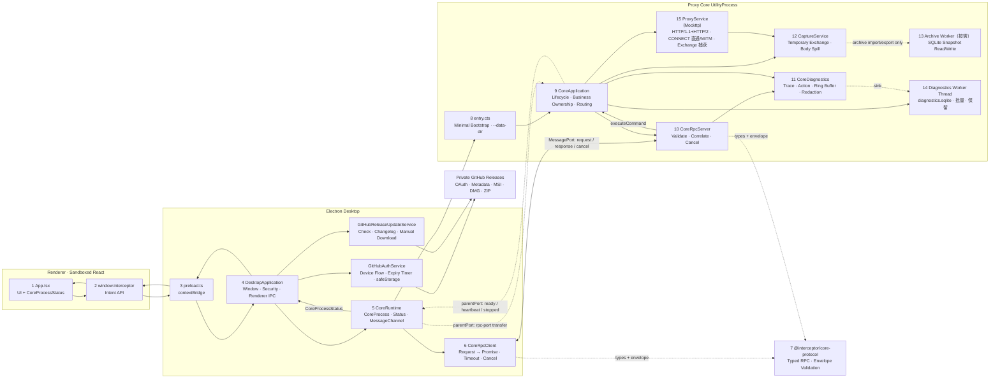

# 平台架构：进程与通信

> 最后更新：2026-08-07
> 范围：只描述已经实现并验证的代码。本文覆盖跨 feature 的进程边界、两条通道、故障分类与关键数据结构；
> feature 级别的设计见 [../README.md](../README.md) 索引的各 feature 文档。

## 1. 进程拓扑

## 2. 两条独立通道

Main 与 Core 之间有两条职责不重叠的通道，不能互相代偿。

### 2.1 生命周期通道：`UtilityProcess.parentPort`

只承载：

- `ready`：Core 入口已启动；
- `heartbeat`：Core Event Loop 仍可调度；
- `rpc-port`：Main 向 Core 转交业务 MessagePort；
- `shutdown` / `stopped`：优雅关闭。

heartbeat 只更新最后活跃时间供诊断观察，**不触发状态变化、kill 或重启**，避免长请求、大正文或 GC 被误判为进程死亡。首个 `ready` 前保留 30 秒启动窗口；ready 后只有真实进程退出或 MessagePort remote-close 会进入恢复。`CoreProcessStatus.running` 不代表 HTTP Listener 等业务一定健康。

### 2.2 RPC 通道：专用 `MessagePort`

只承载：

- Request：`protocolVersion + requestId + traceId + command`；
- Response：匹配 ID 的 Success 或结构化 Error；
- Cancel：timeout、AbortSignal 或调用方取消。

Main/Core 同包发布，MessagePort 会暂存 listener 注册前到达的消息，所以没有额外 channel init/ready 握手、Token 或跨版本协商状态机。每条 Request 自带 `protocolVersion`，不兼容消息由 validator 直接拒绝。

## 3. 故障分类与重启策略

Main/Core 通信严格区分四类状态，**单条业务数据或请求失败不得升级为通道或进程故障**：

| 分类 | 定义 | 处理 | 是否重启 Core |
| --- | --- | --- | --- |
| 数据错误 | 单个 `event-batch` 无法消费，或 Core 产出的单条消息信封不可解析 | 丢弃该消息；可关联 batch 仍发送 ack；记录诊断 | 否 |
| 请求错误 | 单个 request 信封可关联，但 command 无法执行；或 response 与 request 的 trace/result type 不匹配 | 只返回/拒绝该 request 的结构化错误；连接继续服务后续请求 | 否 |
| 通道错误 | MessagePort 真实 `remote-close`，或 `postMessage` 发送失败 | Core 以 code 1 退出；Main 从进程退出路径恢复 | 是 |
| 进程错误 | Core 启动失败、异常退出、启动期无 ready | Main 按 startup deadline 与指数退避恢复；fatal 组合根启动失败停止重试并提示 | 是（fatal 启动失败除外） |

`CoreRpcClient` / `CoreRpcServer` 只运行时校验 RPC 信封、协议版本、request/trace/batch 关联字段与 result type；Renderer、Main、Core 同包同版本，command/result/event payload 由 TypeScript 契约负责，**不做运行时长度、数量、枚举或内容校验**。捕获的 URL、path、headers、MIME、status text 与 Body 在 Core 存储/导出边界不截断。

持久化 TLS passthrough 名单与当前运行名单不同时，Renderer 可请求 `app:restart`。packaged Main 先
经过 guarded shutdown，恢复系统代理并停止 Core；仅清理成功后才调用 `app.relaunch()`，清理失败会
取消 relaunch 并保持当前应用运行。Forge 开发态不能 relaunch Electron：Forge 父进程会随旧 Electron
退出并关闭 Vite，导致新 Renderer 加载失效的 localhost URL。开发态因此保留 Main/Renderer/Vite，调用
`CoreRuntime.restart()` 优雅替换 CoreProcess；长期状态/ready listener 保留，新代完成 TLS 与上游初始化
后才发布 running，Capture bootstrap 随后重建 listener。TLS ready 初始化失败保持同一 Core PID 为
running 并记录 detail，不 kill/restart；shutdown timeout 强杀属于 operator shutdown，不是故障恢复。

## 4. Workflow 详细表

| # | Workflow | 发起方 → 接收方 | 数据/调用 | 代码位置 | 成功结果 | 失败与清理 |
| ---: | --- | --- | --- | --- | --- | --- |
| 1 | Desktop 启动 | Electron → `DesktopApplication` | `app.whenReady()` | `apps/desktop/src/main/main.ts` | 配置安全、IPC、CoreRuntime，并创建窗口 | app 未 ready 前不创建 CoreProcess/窗口 |
| 2 | 配置安全边界 | `DesktopApplication` → Electron Session/WebContents | permission、webview、navigation、download + packaged protocol handlers | `main.ts`、`security/{trusted-renderer-url,packaged-renderer-protocol}.ts` | Renderer 只加载可信 Dev origin 或 `interceptor://app/index.html`；permission 仅放开 clipboard 读写供复制 | 非可信 authority/path/navigation/下载与其余权限被拒绝 |
| 3 | 启动 CoreProcess | `DesktopApplication` → `CoreRuntime` | `start()` | `main.ts`、`core-runtime.ts` | CoreRuntime 调用 `startCoreProcess` | fork 抛错时进入退避重启 |
| 4 | fork CoreProcess | `CoreRuntime` → Electron | `utilityProcess.fork(entry.cjs)` | `core-runtime.ts` | CoreRuntime 独占当前 `CoreProcessHandle`、状态和关闭流程 | 初始化失败时 kill CoreProcess 并进入重启 |
| 5 | 创建 RPC 通道 | `CoreRuntime` → Main/CoreProcess | `new MessageChannelMain()`、`coreProcess.postMessage({type:'rpc-port'}, [port2])` | `core-runtime.ts` | `port1` 附加到内部 `CoreRpcClient`，CoreProcess 接收 `port2` | transfer/attach 失败时关闭 port、client 和 CoreProcess |
| 6 | CoreProcess bootstrap | Electron → `entry.cts` | `process.parentPort` | `entry.cts` | `new CoreApplication(parentPort).start()` | 无 parentPort 时输出错误并非零退出 |
| 7 | CoreProcess 生命周期启动 | `CoreApplication` → parentPort | `ready` + 首个 `heartbeat` | `core-application.ts` | Main 状态变为 `running`，随后每秒 heartbeat | parentPort 故障最终表现为 heartbeat timeout/exit |
| 8 | Renderer 获取 CoreProcess 状态 | Renderer → Preload → Main | `getCoreProcessStatus()` | `App.tsx`、`preload.ts`、`main.ts` | 返回只读 `CoreProcessStatus` | IPC 失败时 UI 标记 `unresponsive` |
| 9 | Renderer 订阅 CoreProcess 状态 | Main → Preload → Renderer | `core:process-status` | `core-runtime.ts`、`main.ts`、`preload.ts`、`App.tsx` | UI 显示 running/restarting/unresponsive/stopping | CoreRuntime.stop 清空状态 listeners；Renderer cleanup 移除 ipcRenderer listener |
| 10 | 发起业务命令 | Renderer → Main | `echoCore(value)` / `getCoreTrace(traceId)` | `desktop-api.ts`、`preload.ts`、`main.ts` | Main 只校验可信 sender，payload 原样构造 typed command | 非可信 sender 拒绝；payload 问题只影响该 request |
| 11 | RPC Request→Promise | Main → `CoreRuntime` → `CoreRpcClient` | `request(command, options)` | `core-runtime.ts`、`core-rpc-client.ts` | 生成 requestId/traceId，注册 `PendingRpcRequest` 并发送 | 无连接、duplicate ID 或 postMessage 失败时 Promise reject |
| 12 | RPC 信封解析 | MessagePort → `CoreRpcServer` | `parseMainToCoreMessage(raw)` | `core-rpc-server.ts`、`core-protocol/validation.ts` | 校验 kind/version/requestId/traceId/type | 非法消息丢弃或返回该 request 错误；连接与进程不变 |
| 13 | command 调度 | `CoreRpcServer` → `CoreApplication` | `executeCommand(command, signal)` | `core-rpc-server.ts`、`core-application.ts` | echo/diagnostics 返回 typed result | 未实现 command 返回 `unsupported-command`；异常转为 `internal` |
| 14 | 结构化日志 | RpcServer/Application → `CoreDiagnostics` | command lifecycle + action | `core-diagnostics.ts` | traceId 下记录 received/validated/handler/action/response/completed | sink 同步/异步失败回退 stderr；日志不得使 command 失败 |
| 15 | RPC Response→Promise | Core → Main | Success/Error Response | `core-rpc-server.ts`、`core-rpc-client.ts` | requestId/traceId/result type 匹配后完成 Promise | mismatch 只拒绝该 request；late response 忽略 |
| 16 | explicit timeout/cancel | Caller → Main → Core | `cancel` + AbortController | `PendingRpcRequest`、`CoreRpcServer` | 只有调用方显式 timeout/abort 才取消；无默认业务 timeout | Cancel 发送失败时本地 Promise 仍清理 |
| 17 | CoreProcess heartbeat 观测 | `CoreApplication` → `CoreRuntime` | 每秒 heartbeat；首个 ready 前 30 秒启动期限 | `core-application.ts`、`core-runtime.ts` | ready 后只更新 lastHeartbeatAt | 运行期暂停 heartbeat 不改变状态或重启 |
| 18 | CoreProcess restart | OS/CoreProcess → `CoreRuntime` | `exit(code)` → backoff → new fork/port | `core-runtime.ts` | 新 PID、新 MessagePort，后续 RPC 正常 | 旧 port 上 pending Promise 被内部 `CoreRpcClient` 拒绝 |
| 19 | graceful shutdown / user restart | Renderer/Electron → DesktopApplication → CoreRuntime/CoreApplication | `app:quit` / `app:restart`、`before-quit`、`shutdown`、`stopped` | `desktop-api.ts`、`preload.ts`、`main.ts`、`core-runtime.ts`、`core-application.ts` | packaged 恢复系统代理并停止 Core 后 relaunch；Forge 开发态保留 Vite/窗口并优雅替换 Core 代际 | 清理期间重复 quit 仍被拦截；packaged 恢复失败取消 relaunch；开发态等待新 Core 初始化完成；Core 停止超过 1.5 秒则 force kill |
| 20 | build/package/runtime | npm → esbuild → Forge → package/maker | 0-map Core + native helper → ASAR/extraResource → strict Fuses → sign → MSI/DMG/ZIP | root scripts、`proxy-core/build.mjs`、`forge.config.ts`、installer tests | package audit + packaged workflow smoke + platform installer smoke | 缺 tool/凭据、资源泄漏、Fuse 漂移、安装/升级失败均使门禁失败 |
| 21 | GitHub Device Flow 与 token 刷新 | Renderer → Preload → Main → GitHub OAuth | get/signIn/open/signOut + auth status；启动 refresh；access 到期前 5 分钟 refresh | `desktop-api.ts`、`preload.ts`、`main.ts`、`updates/github-auth-service.ts`、Settings Updates | token/过期时间经 safeStorage 加密；每次成功轮换整组 token 并重排单 timer；Renderer 只见公开账号和设备码状态 | refresh token 缺失、过期或非退出刷新失败即删本地登录；退出取消 timer；无 client secret/private key |
| 22 | 检查并手动下载私有更新 | Renderer → Preload → Main → GitHub Releases | get/check/download/openDownloaded + status event | `desktop-api.ts`、`preload.ts`、`main.ts`、`updates/github-release-update-service.ts`、Settings Updates | Bearer 读取固定仓库；app 内 changelog/进度；完整安装包原子落盘后由系统打开 | 非 stable、外域/Asset API/架构/size/hash 错误拒绝；失败清 `.part` 且当前应用不变 |
| 23 | TLS compatibility 全局处理 | Core → Main → App shell → Core | ACK event batch → `tls:compatibility` → global list dialog → get/replace settings | `proxy/entry.ts`、`core-rpc-server.ts`、`main.ts`、`tlsCompatibilityStore.ts`、`TlsCompatibilityDialog.tsx` | 任意工作区按 host 累积去重事件；Add all hosts 一次 revision replace 后导航 TLS Settings，已挂载面板由 change sequence 立即刷新 | wildcard 已覆盖的 host 不重复写；保存失败保留 dialog；保存旧批次期间到达的新事件不被旧完成路径清除；异步旧 load 不覆盖新名单 |

## 5. 关键数据结构

| 数据 | 定义位置 | 用途 |
| --- | --- | --- |
| `CoreProcessStatus` | `apps/desktop/src/shared/desktop-api.ts` | Renderer 可见的 CoreProcess 状态；`running` 仅代表 heartbeat 正常 |
| `GitHubAuthStatus` | `apps/desktop/src/shared/desktop-api.ts` | Renderer 可见的无凭据授权状态；token 与绝对过期时间只在 Main 密文中 |
| `CoreCommand` | `packages/core-protocol/src/messages.ts` | Main → Core 的 typed command union |
| `CoreResultForCommand<T>` | `packages/core-protocol/src/messages.ts` | 编译期保证 command/result 配对 |
| `CoreRequest` / Response / Cancel | `packages/core-protocol/src/messages.ts` | MessagePort RPC envelope |
| `CoreError` | `packages/core-protocol/src/messages.ts` | invalid/unsupported/timeout/cancelled/disconnected/conflict/internal |
| `DiagnosticLogRecord` | `packages/core-protocol/src/messages.ts` | core/main/renderer 来源、Trace/Action/Duration/Outcome 的结构化日志 |
| `CaptureStatusResult` / `CaptureUsage` | `core-protocol/src/messages.ts`、`desktop/src/shared/desktop-api.ts` | 存储用量（会话/Exchange/Body 计数、DB/Blob/总量；无配额） |
| `ExchangeInput` / `SessionQuery` | `apps/proxy-core/src/proxy-core/capture/interfaces/index.ts` | Core 内部抓包域类型；不跨进程，不复用 core-protocol |
| `TransferJobSnapshot` | `packages/core-protocol/src/messages.ts` | HAR/native 文件任务的有限公开状态；不含绝对路径 |
| `ClientAppIdentity` | `packages/core-protocol/src/messages.ts` | 客户端应用身份（id/name/path）；随 `event-batch` 只到 Main，path 不进 Renderer，系统权限进程的 path 为空 |

## 6. 扩展规则

- Capture 与 Proxy 由 `CoreApplication` 统一拥有，不要把业务逻辑放入 `CoreRpcServer`。
- Capture Event 使用无淘汰合并队列、批处理、背压和 sequence/ack。
- `CoreRuntime` 是 Main 唯一的 Core 入口；`CoreRpcClient` 只作为其内部 RPC 状态机（含事件批接收 + 回 ack）。
- `CoreProcessStatus.running` 不得描述为"业务健康"。
- Main 不搬运 Body；Renderer 经 `body.read-range` 按需读取完整正文，header/body 不进入 Renderer 全局状态。
- Renderer API 继续面向意图，不暴露通用 IPC、MessagePort 或 Node 原语。
