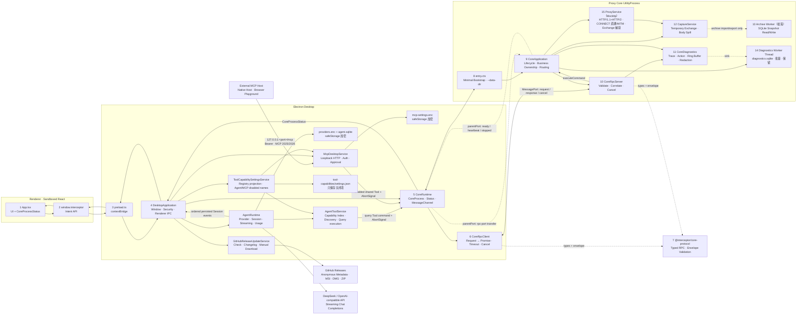

# 平台架构：进程与通信

> 范围：跨feature的进程边界、两条通信通道、故障分类与关键数据结构；
> feature 级别的设计见 [../README.md](../README.md) 索引的各 feature 文档。

## 1. 进程拓扑

`PlatformCapabilitiesService`来自内部`@interceptor/platform-capabilities`，系统代理、证书与helper业务仍在Main进程执行。Main只注入资源目录、safeStorage、typed `requestCore`与`getCoreProcessState`、DiagnosticsRecorder及通知；package不导入Main、Core应用入口或Electron。Core仅通过独立client-app子入口读取原生应用归属，缓存和Capture关联不搬迁。平台DTO在Desktop API中仅作type导出，Renderer不加载平台运行时代码。

上游配置通过`getUpstreamSettings / applyUpstreamSettings`窄Preload API进入Main，IPC继续校验Renderer发送者。
`SystemProxyService`统一解析已选模式、处理互斥和广播变化；Core通过`upstream.applySettings`先预检PAC，
再保存Workspace偏好并更新后续请求的路由。helper只提供原生网络信息和系统代理读写，不转发业务HTTP。
Core ready屏障内RPC已可用，不能因生命周期尚未公开running而跳过已有listener的上游下发。
若listener尚未启动，Capture bootstrap在启动后仍调用Main的幂等Enable；OS owned只表示系统归属，
不代表新Core已经配置路线。Main在已owned分支应用上游但不重复写系统配置，进入running后通知Renderer刷新。
`system-proxy.read-discovery`为无参数只读入口，返回主网络搜索域及缓存DHCP 252；实际系统WPAD、
DHCP和端到端验收仍按Settings的能力边界跟踪，不把读取缓存视为主动发现已验证。

`CoreApplication`拥有唯一的[Http2ClientService](../../apps/proxy-core/src/proxy-core/http2-client/README.md)，
只在本Core代际运行时观察其出站TLS/H2客户端，包括Mockttp与Composer。通过Node公开channel与
`allowHalfOpen`保留TLS EOF后未排空的响应；真实截断显式失败，不消费正文或替换依赖内部方法。
Core停止时注销订阅、取消待执行检查并等待已观察session关闭，再发送`stopped`；Main、Renderer、入站
server session和只握手TLS探测不受该策略管理。

`AgentRuntime` 是 Main 内长期存活的 Agent domain 组合根，拥有 Provider registry、Credential、Session、Turn、
History、Context、Usage、Streaming 请求与有序事件。Main 只注册可信 Renderer intent、注入 `userData`、
`safeStorage`、`fetch`与动态`AgentToolSource`，并把已持久化的 Session event 广播给 Renderer。
`AgentToolService`把共享registry、Tool开关与`CoreRuntime`组合成Capability Index、`discover_tools`，以及按
Capture、Rules、Composer、Breakpoints、Diagnostics、Settings所有权分组的业务Tool；当前数量见
[唯一能力目录](../features/tool-capabilities.md)。共享host的`invoke`只执行Core命令，`invokeMain`只执行typed Main命令。Settings的四项Main状态查询经
`DesktopApplication`既有Action Gate进入CoreRuntime/SystemProxy/Certificate/AppContainer正式owner，
两项TLS查询沿用Core RPC；Tool结果白名单不包含本机路径、私钥或完整系统代理配置。
证书生成、安装、卸载、删除、定位和查看的IPC/Agent/MCP共用`DesktopApplication`的对应方法。
生成前检查当前CA未受信任；删除先卸载当前信任。四项状态变更完成Core同步后广播既有`tlsSettingsChanged`，
已挂载面板重读正式状态；Tool只投影公开身份和信任字段，定位/查看仅返回`requested`，路径只由Main使用。
证书Tool的参数与副作用边界见[证书契约](../features/settings.md#certificate-tool-acceptance)。
`capture.body.export`由Main验证当前Exchange/Body归属与Core代际，再经原生Save Dialog和既有
`body.export.start`保存完整编码字节；对话框返回后重新确认身份，路径只在Main/Core内流转。UI与Tool共用
文件名推导和任务启动，Tool只返回安全任务摘要，不读取正文、不增加Preload API或第二套文件写入。

gRPC在途消息载荷经`window.interceptor.readGrpcBody({ exchangeId, side, offset, length })`进入可信Renderer校验后的`grpc:read-range` IPC，再由`CoreRuntime`转`grpc.read-range`。Core只从Capture已有的Exchange/side返回当前可读range；Renderer仍按1 MiB分块、5 MiB预览上限读取，不接触路径或完整stream。该入口不自动注册MCP/Agent Tool，完成态的hash读取与Save接口保持不变。

- HAR的IPC、MCP和Agent调用同一`startHarExport`或`startHarImport`，路径只来自原生Save/Open Dialog。
- 语言、主题和导出隐私的IPC/Agent/MCP共用`UiPreferencesService.setLanguage/setTheme/setExportPrivacyDefaults`。
  - Main只保存待执行请求及生命周期；Renderer的`UiPreferencesActions`常驻串行领取、应用并写入既有localStorage，再回传窄确认，Main通知其他Renderer。
  - 领取前取消使晚到请求无效，领取后完成已开始的提交；窗口关闭/Renderer退出清理所有pending。请求与响应都在Main校验，不暴露执行脚本、任意Store或存储路径接口。
  - `setUiLanguage`、`setUiTheme`、`setExportPrivacyDefaults`及领取/确认/请求/完成事件构成窄Preload API，只有前三项设置意图注册为Tool。[偏好契约](../features/settings.md#ui-preferences-acceptance)。
- AppContainer单项/批量启停的IPC/Agent/MCP共用`DesktopApplication.enableAppContainer/disableAppContainer/enableAllAppContainers/disableAllAppContainers`。
  - Main调用PlatformCapabilitiesService，所属AppContainerService执行提权helper和读回验证，完成后通知Main广播`app-container:changed`；调用方取消只在进入平台前检查。
  - `onAppContainersChanged`只提供变更订阅；Renderer重读正式列表并按请求序号拒绝迟到结果，原生授权、退出后保留exemption的语义不变。
  - 四项Tool仅返回公开AppContainer字段，不包含helper路径、binaries、workingDirectory或完整原始exemption集合。[AppContainer契约](../features/settings.md#app-container-tool-acceptance)。
- `TransferService`在HAR/Archive导入成功后通知`CoreApplication`，后者通过`event-batch.captureImported`发送信号。
  - Main和Preload转发给`onCaptureImported`，Renderer常驻`useCaptureData`重新查询summaries。
  - 发送失败时Core保留待发送信号；失败、取消的文件任务不发成功通知。
  - 导入弹窗不再负责刷新，通知不含文件内容或路径。
- Clear前的旧查询仍由`syncRevision`拒绝，迟到实时事件仍由`clearedBefore`拒绝；当前Core查询允许返回历史时间的导入记录。

系统代理Enable/Restore由UI与Tool经Main直接调用同一PlatformCapabilitiesService方法，SystemProxyService拥有操作状态、
native写入、upstream同步与必要恢复。平台API不接收AbortSignal；调用前可取消，已开始的操作完整收尾，冲突立即拒绝而不排队。
冷启动自动接管及退出恢复路径不变。
每次Model Call与每项Tool执行前都重取
快照；产生当前响应时披露的集合继续约束该响应，执行时已关闭的Tool返回`unknown_tool`，不触达Core。
直接调用Core的业务Tool仍将`AbortSignal`传入Core RPC取消链路；平台操作不传signal，Main不在owner成功返回后追加取消检查。
Collection/Rules普通UI导入不造占位controller，Agent/MCP才传真实signal。Session持久化`ask/auto`与审批状态；Main把Agent或产品UI
产生的CaptureStatus统一广播给Renderer，避免Agent修改Core后Capture控件保留旧状态。
产品按钮、Agent或MCP完成`capture.cleanup(all)`后，Main还会广播同一个带`clearedBefore`时间边界的
`capture:reset`事件。Renderer常驻Capture管线据此同步清空rows、selection、facet派生状态与Rules hits，并以
现有`syncRevision`和时间边界拒绝旧分页/事件回填；业务入口不各自维护第二套clear逻辑。
Agent或MCP完成`rules.replace`后，Main广播`rules:changed { revision }`；产品UI保存则只通知其他Renderer窗口。
clean Rules Store按最新revision重载，dirty/saving Store保留草稿并进入conflict；提交快照、最高外部revision与加载序列
分别防止保存期间编辑被误判clean、低revision事件重入和旧异步响应回退。

`ToolCapabilitySettingsService`是Main内全局Agent/MCP Tool开关owner，从`@interceptor/tools`的同一可执行registry
投影六个feature Settings目录，只把两组关闭名称原子写入`<userData>/tool-capabilities/settings.json`。fresh profile与
全开状态不保留文件；当前快照已驱动Agent Capability Index、discovery、schema与执行前检查，MCP `tools/list`
和`tools/call`也在每次请求前读取同一快照。

`McpDesktopService`是Main内唯一外部MCP入口。用户显式开启后，它只在`127.0.0.1`创建独立高位端口的
Streamable HTTP listener，不复用代理端口`8888`。每个Client的Bearer token、label与`ask` / `auto`经
`safeStorage`整体加密；启停和app重启不轮换Token，只有用户手动重新生成或撤销才失效。Main逐请求认证、
对Browser提供标准CORS；Origin与Host都不参与身份判断。Main只处理`/mcp`路由、无凭据preflight与Bearer，
认证成功后原样交给`@interceptor/mcp-server`官方SDK handler与共享Tool registry；`legacy: 'stateless'`
复用同一factory处理2025与2026协议，不新增业务实现或Session。2025单次取消由SDK公开通知handler解析，
按认证Client/协议/request ID转交原有AbortSignal；HTTP取消关联保留到响应流结束。`apps/playground`
是独立Web人工验收工具，不进入Desktop包；Browser直接访问MCP，Node
Traffic Lab使用显式`127.0.0.1:8888`产生可观测H1场景。

### 1.1 系统代理进程边界

| 进程或边界 | 允许的职责 | 禁止的职责 |
| --- | --- | --- |
| Renderer / Preload | 发送 Enable、Restore、Status 意图并显示结果 | 直接访问系统代理、journal 或 native helper |
| `DesktopApplication`（Electron Main） | 持有一个readonly平台对象并直接调用方法，管理App/Core生命周期、转发通知与展示error | 持有子service或重复实现平台操作、互斥、upstream与恢复步骤 |
| `PlatformCapabilitiesService`及所属module（Main进程） | private组装各module；SystemProxyService管理操作状态、journal、upstream与必要恢复，CertificateService管理材料/信任/Core同步 | 集中维护所有组busy副本、排队或重放被拒绝的用户请求、向Renderer或日志泄露原始快照 |
| Proxy Core UtilityProcess | 监听8888并按 Main 下发的 upstream 转发 | 修改系统代理、读取 journal、决定恢复目标 |
| native helper | Windows执行一次原生读写；macOS常驻root服务认证生产App/开发UID，只执行固定代理/公开证书存取；同一二进制的普通用户前台入口执行trust/untrust并请求系统确认 | 保存第二份系统代理original/journal、修改授权规则、决定接管时机、接收CA私钥或通用shell |
| E2E runner | 在产品外记录测试进程 PID+启动时间，并在失败后保护宿主 | 把测试进程身份写入产品 journal 或协议 |

Windows 使用 `%LOCALAPPDATA%/Interceptor/system-proxy/journal.json`，现有`version/original/owned`契约不变。
macOS 使用`~/Library/Application Support/Interceptor Platform/system-proxy/journal.json`，只保存`original/owned/effectiveProxies`，无版本或迁移分支。
`effectiveProxies`是接管前系统生效代理；原service快照负责恢复。产品只考虑单App，不复制owner或业务journal。
两端恢复记录都与profile分离；macOS目录也避开默认Interceptor profile。

用户Enable/Restore冲突立即返回当前operation，不留请求；Core故障由SystemProxyService
合并必要恢复，等待已开始的操作明确结算。正常退出先询问平台是否仍忙，忙时拒绝本次Quit且不自动重放；允许退出后
通过Action Gate拒绝新IPC、排空已接受命令，再调用平台stop恢复代理。完整参与者、当场比较表、正常启动、崩溃重启、正常退出、启动失败与
Core 故障时序见 [../features/settings.md](../features/settings.md) §3.2。

macOS Main在窗口显示后调用`PlatformCapabilitiesService.prepare()`，内部顺序执行helper准备、代理恢复和共享CA准备；按真实`app.isPackaged`选择生产或开发socket。首次部署/新增授权由同包helper请求系统确认，只部署helper、root配置和launchd；App不搬迁。开发按核准UID复用，生产保持App身份/资源/运行时检查，不失败回退。证书导入/删除走常驻服务；trust/untrust直接启动同一helper的普通用户前台入口，由系统确认，不存在后台trust命令、规则修改或授权规则journal。CA私钥不交给helper。协议见[平台模块](../../packages/platform-capabilities/README.md)。

生产完整资源校验使用同一受保护helper的短生命周期只读`verify-code-signature`子进程，避免常驻服务内已观测到的Security扫描/内存回收尾延迟。常驻服务仍核验socket调用者和运行时保护，等待子进程完整验证成功后才执行系统写入并记录结束；子进程失败拒绝原请求。未减少strict/nested/all-architectures检查，未缓存信任或延长30秒期限，该CLI不开放给socket调用方。

CaptureStatus的recording事实不直接等于系统路由就绪；Renderer接收记录事件后确认代理owned且未失权，Stop、代理失权或Core换代使迟到查询失效。Core故障期间不会仅因新listener已记录而提前显示Recording；平台module操作完成和原生条件写成功才是代理接管依据。

每条真实 Electron workflow 和 packaged smoke 均由外层宿主 guard 保存、恢复并复核完整 WinINet、crash
journal、测试进程树和8888 listener。宿主恢复检查与功能行为验收分别进行，不能互相替代。

### 1.2 平台数据与profile边界

- profile外：OS代理配置、系统公开CA和系统信任；macOS安装的helper/launchd/授权配置；两端随App交付的native资源。Windows恢复journal另在用户级固定目录。
- 两端profile内：Workspace规则/集合/TLS名单/MITM意图，Agent/MCP配置与凭据，Tool授权、Renderer偏好和诊断数据。Capture属于当前Core代际，不跨profile共享。
- CA材料保存在用户级共享目录，Main先显示启动页，再由平台prepare完成原生组件/代理恢复、材料校验与按需授信；Core重启只同步材料/MITM意图，普通退出不删除。
- 两端具体路径、能力和原生差异见[平台归属](../../packages/platform-capabilities/README.md#业务边界)。

## 2. 两条独立通道

Main 与 Core 之间有两条职责不重叠的通道，不能互相代偿。

### 2.1 生命周期通道：`UtilityProcess.parentPort`

只承载：

- `ready`：Core 入口已启动；
- `heartbeat`：Core Event Loop 仍可调度；
- `rpc-port`：Main 向 Core 转交业务 MessagePort；
- `shutdown` / `stopped`：优雅关闭。

heartbeat 只更新最后活跃时间供诊断观察，**不触发状态变化、kill 或重启**，避免长请求、大正文或 GC 被误判为进程死亡。首个 `ready` 前保留 30 秒启动窗口；ready 后只有真实进程退出或 MessagePort remote-close 会进入恢复。`CoreProcessStatus.running` 不代表 HTTP Listener 等业务一定健康。

开发版启动 Core 时，若 Main 的 Node.js inspector 已开启，`CoreRuntime` 通过 `execArgv: ['--inspect=127.0.0.1:0']` 为 Core 开启独立的本机调试端口；端口由系统分配，并通过 `[proxy-core]` 日志输出。Main 与 Core 可同时使用浏览器 DevTools 或编辑器附加，不复用端口，也不向 Core 传递 `--inspect-brk`。普通启动和 packaged Core 不开启 inspector；ready、重启与退出流程不变。使用命令见 [开发指南](../development.md#调试)。

### 2.2 RPC 通道：专用 `MessagePort`

只承载：

- Request：`protocolVersion + requestId + traceId + command`；
- Response：匹配 ID 的 Success 或结构化 Error；
- Cancel：timeout、AbortSignal 或调用方取消。

Main/Core 同包发布，MessagePort 会暂存 listener 注册前到达的消息，所以没有额外 channel init/ready 握手、Token 或跨版本协商状态机。每条 Request 自带 `protocolVersion`，不兼容消息由 validator 直接拒绝。

## 3. 故障分类与重启策略

Main/Core 通信严格区分四类状态，**单条业务数据或请求失败不得升级为通道或进程故障**：

| 分类 | 定义 | 处理 | 是否重启 Core |
| --- | --- | --- | --- |
| 数据错误 | 单个 `event-batch` 无法消费，或 Core 产出的单条消息信封不可解析 | 丢弃该消息；可关联 batch 仍发送 ack；记录诊断 | 否 |
| 请求错误 | 单个 request 信封可关联，但 command 无法执行；或 response 与 request 的 trace/result type 不匹配 | 只返回/拒绝该 request 的结构化错误；连接继续服务后续请求 | 否 |
| 通道错误 | MessagePort 真实 `remote-close`，或 `postMessage` 发送失败 | Core 以 code 1 退出；Main 从进程退出路径恢复 | 是 |
| 进程错误 | Core 启动失败、异常退出、启动期无 ready | Main 按 startup deadline 与指数退避恢复；fatal 组合根启动失败停止重试并提示 | 是（fatal 启动失败除外） |

`CoreRpcClient` / `CoreRpcServer` 只运行时校验 RPC 信封、协议版本、request/trace/batch 关联字段与 result type；Renderer、Main、Core 同包同版本，command/result/event payload 由 TypeScript 契约负责，**不做运行时长度、数量、枚举或内容校验**。捕获的 URL、path、headers、MIME、status text 与 Body 在 Core 存储/导出边界不截断。

TLS passthrough 名单保存即对新连接生效：[`patches/mockttp+4.6.3.patch`](../../patches/mockttp+4.6.3.patch) 让 `tlsPassthrough` 接受 getter，
Listener 每连接重新求值那份数组，因此不需要重建 listener，也不再提供“重启应用”入口。已失败的 TLS
连接无法原地倒带，仍需客户端重试。唯一会换 listener 的场景是开始解密且 listener 上仍挂旧证书；
此时在途 Exchange 按 `ERR_LISTENER_REBUILD` 干净终结，代际与计数不重置。TLS ready 初始化失败保持同一
Core PID 为 running 并记录 detail，不 kill/restart；shutdown timeout 强杀属于 operator shutdown，不是故障恢复。
同一patch还在Electron UtilityProcess中避免向不安全源站的TLS cipher配置追加OpenSSL专用`@SECLEVEL=0`；
Electron不支持该命令。Node/OpenSSL路径继续保留原行为，`rejectUnauthorized: false`的源站例外语义不变。

## 4. Workflow 详细表

Main 创建 frameless `BrowserWindow` 时以 `useContentSize: true` 配置 `1600 × 900`，并在隐藏菜单栏后显式
`setContentSize(1600, 900)`，确保 Windows 不可见 resize border 不把 Renderer viewport 扩成 `1600 × 902`。
最小窗口仍为 `880 × 560`；`1600 × 900` 是 fresh profile 与 Design/Parity 的唯一初始基线。

| # | Workflow | 发起方 → 接收方 | 数据/调用 | 代码位置 | 成功结果 | 失败与清理 |
| ---: | --- | --- | --- | --- | --- | --- |
| 1 | Desktop 启动 | Electron → `DesktopApplication` | `app.whenReady()` | `apps/desktop/src/main/main.ts` | 先配置安全IPC并显示启动页，再调用readonly平台对象的prepare；内部准备helper、按共享journal三态加载/清理恢复记录并校验/授信共享CA，随后初始化Agent/更新/Core | 外部修改零系统代理写入；平台忙时Quit立即拒绝；后续初始化失败先尝试恢复当前系统代理接管，再逐项清理并明确退出 |
| 2 | 配置安全边界 | `DesktopApplication` → Electron Session/WebContents | permission、webview、navigation、download + packaged protocol handlers | `main.ts`、`security/{trusted-renderer-url,packaged-renderer-protocol}.ts` | Renderer 只加载可信 Dev origin 或 `interceptor://app/index.html`；permission 仅放开 clipboard 读写供复制 | 非可信 authority/path/navigation/下载与其余权限被拒绝 |
| 3 | 启动 CoreProcess | `DesktopApplication` → `CoreRuntime` | `start()` | `main.ts`、`core-runtime.ts` | CoreRuntime 调用 `startCoreProcess` | fork 抛错时进入退避重启 |
| 4 | fork CoreProcess | `CoreRuntime` → Electron | `utilityProcess.fork(entry.cjs)` | `core-runtime.ts` | CoreRuntime 独占当前 `CoreProcessHandle`、状态和关闭流程 | 初始化失败时 kill CoreProcess 并进入重启 |
| 5 | 创建 RPC 通道 | `CoreRuntime` → Main/CoreProcess | `new MessageChannelMain()`、`coreProcess.postMessage({type:'rpc-port'}, [port2])` | `core-runtime.ts` | `port1` 附加到内部 `CoreRpcClient`，CoreProcess 接收 `port2` | transfer/attach 失败时关闭 port、client 和 CoreProcess |
| 6 | CoreProcess bootstrap | Electron → `entry.cts` | `process.parentPort` | `entry.cts` | `new CoreApplication(parentPort).start()` | 无 parentPort 时输出错误并非零退出 |
| 7 | CoreProcess 生命周期启动 | `CoreApplication` → parentPort | `ready` + 首个 `heartbeat` | `core-application.ts` | Main状态变为`running`，随后每秒heartbeat | 真实通道关闭或进程退出触发恢复；运行期heartbeat暂停不触发重启 |
| 8 | Renderer 获取 CoreProcess 状态 | Renderer → Preload → Main | `getCoreProcessStatus()` | `App.tsx`、`preload.ts`、`main.ts` | 返回只读 `CoreProcessStatus` | IPC 失败时 UI 标记 `unresponsive` |
| 9 | Renderer 订阅 CoreProcess 状态 | Main → Preload → Renderer | `core:process-status` | `core-runtime.ts`、`main.ts`、`preload.ts`、`App.tsx` | UI 显示 running/restarting/unresponsive/stopping | CoreRuntime.stop 清空状态 listeners；Renderer cleanup 移除 ipcRenderer listener |
| 10 | 发起业务命令 | Renderer → Main | `echoCore(value)` / `getCoreTrace(traceId)` | `desktop-api.ts`、`preload.ts`、`main.ts` | Main 只校验可信 sender，payload 原样构造 typed command | 非可信 sender 拒绝；payload 问题只影响该 request |
| 11 | RPC Request→Promise | Main → `CoreRuntime` → `CoreRpcClient` | `request(command, options)` | `core-runtime.ts`、`core-rpc-client.ts` | 生成 requestId/traceId，注册 `PendingRpcRequest` 并发送 | 无连接、duplicate ID 或 postMessage 失败时 Promise reject |
| 12 | RPC 信封解析 | MessagePort → `CoreRpcServer` | `parseMainToCoreMessage(raw)` | `core-rpc-server.ts`、`core-protocol/validation.ts` | 校验 kind/version/requestId/traceId/type | 非法消息丢弃或返回该 request 错误；连接与进程不变 |
| 13 | command 调度 | `CoreRpcServer` → `CoreApplication` | `executeCommand(command, signal)` | `core-rpc-server.ts`、`core-application.ts` | echo/diagnostics 返回 typed result | 未实现 command 返回 `unsupported-command`；异常转为 `internal` |
| 14 | 结构化日志 | RpcServer/Application → `CoreDiagnostics` | command lifecycle + action | `core-diagnostics.ts` | traceId 下记录 received/validated/handler/action/response/completed | sink 同步/异步失败回退 stderr；日志不得使 command 失败 |
| 15 | RPC Response→Promise | Core → Main | Success/Error Response | `core-rpc-server.ts`、`core-rpc-client.ts` | requestId/traceId/result type 匹配后完成 Promise | mismatch 只拒绝该 request；late response 忽略 |
| 16 | explicit timeout/cancel | Caller → Main → Core | `cancel` + AbortController | `PendingRpcRequest`、`CoreRpcServer` | 只有调用方显式 timeout/abort 才取消；无默认业务 timeout | Cancel 发送失败时本地 Promise 仍清理 |
| 17 | CoreProcess heartbeat 观测 | `CoreApplication` → `CoreRuntime` | 每秒 heartbeat；首个 ready 前 30 秒启动期限 | `core-application.ts`、`core-runtime.ts` | ready 后只更新 lastHeartbeatAt | 运行期暂停 heartbeat 不改变状态或重启 |
| 18 | CoreProcess restart | OS/CoreProcess → `CoreRuntime` | `exit(code)` → backoff → new fork/port | `core-runtime.ts` | 新 PID、新 MessagePort，后续 RPC 正常 | 旧 port 上 pending Promise 被内部 `CoreRpcClient` 拒绝 |
| 19 | graceful shutdown | Renderer/Electron → DesktopApplication → 平台/Core | `app:quit`、`before-quit`、`shutdown`、`stopped` | `main.ts`、`lifecycle/application-shutdown.ts`、`core-runtime.ts`、`core-application.ts` | 平台空闲后由action gate拒绝新IPC并收尾已接受命令/Agent Turn；平台恢复首次original、验证并清journal，再停止服务/Core | 平台忙时拒绝本次Quit且不重放；外部修改零系统写入；恢复失败保留journal并恢复命令、Agent和窗口 |
| 20 | build/package/runtime | npm → esbuild → Forge → package/maker | 0-map Core + native helper → ASAR/extraResource → strict Fuses → sign → MSI/DMG/ZIP | root scripts、`proxy-core/build.mjs`、`forge.config.ts`、installer tests | package audit + packaged workflow smoke + platform installer smoke | 缺 tool/凭据、资源泄漏、Fuse 漂移、安装/升级失败均使门禁失败 |
| 22 | 匿名检查并手动下载更新 | Renderer → Preload → Main → GitHub Releases | get/check/download/openDownloaded + status event | `desktop-api.ts`、`preload.ts`、`main.ts`、`updates/github-release-update-service.ts`、Settings Updates | 不带账号凭据读取固定仓库；app内changelog/进度；完整安装包原子落盘后由系统打开 | HTTP/网络错误为failed，不转登录；非stable、外域/Asset API/架构/size/hash错误拒绝；退出取消请求，失败清`.part`且当前应用不变 |
| 23 | TLS compatibility 全局处理 | Core → Main → App shell → Core | ACK event batch → `tls:compatibility` → global list dialog → get/replace settings | `proxy/entry.ts`、`core-rpc-server.ts`、`main.ts`、`tlsCompatibilityStore.ts`、`TlsCompatibilityDialog.tsx` | 任意工作区按 host 累积去重事件；每个 host 列出精确值与逐级父域 wildcard，选中项一次 revision replace 后导航 TLS Settings，已挂载面板由 change sequence 立即刷新 | wildcard 已覆盖的 host 不重复写；保存失败保留 dialog；保存旧批次期间到达的新事件不被旧完成路径清除；异步旧 load 不覆盖新名单 |
| 24 | Agent Provider 与持久化 Chat | Renderer → Preload → Main → `AgentRuntime` → Model API | Provider Test/Save/Remove/default；Session Create/Select/Rename/Delete；Send/Stop/Retry；Streaming event | `desktop-api.ts`、`preload.ts`、`main.ts`、`packages/agent-runtime/`、Renderer `features/agent/` | Provider 与API Key整体加密，Session/Turn/Item/chunk/Usage写入`agent.sqlite`；Renderer按sequence合并Streaming，重启恢复且不重放请求 | Agent错误只结束目标Turn；退出先拒绝新IPC、排空已接受命令并取消Turn；Provider/Store启动失败走Desktop逐项清理，不跳过系统代理恢复 |
| 25 | Agent Capture Tool | `AgentRuntime` → `AgentToolService` → `CoreRuntime` | Capability Index、`discover_tools`与registry中的Capture Tool | `packages/agent-runtime/src/agent/entry.ts`、`sessions/entry.ts`、`main/agent/entry.ts` | query直接执行；change按Session的`ask/auto`等待裁决或执行，Tool Result按call ID持久化；recording与reset事实广播Renderer | 未披露/已关闭Tool返回`unknown_tool`；Deny返回`tool_denied`；Core取消沿AbortSignal传递并补失败Result；reset保持单调cutoff |
| 26 | 外部MCP Tool | MCP Host → Main loopback HTTP → `McpDesktopService` → `CoreRuntime` | 当前MCP协议、Bearer、CORS、`tools/list`、`tools/call`、Client `ask/auto` | `main/mcp/`、`packages/mcp-server/`、Settings MCP组件、`apps/playground/` | 每次请求重读MCP Tool开关与Client模式；query直达，change按Ask/Auto执行正式命令；Browser与原生Host共用同一入口 | `OPTIONS /mcp`返回204；实际请求缺失/错误Token为401；旧协议由SDK拒绝；停用、撤销、轮换或退出取消归属调用且不影响代理转发 |

## 5. 关键数据结构

| 数据 | 定义位置 | 用途 |
| --- | --- | --- |
| `CoreProcessStatus` | `apps/desktop/src/shared/desktop-api.ts` | Renderer可见的Core进程生命周期；`running`不保证listener或其他业务健康 |
| `UpdateStatus` | `apps/desktop/src/shared/desktop-api.ts` | Renderer可见的版本、下载进度、纯文本说明与失败状态；不含凭据、URL或安装器路径 |
| `CoreCommand` | `packages/core-protocol/src/messages.ts` | Main → Core 的 typed command union |
| `CoreResultForCommand<T>` | `packages/core-protocol/src/messages.ts` | 编译期保证 command/result 配对 |
| `CoreRequest` / Response / Cancel | `packages/core-protocol/src/messages.ts` | MessagePort RPC envelope |
| `CoreError` | `packages/core-protocol/src/messages.ts` | invalid/unsupported/timeout/cancelled/disconnected/conflict/internal |
| `DiagnosticLogRecord` | `packages/core-protocol/src/messages.ts` | core/main/renderer 来源、Trace/Action/Duration/Outcome 的结构化日志 |
| `CaptureStatusResult` / `CaptureUsage` | `core-protocol/src/messages.ts`、`desktop/src/shared/desktop-api.ts` | 存储用量（会话/Exchange/Body 计数、DB/Blob/总量；无配额） |
| `ExchangeInput` / `SessionQuery` | `apps/proxy-core/src/proxy-core/capture/interfaces/index.ts` | Core 内部抓包域类型；不跨进程，不复用 core-protocol |
| `TransferJobSnapshot` | `packages/core-protocol/src/messages.ts` | HAR/native 文件任务的有限公开状态；不含绝对路径 |
| `ClientAppIdentity` | `packages/core-protocol/src/messages.ts` | 客户端应用身份（id/name/path）；随 `event-batch` 只到 Main，path 不进 Renderer，系统权限进程的 path 为空 |
| `AgentModelsSnapshot` / `AgentSessionSnapshot` / `AgentRuntimeEvent` | `packages/agent-runtime/src/interfaces/index.ts`、`apps/desktop/src/shared/desktop-api.ts` | Renderer可见的脱敏Provider、持久Session快照与有序Streaming事件；API Key和密文不跨Preload |
| `McpDesktopStatus` / `McpApprovalRequest` | `apps/desktop/src/shared/desktop-api.ts`、`packages/mcp-server/src/interfaces/index.ts` | Renderer可见的无凭据endpoint/Client状态与App级change Tool审批；Bearer token不跨Preload |

## 6. 扩展规则

- Capture 与 Proxy 由 `CoreApplication` 统一拥有，不要把业务逻辑放入 `CoreRpcServer`。
- Capture Event 使用无淘汰合并队列、批处理、背压和 sequence/ack。
- `CoreRuntime` 是 Main 唯一的 Core 入口；`CoreRpcClient` 只作为其内部 RPC 状态机（含事件批接收 + 回 ack）。
- `CoreProcessStatus.running` 不得描述为"业务健康"。
- Main 不搬运 Body；Renderer 经 `body.read-range` 按需读取完整正文，header/body 不进入 Renderer 全局状态。
- Renderer API 继续面向意图，不暴露通用 IPC、MessagePort 或 Node 原语。
