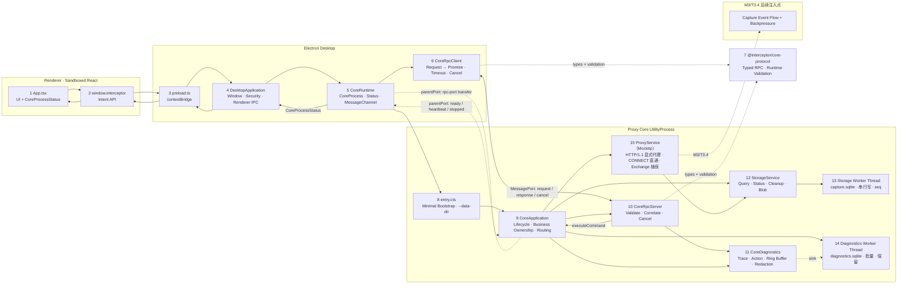

# Interceptor 当前实现架构与 Workflow

> 最后更新：2026-07-14
> 范围：只描述已经实现并验证的代码；未来设计见 [桌面网络调试代理完整方案.md](桌面网络调试代理完整方案.md)。

## 完整 Workflow 架构图

图中的实线是当前已实现路径，虚线 `M3/T3.4` 是明确的后续注入点。存储层（12–14）与显式代理（15，HTTP/1.1 + CONNECT 直通 + Exchange 捕获）已实现；增量 Capture Event 流与背压（T3.4）、HTTPS 解密（M5）、HTTP/2（M6）尚未实现。

## Renderer UI 架构（M2/T2.0，已落地）

> Renderer 仍只通过 `window.interceptor` 意图 API 访问 Main，不触达 Electron/Node/MessagePort；以下为已实现并 typecheck 通过的 UI 结构，视觉取值以 `design/design-system.md` 为准。

- **App shell**：`app/App.tsx` 持有 `themeMode`（light/warm/dark/ember）与 `lang` state，按 `ViewId` 渲染对应 feature 的 topbar/main/statusbar；`app/AppShell.tsx` 是 Grid 外壳，`app/Sidebar.tsx` 是导航 + 底部主题/语言切换器。
- **Feature workspaces**：`features/{capture,rules,composer,breakpoints,diagnostics,settings}/`，每个拆成 Topbar/Main/Statusbar 子组件 + colocated CSS Module，一对一还原 `design/app` 对应视图。Capture 工作区已在 M4 数据驱动（见「Capture 渲染数据层架构」小节），Settings 存储面板呈现真实 `StorageUsage`，其余视图仍为占位/disabled，随后续 Stage 接入。
- **共享组件库**：`components/` 扁平库，每组件独立子目录（`Component.tsx` + `Component.module.css`）；含 Flyout（portal 锚定弹层）、ThemeSwitcher、LanguageSwitcher（侧栏底部，取代旧 Account）。
- **主题**：四套时段主题——`theme/theme.ts` 的 Ant ConfigProvider palette + 算法（light/warm=default、dark/ember=dark），`styles/global.css` 的 `:root[data-theme]` CSS 变量；`App.tsx` 把 `themeMode` 写入 `document.documentElement.dataset.theme` 并持久化 localStorage。
- **验收**：typecheck 通过；四主题 screenshot、1280×800/900×600 package smoke 与 parity 为 T2.0 收尾项，待跑。

## 存储层架构（M2，已落地）

> 存储读写与查询全部在 Core UtilityProcess 内，通过 `worker_threads` 把同步 `node:sqlite` 移出网络事件循环。Renderer 只通过意图 API 拿到 `StorageUsage` DTO，永不接触 SQL、数据库文件或 Blob 路径。

- **数据目录注入**：Main `CoreRuntime.launchCoreProcess` fork Core 时传 `--data-dir=<userData>/storage`；`entry.cts` 据此构建 `StorageService` 与 `DiagnosticsWorkerHost`（缺省则无存储模式）。`entry.cts` 用 try/catch 包住组合根装配与启动，失败时向 Main 发 `fatal` 生命周期消息并置非零退出码；Main `CoreRuntime` 收到后停止重启并 `dialog.showErrorBox` 弹窗提示。
- **模块结构**：`storage/` 与 `diagnostics/` 各分三块——`entry.ts`（对外门面/桶）、`host/host-*.ts`（Core 主线程侧的 worker 代理与 Blob Store）、`worker/worker-*.ts`（worker 线程侧入口与 SQLite 访问层）；共享的 `constants.ts`、`types.ts`、`protocol.ts` 放模块根。跨模块共享的 SQLite 迁移器在 `proxy-core/migration-runner.ts`。
- **常量集中**：各模块 `constants.ts`（+ `proxy-core/constants.ts`）是所有数值/路径常量的唯一来源；生产构造函数不再接收仅测试用的注入参数，单元测试用 `vi.mock` 覆盖常量、用真实 Worker 覆盖通道，详见 `apps/proxy-core/CONSTANTS.md`。
- **StorageService**（`storage/entry.ts`）：CoreApplication 独占拥有的存储门面，组合 Storage Worker host 与 Blob Store，暴露 `ensureSession/appendExchanges/updateExchange/querySessions/status/cleanup/readBodyRange`。清理时先删 DB 记录再按剩余引用集合 GC 孤立 Blob。
- **Storage Worker**（`storage/worker/worker-entry.cts` + `storage/host/host-worker.ts`）：worker 线程独占 `capture.sqlite` 连接，`worker_threads` 一次处理一条消息天然串行化写入；`CaptureStore` 分配单调 `seq`、维护 `exchange_fts` FTS5、执行 keyset opaque cursor 分页（不 hydrate body）。host 在主线程按 requestId 关联请求/响应。
- **Blob Store**（`storage/host/host-blob-store.ts`）：内容寻址正文存储，流式写临时文件→SHA-256→按 hash 分片路径原子 rename，命中去重；单条/全局配额、crash-safe GC（删未引用 Blob + 启动清临时文件）。
- **Diagnostics Worker**（`diagnostics/worker/worker-entry.cts` + `diagnostics/host/host-worker.ts`）：worker 线程独占 `diagnostics.sqlite`，批量事务写入 + 条数/时长保留 + 聚合丢弃计数 + keyset 分页；`CoreDiagnostics` 的 sink 路由到该 host（fire-and-forget，预就绪有界缓冲），写入失败只计数，绝不阻塞或回滚捕获，也不递归回灌同一 sink。内存 Ring Buffer 仍作即时回退。
- **Capture 与 Diagnostics 强隔离**：两库、两连接、两 Worker 独立；日志写入失败不影响捕获数据。
- **构建/打包**：`proxy-core` esbuild 多入口输出 `entry.cjs` + `storage/worker/worker-entry.cjs` + `diagnostics/worker/worker-entry.cjs`（`--outdir=dist --outbase=src --out-extension:.js=.cjs`）；host 通过 `resolveStorageWorkerEntry`/`resolveDiagnosticsWorkerEntry` 自解析 worker bundle（生产用 `__dirname` 定位同包路径，源码运行回落到工作区 `dist`），Forge `extraResource` 递归复制整个 `dist/proxy-core`。
- **契约**：新增 `storage.status`/`storage.cleanup`/`diagnostics.query` typed command + 运行时校验；Renderer 经 `getStorageStatus`/`clearStorage` 窄 API 访问。

## 代理层与捕获管线架构（M3，已落地）

> Mockttp 显式代理把真实 HTTP/1.1 流量采集为规范 Exchange 写入 M2 存储，正文经内容寻址 Blob 持久化，实时事件经有界合并队列 + 窗口背压批量推送给 Main 再广播 Renderer。真正零内存流式正文作为 M5+ 优化项。

- **引擎**：`proxy/proxy-service.ts` 用 `mockttp` 的 `getLocal()` 作显式代理（`thenPassThrough` 转发，未配置解密时 CONNECT 字节直通），`request`/`response`/`abort` 事件按 id 关联采集 Exchange，写入结构化 `CaptureSink`（`StorageService`）。仅绑 loopback，由 `proxy.start`/`proxy.stop`/`proxy.status` 命令显式控制（默认不捕获）。
- **正文持久化（T3.3）**：请求/响应正文经 `StorageService.writeBody` 写入内容寻址 Blob Store，生成 `body_ref` 并在同事务内绑定 Exchange 的 request/response body id；超单体上限/配额时省略正文保留元数据（truncated/skipped）。当前经 Mockttp 内存缓冲后写盘，真正零内存流式（body-data 事件增量写盘）留后续。
- **捕获事件管线（T3.4）**：`proxy/capture-event-queue.ts` 的 `CaptureEventQueue` 有界、按 Exchange id 合并、保留终态、分配单调 sequence；`CoreApplication.flushCaptureEvents` 按窗口背压排空（`MAX_INFLIGHT_EVENT_BATCHES`/`EVENT_DRAIN_BATCH`/`EVENT_FLUSH_INTERVAL_MS`）经 `CoreRpcServer.sendEventBatch` 发 `event-batch`；Main `CoreRpcClient` 收批回 `event-ack` 并触发 `CoreRuntime.onCaptureEvents`，Main 经 `capture:events` 广播 Renderer。分页 `sessions.query` 与实时事件共用 `CaptureExchangeSummary` 单行结构。
- **按需详情（M4 后端）**：`sessions.detail` 命令经 `CaptureStore.getExchangeDetail`（SELECT exchange + message_headers + body_ref）返回 `CaptureExchangeDetail`（头部 + 正文引用元数据）；正文字节经 `body.read-range` → `StorageService.readBodyRange`（按 blob hash 分块）。
- **依赖打包**：Mockttp 依赖含 WASM（`brotli-wasm`）与原生插件（`tls-impersonate` 的 `.node` prebuilds），无法内联进单文件。因此 esbuild 用 `--external:mockttp` 保留 `require('mockttp')`，`scripts/ship-core-deps.mjs` 用 `@vercel/nft` 追踪运行时闭包并补拷 `prebuilds/`/`build/Release/*.node`，按 node_modules 结构（保留嵌套、避免版本互相覆盖）拷进 `dist/proxy-core/node_modules`；Forge extraResource 递归随包发到 `resources/proxy-core/node_modules`。
- **验证**：packaged 真实 exe 启动即 `require('mockttp')`，从隔离随包 node_modules 成功加载并进入 `running`；`npm audit --omit=dev` 0 漏洞。

## Capture 渲染数据层架构（M4，已落地）

> Capture 工作区把占位 UI 升级为真实数据驱动，仍只经 `window.interceptor` 意图 API 访问 Main；Exchange 摘要进 Zustand 视图状态，header/body 均不进入全局状态，按需从 Core 拉取。

- **视图状态**：`features/capture/captureStore.ts`（Zustand）只存 `CaptureExchangeSummary` 行 + `indexById`，实时事件按 id 原位更新 / 新行整块前插，`live`/`capturing` 开关、`filter`（分段 + 关键字 + method/status/host）与 `selectedId` 均在此。
- **数据管线**：`useCaptureData.ts` 订阅 `onCaptureEvents`、按过滤条件去抖重查 `querySessions`、滚动近底 `loadMoreSessions` 按 keyset 游标追加历史页、`toggleCapture` 调 `startCapture`/`stopCapture`；`useExchangeDetail.ts` 选中行按需 `getExchangeDetail`（组件本地 state）。
- **渲染**：`RequestList` 用 `@tanstack/react-virtual` 固定行高虚拟化；`Omnibox` 关键字下推 Core FTS、method/status/host 结构化过滤显示可移除 pill；`RequestInspector` 各标签接 detail，`BodyView` 用 CodeMirror（JSON 高亮）渲染文本正文、二进制走 hex fallback（256KB 预览上限）。
- **窄 API**：`shared/desktop-api.ts` 暴露 `startCapture`/`stopCapture`/`getCaptureStatus`/`querySessions`/`getExchangeDetail`/`readBody`/`onCaptureEvents`；Main 在 `main.ts` 做边界校验（`toCoreSessionQuery`/`assertOptionalPort`/`toByteRange`）后转交 CoreRuntime。

## 证书与 HTTPS MITM 架构（M5，已落地）

> CA 生成/加密/信任库操作全在 Main（Electron `safeStorage` 与平台信任库命令只在 Main 可用），Core 只接收解密后的 CA 做 Mockttp MITM。私钥只在 Main↔Core 内部通道单向下发，绝不进 Renderer/日志/导出。

- **CertificateService**（`apps/desktop/src/main/certificates/certificate-service.ts`）：用 `@peculiar/x509` 生成 RSA 2048/SHA-256 Root CA（BasicConstraints CA、keyCertSign/cRLSign、随机 serial、3 年有效期）；`safeStorage`（DPAPI/Keychain）加密私钥存 `<userData>/certificates/root-key.enc`，明文 `root-cert.pem` 与 meta（SHA-256 fingerprint + SHA-1 thumbprint）单独存。**证书库懒加载**：模块顶层不 import `@peculiar/x509`（其 tsyringe/reflect-metadata 顶层副作用会阻塞 Main/Chromium/CDP 启动），仅在 `generate()` 内 `await import(...)` 并设 WebCrypto provider。
- **TrustStoreService**（`trust-store-service.ts`）：Windows `certutil -user` / macOS `security`（登录钥匙串）current-user 安装/卸载/检测；按 SHA-1 thumbprint 精确定位；`execFile` 不经 shell；注入 `CommandRunner` 便于 mock 单测（开发机不真实改系统）。
- **下发通道**：Main 经内部 `tls.configure` 命令（复用 request/response，Renderer 无对应窄 API 拿不到私钥）把 CA material + `insecureHosts` 下发 Core；`CoreRuntime.onCoreProcessReady` 在每代 Core 就绪后触发 `provisionCoreTls`。**仅当 CA 已安装信任（`trustStore.isTrusted`）时才下发 material 启用 MITM**，否则下发 null（CONNECT 字节直通不解密）。
- **MITM**（Core）：`ProxyService` 有 CA 时 `getLocal({https:{key,cert}})`，Mockttp 用该 CA 动态签发并缓存 leaf；`thenPassThrough({ignoreHostHttpsErrors})` 默认验证源站证书链/hostname、仅对 per-host 例外忽略。解密的 HTTPS Exchange 复用现有 `request`/`response` 捕获管线（`scheme=https`、`secure=true`）。
- **窄 API**：`getCertificateStatus`/`generate`/`install`/`uninstall`Certificate、`get`/`setInsecureHosts`（Main 组装 `CertificateInfo`，私钥不出 Main）；Settings/Certificates 面板呈现真实证书状态、信任、fingerprint、MITM 开关与不安全例外。

## 两条独立通道
### 生命周期通道：`UtilityProcess.parentPort`

只承载：

- `ready`：Core 入口已启动；
- `heartbeat`：Core Event Loop 仍可调度；
- `rpc-port`：Main 向 Core 转交业务 MessagePort；
- `shutdown` / `stopped`：优雅关闭。

heartbeat 的唯一目的，是发现“CoreProcess 仍存在但 Event Loop 已卡死”。Main 4 秒未收到 heartbeat 时将状态设为 `unresponsive`、kill CoreProcess，并退避重启。`CoreProcessStatus.running` 不代表 HTTP Listener、数据库等业务一定健康。

### RPC 通道：专用 `MessagePort`

只承载：

- Request：`protocolVersion + requestId + traceId + command`；
- Response：匹配 ID 的 Success 或结构化 Error；
- Cancel：timeout、AbortSignal 或调用方取消。

Main/Core 同包发布，MessagePort 会暂存 listener 注册前到达的消息，所以没有额外 channel init/ready 握手、Token 或跨版本协商状态机。每条 Request 自带 `protocolVersion`，不兼容消息由 validator 直接拒绝。

## Workflow 详细表

| # | Workflow | 发起方 → 接收方 | 数据/调用 | 代码位置 | 成功结果 | 失败与清理 |
| ---: | --- | --- | --- | --- | --- | --- |
| 1 | Desktop 启动 | Electron → `DesktopApplication` | `app.whenReady()` | `apps/desktop/src/main/main.ts` | 配置安全、IPC、CoreRuntime，并创建窗口 | app 未 ready 前不创建 CoreProcess/窗口 |
| 2 | 配置安全边界 | `DesktopApplication` → Electron Session/WebContents | permission、webview、navigation、download handlers | `main.ts`、`security/trusted-renderer-url.ts` | Renderer 只加载可信 Dev origin 或 packaged HTML | 非可信导航/权限/下载被拒绝 |
| 3 | 启动 CoreProcess | `DesktopApplication` → `CoreRuntime` | `start()` | `main.ts`、`core-runtime.ts` | CoreRuntime 调用 `startCoreProcess` | fork 抛错时进入退避重启 |
| 4 | fork CoreProcess | `CoreRuntime` → Electron | `utilityProcess.fork(entry.cjs)` | `core-runtime.ts` | CoreRuntime 独占当前 `CoreProcessHandle`、状态和关闭流程 | 初始化失败时 kill CoreProcess 并进入重启 |
| 5 | 创建 RPC 通道 | `CoreRuntime` → Main/CoreProcess | `new MessageChannelMain()`、`coreProcess.postMessage({type:'rpc-port'}, [port2])` | `core-runtime.ts` | `port1` 附加到内部 `CoreRpcClient`，CoreProcess 接收 `port2` | transfer/attach 失败时关闭 port、client 和 CoreProcess |
| 6 | CoreProcess bootstrap | Electron → `entry.cts` | `process.parentPort` | `entry.cts` | `new CoreApplication(parentPort).start()` | 无 parentPort 时输出错误并非零退出 |
| 7 | CoreProcess 生命周期启动 | `CoreApplication` → parentPort | `ready` + 首个 `heartbeat` | `core-application.ts` | Main 状态变为 `running`，随后每秒 heartbeat | parentPort 故障最终表现为 heartbeat timeout/exit |
| 8 | Renderer 获取 CoreProcess 状态 | Renderer → Preload → Main | `getCoreProcessStatus()` | `App.tsx`、`preload.ts`、`main.ts` | 返回只读 `CoreProcessStatus` | IPC 失败时 UI 标记 `unresponsive` |
| 9 | Renderer 订阅 CoreProcess 状态 | Main → Preload → Renderer | `core:process-status` | `core-runtime.ts`、`main.ts`、`preload.ts`、`App.tsx` | UI 显示 running/restarting/unresponsive/stopping | CoreRuntime.stop 清空状态 listeners；Renderer cleanup 移除 ipcRenderer listener |
| 10 | 发起业务命令 | Renderer → Main | `echoCore(value)` / `getCoreTrace(traceId)` | `desktop-api.ts`、`preload.ts`、`main.ts` | Main 校验 sender 和参数，构造 typed command | 非可信 sender/非法参数直接拒绝 |
| 11 | RPC Request→Promise | Main → `CoreRuntime` → `CoreRpcClient` | `request(command, options)` | `core-runtime.ts`、`core-rpc-client.ts` | 生成 requestId/traceId，注册 `PendingRpcRequest` 并发送 | 无连接、duplicate ID 或 postMessage 失败时 Promise reject |
| 12 | RPC 边界校验 | MessagePort → `CoreRpcServer` | `parseMainToCoreMessage(raw)` | `core-rpc-server.ts`、`core-protocol/validation.ts` | 得到安全的 Request 或 Cancel | 非法消息关闭连接并触发 Core fatal recovery |
| 13 | command 调度 | `CoreRpcServer` → `CoreApplication` | `executeCommand(command, signal)` | `core-rpc-server.ts`、`core-application.ts` | echo/diagnostics 返回 typed result | 未实现 command 返回 `unsupported-command`；异常转为 `internal` |
| 14 | 结构化日志 | RpcServer/Application → `CoreDiagnostics` | command lifecycle + action | `core-diagnostics.ts` | traceId 下记录 received/validated/handler/action/response/completed | sink 同步/异步失败回退 stderr；日志不得使 command 失败 |
| 15 | RPC Response→Promise | Core → Main | Success/Error Response | `core-rpc-server.ts`、`core-rpc-client.ts` | requestId/traceId/result type 匹配后完成 Promise | mismatch 关闭连接；late response 被忽略 |
| 16 | timeout/cancel | Caller/Timer → Main → Core | `cancel` + AbortController | `PendingRpcRequest`、`CoreRpcServer` | 两端释放 timer/listener/active request | Cancel 消息发送失败时本地 Promise 仍完成清理 |
| 17 | CoreProcess heartbeat 检测 | `CoreApplication` → `CoreRuntime` | 每秒 heartbeat，4 秒 deadline | `core-application.ts`、`core-runtime.ts` | 持续保持 `running` | 超时标记 `unresponsive`、kill，exit 后退避重启 |
| 18 | CoreProcess restart | OS/CoreProcess → `CoreRuntime` | `exit(code)` → backoff → new fork/port | `core-runtime.ts` | 新 PID、新 MessagePort，后续 RPC 正常 | 旧 port 上 pending Promise 被内部 `CoreRpcClient` 拒绝 |
| 19 | graceful shutdown | Electron → DesktopApplication → CoreRuntime/CoreApplication | `before-quit`、`shutdown`、`stopped` | `main.ts`、`core-runtime.ts`、`core-application.ts` | CoreApplication 关闭 RPC、停止 heartbeat、退出；CoreRuntime 清空 listeners 后 Main 再 quit | 超过 1.5 秒则 CoreRuntime force kill |
| 20 | build/package/runtime | npm → esbuild → Forge → packaged app | `entry.cts` → `entry.cjs` → `extraResource` | root/package scripts、`apps/proxy-core/package.json`、`forge.config.ts`、`core-runtime.ts` | Dev 从 sibling dist 加载；package 从 `resources/proxy-core/entry.cjs` 加载 | packaged smoke 直接验证最终路径、CoreProcess restart 和清理 |

## 关键数据结构

| 数据 | 定义位置 | 用途 |
| --- | --- | --- |
| `CoreProcessStatus` | `apps/desktop/src/shared/desktop-api.ts` | Renderer 可见的 CoreProcess 状态；`running` 仅代表 heartbeat 正常 |
| `CoreCommand` | `packages/core-protocol/src/messages.ts` | Main → Core 的 typed command union |
| `CoreResultForCommand<T>` | `packages/core-protocol/src/messages.ts` | 编译期保证 command/result 配对 |
| `CoreRequest` / Response / Cancel | `packages/core-protocol/src/messages.ts` | MessagePort RPC envelope |
| `CoreError` | `packages/core-protocol/src/messages.ts` | invalid/unsupported/timeout/cancelled/disconnected/conflict/internal |
| `DiagnosticLogRecord` | `packages/core-protocol/src/messages.ts` | Trace/Action/Duration/Outcome 的结构化日志 |
| `StorageStatusResult` / `StorageUsage` | `core-protocol/src/messages.ts`、`desktop/src/shared/desktop-api.ts` | 存储用量（会话/Exchange/Body 计数、DB/Blob/总量/配额字节） |
| `ExchangeInput` / `SessionQuery` | `apps/proxy-core/src/proxy-core/storage/types.ts` | Core 内部存储域类型；不跨进程，不复用 core-protocol |

## 后续扩展规则

- M2 Storage Service 与 M3 Proxy Service 由 `CoreApplication` 统一拥有，不要把业务逻辑放入 `CoreRpcServer`。
- 真实 Capture Event 的有界队列、批处理、合并和 sequence/ack 已在 M3/T3.4 实现（`CaptureEventQueue` + `event-batch`/`event-ack`），不能复活 M1 的占位事件模型。
- `CoreRuntime` 是 Main 唯一的 Core 入口；`CoreRpcClient` 只作为其内部 RPC 状态机（含事件批接收 + 回 ack）。
- `CoreProcessStatus.running` 不得描述为“业务健康”。
- Main 不搬运完整 Body；Body 只通过有限 range/chunk（`body.read-range`）读取，header/body 不进入 Renderer 全局状态。
- Renderer API 继续面向意图，不暴露通用 IPC、MessagePort 或 Node 原语。

## 当前未实现

- HTTP/2、WebSocket、gRPC（未 MITM 的 CONNECT 仍字节直通；HTTP/2 下游/上游在 M6，WebSocket/gRPC 在 M9）。
- 真正零内存流式正文落盘（M3/T3.3 优化项；当前经内存缓冲后写内容寻址 Blob，body-data 增量写盘留后续）。
- 详细源站 TLS metadata（version/cipher/ALPN/证书链）记录与 Inspector TLS/Timing 标签填充（当前 HTTPS 已解密捕获，但 TLS/Timing 富数据为诚实空态）。
- CA 导出、机器级信任库安装（需提权）；规则引擎、系统代理适配、导入导出、签名安装器和更新机制（M6+）。

## 更新规则

- 本文件只记录已经实现并验证的 workflow。
- 计划能力留在完整方案和对应 Stage 文件。
- 阶段边界同步核对 [PROGRESS.md](PROGRESS.md)、[HANDOVER.md](HANDOVER.md) 和对应 `M*.md`。