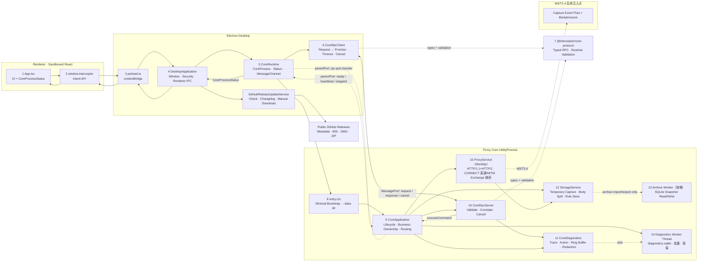
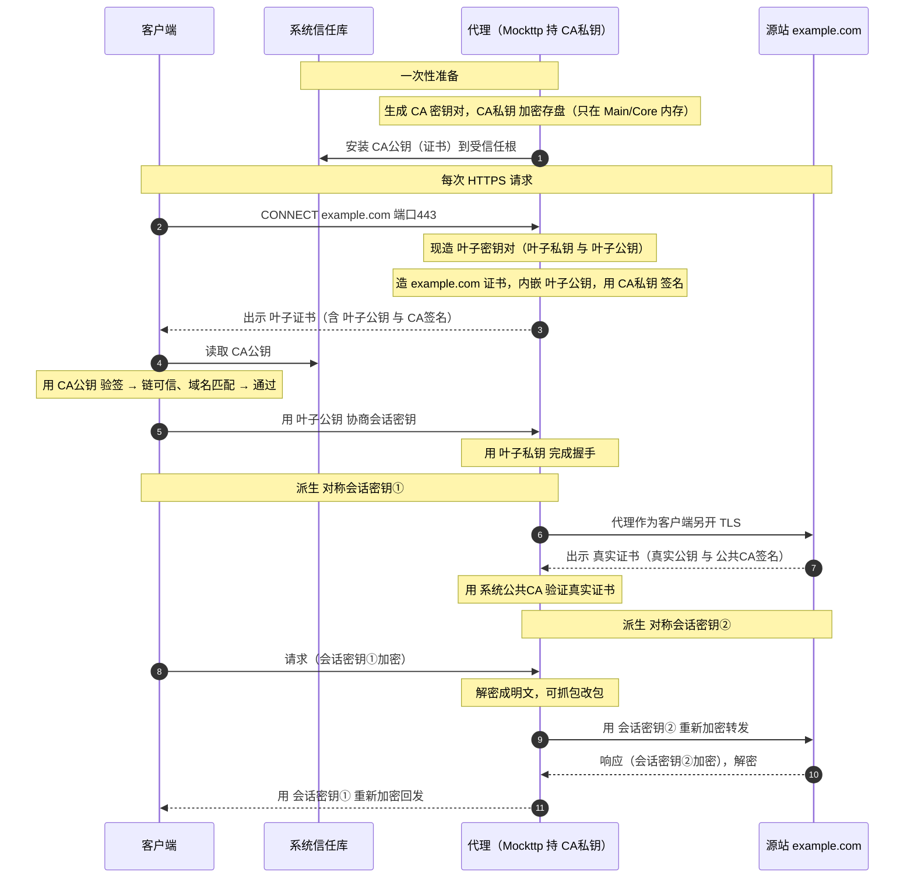

# Interceptor 当前实现架构与 Workflow

> 最后更新：2026-07-20
> 范围：只描述已经实现并验证的代码；历史产品设计见 [archived/桌面网络调试代理完整方案.md](archived/桌面网络调试代理完整方案.md)。

## 完整 Workflow 架构图

图中的实线是当前已实现路径，虚线 `M3/T3.4` 是明确的后续注入点。存储层（12–14）与显式代理（15，HTTP/1.1+HTTP/2 + CONNECT 直通/MITM + Exchange 捕获）已实现；增量 Capture Event 流与背压（T3.4）、HTTPS 解密（M5）、HTTP/2（M6）均已实现。

## Renderer UI 架构（M2/T2.0，已落地）

> Renderer 仍只通过 `window.interceptor` 意图 API 访问 Main，不触达 Electron/Node/MessagePort；以下为已实现并 typecheck 通过的 UI 结构，视觉取值以 `design/design-system.md` 为准。

- **App shell**：`app/App.tsx` 持有 `themeMode`（light/warm/dark/ember），消费 i18next 当前语言，并直接拥有全高侧栏 + 46px Window Header + `main` + 30px `footer` Grid；按 `ViewId` 注入对应 feature 的 main/statusbar。`app/Sidebar.tsx` 负责导航 + 底部主题/语言切换器，不再保留单独的 `AppShell` 转发层。
- **设计源**：`design/app` 只保留静态 `shell-v2` 根布局；旧 `layout=current` / `data-layout` 状态、六组 feature `.tv` 顶栏和 Layout 设计切换器已删除。其余 Capture/Rules/overlay 截图均由同一 Shell V2 布局生成，是当前细节场景而非旧版设计。
- **自有窗口 Chrome**：Windows/macOS BrowserWindow 均为 `frame:false`；Renderer 46px Window Header 是 drag region，左侧只保留 no-drag 侧栏折叠按钮和 feature 名称，右侧固定 Minimize / Maximize-or-restore / Close 三按钮。Close 经窄 Preload IPC 进入 `app.quit()` 的 guarded 系统代理恢复与 Core shutdown。业务命令不进入 Header；UpdateNotification 是 Header 下方独立 overlay，不占 Header flex。
- **Feature workspaces**：`features/{capture,rules,composer,breakpoints,diagnostics,settings}/` 均为 Main/Statusbar + colocated CSS Module；旧 Feature Topbar 已删除。Capture 由 `CaptureWorkbar` 承载 Recording/Omnibox/Import/Export；Rules、Composer、Breakpoints、Diagnostics 的业务命令分别位于列表、协议、暂停队列和日志内容工具栏。状态统一进入 Statusbar。所有左右分栏复用 1px `Splitter`，抓手为同一 flex 中轴上的 4×40px 子项。
- **Filtering / Rules 交互**：Capture Omnibox 支持 Method/Status/Host/Type/Duration 字段选择、规范化输入与 Enter 提交；Rules 支持八种 matcher 创建、列表操作菜单及 grip 拖放排序，Renderer 始终同步 `priority`，保证列表顺序与 Core 执行顺序一致。
- **共享组件库**：`components/` 扁平库，每组件独立子目录（`Component.tsx` + `Component.module.css`）；含 Flyout（portal 锚定弹层）、ThemeSwitcher、LanguageSwitcher（侧栏底部，取代旧 Account）。设计源只保留当前 Theme flyout 与 Language list，不保留替代变体。
- **主题与语言**：四套时段主题由 `theme/theme.ts` + `styles/global.css` 驱动。`renderer/i18n/` 用 `i18next` + `react-i18next` 注册 15 个本地静态完整 catalog，英语为默认/回退；切换同步 Ant `ConfigProvider.locale`、`html lang`、localStorage 与 `Intl` 格式。Renderer 经受限 `setUiLanguage` Preload 意图把 15 值枚举同步给 Main，Main 只用内存状态本地化自己持有的 HAR/archive/Diagnostics 文件对话框，不把路径或通用 IPC 暴露给 Renderer。
- **验收**：M12 历史验收覆盖六视图双主题、900×600 与四语言状态，共 42 张截图且无页面级溢出。2026-07-18 多语言增强 smoke 在真实 Windows package 中逐项切换 15 种语言，验证持久化、UI 文案、页面无溢出及 Main IPC 非法值拒绝；catalog 契约测试校验 659 个主 key、插值与 CLDR 多复数。
- **Updates（M13）**：App级`UpdateActions`订阅Main状态；Settings展示当前/最新版本、GitHub changelog、用户触发下载进度、失败/已下载；Header 下方通知仅在available/downloaded显示。Renderer只调用意图API，不接触URL、路径或文件流。

## 存储层架构（M2，已落地）

> Capture/Body 直接属于当前 Core UtilityProcess；活动抓包不使用 SQLite 或常驻 Storage Worker。Renderer 只持有全量轻量 summary，不接触 SQL、临时文件或完整正文。

- **数据目录注入**：Main `CoreRuntime.launchCoreProcess` fork Core 时传 `--data-dir=<userData>/storage`；`entry.cts` 据此构建 `StorageService` 与 `DiagnosticsService`（内部组合 `DiagnosticsWorkerHost`，缺省则无存储模式）。`entry.cts` 用 try/catch 包住组合根装配与启动，失败时向 Main 发 `fatal` 生命周期消息并置非零退出码。
- **模块结构**：composer/connection/diagnostics/grpc/har/proxy/rules/storage 均以真实 `entry.ts` 门面为根，Service/Engine class 直接定义在 entry；显式类型集中 `interfaces/index.ts`，无状态函数集中 `utils/index.ts`，其余实现文件使用模块前缀且一文件一个 class。host/worker 子模块所有者也使用 `entry.ts`，其余文件保持 `host-*`/`worker-*`。
- **常量集中**：模块常量使用 `<module>-constants.ts`（+ `proxy-core/constants.ts`），是数值/策略的唯一来源；生产构造函数不接收仅测试用的注入参数，单元测试用 `vi.mock` 覆盖常量、用真实 Worker 覆盖通道，详见 `apps/proxy-core/CONSTANTS.md`。
- **StorageService**（`storage/entry.ts`）：直接组合 `TemporaryCaptureStore`、`TemporaryBodyStore` 与 `RuleStore`。Capture 用 Map + 惰性 `(startedAt,seq)` 索引；Body 小于1MiB驻内存，较大正文 spill 到 `capture-temp/`；RuleSet 低频直接读写 `rules.sqlite`。
- **Recording 生命周期**：Stop 只经 `proxy.setRecording{recording:false}` 暂停记录——Mockttp listener 与系统代理保持运行、流量继续转发，暂停期间的新连接不再落库/推送，已在途的 Exchange 自然完成；监听器与系统代理不受影响。Start（含首次 bootstrap）经 `proxy.start` 恢复 `recording=true`（若未监听则先启动 listener，显式换端口时在同会话迁移监听端口）；系统代理只在应用退出与紧急修复时由 Main 恢复。Clear 才推进 cutoff、取消 transfer、清 Capture/Body；Core 退出自然释放临时数据。`proxy.status` 同时上报 `listening` 与 `recording`，Renderer 的 `capturing` 取 `recording`。
- **Archive Worker**（`archive/host/entry.ts` + `archive/worker/entry.ts`）：仅 native archive 导入/导出时创建，按100条批次把内存 Capture materialize/读取兼容 `capture.sqlite`；完成、取消或失败即退出。
- **Transfer 交互**：命令到达 Core 后直接读取当前 Store；Renderer 全屏 Loading 在运行时只提供 Cancel，取消即 Abort 并恢复 UI。Core 不增加特殊 action 门禁。
- **Diagnostics Worker**（`diagnostics/entry.ts` → `diagnostics/host/entry.ts` + `diagnostics/worker/entry.ts`）：`DiagnosticsService` 是根门面，组合 `DiagnosticsWorkerHost`；worker 独占 `diagnostics.sqlite`，批量事务写入 + 条数/时长保留 + 聚合丢弃计数 + keyset 分页。写入失败只计数，绝不阻塞或回滚捕获，也不递归回灌同一 sink。
- **Capture 与 Diagnostics 强隔离**：Capture 无数据库；Diagnostics Worker 独占 `diagnostics.sqlite`，日志失败不影响抓包。
- **构建/打包**：`proxy-core` 输出 `entry.cjs` + 按需 `archive/worker/entry.cjs` + 常驻 `diagnostics/worker/entry.cjs`；Forge 递归复制整个 `dist/proxy-core`。
- **契约**：新增 `storage.status`/`storage.cleanup`/`diagnostics.query` typed command + 运行时校验；Renderer 经 `getStorageStatus`/`clearStorage` 窄 API 访问。

## 代理层与捕获管线架构（M3，已落地）

> Mockttp 显式代理把流量采集为 Core 临时 Exchange，正文进入内存+spill TemporaryBodyStore，实时 summary 经有界队列推送 Renderer。

- **引擎**：`proxy/entry.ts` 的 `ProxyService` 用 `mockttp` 的 `getLocal()` 作显式代理（`thenPassThrough` 转发，未配置解密时 CONNECT 字节直通），`request`/`response`/`abort` 事件按 id 关联采集 Exchange，写入结构化 `CaptureSink`（`StorageService`）。仅绑 loopback，由 `proxy.start`/`proxy.stop`/`proxy.status` 命令显式控制；Renderer 的 Capture bootstrap 在 Core running 后自动调用 `proxy.start(8888)`。
- **Recording 暂停/清理**：Stop 恢复系统代理并停止 listener，但不清 Capture；Start 新 Session 继续追加。Clear 是唯一用户删除入口，重置 event queue/cutoff 并删除所有临时 Exchange/Body。
- **HTTP/2（M6）**：有 CA（MITM）时 `getLocal({https, http2:true})` 对经 ALPN 声明 h2 的客户端启用 HTTP/2、H1-only 回落 http/1.1，上游由 passthrough 按源站 ALPN 独立协商 h2/h1 并做四组转换（无 CA 的明文代理不启用 h2）；`captureExchange` 采集 request/response header 与 `rawTrailers`（按 kind 落库，`:` 前缀标记 pseudo），protocol 记 `h2`/`http/1.1`。streamId/GOAWAY/RST/settings/背压 Mockttp 未暴露，待原生 http2 补齐。
- **正文存储（M14）**：请求/响应/WS/gRPC payload 经 `StorageService.writeBody` 写入 TemporaryBodyStore，按 hash 去重；小正文驻内存，大正文异步 spill；超上限/配额保留 truncated/skipped metadata。
- **捕获事件管线（T3.4）**：`proxy/proxy-capture-event-queue.ts` 的 `CaptureEventQueue` 有界、按 Exchange id 合并、保留终态、分配单调 sequence；`CoreApplication.flushCaptureEvents` 按窗口背压排空，经 `event-batch`/`event-ack` 推送 Main/Renderer。分页 `sessions.query` 与实时事件共用 `CaptureExchangeSummary`。
- **按需详情（M4 后端 + M6 扩展）**：`sessions.detail` 返回 `CaptureExchangeDetail`，正文经 `body.read-range` 按 hash 分块；`decode` 请求由 `proxy/utils/index.ts` 的 `decodeBody` 按 gzip/deflate/brotli（多层、容错）延迟解压并回传 `decodeStatus`。
- **依赖打包**：Mockttp 依赖含 WASM（`brotli-wasm`）与原生插件（`tls-impersonate` 的 `.node` prebuilds），WebSocket bridge 直接依赖 `ws`。esbuild 用 `--external:mockttp --external:ws` 保留运行时 require（`ws` 内联会阻塞首代 Electron UtilityProcess entry），`scripts/ship-core-deps.mjs` 用 `@vercel/nft` 追踪运行时闭包并补拷原生资产，按 node_modules 结构拷进 `dist/proxy-core/node_modules`；Forge extraResource 递归随包发到 `resources/proxy-core/node_modules`。
- **验证**：packaged 真实 exe 启动即 `require('mockttp')`，从隔离随包 node_modules 成功加载并进入 `running`；`npm audit --omit=dev` 0 漏洞。

## Capture 渲染数据层架构（M4，已落地）

> Capture 工作区把占位 UI 升级为真实数据驱动，仍只经 `window.interceptor` 意图 API 访问 Main；Exchange 摘要进 Zustand 视图状态，header/body 均不进入全局状态，按需从 Core 拉取。

- **视图状态**：Zustand 持有当前 Core 的全部 `CaptureExchangeSummary` + id索引、filter、selection、scrollTop、Inspector tab/width；header/body 不进入 Renderer 全局状态。
- **数据管线**：`useCaptureData` 常驻 App，跨 feature 持续接收事件；bootstrap/重连以500条有界页同步当前 Core 全量 summary，过滤完全在 Renderer 派生。Stop/Start 保留行，Core generation 变化或 Clear 才清空。
- **渲染**：`RequestList` 用固定 52px TanStack Virtual 行，实时前插时按选中项 index delta 补偿 scrollTop；`Omnibox` 关键字下推 Core FTS。Inspector Cookies 收集所有重复 Cookie header；Timing 使用真实 response-start/completed 时间；`BodyView` 提供 Auto/Text/JSON/Hex、未知 MIME UTF-8 探测、JSON pretty print 与响应式 hex（256KB 预览上限）。
- **窄 API**：`shared/desktop-api.ts` 暴露 Capture/body 读取与 HAR transfer 意图；Main 做边界校验后转交 CoreRuntime。文件路径只由 Main 系统对话框产生，Renderer 不获得 path/readFile/writeFile。

## 证书与 HTTPS MITM 架构（M5，已落地）

> CA 生成/加密/信任库操作全在 Main（Electron `safeStorage` 与平台信任库命令只在 Main 可用），Core 只接收解密后的 CA 做 Mockttp MITM。私钥只在 Main↔Core 内部通道单向下发，绝不进 Renderer/日志/导出。

- **CertificateService**（`apps/desktop/src/main/certificates/certificate-service.ts`）：用 `@peculiar/x509` 生成 RSA 2048/SHA-256 Root CA（BasicConstraints CA、keyCertSign/cRLSign、随机 serial、3 年有效期）；`safeStorage`（DPAPI/Keychain）加密私钥存 `<userData>/certificates/root-key.enc`，明文 `root-cert.pem` 与 meta（SHA-256 fingerprint + SHA-1 thumbprint）单独存。**证书库懒加载**：模块顶层不 import `@peculiar/x509`（其 tsyringe/reflect-metadata 顶层副作用会阻塞 Main/Chromium/CDP 启动），仅在 `generate()` 内 `await import(...)` 并设 WebCrypto provider。
- **TrustStoreService**（`trust-store-service.ts`）：**local-machine 信任库**——`@vscode/sudo-prompt` 提权执行 `certutil -addstore -f Root`（Windows，去 `-user`）/ `security add-trusted-cert -d -r trustRoot -k /Library/Keychains/System.keychain`（macOS）安装/卸载，非提权 `certutil -verifystore Root <sha1>` / `security find-certificate` 检测；按 SHA-1 thumbprint 精确定位；`execFile` 不经 shell；注入 `ElevatedRunner`（默认 `sudoPromptRunner`）+ `CommandRunner` 便于 mock 单测。本机全部用户/进程（含浏览器）统一信任。
- **下发通道**：Main 经内部 `tls.configure` 命令（复用 request/response，Renderer 无对应窄 API 拿不到私钥）把 CA material + `insecureHosts` 下发 Core；`CoreRuntime.onCoreProcessReady` 在每代 Core 就绪后触发 `provisionCoreTls`。**仅当 CA 已安装信任（`trustStore.isTrusted`）且 `mitmEnabled` 开关开启时才下发 material 启用 MITM**（信任与 MITM 解耦，窄 API `setHttpsDecryption`），否则下发 null（CONNECT 字节直通不解密）。
- **默认 HTTPS 直通**：Main 每次进程启动都从 `mitmEnabled=false` 开始。Core 无 CA material 时以 `tlsInterceptOnly: []` 保证所有 TLS passthrough，并把 opened/closed 事件记录为有限 `CONNECT` tunnel metadata（目标、时间、duration），不读取隧道 header/body。Capture Tunnel 面板只在用户点击后打开 HTTPS Setup，按需 Generate CA、Install trust、Start decrypting。
- **MITM**（Core）：`ProxyService` 有 CA 时 `getLocal({https:{key,cert}})`，Mockttp 用该 CA 动态签发并缓存 leaf；`thenPassThrough({ignoreHostHttpsErrors})` 默认验证源站证书链/hostname、仅对 per-host 例外忽略。解密的 HTTPS Exchange 复用现有 `request`/`response` 捕获管线（`scheme=https`、`secure=true`）。
- **窄 API**：`getCertificateStatus`/`generate`/`install`/`uninstall`/`delete`/`reveal`/`view`Certificate、`openCertificateManager`、`get`/`setInsecureHosts`、`setHttpsDecryption`（Main 组装 `CertificateInfo` 含 `path`/`mitmEnabled`，私钥不出 Main）；install 不自动生成（要求已 present）；Settings/Certificates 面板呈现真实证书状态、信任、fingerprint、MITM 开关、证书文件入口（reveal/view/系统证书管理器）与不安全例外。

### 公钥/私钥与握手时序

三对密钥各司其职：**CA 密钥对**（本应用生成管理，CA 私钥签发 leaf、CA 公钥/证书装信任库验签）、**leaf 密钥对**（Mockttp 按 host 现造并缓存，用于与客户端的会话①）、**源站真实密钥对**（真站持有，用于代理↔源站的会话②）。CA 私钥经 `safeStorage` 加密后只在 Main↔Core 内部流转，绝不进 Renderer/日志/导出。

> 密钥交换细节：TLS 1.2+RSA 时客户端用 leaf 公钥加密预主密钥、代理用 leaf 私钥解密；TLS 1.3/ECDHE 时会话密钥由临时 DH 生成（前向保密），leaf 私钥只用来签握手、客户端用 leaf 公钥验签。两种情况下客户端信任 leaf 都取决于用信任库里的 CA 公钥验签成功。

## 诊断可观测性架构（2026-07 增强，已落地）

> 在 M2 Diagnostics 基座（Ring Buffer + Worker 持久化）之上，Core 各组件经共享 `DiagnosticsRecorder` 记结构化关键节点，Renderer Diagnostics 面板通过持久化分页查询展示真实命令 trace。

- **DiagnosticsRecorder 全组件注入**：`core-diagnostics.ts` 导出 `DiagnosticsRecorder`（`info/warn/error(phase,fields)`，`CoreDiagnostics` 唯一实现）；RpcServer 内建、Proxy/Storage host 经 `attachDiagnostics` 注入（`CoreApplication` 装配后转交）。各组件记 initialize/生命周期/action/error 关键节点：RpcServer `rpc.connected`/`connection-failed` + 每命令 1 条 `command.completed`；Application `core.started`/`stopping`/`storage.ready`/`diagnostics.ready`；Proxy `proxy.listening`/`stopped`/`tls.reconfigured`/`tls.client-error` + 异常 exchange；Storage `storage.worker-ready`/`fatal`/`error`/`exit`。命令级精简为单条 completed，`diagnostics.recent`/`query` 静默避免轮询自污染。
- **分页分析数据流（T10.4/T10.5）**：Renderer `DiagnosticsProvider`（2s 轮询）→ `queryDiagnostics` 窄 API → Main `core:query-diagnostics` → Core `diagnostics.query` → Diagnostics Worker。支持 process(core/main/renderer)/trace/command/level/outcome/duration 条件与递减 id keyset cursor；Provider 默认拉 200 条，过滤变化重查首页，按 process+timestamp+sequence 去重并可加载更旧记录；`TraceDetail` 展示来源、标识与 Action 时间线。
- **Main/Renderer 汇入（T10.5）**：Main `MainDiagnostics` 是最多 128 条的串行 fire-and-forget 队列，记录 CoreRuntime 状态跃迁、统一 IPC 失败、证书/信任/TLS action；发送失败只累计 dropped。Preload 的 `reportRendererDiagnostic` 只接受 Renderer `uncaught-error`/`unhandled-rejection` 短摘要，Main 固定来源和 phase 后走内部 `diagnostics.ingest`。Core 重建 timestamp/sequence，并执行与 Core 日志相同的上限、敏感键、凭据片段与 URL query 脱敏；外部记录不继承 ingest command 的 ALS 上下文。
- **脱敏 JSONL（T10.4/T10.5）**：`diagnostics.export.start` 复用共享 `TransferJobManager`，Main 系统 Save Dialog 独占路径，Core 按可选 process/level/outcome 分页逐行写临时文件、fsync 后原子替换。日志入库由 CoreDiagnostics 脱敏，导出前 `redactRecordForExport` 再次遮罩敏感 attribute 与 URL Query，Renderer 只拿 job snapshot。

## 系统代理与恢复架构（M11，已落地）

> 系统代理归 Electron Main 所有，Renderer 只表达 status/enable/restore/repair 意图；Proxy Core 不读写操作系统设置。所有 native helper、平台 service 与 journal 位于 `apps/desktop/src/main/system-proxy/`。

- **Windows**：`windows-helper.cs` 使用当前用户 WinINet per-connection API 读写 flags、Proxy Server、Bypass、PAC URL、Auto Detect，并广播 settings changed/refresh。`WindowsSystemProxyService` 只允许 loopback listener。
- **macOS**：`macos-helper.swift` 通过 Authorization Services + SystemConfiguration 枚举当前 Network Set 的全部活动 service；完整校验后在单个 preferences session 中 set/commit/apply。`MacosSystemProxyService` 把多 service 字典作为一个 ownership 单元。
- **Guarded ownership**：enable 前读取 original 并计算 owned；restore/repair 重新读取 current，只有 `current == owned` 才写回 original。外部修改导致 `ownershipLost`，零写入且不会覆盖用户值。
- **Startup journal**：`SystemProxyJournal` 在 native write 前原子持久化 version/platform/phase/original/owned，临时文件同步后 rename。启动时 `current == owned` 恢复，`current == original` 清 journal，其余保留冲突。Core 从 running 进入 unresponsive/restarting、停止 Capture 和应用退出时复用同一 guarded decision。
- **窄 Desktop API**：`getSystemProxyStatus`、`enableSystemProxy`、`restoreSystemProxy`、`repairSystemProxy`。Emergency repair 先恢复仍 owned 的设置，再尽力停止 listener；Main 日志不包含 snapshot。
- **启动/UI**：first-run 已移除。默认 Capture 视图在 Core ready 后启动 8888 loopback listener，随后只检查系统代理 readiness；未 owned、ownership lost 或 listener 失败时 `capturing=false` 并弹出全局引导，用户显式点击 Enable 后才调用系统代理接管，或进入 Proxy Settings。只有 listener+routing 同时 ready 才显示 Recording；手动 Start 与 Core 重启复用同一检查。CA 生成/信任从启动流程中拆出，只能由用户在 HTTPS Setup 显式授权。Proxy Settings 继续展示 listener、ownership、PAC/bypass、授权结果与 repair 二次确认。
- **构建/打包**：Windows 用系统 .NET Framework `csc.exe`，macOS 用 `xcrun swiftc`；Forge 按平台把 `dist/system-proxy` 放到 packaged `resources/system-proxy`。

## 发布与产物安全架构（M12，已落地）

- **稳定身份/版本**：Desktop `0.1.0`，`com.zhxmt.interceptor` 作为 Bundle ID/AppUserModelId；Windows executable 为 `asInvoker`。MSI 固定 UpgradeCode，x64、per-user，不把 auto-update feature 耦合进安装器。
- **Windows maker**：Forge WiX maker + 固定校验的 portable WiX 3.14.1；`make` 产出 MSI。可选 `WINDOWS_CERTIFICATE_FILE/PASSWORD` 同时签 app 与 MSI。生命周期 smoke 构建两版，验证 install/launch/major-upgrade/launch/uninstall。
- **macOS maker**：无身份 ad-hoc；有 `APPLE_SIGN_IDENTITY` 时 Developer ID；身份和三项 notarize 凭据齐全才提交并自动 staple。DMG + ZIP 同时产出，平台 smoke 验证 helper、deep signature、Gatekeeper/stapler（按凭据）。
- **Renderer origin**：production 从固定 `interceptor://app/index.html` 加载。协议只服务 Renderer root 内 GET 文件，standard/secure/fetch/stream/code-cache，禁止 CSP bypass/Service Worker/CORS；可信导航逐项比较 scheme/authority/path。
- **Fuses**：`@electron/fuses` 2.1.3 在 packageAfterCopy、平台签名前以 strict all-fuses 写入 Electron 43 全九项；RunAsNode/NodeOptions/CLI inspect/file extras 关闭，cookie encryption/ASAR integrity/only-ASAR/WasmTrapHandlers 开启。
- **产物最小化**：Main/Preload production 与 Core release 默认 0 source maps；artifact audit 拒绝 maps/env/tests/source，验证 ASAR、Worker、native helper、文件/体积上限、Fuses 和签名策略。
- **发布 CI**：GitHub Actions Windows/macOS原生jobs，所有actions固定commit SHA；签名材料只从Secrets进入临时文件/keychain。tag构建验收后发布MSI/DMG/ZIP到同一GitHub Release并用`--generate-notes`生成changelog；测试诊断使用独立artifact，绝不混入Release assets。

## GitHub Releases更新架构（M13，已落地）

> GitHub Releases是唯一远端更新基础设施。应用自动检查与通知，但下载必须由用户显式触发，安装必须由用户打开平台安装器；无自建服务、资源热更新、Squirrel或静默安装。

- **Main所有者**：`main/updates/github-release-update-service.ts`在packaged Windows/macOS启动时检查一次，随后每小时检查。固定调用`api.github.com/repos/zhxmt-xm/Interceptor/releases/latest`，只接受非draft/non-prerelease SemVer tag。
- **Metadata/changelog**：解析字段只限tag、draft/prerelease、body和assets；response上限512KiB、10s timeout。Release body保留有限换行并限制16KiB，作为不可信纯文本经窄DTO进入Renderer，React不使用HTML渲染。
- **Asset选择**：Windows只接受单一`.msi`，macOS只接受单一`.dmg`。下载URL必须是`https://github.com/zhxmt-xm/Interceptor/releases/download/<validated-tag>/<basename>`，拒绝凭据/query/hash、路径编码逃逸、外域、重复候选和显式架构错配。
- **下载**：用户调用`downloadUpdate`后才开始。Main跟随GitHub CDN redirect，强制Release声明size与1GiB总上限，流式写入`<userData>/updates/downloads/.<name>.<uuid>.part`，累计字节和进度有界广播；完成后校验size及必需的`sha256:` digest、FileHandle sync并原子rename。失败删除临时文件且不改变当前应用。
- **打开安装器**：Renderer调用无参数`openDownloadedUpdate`；Main只对当前进程内成功下载并保留的绝对路径调用`shell.openPath`。Renderer无法提交任意URL/path。Windows交给MSI，macOS交给DMG；无自动安装或重启。
- **窄契约**：`UpdateStatus`仅含supported/state/currentVersion/latestVersion/progress/downloadedBytes/totalBytes/releaseNotes/message/lastCheckedAt；状态为unsupported/idle/checking/available/downloading/downloaded/up-to-date/failed。Preload暴露get/check/download/openDownloaded/status event。
- **生命周期**：`DesktopApplication`在创建窗口前构造服务，窗口后启动检查；状态通过`update:status`广播。退出时`stop()`清timer、abort活动下载并移除listeners。packaged Renderer始终从受保护ASAR经`interceptor://app`协议加载，不存在远程代码覆盖层。

## 规则引擎架构（M7，已落地）

> 规则以可序列化模型持久化（不存 callback/运行时对象），捕获启动/热更新时编译为 Mockttp
> passthrough 的 beforeRequest/beforeResponse 改写函数；执行在 Core 数据面，Renderer 经
> rules.get/validate/replace 管理（UI 在 M8）。

- **模型与校验**（`packages/core-protocol/src/rules.ts`+`validation.ts`）：RuleSet{revision,rules}、RuleDefinition{id,name,enabled,priority,matchers,actions}；Matcher（method/host/path/url/query/header/status/mime，AND）与 Action（header/query/body/synthetic/map-local/map-remote/block/status/delay/throttle/breakpoint）纯数据 + 资源上限；wire 校验 + `collectRuleDiagnostics` 语义校验（重复 id / regex 可编译 / status 区间 / JSON body / map 路径穿越 / 空 map-remote）。
- **持久化**（`storage`，schema v2）：单行 `rule_set` 表（revision + rules_json）；`CaptureStore.saveRuleSet` 单事务乐观并发（expectedRevision 不符抛 RuleRevisionConflictError→conflict）、`loadRuleSet` 空库返回 revision 0；`rule_hit` 表（schema v1）记 RuleHit 审计。
- **编译与执行**（`proxy-core/rules/`）：`matcher-compiler` 把 Matcher 编译为纯判定（大小写策略遵循 HTTP 语义）；`action-executor` 产出 ActionOutcome（mutate/respond/block/delay/throttle），Map Local 路径规范化 + 允许根校验防穿越；`breakpoint-queue` waiting→continued/edited/dropped/timed_out 状态机（强制 timeout + 断线 closeAll）；`rule-engine` 持有 ruleSet 引用，evaluateRequest/evaluateResponse 按 priority/id 执行、聚合 outcome 与 RuleHit。
- **接入与热切换**（`proxy-service` + `core-application`）：单 `thenPassThrough` 的 beforeRequest/beforeResponse 调 engine，据评估返回改写/短路/阻断/延迟；按 request id 暂存 hits，captureExchange 关联 exchange id 后写 rule_hit。CoreApplication 组合根创建 RuleEngine+BreakpointQueue 注入 proxy-service，存储就绪 loadRuleSet 热加载，`rules.replace` 成功后 `setRuleSet` 原子替换（不 reset server，热更新不丢流量）。
- **命令**：`rules.get`/`rules.validate`/`rules.replace`（乐观并发）、`breakpoint.resolve`（continue/drop/timeout + 可选 edit）。
- **未实现/限制**：throttle 带宽限速（Mockttp 无流控原语，evaluation 已聚合 throttleBps 待原生增强）；断点命中事件推送 Renderer 与规则 UI 在 M8。

## 规则 UI / Composer / Breakpoint / Connection 架构（M8，已落地）

> M8 把 M7 规则引擎能力接入 Renderer 并补齐 Composer、Breakpoint 编辑与 Connection/TLS 详情。Renderer 仍只经 `window.interceptor` 意图 API 访问 Main；新增 12 项窄 API 均在 Main 边界做结构/范围校验（`renderer-utils`），Core RPC 边界做权威 wire 校验。

- **Rules workspace（T8.1）**：Renderer `features/rules/` 数据驱动——`rulesStore`（Zustand：`revision` + 可编辑规则草稿 + `diagnostics` + `hits` + `dirty`/`saving`/`conflict`）、`useRulesData`（挂载 `rules.get` 加载、`JSON.stringify(rules)` 去抖调 `rules.validate` 刷诊断、`rules.replace` 乐观并发保存并处理 `conflict` 重载、4s 轮询 `rules.hits`）；`MatcherRow` 覆盖 8 种 matcher、`ActionEditor` 覆盖 11 种 action 的受控编辑（header/query 名值自由输入）。Server 新增 `CaptureStore.countRuleHits`（按 `rule_id` 聚合 `rule_hit`）经 `count-rule-hits` worker 请求链路 + `rules.hits` handler。窄 API：`getRules`/`validateRules`/`replaceRules`（结构化 `RuleReplaceResult` 回传 conflict/invalid）/`getRuleHits`。
- **Composer（T8.2）**：Core `proxy-core/composer/entry.ts` 的 `ComposerService.send` 用 Node `http`/`https`（HTTP/1.1）或 `http2`（h2）出站执行，采集响应状态/头/有界正文（1 MiB）/时序 + 真实 TLS/证书主题 + `remoteAddress`；Renderer 提供请求构造、历史和响应查看。窄 API：`sendComposerRequest`。
- **Breakpoint 编辑（T8.3）**：`BreakpointQueue.suspend` 存请求/响应快照（ruleName/method/url/statusCode/headers/body）+ `deadline`，`list()` 返回快照；`RuleEngine` 加全局 break-on-match 开关（关闭时命中 breakpoint action 立即 continue），`awaitBreakpoint` 从可变 state 构建快照。`breakpoint.list`（返回 pending 快照 + enabled）/`breakpoint.configure`（设开关）handler；沿用 M7 `breakpoint.resolve`（continue/drop/edit）。Renderer `features/breakpoints/` 的 `breakpointsStore`（暂停列表 + 编辑草稿，轮询期间不覆盖用户编辑）+ `useBreakpoints`（1s 轮询 `breakpoint.list`、`resolveSelected`、`continueAllBreakpoints`、`setBreakOnMatch`）；UI `PausedQueue`（倒计时 + Continue all）/`BreakpointEditor`（编辑 header/body + Drop/Continue/Execute）。**采用轮询而非 push 事件通道**（请求在 Core 侧 await 挂起，1s 轮询延迟可接受）。窄 API：`listBreakpoints`/`resolveBreakpoint`/`setBreakpointsEnabled`。
- **Connection/TLS 详情（T8.4）**：Core `proxy-core/connection/entry.ts` 的 `ConnectionService.probe` 用 `tls.connect`（ALPN h2/http1.1、不发应用数据）读取协议/套件/ALPN/authorized 与有限证书链；Renderer TLS 标签展示捕获连接事实 + 按需实时探测。窄 API：`probeConnection`。

## WebSocket 与 gRPC 架构（M9，已落地）

> M9 在既有 Mockttp HTTP/1.1+HTTP/2 数据面上增加 WebSocket 应用消息和原生 gRPC 完成后 framing 展示。大 payload 始终留在 Core Blob Store；跨进程只传有限 metadata，Renderer 选中项后才走有限 range。

- **WebSocket 握手与生命周期**：Mockttp 独立 WebSocket rule 接收 HTTP/1.1 Upgrade；`websocket-request`/`accepted` 关联成 protocol=`ws` 的 101 Exchange。101 后 state=`request-complete`（open），clean close 经 `StorageService.updateExchange` 更新 completed 并发 `exchange-updated`。仅支持 RFC 6455 H1 Upgrade；RFC 8441 H2 Extended CONNECT 未实现。
- **WebSocket message 数据面**：`proxy/proxy-websocket-bridge.ts` 以 Mockttp 本地 custom step 保留 listener/Upgrade/观测事件，用 `ws` 连接上游并串行桥接双向 text/binary message。独立 `Pause on message` 开关启用后，每条消息在 target `send()` 前 await `RuleEngine.pauseWebSocketMessage`→`BreakpointQueue`；支持 text/hex edit、continue/drop/timeout。
- **WebSocket 存储/查询**：payload 写内容寻址 Blob；`websocket_frame` 存 exchange_id/seq/direction/opcode/payload_body_id/size/time。`websocket.frames` 按 seq opaque keyset 分页、可按方向过滤，只返回 metadata + `CaptureBodyRef`；Renderer 用 `body.read-range` 读取选中 payload。
- **原生 gRPC 捕获**：没有独立 gRPC listener。Mockttp `http2:true` 的通用 `forAnyRequest().thenPassThrough()` 接收 H2 POST，`request/response` 完成事件保存 `application/grpc` / `application/grpc+*` body 与 grpc-status/message trailer。真实 TLS+ALPN h2 集成测试验证双方 envelope bytes 和 trailer。`application/grpc-web*` 明确不按原生 framing 解析。
- **gRPC framing/query**：`grpc/entry.ts` 的 `GrpcService` 通过 `grpc/utils/index.ts` 解析 5-byte envelope；每条只从 Blob 读 5B header，再按 payload length 跳到下一 offset。无需 DB migration/新 Blob；payload 继续走既有 range。
- **Renderer**：Capture Inspector 对 WS 动态显示 WebSocket Messages（虚拟列表、方向过滤、tail 轮询、断点），对 H2 native gRPC 显示 Request/Response Messages（虚拟列表、compression/truncation/malformed、offset、trailers）。无 descriptor 时 protobuf 只显示 raw hex，`application/grpc+json` 可文本显示；紧凑预览 48B，Copy 上限 256KiB。
- **窄 API**：M9 新增 `queryWebSocketFrames`、`setWebSocketBreakpointsEnabled`、`queryGrpcMessages`；Main 校验 id/cursor/limit/direction/side，Core protocol 做完整 runtime validation。Parity 测试通过导航前 fake Preload 注入这些意图 API，业务 Renderer 无测试后门。
- **已知边界**：gRPC 当前依赖 Mockttp 完成后的 body，Unary 可展示；长时间 server-streaming/bidi-streaming 需等 stream 结束。实时消息需接 `request-body-data`/`response-body-data` 并维护跨 chunk framing；descriptor/reflection、message-level 解压均未实现。

## HAR 1.2 导入导出架构（M10/T10.1，已落地）

> 文件系统与大正文始终留在 Main/Core：Renderer 只提交导入/导出意图与 scope/redaction，Main 用系统文件对话框选择路径，Core 从 Storage/Blob 直接转换并通过公开 job snapshot 回报进度。

- **Core 门面**：`har/entry.ts` 的 `HarService` 直接作为模块入口，组合 `HarJobManager`、`HarDocumentParser`、`interfaces/index.ts` 和 `utils/index.ts`。导出按 `sessions.query` keyset 页枚举 ID，再逐条 detail/body range 转 HAR entry；导入先验证完整不可信 JSON，再建立隔离 Session、分批写 Blob/Exchange，失败/取消按 Session cleanup 回滚。
- **文件任务**：`har.export.start` / `har.import.start` 立即返回 `TransferJobSnapshot`；`transfer.job.get/cancel` 轮询和取消。任务有界保留、每任务独立 AbortController；公开字段只有 id/kind/state/basename/progress/timestamps/message/warnings，不含绝对路径。Core 关闭先 cancelAll，再释放 Storage。
- **安全边界**：文件 256 MiB、100,000 entries、每 entry 1,000 headers、header value 8 KiB、URL 16 KiB、body 64 MiB；严格 base64，只接受 http/https/ws/wss。导入只使用 `JSON.parse` 和结构化字段，不 eval、不渲染 HTML、不加载远程资源、不执行脚本/插件。Main 与 Core 各自校验参数。
- **HAR 映射与损失**：HTTP request/response/header/query/content/timings 与 text/base64 body 可互操作；压缩 Response 在导出时先按 gzip/deflate/br 解码，`bodySize` 保持线上编码大小，`content.size`/`compression` 表达解码资源与压缩收益。pseudo-header/trailer、WebSocket message、TLS detail、rule history 无法无损表达，Core/UI 明确警告。导出可遮罩 Authorization/Proxy-Authorization、Cookie/Set-Cookie，并可移除正文；T10.3 仍负责更广的默认隐私/URL query/token/确认策略。
- **Desktop**：`startHarExport/startHarImport/getTransferJob/cancelTransferJob` 是唯一 Renderer API；Main 的 `showSaveDialog/showOpenDialog` 持有路径。Capture 顶栏 Import/Export 菜单分别提供 `Import HAR` / `Export HAR`；HAR Export 单一动作弹层支持 all/current filter/selected、redaction、进度/取消/终态，导入成功重查列表。Parity 用 fake Preload + 正常点击，业务 Renderer 无测试后门。
- **验证**：HAR unit 覆盖 round-trip、脚本文本 inert、上限、脱敏、失败回滚、任务取消/路径隐藏；light/dark parity 各 11/11 targets、0 flagged；Windows package + 真实 packaged smoke 验证新 Preload 面和 worker bundle 路径。

## 原生 archive 导入导出架构（M10/T10.2，已落地）

> 原生 archive 是保留 Interceptor 全保真度的版本化 ZIP 容器；与 HAR 共用同一套异步 transfer job 与 Main 系统对话框边界，文件系统与大正文始终留在 Core，不新增生产依赖。

- **共享任务基础设施**：`transfer/entry.ts` 的 `TransferJobManager`（通用 `start(jobId, kind, filePath, operation)` + get/cancel/cancelAll）由 `CoreApplication` 独占一个实例，`HarService` 与 `ArchiveService` 共用；`transfer.job.get/cancel` 直接查询该实例。`TransferJobKind` 扩展为 `har-export`/`har-import`/`archive-export`/`archive-import`。
- **依赖零新增的 ZIP**：`archive/archive-zip-writer.ts` 手写流式 ZIP（占位本地头 → 流式 `deflateRaw` → 回填 crc/大小 → central directory/EOCD，FileHandle 定位回填避免数据描述符），`archive/archive-zip-reader.ts` 只信任 central directory；CRC-32、条目名安全、manifest 解析集中在 `archive/utils/index.ts`。全部用 Node `zlib`/`crypto`。
- **一致快照**：`storage` 新增 worker 请求 `snapshot` → `CaptureStore.snapshotInto` 用 `PRAGMA wal_checkpoint(TRUNCATE)` + `VACUUM INTO ?` 生成紧凑一致快照（不复制活动库文件）；`StorageService` 暴露 `snapshot`/`referencedBlobHashes`/`openBlobStream`（`BlobStore.openReadStream`）。
- **导出**：`ArchiveService.exportToFile` 生成 `capture.sqlite` 快照 → 逐个流式写入引用 Blob（`blobs/<sha256>`）→ 最后写 `manifest.json`（format/archiveVersion/schemaVersion/appVersion/createdAt + 每文件 path/size/sha256）→ finalize → 原子 rename。
- **导入（不可信输入）**：stat 大小上限 → 解析 EOCD/central directory → **提取任何字节前**校验加密位/压缩方法/符号链接/绝对·`..`·反斜杠·穿越/白名单外条目/单条与总解压上限/压缩比 zip-bomb/重复条目 → 提取并解析 manifest（拒绝未知 format/不支持版本/`schemaVersion` 高于当前）→ manifest 与 central directory 交叉一致 → 提取快照与 Blob 逐文件校验 size+sha256 → 提取以声明大小为硬上限 + 逐条 CRC-32 → Blob 经内容寻址 `writeBody` 三重校验 → 快照 `PRAGMA integrity_check` → 用 storage 拥有的 `CaptureStore` 读快照，把 Exchange（含 pseudo-header/trailer/正文引用/WebSocket 帧）重插入隔离 Session；失败/取消回滚。不支持 ZIP64，遇到即拒绝。
- **Desktop**：`startArchiveExport/startArchiveImport` 是唯一 Renderer API；Main `showSaveDialog/showOpenDialog` 持有 `.iarchive` 路径。Capture 顶栏把 archive 呈现为独立的 `Open Capture` / `Save Capture` 命令（整库无损，不与 HAR 共用 Format），进度/取消/终态复用 transfer job 轮询。

## 两条独立通道
### 生命周期通道：`UtilityProcess.parentPort`

只承载：

- `ready`：Core 入口已启动；
- `heartbeat`：Core Event Loop 仍可调度；
- `rpc-port`：Main 向 Core 转交业务 MessagePort；
- `shutdown` / `stopped`：优雅关闭。

heartbeat 的唯一目的，是发现“CoreProcess 仍存在但 Event Loop 已卡死”。Main 4 秒未收到 heartbeat 时将状态设为 `unresponsive`、kill CoreProcess，并退避重启。`CoreProcessStatus.running` 不代表 HTTP Listener、数据库等业务一定健康。

### RPC 通道：专用 `MessagePort`

只承载：

- Request：`protocolVersion + requestId + traceId + command`；
- Response：匹配 ID 的 Success 或结构化 Error；
- Cancel：timeout、AbortSignal 或调用方取消。

Main/Core 同包发布，MessagePort 会暂存 listener 注册前到达的消息，所以没有额外 channel init/ready 握手、Token 或跨版本协商状态机。每条 Request 自带 `protocolVersion`，不兼容消息由 validator 直接拒绝。

## Workflow 详细表

| # | Workflow | 发起方 → 接收方 | 数据/调用 | 代码位置 | 成功结果 | 失败与清理 |
| ---: | --- | --- | --- | --- | --- | --- |
| 1 | Desktop 启动 | Electron → `DesktopApplication` | `app.whenReady()` | `apps/desktop/src/main/main.ts` | 配置安全、IPC、CoreRuntime，并创建窗口 | app 未 ready 前不创建 CoreProcess/窗口 |
| 2 | 配置安全边界 | `DesktopApplication` → Electron Session/WebContents | permission、webview、navigation、download + packaged protocol handlers | `main.ts`、`security/{trusted-renderer-url,packaged-renderer-protocol}.ts` | Renderer 只加载可信 Dev origin 或 `interceptor://app/index.html` | 非可信 authority/path/navigation/权限/下载被拒绝 |
| 3 | 启动 CoreProcess | `DesktopApplication` → `CoreRuntime` | `start()` | `main.ts`、`core-runtime.ts` | CoreRuntime 调用 `startCoreProcess` | fork 抛错时进入退避重启 |
| 4 | fork CoreProcess | `CoreRuntime` → Electron | `utilityProcess.fork(entry.cjs)` | `core-runtime.ts` | CoreRuntime 独占当前 `CoreProcessHandle`、状态和关闭流程 | 初始化失败时 kill CoreProcess 并进入重启 |
| 5 | 创建 RPC 通道 | `CoreRuntime` → Main/CoreProcess | `new MessageChannelMain()`、`coreProcess.postMessage({type:'rpc-port'}, [port2])` | `core-runtime.ts` | `port1` 附加到内部 `CoreRpcClient`，CoreProcess 接收 `port2` | transfer/attach 失败时关闭 port、client 和 CoreProcess |
| 6 | CoreProcess bootstrap | Electron → `entry.cts` | `process.parentPort` | `entry.cts` | `new CoreApplication(parentPort).start()` | 无 parentPort 时输出错误并非零退出 |
| 7 | CoreProcess 生命周期启动 | `CoreApplication` → parentPort | `ready` + 首个 `heartbeat` | `core-application.ts` | Main 状态变为 `running`，随后每秒 heartbeat | parentPort 故障最终表现为 heartbeat timeout/exit |
| 8 | Renderer 获取 CoreProcess 状态 | Renderer → Preload → Main | `getCoreProcessStatus()` | `App.tsx`、`preload.ts`、`main.ts` | 返回只读 `CoreProcessStatus` | IPC 失败时 UI 标记 `unresponsive` |
| 9 | Renderer 订阅 CoreProcess 状态 | Main → Preload → Renderer | `core:process-status` | `core-runtime.ts`、`main.ts`、`preload.ts`、`App.tsx` | UI 显示 running/restarting/unresponsive/stopping | CoreRuntime.stop 清空状态 listeners；Renderer cleanup 移除 ipcRenderer listener |
| 10 | 发起业务命令 | Renderer → Main | `echoCore(value)` / `getCoreTrace(traceId)` | `desktop-api.ts`、`preload.ts`、`main.ts` | Main 校验 sender 和参数，构造 typed command | 非可信 sender/非法参数直接拒绝 |
| 11 | RPC Request→Promise | Main → `CoreRuntime` → `CoreRpcClient` | `request(command, options)` | `core-runtime.ts`、`core-rpc-client.ts` | 生成 requestId/traceId，注册 `PendingRpcRequest` 并发送 | 无连接、duplicate ID 或 postMessage 失败时 Promise reject |
| 12 | RPC 边界校验 | MessagePort → `CoreRpcServer` | `parseMainToCoreMessage(raw)` | `core-rpc-server.ts`、`core-protocol/validation.ts` | 得到安全的 Request 或 Cancel | 非法消息关闭连接并触发 Core fatal recovery |
| 13 | command 调度 | `CoreRpcServer` → `CoreApplication` | `executeCommand(command, signal)` | `core-rpc-server.ts`、`core-application.ts` | echo/diagnostics 返回 typed result | 未实现 command 返回 `unsupported-command`；异常转为 `internal` |
| 14 | 结构化日志 | RpcServer/Application → `CoreDiagnostics` | command lifecycle + action | `core-diagnostics.ts` | traceId 下记录 received/validated/handler/action/response/completed | sink 同步/异步失败回退 stderr；日志不得使 command 失败 |
| 15 | RPC Response→Promise | Core → Main | Success/Error Response | `core-rpc-server.ts`、`core-rpc-client.ts` | requestId/traceId/result type 匹配后完成 Promise | mismatch 关闭连接；late response 被忽略 |
| 16 | timeout/cancel | Caller/Timer → Main → Core | `cancel` + AbortController | `PendingRpcRequest`、`CoreRpcServer` | 两端释放 timer/listener/active request | Cancel 消息发送失败时本地 Promise 仍完成清理 |
| 17 | CoreProcess heartbeat 检测 | `CoreApplication` → `CoreRuntime` | 每秒 heartbeat，4 秒 deadline | `core-application.ts`、`core-runtime.ts` | 持续保持 `running` | 超时标记 `unresponsive`、kill，exit 后退避重启 |
| 18 | CoreProcess restart | OS/CoreProcess → `CoreRuntime` | `exit(code)` → backoff → new fork/port | `core-runtime.ts` | 新 PID、新 MessagePort，后续 RPC 正常 | 旧 port 上 pending Promise 被内部 `CoreRpcClient` 拒绝 |
| 19 | graceful shutdown | Electron → DesktopApplication → CoreRuntime/CoreApplication | `before-quit`、`shutdown`、`stopped` | `main.ts`、`core-runtime.ts`、`core-application.ts` | CoreApplication 关闭 RPC、停止 heartbeat、退出；CoreRuntime 清空 listeners 后 Main 再 quit | 超过 1.5 秒则 CoreRuntime force kill |
| 20 | build/package/runtime | npm → esbuild → Forge → package/maker | 0-map Core + native helper → ASAR/extraResource → strict Fuses → sign → MSI/DMG/ZIP | root scripts、`proxy-core/build.mjs`、`forge.config.ts`、installer tests | package audit + packaged workflow smoke + platform installer smoke | 缺 tool/凭据、资源泄漏、Fuse 漂移、安装/升级失败均使门禁失败 |
| 21 | 检查并手动下载更新 | Renderer → Preload → Main → GitHub Releases | get/check/download/openDownloaded + status event | `desktop-api.ts`、`preload.ts`、`main.ts`、`updates/github-release-update-service.ts`、Settings Updates | app内changelog/进度；完整安装包原子落盘后由系统打开 | 非stable、外域/路径/架构/size/hash错误拒绝；失败清`.part`且当前应用不变 |

## 关键数据结构

| 数据 | 定义位置 | 用途 |
| --- | --- | --- |
| `CoreProcessStatus` | `apps/desktop/src/shared/desktop-api.ts` | Renderer 可见的 CoreProcess 状态；`running` 仅代表 heartbeat 正常 |
| `CoreCommand` | `packages/core-protocol/src/messages.ts` | Main → Core 的 typed command union |
| `CoreResultForCommand<T>` | `packages/core-protocol/src/messages.ts` | 编译期保证 command/result 配对 |
| `CoreRequest` / Response / Cancel | `packages/core-protocol/src/messages.ts` | MessagePort RPC envelope |
| `CoreError` | `packages/core-protocol/src/messages.ts` | invalid/unsupported/timeout/cancelled/disconnected/conflict/internal |
| `DiagnosticLogRecord` | `packages/core-protocol/src/messages.ts` | core/main/renderer 来源、Trace/Action/Duration/Outcome 的结构化日志 |
| `StorageStatusResult` / `StorageUsage` | `core-protocol/src/messages.ts`、`desktop/src/shared/desktop-api.ts` | 存储用量（会话/Exchange/Body 计数、DB/Blob/总量/配额字节） |
| `ExchangeInput` / `SessionQuery` | `apps/proxy-core/src/proxy-core/storage/interfaces/index.ts` | Core 内部存储域类型；不跨进程，不复用 core-protocol |
| `TransferJobSnapshot` | `packages/core-protocol/src/messages.ts` | HAR/native 文件任务的有限公开状态；不含绝对路径 |

## 后续扩展规则

- M2 Storage Service 与 M3 Proxy Service 由 `CoreApplication` 统一拥有，不要把业务逻辑放入 `CoreRpcServer`。
- 真实 Capture Event 的有界队列、批处理、合并和 sequence/ack 已在 M3/T3.4 实现（`CaptureEventQueue` + `event-batch`/`event-ack`），不能复活 M1 的占位事件模型。
- `CoreRuntime` 是 Main 唯一的 Core 入口；`CoreRpcClient` 只作为其内部 RPC 状态机（含事件批接收 + 回 ack）。
- `CoreProcessStatus.running` 不得描述为“业务健康”。
- Main 不搬运完整 Body；Body 只通过有限 range/chunk（`body.read-range`）读取，header/body 不进入 Renderer 全局状态。
- Renderer API 继续面向意图，不暴露通用 IPC、MessagePort 或 Node 原语。

## 当前未实现

- HTTP/2 深度 stream 健壮性（streamId/GOAWAY/RST/settings/背压）Mockttp 未暴露，待原生 http2 补齐；WebSocket H2 Extended CONNECT 未实现。
- gRPC 实时 streaming 增量 framing、message-level 解压、Protobuf descriptor 与 Server Reflection 未实现；当前为完成后 raw message 展示。
- 真正零内存流式正文落盘（M3/T3.3 优化项；当前经内存缓冲后写内容寻址 Blob，body-data 增量写盘留后续）。
- 每 exchange 上游 TLS metadata 落库（M8 的 Connection/TLS 详情用按需 `connection.probe` 实时探测替代；Mockttp 未暴露数据面上游 TLS，逐 exchange 记录待原生 http 数据面）。
- CA导出未实现。M13 GitHub Release检查/手动下载已落地；生产Authenticode、Developer ID/notarization与真实macOS DMG下载/打开仍需仓库外凭据和原生runner留证。

## 更新规则

- 本文件只记录已经实现并验证的 workflow。
- 计划能力留在完整方案和对应 Stage 文件。
- 里程碑边界同步核对 [HANDOVER.md](HANDOVER.md) 与本文件；历史 Stage 资料只保留在 [archived/](archived/)。