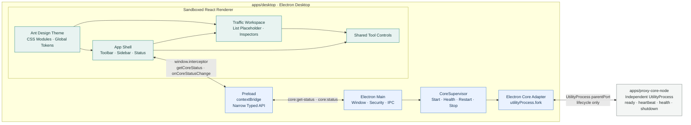
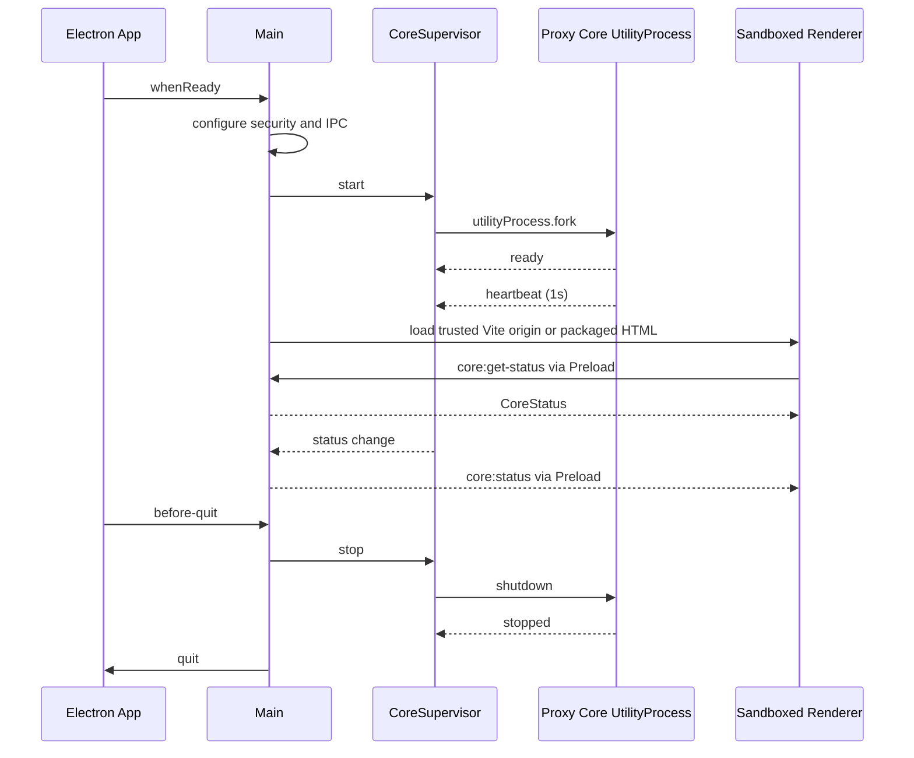
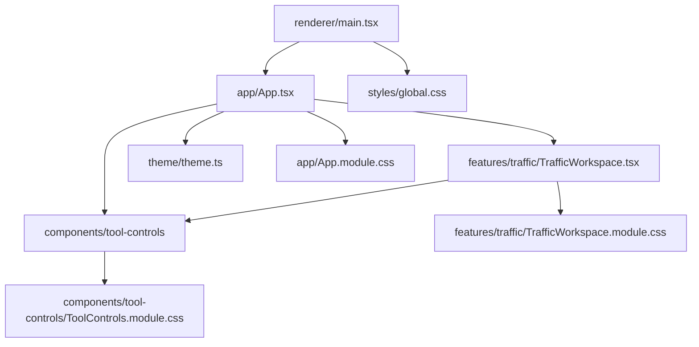
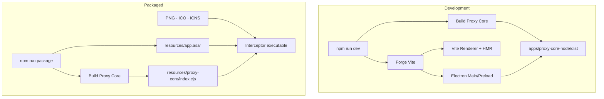

# Interceptor 当前实现架构

> 最后更新：2026-07-12
> 范围：只描述仓库中已经实现的代码，不描述产品完整目标架构。未来设计见 [桌面网络调试代理完整方案.md](桌面网络调试代理完整方案.md)。

## 文档职责

- 本文件回答“当前代码如何组成、边界在哪里、运行时如何通信”。
- 当前里程碑和进度索引见 [PROGRESS.md](PROGRESS.md)。
- 当前 Session 接棒事项见 [HANDOVER.md](HANDOVER.md)。
- 阶段实现与验证历史见 [Stage 文档目录](./)。

## 当前系统拓扑



## 运行时边界

| 边界 | 已实现职责 | 明确不负责 |
| --- | --- | --- |
| Renderer | 应用壳、工作区导航、Traffic/Inspector 空状态、主题、Core 状态展示 | Node.js、文件系统、Socket、证书、直接 Electron IPC |
| Preload | 暴露类型化 `window.interceptor`，转发 Core 状态查询和订阅 | 通用 `send`/`invoke`、进程控制、任意 Channel |
| Electron Main | BrowserWindow、安全策略、Renderer IPC、Core 生命周期 | 捕获流量数据面、请求/响应正文搬运 |
| CoreSupervisor | 启停、heartbeat 失联检测、health correlation、退避重启、优雅停止 | HTTP 代理协议、持久化、Renderer 状态 |
| Electron Core Adapter | 把 Supervisor 抽象映射到 `utilityProcess.fork`，解析开发/生产 Core 路径 | 产品协议和业务模型 |
| Proxy Core | M0 生命周期消息：`ready`、`heartbeat`、`health-check`、`shutdown`、`stopped` | HTTP Listener、MITM、规则、存储、正式 IPC |

## 启动与关闭流程



## Renderer 结构



所有权规则：

- `app/`：应用壳、全局导航、Toolbar、Sidebar、Status Bar。
- `features/`：Traffic 等产品工作区；业务布局与状态归功能所有。
- `components/`：跨功能复用的 UI 原语；当前包括图标按钮和模式选择。
- `theme/`：Ant Design 全局 Token 和组件 Token。
- `styles/`：仅 reset、根设计变量、字体和 accessibility media query。
- 功能与组件样式使用 colocated CSS Modules；不覆盖 Ant Design 私有 DOM 尺寸。

## Renderer API 契约

Renderer 当前只能看到：

```ts
interface InterceptorDesktopApi {
  getCoreStatus(): Promise<CoreStatus>;
  onCoreStatusChange(listener: (status: CoreStatus) => void): () => void;
}
```

`CoreStatus` 是只读状态快照，包含运行状态、PID、重启次数、启动/heartbeat/更新时间和诊断详情。Renderer 不具备启动、停止或向 Core 发送任意消息的能力。

## 安全架构

- `sandbox: true`、`contextIsolation: true`、`nodeIntegration: false`、`webSecurity: true`。
- permission request/check、webview、新窗口、下载和外部 URL 默认拒绝。
- IPC handler 校验 sender URL；Preload 不暴露 Node/Electron 原语。
- 开发态只允许精确 Vite origin 内的 Renderer reload；生产态只允许精确 packaged `index.html` URL。
- CSP 按环境生成；生产 `connect-src 'none'`、`frame-src 'none'`，资产全部本地加载。
- Fuses 禁用 RunAsNode、`NODE_OPTIONS` 和 CLI inspect，启用 cookie encryption、ASAR integrity 和 OnlyLoadAppFromAsar。
- `GrantFileProtocolExtraPrivileges` 当前保留启用，因为生产 Renderer 仍通过 `loadFile` 加载；迁移标准自定义协议后再评估关闭。

## 开发与打包路径



- Forge 将 Main、Preload、Renderer 构建进 ASAR，将 Core 作为 `extraResource` 放在 `resources/proxy-core`。
- Electron ZIP 使用锁定 npm 包内的官方 SHA-256 checksums 校验；镜像只作为临时下载源。
- 产品图标源为 `apps/desktop/assets/interceptor-icon.svg`；脚本生成 PNG、ICO、ICNS，Forge 按平台选择。
- packaged smoke 启动真实 `Interceptor.exe`，通过 Chromium CDP 验证 Renderer、安全边界、Core 健康和退出清理；不依赖被 Fuse 禁用的 Node inspector。

## 当前未实现

- HTTP/HTTPS Listener、CONNECT、MITM、HTTP/2、WebSocket、gRPC。
- Named Pipe/UDS、Protobuf、认证、消息背压和正式命令/事件协议。
- SQLite、Blob Store、Session/Body 持久化。
- 真实会话列表、搜索、筛选、Inspector 数据加载。
- CA、系统代理、规则引擎、Composer、导入导出、签名安装器和更新。

这些能力不能从现有 UI 占位或可启动 package 中推断为已完成。

## 架构更新规则

- 仅在实现边界、进程职责、通信路径、构建/打包路径或安全策略发生变化时更新本文件。
- 计划能力先写入阶段文件和产品方案，只有代码落地并通过验证后才进入本架构图。
- 阶段收尾时同时核对 [PROGRESS.md](PROGRESS.md)、[HANDOVER.md](HANDOVER.md) 和对应的 `M*.md` 文件。