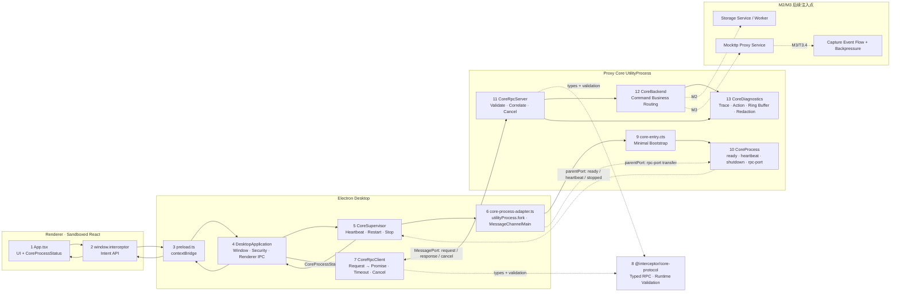

# Interceptor 当前实现架构与 Workflow

> 最后更新：2026-07-13
> 范围：只描述已经实现并验证的代码；未来设计见 [桌面网络调试代理完整方案.md](桌面网络调试代理完整方案.md)。

## 完整 Workflow 架构图

图中的实线是当前已实现路径，虚线 `M2/M3` 是明确的后续注入点，不表示当前已有存储、代理或 Capture Event。

## 两条独立通道

### 生命周期通道：`UtilityProcess.parentPort`

只承载：

- `ready`：Core 入口已启动；
- `heartbeat`：Core Event Loop 仍可调度；
- `rpc-port`：Main 向 Core 转交业务 MessagePort；
- `shutdown` / `stopped`：优雅关闭。

heartbeat 的唯一目的，是发现“进程仍存在但 Event Loop 已卡死”。Main 4 秒未收到 heartbeat 时将状态设为 `unresponsive`、kill Core，并退避重启。`CoreProcessStatus.running` 不代表 HTTP Listener、数据库等业务一定健康。

### RPC 通道：专用 `MessagePort`

只承载：

- Request：`protocolVersion + requestId + traceId + command`；
- Response：匹配 ID 的 Success 或结构化 Error；
- Cancel：timeout、AbortSignal 或调用方取消。

Main/Core 同包发布，MessagePort 会暂存 listener 注册前到达的消息，所以没有额外 channel init/ready 握手、Token 或跨版本协商状态机。每条 Request 自带 `protocolVersion`，不兼容消息由 validator 直接拒绝。

## Code Location 索引

| 层级 | 文件 | 主要对象/符号 | 职责 |
| --- | --- | --- | --- |
| Renderer | `apps/desktop/src/renderer/app/App.tsx` | `App`、`StatusBar` | 订阅并展示 `CoreProcessStatus`；不直接访问 Electron/Core |
| Renderer type | `apps/desktop/src/shared/desktop-api.ts` | `InterceptorDesktopApi`、`CoreProcessStatus` | Renderer 可见 DTO、API 和固定 IPC channel 名 |
| Preload | `apps/desktop/src/preload/preload.ts` | `api` | 把固定意图 API 映射到 `ipcRenderer`，不暴露通用 send/invoke |
| Main app | `apps/desktop/src/main/main.ts` | `DesktopApplication` | 应用级所有者：窗口、安全策略、IPC、Supervisor、RPC client |
| Main lifecycle | `apps/desktop/src/main/core/core-supervisor.ts` | `CoreSupervisor`、`CoreProcessHandle` | 启停、heartbeat 卡死检测、退避重启、graceful/forced stop |
| Main RPC | `apps/desktop/src/main/core/core-rpc-client.ts` | `CoreRpcClient`、`PendingRpcRequest` | Request→Promise、timeout/cancel、correlation、断线清理 |
| Electron adapter | `apps/desktop/src/main/core/core-process-adapter.ts` | `createElectronCoreProcess` | fork Core、转交 MessagePort、路径解析、stdout/stderr 转发 |
| Protocol | `packages/core-protocol/src/messages.ts` | `CoreCommand`、`CoreResultForCommand`、RPC envelope | 平台中立的 typed contract |
| Validation | `packages/core-protocol/src/validation.ts` | `parseMainToCoreMessage`、`parseCoreToMainMessage` | 两端 runtime 边界校验 |
| Core entry | `apps/proxy-core/src/proxy-core/core-entry.cts` | bootstrap | 获取 Electron parentPort 并启动 `CoreProcess` |
| Core lifecycle | `apps/proxy-core/src/proxy-core/core-process.ts` | `CoreProcess` | ready/heartbeat/shutdown/signal、RPC port 注入 |
| Core RPC | `apps/proxy-core/src/proxy-core/core-rpc-server.ts` | `CoreRpcServer`、`RpcConnection` | 校验、request/cancel、response、连接 replacement |
| Core business | `apps/proxy-core/src/proxy-core/core-backend.ts` | `CoreBackend`、`CoreCommandExecutor` | command 的唯一业务路由；M2/M3 Service 注入点 |
| Diagnostics | `apps/proxy-core/src/proxy-core/core-diagnostics.ts` | `CoreDiagnostics` | AsyncLocalStorage Trace、Action、内存上限、脱敏、sink fallback |
| Core tests | `apps/proxy-core/src/proxy-core/tests/core-*.test.ts` | Backend/RPC/Diagnostics tests | 按对象职责验证 Core 行为 |
| Main tests | `apps/desktop/src/main/core/tests/core-*.test.ts` | Supervisor/RPC tests | 进程生命周期与 Main RPC 行为 |
| Packaged smoke | `apps/desktop/tests/packaged-startup.spec.ts` | Playwright test | 最终 exe、隔离、状态、RPC、Core crash/restart、退出清理 |
| Core build | `apps/proxy-core/package.json` | `build` | `core-entry.cts` → `dist/proxy-core/core-entry.cjs` |
| Forge package | `apps/desktop/forge.config.ts` | `packagerConfig.extraResource` | 把 Core bundle 复制到 `resources/proxy-core` |

## Call Stack

以下表格按调用发生顺序排列。`async` 表示 Promise、EventEmitter、IPC 或 MessagePort 边界；Response 会沿相反方向完成 Promise/IPC 调用。

### A. Desktop 与 Core 启动栈

| Frame | 进程 | Code location / Symbol | 边界 | 详细说明 |
| ---: | --- | --- | --- | --- |
| A1 | Main | [main.ts](../apps/desktop/src/main/main.ts#L252) · `new DesktopApplication().start()` | sync | Main bundle 的实际入口，只创建一个应用级所有者。 |
| A2 | Main | [main.ts](../apps/desktop/src/main/main.ts#L29) · `DesktopApplication.start()` | async: Electron events | 注册 `whenReady`、`activate`、`window-all-closed`、`before-quit`。 |
| A3 | Main | [main.ts](../apps/desktop/src/main/main.ts#L36) · `onReady()` | Promise continuation | 配置 Session 安全、Renderer IPC、进程状态广播，然后启动 Supervisor 和窗口。 |
| A4 | Main | [core-supervisor.ts](../apps/desktop/src/main/core/core-supervisor.ts#L74) · `CoreSupervisor.start()` | sync | 将 `desiredRunning` 设为 true，并进入 `spawn()`。 |
| A5 | Main | [core-supervisor.ts](../apps/desktop/src/main/core/core-supervisor.ts#L117) · `spawn()` | sync → Electron | 调用注入的 process factory；失败时不抛给 UI，而是进入退避重启。 |
| A6 | Main | [core-process-adapter.ts](../apps/desktop/src/main/core/core-process-adapter.ts#L16) · `createElectronCoreProcess()` | Electron UtilityProcess | 解析 Core 入口并执行 `utilityProcess.fork()`，随后包装为 `CoreProcessHandle`。 |
| A7 | Main | [core-process-adapter.ts](../apps/desktop/src/main/core/core-process-adapter.ts#L49) · `connectRpcPort()` | MessageChannel transfer | 创建 `MessageChannelMain`；`port1` 交给 `CoreRpcClient`，`port2` 通过 parentPort 转给 Core。 |
| A8 | Core | [core-entry.cts](../apps/proxy-core/src/proxy-core/core-entry.cts#L16) · `new CoreProcess(...).start()` | UtilityProcess bootstrap | 校验 Electron 注入的 parentPort；不存在时非零退出。 |
| A9 | Core | [core-process.ts](../apps/proxy-core/src/proxy-core/core-process.ts#L52) · `CoreProcess.start()` | EventEmitter + timer | 监听 parent message/SIGINT/SIGTERM，发送 `ready`、首个 heartbeat，并启动 1 秒 interval。 |
| A10 | Main | [core-supervisor.ts](../apps/desktop/src/main/core/core-supervisor.ts#L164) · `handleMessage()` | parentPort event | 解析 `ready/heartbeat`，将进程状态更新为 `running` 并重置 4 秒 watchdog。 |

### B1. CoreProcessStatus 初始查询栈

| Frame | 方向 | Code location / Symbol | 数据 | 详细说明 |
| ---: | --- | --- | --- | --- |
| B1 | Renderer → Preload | [App.tsx](../apps/desktop/src/renderer/app/App.tsx#L67) · Core status `useEffect` | 无 | 先注册状态订阅，再拉取初始状态，避免旧快照覆盖新推送。 |
| B2 | Preload → Main | [preload.ts](../apps/desktop/src/preload/preload.ts#L11) · `getCoreProcessStatus()` | `core:get-process-status` | 使用固定 channel 调用 `ipcRenderer.invoke`，Renderer 看不到通用 invoke。 |
| B3 | Main | [main.ts](../apps/desktop/src/main/main.ts#L131) · `configureRendererIpc()` | IPC event | 校验 sender URL 后调用 Supervisor；这里不做业务健康推断。 |
| B4 | Main | [core-supervisor.ts](../apps/desktop/src/main/core/core-supervisor.ts#L65) · `getProcessStatus()` | `CoreProcessStatus` | 返回防修改的快照；`running` 只代表 heartbeat 正常。 |

### B2. CoreProcessStatus 实时推送栈

| Frame | 方向 | Code location / Symbol | 数据 | 详细说明 |
| ---: | --- | --- | --- | --- |
| B5 | Core → Main | [core-process.ts](../apps/proxy-core/src/proxy-core/core-process.ts#L95) · `sendHeartbeat()` | `{type:'heartbeat', pid, timestamp}` | 每秒通过 parentPort 上报 Event Loop 仍可调度。 |
| B6 | Main | [core-supervisor.ts](../apps/desktop/src/main/core/core-supervisor.ts#L164) · `handleMessage()` | lifecycle message | 更新 PID/heartbeat 时间，调用 `updateStatus()` 并重装 watchdog。 |
| B7 | Main → Renderer | [main.ts](../apps/desktop/src/main/main.ts#L175) · `broadcastProcessStatus()` | `core:process-status` | 向所有未销毁窗口广播最新快照。 |
| B8 | Preload → Renderer | [preload.ts](../apps/desktop/src/preload/preload.ts#L15) · `onCoreProcessStatusChange()` | typed listener | 包装 `ipcRenderer.on`，unsubscribe 时移除准确 handler。 |
| B9 | Renderer | [App.tsx](../apps/desktop/src/renderer/app/App.tsx#L71) · `applyStatus()` | `CoreProcessStatus` | 按 `updatedAt` 丢弃更旧快照，更新状态栏和指示点。 |

### C. Echo RPC 往返栈

| Frame | 进程 | Code location / Symbol | 输入/输出 | 详细说明 |
| ---: | --- | --- | --- | --- |
| C1 | Renderer | [desktop-api.ts](../apps/desktop/src/shared/desktop-api.ts#L52) · `echoCore(value)` | string → `Promise<CoreEchoResult>` | Renderer 只能调用面向意图的方法。 |
| C2 | Preload | [preload.ts](../apps/desktop/src/preload/preload.ts#L10) · `api.echoCore` | `ipcRenderer.invoke` | 跨越 Renderer/Main 隔离边界。 |
| C3 | Main | [main.ts](../apps/desktop/src/main/main.ts#L140) · `coreEcho` handler | unknown → validated string | 校验 sender、长度，生成 traceId，构造 typed Echo command。 |
| C4 | Main | [core-rpc-client.ts](../apps/desktop/src/main/core/core-rpc-client.ts#L96) · `CoreRpcClient.request()` | command → Promise | 生成/接收 requestId、traceId，创建 `PendingRpcRequest` 并通过 MessagePort 发送。 |
| C5 | Main | [core-rpc-client.ts](../apps/desktop/src/main/core/core-rpc-client.ts#L245) · `PendingRpcRequest` | timer + AbortSignal | 单个对象拥有 Promise、timeout 和取消 listener，完成时统一清理。 |
| C6 | Core | [core-rpc-server.ts](../apps/proxy-core/src/proxy-core/core-rpc-server.ts#L89) · `handleMessage()` | unknown → validated RPC | 调用 `parseMainToCoreMessage`；非法消息关闭 RPC 连接并让 Core 退出重启。 |
| C7 | Core | [core-rpc-server.ts](../apps/proxy-core/src/proxy-core/core-rpc-server.ts#L116) · `executeRequest()` | `CoreRequest` | 建立 AbortController 和统一 command 日志生命周期。 |
| C8 | Core | [core-backend.ts](../apps/proxy-core/src/proxy-core/core-backend.ts#L38) · `CoreBackend.execute()` | EchoCommand → EchoResult | command 的业务路由；echo 在 [core-backend.ts](../apps/proxy-core/src/proxy-core/core-backend.ts#L44) 执行。 |
| C9 | Core | [core-diagnostics.ts](../apps/proxy-core/src/proxy-core/core-diagnostics.ts#L81) · `action()` | action start/end | 记录 `echo.copy` action、时长和 outcome。 |
| C10 | Core | [core-rpc-server.ts](../apps/proxy-core/src/proxy-core/core-rpc-server.ts#L225) · `sendSuccess()` | Success Response | 写回相同 requestId/traceId 与 typed result。 |
| C11 | Main | [core-rpc-client.ts](../apps/desktop/src/main/core/core-rpc-client.ts#L155) · `handleResponse()` | Response → Promise completion | 校验 requestId、traceId、result type，完成并清理 `PendingRpcRequest`。 |
| C12 | Main → Renderer | [main.ts](../apps/desktop/src/main/main.ts#L140) · IPC handler return | `CoreEchoResult` | Electron 完成原 `invoke` Promise，结果返回调用方。 |

### D. Trace 查询栈

| Frame | 进程 | Code location / Symbol | 输入/输出 | 详细说明 |
| ---: | --- | --- | --- | --- |
| D1 | Renderer → Main | [preload.ts](../apps/desktop/src/preload/preload.ts#L13) · `getCoreTrace(traceId)` | traceId | 通过固定 IPC channel 发起查询。 |
| D2 | Main | [main.ts](../apps/desktop/src/main/main.ts#L157) · `coreGetTrace` handler | validated traceId | 构造 `diagnostics.recent` command，limit 固定为 200。 |
| D3 | Main → Core | [core-rpc-client.ts](../apps/desktop/src/main/core/core-rpc-client.ts#L96) · `request()` | DiagnosticsRecentCommand | 与 Echo 复用同一 RPC correlation/timeout 流程。 |
| D4 | Core | [core-backend.ts](../apps/proxy-core/src/proxy-core/core-backend.ts#L52) · `diagnostics.recent` branch | traceId + limit | 调用 Diagnostics Ring Buffer 查询。 |
| D5 | Core | [core-diagnostics.ts](../apps/proxy-core/src/proxy-core/core-diagnostics.ts#L119) · `recent()` | `DiagnosticLogRecord[]` | 过滤 traceId，返回副本和 droppedCount。 |
| D6 | Main | [main.ts](../apps/desktop/src/main/main.ts#L186) · `toRendererDiagnosticRecord()` | protocol DTO → Renderer DTO | 只映射允许展示的脱敏字段，不透传 attributes。 |
| D7 | Renderer | [desktop-api.ts](../apps/desktop/src/shared/desktop-api.ts#L54) · `getCoreTrace()` | `CoreDiagnosticTrace` | 调用方拿到按 trace 聚合的生命周期/action 记录。 |

### E. Timeout / Abort / Cancel 栈

| Frame | 进程 | Code location / Symbol | 触发 | 详细说明 |
| ---: | --- | --- | --- | --- |
| E1 | Main | [core-rpc-client.ts](../apps/desktop/src/main/core/core-rpc-client.ts#L96) · `request()` | `timeoutMs` / `AbortSignal` | 创建 `PendingRpcRequest` 并发送 Request。 |
| E2 | Main | [core-rpc-client.ts](../apps/desktop/src/main/core/core-rpc-client.ts#L263) · `PendingRpcRequest.start()` | timer / abort event | 任一先发生便调用 Client 的 `cancel(requestId, reason)`。 |
| E3 | Main | [core-rpc-client.ts](../apps/desktop/src/main/core/core-rpc-client.ts#L187) · `cancel()` | Cancel envelope | 尝试通知 Core；无论发送是否成功都清理本地 Promise。 |
| E4 | Core | [core-rpc-server.ts](../apps/proxy-core/src/proxy-core/core-rpc-server.ts#L89) · `handleMessage()` | Cancel | 解析后调用 `cancelRequest()`。 |
| E5 | Core | [core-rpc-server.ts](../apps/proxy-core/src/proxy-core/core-rpc-server.ts#L182) · `cancelRequest()` | requestId | 只取消属于当前连接的 AbortController。 |
| E6 | Core Backend/Service | [core-backend.ts](../apps/proxy-core/src/proxy-core/core-backend.ts#L38) · `execute()` | aborted signal | 当前/未来 Service 应观察 signal 并停止 I/O；Server 统一转换为 `cancelled` Error。 |
| E7 | Main | [core-rpc-client.ts](../apps/desktop/src/main/core/core-rpc-client.ts#L155) · `handleResponse()` | late response | Pending 已删除时忽略，不会错误完成另一个 Promise。 |

### F. Heartbeat 卡死检测与 Core 重启栈

| Frame | 进程 | Code location / Symbol | 数据/事件 | 详细说明 |
| ---: | --- | --- | --- | --- |
| F1 | Core | [core-process.ts](../apps/proxy-core/src/proxy-core/core-process.ts#L95) · `sendHeartbeat()` | heartbeat / 1s | 证明 Node Event Loop 仍能调度。 |
| F2 | Main | [core-supervisor.ts](../apps/desktop/src/main/core/core-supervisor.ts#L164) · `handleMessage()` | heartbeat | 更新 `lastHeartbeatAt`，状态设为 `running`，重装 watchdog。 |
| F3 | Main | [core-supervisor.ts](../apps/desktop/src/main/core/core-supervisor.ts#L225) · `armHeartbeatTimer()` | 4s deadline | 超时则状态设为 `unresponsive` 并 `child.kill()`。 |
| F4 | Main | [core-supervisor.ts](../apps/desktop/src/main/core/core-supervisor.ts#L202) · `handleExit()` | child exit | 清理 timer/pid；若仍期望运行则进入 restart。 |
| F5 | Main | [core-supervisor.ts](../apps/desktop/src/main/core/core-supervisor.ts#L247) · `scheduleRestart()` | 250ms…5s backoff | 增加 restartCount，延迟调用 `spawn()`。 |
| F6 | Main | [core-process-adapter.ts](../apps/desktop/src/main/core/core-process-adapter.ts#L16) · `createElectronCoreProcess()` | new child + new port | fork 新 PID 并创建全新 MessageChannel。 |
| F7 | Main | [core-rpc-client.ts](../apps/desktop/src/main/core/core-rpc-client.ts#L72) · `attach()` | replacement port | 旧连接上的 Pending Promise 以 disconnected 失败，新 RPC 使用新 port。 |
| F8 | Renderer | [App.tsx](../apps/desktop/src/renderer/app/App.tsx#L71) · `applyStatus()` | restarting → running | UI 通过单一 ProcessStatus 链看到重启过程。 |

### G. Graceful Shutdown 栈

| Frame | 进程 | Code location / Symbol | 调用/消息 | 详细说明 |
| ---: | --- | --- | --- | --- |
| G1 | Main | [main.ts](../apps/desktop/src/main/main.ts#L58) · `onBeforeQuit()` | Electron `before-quit` | `preventDefault()`，确保 Core 先清理；重复 before-quit 被 `quitting` 忽略。 |
| G2 | Main | [core-supervisor.ts](../apps/desktop/src/main/core/core-supervisor.ts#L84) · `stop()` | `{type:'shutdown'}` | 停止 heartbeat watchdog/restart timer，状态设为 `stopping`，发送 lifecycle shutdown。 |
| G3 | Core | [core-process.ts](../apps/proxy-core/src/proxy-core/core-process.ts#L84) · `handleParentMessage()` | shutdown | 调用 `stop()`。 |
| G4 | Core | [core-process.ts](../apps/proxy-core/src/proxy-core/core-process.ts#L66) · `stop()` | close RPC + stopped | 停止 heartbeat、取消 active RPC、发送 `stopped`，随后 `process.exit(0)`。 |
| G5 | Main | [core-supervisor.ts](../apps/desktop/src/main/core/core-supervisor.ts#L202) · `handleExit()` | exit(0) | 状态设为 `stopped`，resolve `stop()` Promise。 |
| G6 | Main | [main.ts](../apps/desktop/src/main/main.ts#L58) · `finally` | `rpcClient.close(); app.quit()` | 拒绝剩余 Promise，第二次 `before-quit` 直接放行。 |
| G7 | Main fallback | [core-supervisor.ts](../apps/desktop/src/main/core/core-supervisor.ts#L272) · `forceStop()` | 1.5s timeout | Core 未退出时强杀并完成 stop Promise，避免应用永久卡住。 |

### H. Build / Package / Runtime 入口栈

| Frame | 阶段 | Code location | 命令/产物 | 详细说明 |
| ---: | --- | --- | --- | --- |
| H1 | Root orchestration | [package.json](../package.json#L16) | `npm run build:core` | 先构建 Core Protocol，再构建 Proxy Core。 |
| H2 | Protocol build | [packages/core-protocol/package.json](../packages/core-protocol/package.json#L16) | `tsc --project tsconfig.json` | 验证并生成 protocol JS/declaration。 |
| H3 | Core clean/build | [apps/proxy-core/package.json](../apps/proxy-core/package.json#L9) | clean + esbuild | 清理旧 dist，将 `core-entry.cts` 和依赖 bundle 为 `core-entry.cjs`。 |
| H4 | Forge package | [package.json](../package.json#L18) → [apps/desktop/package.json](../apps/desktop/package.json#L10) | `electron-forge package` | 构建 Main/Preload/Renderer 并封装 Electron。 |
| H5 | Resource copy | [forge.config.ts](../apps/desktop/forge.config.ts#L16) · `proxyCoreDirectory` | `extraResource` | 将 clean Core bundle 复制到 `resources/proxy-core/`。 |
| H6 | Runtime resolution | [core-process-adapter.ts](../apps/desktop/src/main/core/core-process-adapter.ts#L90) · `resolveCoreEntry()` | Dev sibling / packaged resource | Dev 加载 workspace dist；package 加载 `resources/proxy-core/core-entry.cjs`。 |
| H7 | Final acceptance | [packaged-startup.spec.ts](../apps/desktop/tests/packaged-startup.spec.ts) | Playwright + real exe | 验证最终路径、Renderer 隔离、状态、RPC、Core crash/restart 和进程清理。 |

## Workflow 详细表

| # | Workflow | 发起方 → 接收方 | 数据/调用 | 代码位置 | 成功结果 | 失败与清理 |
| ---: | --- | --- | --- | --- | --- | --- |
| 1 | Desktop 启动 | Electron → `DesktopApplication` | `app.whenReady()` | `apps/desktop/src/main/main.ts` | 配置安全、IPC、Supervisor，并创建窗口 | app 未 ready 前不创建 UtilityProcess/窗口 |
| 2 | 配置安全边界 | `DesktopApplication` → Electron Session/WebContents | permission、webview、navigation、download handlers | `main.ts`、`security/trusted-renderer-url.ts` | Renderer 只加载可信 Dev origin 或 packaged HTML | 非可信导航/权限/下载被拒绝 |
| 3 | 启动 Core | `DesktopApplication` → `CoreSupervisor` | `start()` | `main.ts`、`core-supervisor.ts` | Supervisor 调用 process factory | fork 抛错时进入退避重启 |
| 4 | fork UtilityProcess | `CoreSupervisor` → adapter → Electron | `utilityProcess.fork(core-entry.cjs)` | `core-process-adapter.ts` | 得到 `CoreProcessHandle` 和 PID | adapter 初始化失败则 kill child 并抛给 Supervisor |
| 5 | 创建 RPC 通道 | adapter → Main/Core | `new MessageChannelMain()`、`child.postMessage({type:'rpc-port'}, [port2])` | `core-process-adapter.ts` | Main `port1` 附加到 `CoreRpcClient`，Core 接收 `port2` | transfer/attach 失败时关闭 port、client 和 child |
| 6 | Core bootstrap | Electron → `core-entry.cts` | `process.parentPort` | `core-entry.cts` | `new CoreProcess(parentPort).start()` | 无 parentPort 时输出错误并非零退出 |
| 7 | Core 生命周期启动 | `CoreProcess` → parentPort | `ready` + 首个 `heartbeat` | `core-process.ts` | Main 状态变为 `running`，随后每秒 heartbeat | parentPort 故障最终表现为 heartbeat timeout/exit |
| 8 | Renderer 获取状态 | Renderer → Preload → Main | `getCoreProcessStatus()` | `App.tsx`、`preload.ts`、`main.ts` | 返回只读 `CoreProcessStatus` | IPC 失败时 UI 标记 `unresponsive` |
| 9 | Renderer 状态订阅 | Main → Preload → Renderer | `core:process-status` | `core-supervisor.ts`、`main.ts`、`preload.ts`、`App.tsx` | UI 显示 running/restarting/unresponsive/stopping | Renderer cleanup 移除 ipcRenderer listener |
| 10 | 发起业务命令 | Renderer → Main | `echoCore(value)` / `getCoreTrace(traceId)` | `desktop-api.ts`、`preload.ts`、`main.ts` | Main 校验 sender 和参数，构造 typed command | 非可信 sender/非法参数直接拒绝 |
| 11 | RPC Request→Promise | Main → `CoreRpcClient` | `request(command, options)` | `core-rpc-client.ts` | 生成 requestId/traceId，注册 `PendingRpcRequest` 并发送 | 无连接、duplicate ID 或 postMessage 失败时 Promise reject |
| 12 | RPC 边界校验 | MessagePort → `CoreRpcServer` | `parseMainToCoreMessage(raw)` | `core-rpc-server.ts`、`core-protocol/validation.ts` | 得到安全的 Request 或 Cancel | 非法消息关闭连接并触发 Core fatal recovery |
| 13 | command 调度 | `CoreRpcServer` → `CoreBackend` | `execute(command, signal)` | `core-rpc-server.ts`、`core-backend.ts` | echo/diagnostics 返回 typed result | 未实现 command 返回 `unsupported-command`；异常转为 `internal` |
| 14 | 结构化日志 | RPC Server/Backend → `CoreDiagnostics` | command lifecycle + action | `core-diagnostics.ts` | traceId 下记录 received/validated/handler/action/response/completed | sink 同步/异步失败回退 stderr；日志不得使 command 失败 |
| 15 | RPC Response→Promise | Core → Main | Success/Error Response | `core-rpc-server.ts`、`core-rpc-client.ts` | requestId/traceId/result type 匹配后完成 Promise | mismatch 关闭连接；late response 被忽略 |
| 16 | timeout/cancel | Caller/Timer → Main → Core | `cancel` + AbortController | `PendingRpcRequest`、`CoreRpcServer` | 两端释放 timer/listener/active request | Cancel 消息发送失败时本地 Promise 仍完成清理 |
| 17 | heartbeat 卡死检测 | Core → `CoreSupervisor` | 每秒 heartbeat，4 秒 deadline | `core-process.ts`、`core-supervisor.ts` | 持续保持 `running` | 超时标记 `unresponsive`、kill，exit 后退避重启 |
| 18 | Core crash/restart | OS/Core → Supervisor/adapter | `exit(code)` → backoff → new fork/port | `core-supervisor.ts`、`core-process-adapter.ts` | 新 PID、新 MessagePort，后续 RPC 正常 | 旧 port 上 pending Promise 被 `CoreRpcClient.attach()` 拒绝 |
| 19 | graceful shutdown | Electron → DesktopApplication → Supervisor/Core | `before-quit`、`shutdown`、`stopped` | `main.ts`、`core-supervisor.ts`、`core-process.ts` | Core 关闭 RPC、停止 heartbeat、退出；Main 再 quit | 超过 1.5 秒则 Supervisor force kill |
| 20 | build/package/runtime | npm → esbuild → Forge → packaged app | `core-entry.cts` → `core-entry.cjs` → `extraResource` | root/package scripts、`apps/proxy-core/package.json`、`forge.config.ts`、adapter | Dev 从 sibling dist 加载；package 从 `resources/proxy-core/core-entry.cjs` 加载 | packaged smoke 直接验证最终路径、Core restart 和进程清理 |

## 关键数据结构

| 数据 | 定义位置 | 用途 |
| --- | --- | --- |
| `CoreProcessStatus` | `apps/desktop/src/shared/desktop-api.ts` | Renderer 可见的进程状态；`running` 仅代表 heartbeat 正常 |
| `CoreCommand` | `packages/core-protocol/src/messages.ts` | Main → Core 的 typed command union |
| `CoreResultForCommand<T>` | `packages/core-protocol/src/messages.ts` | 编译期保证 command/result 配对 |
| `CoreRequest` / Response / Cancel | `packages/core-protocol/src/messages.ts` | MessagePort RPC envelope |
| `CoreError` | `packages/core-protocol/src/messages.ts` | invalid/unsupported/timeout/cancelled/disconnected/conflict/internal |
| `DiagnosticLogRecord` | `packages/core-protocol/src/messages.ts` | Trace/Action/Duration/Outcome 的结构化日志 |

## 后续扩展规则

- M2 Storage Service 与 M3 Proxy Service 注入 `CoreBackend`，不要把业务逻辑放入 `CoreRpcServer`。
- 真实 Capture Event 的有界队列、批处理、合并和 sequence/ack 在 M3/T3.4 实现，不能复活 M1 的占位事件模型。
- `CoreSupervisor` 只管理进程，不接收业务 command。
- `CoreProcessStatus.running` 不得描述为“业务健康”。
- Main 不搬运完整 Body；Body 只通过有限 range/chunk 读取。
- Renderer API 继续面向意图，不暴露通用 IPC、MessagePort 或 Node 原语。

## 当前未实现

- HTTP/HTTPS Listener、CONNECT、MITM、HTTP/2、WebSocket、gRPC。
- Capture Event 流与背压。
- SQLite、Blob Store、Diagnostics Worker 与 `diagnostics.sqlite`。
- 真实会话列表、规则、CA、系统代理、导入导出、签名安装器和更新。

## 更新规则

- 本文件只记录已经实现并验证的 workflow。
- 计划能力留在完整方案和对应 Stage 文件。
- 阶段边界同步核对 [PROGRESS.md](PROGRESS.md)、[HANDOVER.md](HANDOVER.md) 和对应 `M*.md`。