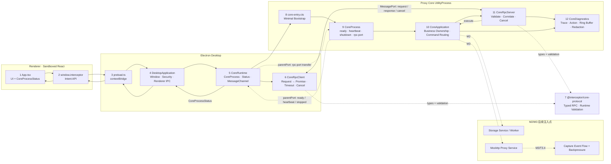

# Interceptor 当前实现架构与 Workflow

> 最后更新：2026-07-13
> 范围：只描述已经实现并验证的代码；未来设计见 [桌面网络调试代理完整方案.md](桌面网络调试代理完整方案.md)。

## 完整 Workflow 架构图

图中的实线是当前已实现路径，虚线 `M2/M3` 是明确的后续注入点，不表示当前已有存储、代理或 Capture Event。

## 两条独立通道

### 生命周期通道：`UtilityProcess.parentPort`

只承载：

- `ready`：Core 入口已启动；
- `heartbeat`：Core Event Loop 仍可调度；
- `rpc-port`：Main 向 Core 转交业务 MessagePort；
- `shutdown` / `stopped`：优雅关闭。

heartbeat 的唯一目的，是发现“CoreProcess 仍存在但 Event Loop 已卡死”。Main 4 秒未收到 heartbeat 时将状态设为 `unresponsive`、kill CoreProcess，并退避重启。`CoreProcessStatus.running` 不代表 HTTP Listener、数据库等业务一定健康。

### RPC 通道：专用 `MessagePort`

只承载：

- Request：`protocolVersion + requestId + traceId + command`；
- Response：匹配 ID 的 Success 或结构化 Error；
- Cancel：timeout、AbortSignal 或调用方取消。

Main/Core 同包发布，MessagePort 会暂存 listener 注册前到达的消息，所以没有额外 channel init/ready 握手、Token 或跨版本协商状态机。每条 Request 自带 `protocolVersion`，不兼容消息由 validator 直接拒绝。

## Workflow 详细表

| # | Workflow | 发起方 → 接收方 | 数据/调用 | 代码位置 | 成功结果 | 失败与清理 |
| ---: | --- | --- | --- | --- | --- | --- |
| 1 | Desktop 启动 | Electron → `DesktopApplication` | `app.whenReady()` | `apps/desktop/src/main/main.ts` | 配置安全、IPC、CoreRuntime，并创建窗口 | app 未 ready 前不创建 CoreProcess/窗口 |
| 2 | 配置安全边界 | `DesktopApplication` → Electron Session/WebContents | permission、webview、navigation、download handlers | `main.ts`、`security/trusted-renderer-url.ts` | Renderer 只加载可信 Dev origin 或 packaged HTML | 非可信导航/权限/下载被拒绝 |
| 3 | 启动 CoreProcess | `DesktopApplication` → `CoreRuntime` | `start()` | `main.ts`、`core-runtime.ts` | CoreRuntime 调用 `startCoreProcess` | fork 抛错时进入退避重启 |
| 4 | fork CoreProcess | `CoreRuntime` → Electron | `utilityProcess.fork(core-entry.cjs)` | `core-runtime.ts` | CoreRuntime 独占当前 `CoreProcessHandle`、状态和关闭流程 | 初始化失败时 kill CoreProcess 并进入重启 |
| 5 | 创建 RPC 通道 | `CoreRuntime` → Main/CoreProcess | `new MessageChannelMain()`、`coreProcess.postMessage({type:'rpc-port'}, [port2])` | `core-runtime.ts` | `port1` 附加到内部 `CoreRpcClient`，CoreProcess 接收 `port2` | transfer/attach 失败时关闭 port、client 和 CoreProcess |
| 6 | CoreProcess bootstrap | Electron → `core-entry.cts` | `process.parentPort` | `core-entry.cts` | `new CoreProcess(parentPort).start()` | 无 parentPort 时输出错误并非零退出 |
| 7 | CoreProcess 生命周期启动 | `CoreProcess` → parentPort | `ready` + 首个 `heartbeat` | `core-process.ts` | Main 状态变为 `running`，随后每秒 heartbeat | parentPort 故障最终表现为 heartbeat timeout/exit |
| 8 | Renderer 获取 CoreProcess 状态 | Renderer → Preload → Main | `getCoreProcessStatus()` | `App.tsx`、`preload.ts`、`main.ts` | 返回只读 `CoreProcessStatus` | IPC 失败时 UI 标记 `unresponsive` |
| 9 | Renderer 订阅 CoreProcess 状态 | Main → Preload → Renderer | `core:process-status` | `core-runtime.ts`、`main.ts`、`preload.ts`、`App.tsx` | UI 显示 running/restarting/unresponsive/stopping | CoreRuntime.stop 清空状态 listeners；Renderer cleanup 移除 ipcRenderer listener |
| 10 | 发起业务命令 | Renderer → Main | `echoCore(value)` / `getCoreTrace(traceId)` | `desktop-api.ts`、`preload.ts`、`main.ts` | Main 校验 sender 和参数，构造 typed command | 非可信 sender/非法参数直接拒绝 |
| 11 | RPC Request→Promise | Main → `CoreRuntime` → `CoreRpcClient` | `request(command, options)` | `core-runtime.ts`、`core-rpc-client.ts` | 生成 requestId/traceId，注册 `PendingRpcRequest` 并发送 | 无连接、duplicate ID 或 postMessage 失败时 Promise reject |
| 12 | RPC 边界校验 | MessagePort → `CoreRpcServer` | `parseMainToCoreMessage(raw)` | `core-rpc-server.ts`、`core-protocol/validation.ts` | 得到安全的 Request 或 Cancel | 非法消息关闭连接并触发 Core fatal recovery |
| 13 | command 调度 | `CoreRpcServer` → `CoreApplication` | `execute(command, signal)` | `core-rpc-server.ts`、`core-application.ts` | echo/diagnostics 返回 typed result | 未实现 command 返回 `unsupported-command`；异常转为 `internal` |
| 14 | 结构化日志 | RpcServer/Application → `CoreDiagnostics` | command lifecycle + action | `core-diagnostics.ts` | traceId 下记录 received/validated/handler/action/response/completed | sink 同步/异步失败回退 stderr；日志不得使 command 失败 |
| 15 | RPC Response→Promise | Core → Main | Success/Error Response | `core-rpc-server.ts`、`core-rpc-client.ts` | requestId/traceId/result type 匹配后完成 Promise | mismatch 关闭连接；late response 被忽略 |
| 16 | timeout/cancel | Caller/Timer → Main → Core | `cancel` + AbortController | `PendingRpcRequest`、`CoreRpcServer` | 两端释放 timer/listener/active request | Cancel 消息发送失败时本地 Promise 仍完成清理 |
| 17 | CoreProcess heartbeat 检测 | `CoreProcess` → `CoreRuntime` | 每秒 heartbeat，4 秒 deadline | `core-process.ts`、`core-runtime.ts` | 持续保持 `running` | 超时标记 `unresponsive`、kill，exit 后退避重启 |
| 18 | CoreProcess restart | OS/CoreProcess → `CoreRuntime` | `exit(code)` → backoff → new fork/port | `core-runtime.ts` | 新 PID、新 MessagePort，后续 RPC 正常 | 旧 port 上 pending Promise 被内部 `CoreRpcClient` 拒绝 |
| 19 | graceful shutdown | Electron → DesktopApplication → CoreRuntime/CoreProcess | `before-quit`、`shutdown`、`stopped` | `main.ts`、`core-runtime.ts`、`core-process.ts` | CoreProcess 关闭 RPC、停止 heartbeat、退出；CoreRuntime 清空 listeners 后 Main 再 quit | 超过 1.5 秒则 CoreRuntime force kill |
| 20 | build/package/runtime | npm → esbuild → Forge → packaged app | `core-entry.cts` → `core-entry.cjs` → `extraResource` | root/package scripts、`apps/proxy-core/package.json`、`forge.config.ts`、`core-runtime.ts` | Dev 从 sibling dist 加载；package 从 `resources/proxy-core/core-entry.cjs` 加载 | packaged smoke 直接验证最终路径、CoreProcess restart 和清理 |

## 关键数据结构

| 数据 | 定义位置 | 用途 |
| --- | --- | --- |
| `CoreProcessStatus` | `apps/desktop/src/shared/desktop-api.ts` | Renderer 可见的 CoreProcess 状态；`running` 仅代表 heartbeat 正常 |
| `CoreCommand` | `packages/core-protocol/src/messages.ts` | Main → Core 的 typed command union |
| `CoreResultForCommand<T>` | `packages/core-protocol/src/messages.ts` | 编译期保证 command/result 配对 |
| `CoreRequest` / Response / Cancel | `packages/core-protocol/src/messages.ts` | MessagePort RPC envelope |
| `CoreError` | `packages/core-protocol/src/messages.ts` | invalid/unsupported/timeout/cancelled/disconnected/conflict/internal |
| `DiagnosticLogRecord` | `packages/core-protocol/src/messages.ts` | Trace/Action/Duration/Outcome 的结构化日志 |

## 后续扩展规则

- M2 Storage Service 与 M3 Proxy Service 由 `CoreApplication` 统一拥有，不要把业务逻辑放入 `CoreRpcServer`。
- 真实 Capture Event 的有界队列、批处理、合并和 sequence/ack 在 M3/T3.4 实现，不能复活 M1 的占位事件模型。
- `CoreRuntime` 是 Main 唯一的 Core 入口；`CoreRpcClient` 只作为其内部 RPC 状态机。
- `CoreProcessStatus.running` 不得描述为“业务健康”。
- Main 不搬运完整 Body；Body 只通过有限 range/chunk 读取。
- Renderer API 继续面向意图，不暴露通用 IPC、MessagePort 或 Node 原语。

## 当前未实现

- HTTP/HTTPS Listener、CONNECT、MITM、HTTP/2、WebSocket、gRPC。
- Capture Event 流与背压。
- SQLite、Blob Store、Diagnostics Worker 与 `diagnostics.sqlite`。
- 真实会话列表、规则、CA、系统代理、导入导出、签名安装器和更新。

## 更新规则

- 本文件只记录已经实现并验证的 workflow。
- 计划能力留在完整方案和对应 Stage 文件。
- 阶段边界同步核对 [PROGRESS.md](PROGRESS.md)、[HANDOVER.md](HANDOVER.md) 和对应 `M*.md`。