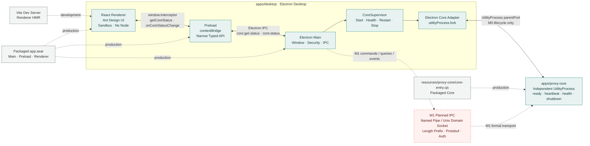

# M0 项目脚手架与工具链

> 状态：已完成
> 进度：100%
> 完成日期：2026-07-12
> 参考方案：[桌面网络调试代理完整方案.md](桌面网络调试代理完整方案.md) 第五、六、七、十五章和第二十七章 M0

## 阶段目标

建立后续代理产品可以安全演进的工程底座：

- Electron Forge + Vite + React + TypeScript 三入口。
- Ant Design v6 桌面应用壳和亮暗主题。
- Renderer sandbox、窄 Preload API、CSP、导航和权限安全基线。
- Vitest、package 和最终可执行产物 smoke 测试链。
- 独立 Proxy Core 进程及其生命周期管理。

本阶段不实现 HTTP Listener、Traffic Capture、CA、存储、规则或正式 IPC。

## 任务验收

| 任务 | 状态 | 交付结果 |
| --- | --- | --- |
| T0.1 Electron Forge + Vite + React + TS 骨架 | 已完成 | npm workspaces、Main/Preload/Renderer、独立 Core、Dev/HMR 和 package 已打通 |
| T0.2 Ant Design v6 外壳布局 | 已完成 | Toolbar、Sidebar、Traffic/Inspector、Status Bar、亮暗主题和紧凑桌面布局 |
| T0.3 Electron 安全基线 | 已完成 | sandbox/context isolation、无 Node integration、CSP、窄 API、导航/权限拒绝和 Fuses |
| T0.4 测试工具链 | 已完成 | Vitest 单测和真实 packaged executable 的 Playwright CDP smoke |
| T0.5 Proxy Core 进程骨架 | 已完成 | UtilityProcess 启停、heartbeat、health、退避重启、优雅/强制停止和进程清理 |

## T0.1 工程与工具链

### 实现

- 根项目使用 npm workspaces 管理 `apps/*` 和未来 `packages/*`；根包只负责编排。
- Desktop 和 Proxy Core 从目录、构建和运行进程上独立。
- Desktop 使用 Forge Vite Plugin 的 Main、Preload、Renderer 三个入口。
- Proxy Core 使用严格 TypeScript 和独立 CommonJS `.cjs` 产物。
- Node/npm 基线固定为 Node.js `24.18.0`、npm `11.16.0`；依赖全部精确锁定。
- Electron `43.1.0`、Forge `7.11.2`、Fuses `1.8.0`、Vite `8.1.4`、React `19.2.7`、Ant Design `6.5.0`、TypeScript `7.0.2`。
- `.npmrc` 开启 `engine-strict` 和 `save-exact`，`.nvmrc` 固定 Node LTS。

### 依赖兼容处理

1. 初始 `@electron/fuses@2.1.3` 与 Forge 7 plugin peer 冲突，严格安装以 `ERESOLVE` 失败。
2. 核对发布元数据后确认 Forge 7 稳定版要求 Fuses 1.x；改为兼容的 `@electron/fuses@1.8.0`，没有使用 `--force` 或 `--legacy-peer-deps`。
3. Forge 8 alpha 虽支持 Fuses 2.x，但整套仍是预发布版本；M0 保留稳定 Forge 7。
4. `@fontsource-variable/ibm-plex-mono` 不存在，Mono 改用 `@fontsource/ibm-plex-mono`。

### 打包

- Forge package 使用 ASAR，并把 Core `dist/proxy-core` 作为 `extraResource` 复制到 `resources/proxy-core`。
- 从锁定的 Electron npm 包读取官方 `checksums.json`，即使临时使用下载镜像也校验官方 SHA-256。
- Windows 输出为 `apps/desktop/out/Interceptor-win32-x64`，ProductName/FileDescription/InternalName 为 `Interceptor`。
- 最终 ASAR 不包含 Forge、node-gyp、tar 等开发工具链。

## T0.2 Renderer 应用壳

### 当前结构

- `renderer/app/`：48 px Toolbar、224 px Sidebar、工作区导航、Status Bar 和 Core 状态订阅。
- `renderer/features/traffic/`：Traffic 结构/顺序视图、Name/Method/Status 列占位、Request/Response Inspector Tabs。
- `renderer/components/tool-controls/`：共享 `ToolIconButton` 和 `ToolSegmentedControl`。
- `renderer/theme/`：Ant Design 全局 Token 和组件 Token。
- `renderer/styles/`：reset、根设计变量、字体与 reduced-motion。
- 功能布局和产品视觉使用 colocated CSS Modules。

### 交互与视觉约束

- 采用紧凑、中性、适合高频检查的桌面工具视觉，参考 Copilot Desktop 和 Charles 的信息密度，而非营销页或卡片后台。
- Ant Design 样式优先级为官方 props、全局/组件 Token、semantic slots、最后才是 CSS Modules。
- Toolbar 只保留一个 Traffic 搜索入口；Filter 是结构化筛选动作，放在同一顶部工具组。
- Tabs 保留选中 ink bar，通过局部官方 Token 隐藏浅色 baseline。
- 未实现的 Capture/Search/Filter/Settings/Inspector 命令保持 disabled，不伪造产品能力。
- 亮暗主题写入 localStorage，首启跟随系统偏好。
- 最小窗口 880×560；阶段截图覆盖 1280×800 和 900×600。

### 图标管线

- `apps/desktop/assets/interceptor-icon.svg` 是可编辑源文件。
- `scripts/generate-icon.ps1` 可重复生成 PNG、ICO 和 ICNS。
- Forge 在 Windows 使用 ICO、macOS 使用 ICNS；PNG 用于 BrowserWindow 和 Renderer 品牌标记。

## T0.3 Electron 安全

### BrowserWindow 与 Session

- `sandbox: true`、`contextIsolation: true`、`nodeIntegration: false`、`webSecurity: true`。
- permission request/check、webview、新窗口、下载和 `open-url` 默认拒绝。
- Main IPC 校验 sender URL；Preload 只暴露 `getCoreStatus` 和 `onCoreStatusChange`。
- Renderer 中 `process` 和 `require` 不存在。

### 导航与冷启动

- 初始实现无条件阻止 `will-navigate`，导致 Vite 冷启动依赖优化触发的同源自动 reload 被拦截；页面只有手工 reload 后才挂载。
- 曾尝试显式预打包 Renderer 依赖，缓存稳定但问题仍复现，因此否定“Vite optimizer 不稳定是根因”的假设。
- 最终实现 `trusted-renderer-url`：开发态仅允许精确 Vite origin，生产态仅允许精确 packaged HTML file URL；外部和无效 URL 继续拒绝。
- 单测覆盖可信同源 reload、外部 origin、无效 URL 和生产精确路径。

### CSP 与 Fuses

- Vite 在构建时注入环境 CSP；生产 `connect-src 'none'`、`frame-src 'none'`，无远程资源。
- `frame-ancestors` 不在 meta CSP 中声明，因为标准要求由 HTTP header 交付。
- 禁用 RunAsNode、`NODE_OPTIONS` 和 CLI inspect；启用 cookie encryption、ASAR integrity 和 OnlyLoadAppFromAsar。
- `GrantFileProtocolExtraPrivileges` 因生产 Renderer 使用 `loadFile` 暂时开启。

## T0.4 测试链

- Vitest 覆盖 CoreSupervisor 生命周期和可信 Renderer URL 策略。
- package smoke 启动真实 `Interceptor.exe`，不使用 Playwright `_electron.launch`。
- 原因：`_electron.launch` 依赖 Node inspector，而最终安全产物通过 Fuse 禁用了 CLI inspect；测试不能反向放宽生产安全。
- smoke 通过 Chromium remote debugging port 和 CDP 连接 Renderer。
- smoke 断言应用壳、Workspaces 导航、Renderer isolation、Preload API、生产 CSP、Core healthy/PID、亮暗主题、1280×800/900×600 布局、窗口关闭、主进程退出和 Core PID 清理。
- 测试截图生成在被 Git 忽略的 Playwright `test-results`，用于阶段人工 Review，不提交仓库。
- 曾探索独立 Electron region visual harness；用户要求暂不采用后已完整撤回，不属于 M0 交付。

## T0.5 Proxy Core 生命周期

- Core 启动发送 `ready`，每秒发送 `heartbeat`，处理带 correlation ID 的 `health-check`。
- 收到 `shutdown` 后停止定时器、发送 `stopped` 并正常退出。
- Core 使用运行时形状访问 UtilityProcess `process.parentPort`，源码不依赖 Electron 包。
- 直接用普通 Node 启动会输出明确错误并非零退出。
- 所有父进程消息先做运行时结构校验，未知消息被忽略。
- `CoreSupervisor` 提供状态快照/订阅、4 秒 heartbeat 失联检测、250 ms 起始指数退避、1.5 秒优雅停止超时和 kill 兜底。
- Electron adapter 在开发态读取 sibling Core dist，在生产态读取 `process.resourcesPath/proxy-core/core-entry.cjs`。
- M0 parent port 永远只承担生命周期控制；正式产品命令和事件从 M1 开始另建协议和 transport。

## 关键排障记录

### Electron 下载失败

- 首次 package 的 UI 停在 `Copying files`，DEBUG 日志证明真正失败发生在 Electron ZIP 下载完成后的 `read ECONNRESET`。
- `extraResource` sibling workspace 路径解析正确，因此没有按错误假设重构资源路径。
- 临时设置 `ELECTRON_MIRROR` 后下载成功，ZIP 仍由官方 checksums 校验并写入缓存。

### Packaged smoke 与安全 Fuse

- 首次 smoke 在 Playwright Electron launch 超时，页面断言尚未开始。
- 根因是最终产物禁用了 Node CLI inspect；改为真实 exe + CDP，而不是降低 Fuse。
- 第二次 smoke 暴露 `<nav>` 缺少 Workspaces accessible name；将 label 放到真实 navigation 元素后通过。

### 紧凑布局

- 900×600 截图曾出现左侧列宽总和超过 Panel 的水平溢出。
- 收紧列宽与 gap 后重打包，水平滚动消失，Splitter、空状态和状态栏无碰撞。

### Renderer HMR

- Dev 模式通过内存标记和临时品牌文本探针验证 HMR：页面更新时 Renderer 未 reload、Core PID 不变、restartCount 为 0。
- 撤销探针同样通过 HMR；清理后无 Electron/Core 进程和 5173/9333 listener 残留。

### Chromium Winsock 10108

- Windows 上 Chromium 可能记录 `WSALookupServiceBegin failed with: 10108`。
- 已验证 Main、Network Service、Core、Vite、IPv6 localhost 和 DNS 正常；这是 NS_NLA 查询失败后的 Chromium fallback，不是 Proxy Core 异常。
- 不为该日志重置系统 Winsock；只有操作系统网络实际异常时才进一步诊断。

## M0 完成后评审修复

对照 M0 交付重新评审代码后修复了三处问题，均已通过根级 typecheck 与 Vitest（2 files / 6 tests）：

- CoreSupervisor 停止竞态：优雅停止把期望状态置为 stopped 后，Core 在途 `heartbeat` 仍被 `handleMessage` 当作健康信号，把状态从 `stopping` 复活为 `healthy` 并重新装载心跳定时器。现在解析完 `health` 回执后，若已不再期望运行则直接返回，不复活状态；新增单测覆盖“停止期间到达心跳仍保持 stopping 直至 exit”。
- Renderer 状态覆盖竞态：`App` 初始 `getCoreStatus()` 与 `onCoreStatusChange` 订阅之间存在覆盖，旧快照可能盖掉更新的推送。现在先订阅再拉取，并按 `updatedAt` 丢弃更旧快照；初始拉取失败仅在尚未收到任何真实状态时才标记 unhealthy。
- 导航加固：Main 之前只拦截 `will-navigate`，现按同一可信 URL 策略同时拦截 `will-redirect`，堵住重定向绕过。
- 文档色相对齐：产品方案未规定操作色色相，实际 Design Token 是自洽的蓝色（`--accent` 亮 `#0a84ff` / 暗 `#4da3ff`，`colorPrimary`、divider 与 Input 焦点阴影同源）。本文件早前“青绿色操作色”的表述已更正为“蓝色操作色”，代码未改动。

`CoreSupervisor.checkHealth` 主动健康探测与 `restartCount` 稳定后归零均为 M1 计划项，M0 保持现状且与文档一致。

## 依赖审计

- `npm audit --omit=dev`：生产依赖漏洞为 0。
- 完整 audit 曾报告 3 low、20 high，位于 Forge CLI、electron-rebuild/node-gyp/tar 和 prompts 临时文件链。
- 相关包只参与开发/打包，最终 ASAR 已验证不包含它们。
- Forge 7 当前无稳定完整修复，不执行会打散锁定版本的 `npm audit fix --force`。

## 阶段验证记录

| 检查 | 结果 |
| --- | --- |
| Node/npm/npx 版本 | `v24.18.0` / `11.16.0` / `11.16.0` |
| 根级 TypeScript | 通过，Desktop 与 Core 均无错误 |
| Vitest | CoreSupervisor 与 trusted Renderer URL 测试通过 |
| Forge package | 通过，生成 Windows x64 `Interceptor` package |
| ASAR/CSP/Fuses | 通过，Core 路径和安全开关符合设计，开发工具链未进入 ASAR |
| Packaged Playwright smoke | 通过，最终 exe 的安全/UI/Core/主题/布局/清理断言通过 |
| Dev/HMR | 通过，首次渲染无需手工 reload，Renderer HMR 不重启 Core |
| Production audit | 通过，0 vulnerabilities |
| `git diff --check` | 通过，无 whitespace error |

2026-07-12 最终收尾复验：根级 typecheck 通过；Vitest 2 files / 5 tests 通过；Forge Windows x64 package 通过；真实最终 exe 的 Playwright smoke 1 test / 1.5s 通过；生产依赖 audit 为 0；20 份 Markdown 本地链接全部有效；`git diff --check` 通过。Package 仅报告 Forge Vite `inlineDynamicImports` 弃用警告。亮色 1280×800、暗色 1280×800 和暗色 900×600 三张最终截图已人工检查，无重叠、截断或水平溢出。

本次 smoke 首轮发现并修复共享 Segmented 的可访问性回归：icon-only option 的 radio 名称曾退化为 `sun/moon` 和图标名。现在通过官方 option `label` slot 提供 visually-hidden 语义文本，icon 对辅助技术隐藏；主题和 Traffic view radio 分别暴露 `Light theme` / `Dark theme` 与 `Structure view` / `Sequence view`。Packaged smoke 通过语义 radio 定位并点击可见 label，随后断言实际 `data-theme` 状态。

M0 旧 `PROGRESS.md` 已从 VS Code Local History 的 490 行最终快照无损归档到本文件末尾；规范化逐行比较文字差异为 0。命令见 [README.md](../README.md)。

## 主要文件

- 根配置：`package.json`、`package-lock.json`、`tsconfig.base.json`、`.npmrc`、`.nvmrc`、`.gitignore`。
- Desktop 构建：`apps/desktop/forge.config.ts`、`vite.*.config.ts`、`tsconfig.json`、`vitest.config.ts`。
- Main/Core：`src/main/main.ts`、`src/main/core/`、`src/main/security/`、`apps/proxy-core/src/proxy-core/core-entry.cts`。
- API：`apps/desktop/src/shared/desktop-api.ts`、`src/preload/preload.ts`、`src/renderer/global.d.ts`。
- Renderer：`src/renderer/app/`、`features/traffic/`、`components/tool-controls/`、`theme/`、`styles/`。
- 图标：`apps/desktop/assets/`、`scripts/generate-icon.ps1`。
- 测试：`apps/desktop/tests/packaged-startup.spec.ts` 和 Main 单元测试。

## 阶段结论

M0 的工程、安全、UI 外壳、生命周期和验证基础均已完成。下一阶段不得继续向临时 `parentPort` 消息堆叠业务能力；从 [M1.md](M1.md) 开始建立正式、版本化的 IPC 基座。

## 拆分前 `PROGRESS.md` 完整存档

> 来源：VS Code Local History `dKcb.md`。
> 快照时间：2026-07-11 21:48:17。
> 原始大小：490 行、46,259 bytes。
> 说明：以下内容按拆分前最后一版 `PROGRESS.md` 原文保存，用于无损追溯。其中项目快照、旧 Renderer 路径和文档更新规则代表当时状态；当前状态以文件顶部摘要、[PROGRESS.md](PROGRESS.md)、[HANDOVER.md](HANDOVER.md) 和 [ARCHITECTURE.md](ARCHITECTURE.md) 为准。

<!-- BEGIN PRE-SPLIT PROGRESS ARCHIVE -->

# Interceptor 项目进度

> 本文件是整个项目跨 Session 的持续进度记录，不限定某个里程碑。默认在阶段或里程碑结束时集中同步；用户也可随时要求同步。阶段边界不明确时，先询问是否更新进度、架构图和 README。

> 历史说明：本文件原始记录中的 M1 Named Pipe/UDS + Protobuf 计划反映 M0 收尾时的设计。该计划已于 2026-07-12 被 [M1.md](M1.md) 中的专用 MessagePort + TypeScript runtime schema 决策取代；保留原文用于追溯，不作为当前实施依据。

> 后续收敛：M0 当时实现的主动 `health-check` 往返已在 M1 可读性复核中删除；当前只保留 heartbeat 用于检测 Core Event Loop 卡死，业务成功/失败由各 RPC Response 表达。

## 状态说明

- `已完成`：交付物已实现，并达到当前阶段的验证标准。
- `进行中`：已经开始，必须记录完成比例、已完成内容、剩余内容和阻塞项。
- `未开始`：尚未产生实现进展。
- `已阻塞`：无法继续，必须记录原因和解除阻塞的下一步。

## 项目快照

- 产品：跨平台桌面 HTTP 网络调试代理
- 总体状态：进行中
- 当前里程碑：M1 IPC 通信基座（尚未开始）
- 当前工作项：M0 已完成，等待开始 M1/T1.1
- 最后更新：2026-07-11
- 进入本 Session 时的 Git 基线：`fb47c7a`（M0 脚手架暂停点）
- 下一步：开始 M1/T1.1，定义版本化 Protobuf schema；先阅读产品方案第十三章和第二十七章 M1，不复用 M0 临时 parent-port 消息作为持久协议。

## 当前实现架构图

> 最后同步：2026-07-11，Renderer 冷启动导航修复后复核，代码拓扑无变化；Main 安全策略允许可信 Renderer 自身 reload，继续拒绝外部导航。实线为当前已实现路径，虚线为开发/打包路径，红色虚线为 M1 计划但尚未实现的正式 IPC。

当前边界：

- Renderer 只负责 UI，不直接访问 Node.js、Electron IPC、文件系统或 Proxy Core。
- Preload 是 Renderer 与 Main 之间的安全桥，只暴露 `InterceptorDesktopApi` 中声明的意图型 API。
- Electron Main 管理窗口、安全策略和 Renderer IPC，不搬运未来捕获的请求/响应正文。
- CoreSupervisor 管理 Proxy Core 生命周期；Electron Core Adapter 只负责把 Supervisor 抽象映射到 `UtilityProcess`。
- Proxy Core 当前仅实现 M0 生命周期控制，尚未实现 HTTP Listener、Mockttp、存储或规则引擎。
- M1 将在 Main/Core 之间增加正式的 Named Pipe/UDS + Protobuf 通道；M0 `parentPort` 继续只用于生命周期管理。

## 里程碑总览

| 里程碑 | 名称 | 状态 | 进度 | 说明 |
| --- | --- | --- | ---: | --- |
| M0 | 项目脚手架与工具链 | 已完成 | 100% | T0.1–T0.5 全部实现并通过 typecheck、unit、package、packaged smoke、audit 与 HMR 验收 |
| M1 | IPC 通信基座 | 未开始 | 0% | 依赖 M0 |
| M2 | 存储层 | 未开始 | 0% | 依赖 M0、M1 的协议基础 |
| M3 | 最小显式代理（HTTP/1.1） | 未开始 | 0% | 依赖 M2 |
| M4 | 会话列表 UI | 未开始 | 0% | 依赖 M3 |
| M5 | CA 与 HTTPS MITM | 未开始 | 0% | 依赖 M3 |
| M6 | HTTP/2 | 未开始 | 0% | 依赖 HTTPS 和代理基础 |
| M7 | 规则引擎 | 未开始 | 0% | 依赖代理与领域模型基础 |
| M8 | 规则 UI 与 Composer | 未开始 | 0% | 依赖 M7 |
| M9 | WebSocket 与 gRPC | 未开始 | 0% | 依赖协议捕获基础 |
| M10 | 导入导出与隐私 | 未开始 | 0% | 尚未排期 |
| M11 | 系统代理适配与恢复 | 未开始 | 0% | 关键发布路径 |
| M12 | 打包发布加固 | 未开始 | 0% | 依赖主要产品能力 |
| M13 | 更新机制 | 未开始 | 0% | 依赖 M12 |

## 已完成步骤

### 2026-07-10

1. 已完成产品方案编写并提交，提交为 `fa486f3 docs: add desktop network debugging proxy plan`。
2. 已阅读产品方案中 M0、总体架构、工程结构、技术栈、Electron 安全、打包和测试章节。
3. 已提取 M0 的五项任务及验收标准：T0.1 脚手架、T0.2 UI 外壳、T0.3 安全基线、T0.4 测试工具链、T0.5 Proxy Core 子进程。
4. 已确认工程采用 monorepo 边界，桌面应用与 Proxy Core 从第一天起保持进程和目录隔离。
5. 已确认 Forge Vite 插件需要独立 main/preload/renderer 构建入口、HMR 全局地址和打包资源路径。
6. 已检查本机 JavaScript 工具链，确认当前终端找不到 `node`、`npm` 和 `npx`。
7. 已建立本文件作为全项目唯一的跨 Session 进度入口。
8. 已通过 Windows Package Manager 安装并验证 Node.js `24.18.0` LTS（Krypton）、npm/npx `11.16.0`，工具链阻塞已解除。

## M0 完成记录

> 2026-07-11 已从暂停点恢复并完成 M0。以下保留诊断、修复和验收详情，供 Review 与后续 Session 追溯。

### 暂停点（2026-07-11）

- 用户要求先暂停，已停止后续构建、诊断和代码修改。
- 最近一次完整通过的检查：Desktop/Proxy Core 根级 typecheck、3 条 Vitest 单元测试、`git diff --check`。
- 首次 `npm run package` 的结果：Proxy Core build 通过；Forge Vite main、preload、renderer 三个生产 Bundle 全部通过；Electron Packager 在 `Packaging for x64 on win32 → Copying files` 阶段失败，未生成可启动的 `out` 产物。
- 生产 Renderer HTML 已生成到 `apps/desktop/.vite/renderer/main_window/index.html`，检查确认生产 CSP 含 `connect-src 'none'`，脚本和样式均使用本地相对资源。
- 已创建 packaged Playwright smoke 测试并通过 TypeScript 检查，但因为 Forge package 尚未成功，测试尚未运行。
- 原计划用 `DEBUG=electron-forge:*,electron-packager` 重跑 package 获取被 spinner 隐藏的具体异常；该诊断命令在用户暂停时取消，未产生新结果。
- 恢复后的第一条命令（PowerShell）：`$env:Path = 'C:\Program Files\nodejs;' + $env:Path; $env:DEBUG = 'electron-forge:*,electron-packager'; npm run package`
- 首要排查假设：`packagerConfig.extraResource` 指向 sibling workspace 的 Core 目录，可能与 npm workspace 下 Packager 的复制/路径边界有关。必须先看 DEBUG 异常再改配置，不凭假设修改。
- 恢复状态：已确认提交 `fb47c7a`、工作树干净，下一动作是执行 DEBUG package。
- DEBUG 诊断结果：Packager 正确解析 `extraResource` 为 `C:\code\Interceptor\apps\proxy-core\dist\proxy-core`，并进入下载 `electron-v43.1.0-win32-x64.zip`；下载进度到 100% 后由 `got` 抛出 `RequestError: read ECONNRESET`，因此 UI 显示的 `Copying files` 只是并行任务标签，不是文件复制根因。
- 假设结论：sibling workspace 资源路径假设已被日志否定，不修改 `extraResource`。
- 新的最小处理方向：为 Electron Packager 提供校验过的本地 Electron ZIP 或修复其缓存，再重跑相同 package 检查。
- 下载处理实现：`forge.config.ts` 从锁定的 `electron@43.1.0` npm 包读取 `checksums.json` 并传给 Packager；后续可临时设置 `ELECTRON_MIRROR`，但 ZIP 仍必须匹配 npm 包内官方 SHA-256，且默认未硬编码第三方镜像。
- 镜像打包结果：设置临时 `ELECTRON_MIRROR=https://npmmirror.com/mirrors/electron/` 后，`@electron/get` 使用 npm 包内 checksums 验证 ZIP 并写入用户缓存；Copying files、ASAR、Finalize 和 postPackage 全部成功。
- 产物初检：`resources/proxy-core/core-entry.cjs` 存在；ASAR 仅 29 个 Bundle/字体/manifest 条目，不含 Forge、node-gyp、tar 或插件开发依赖；生产 HTML 为本地相对资源并包含 `connect-src 'none'`。
- Fuse 初检：RunAsNode、`NODE_OPTIONS`、CLI inspect 均禁用，cookie encryption、ASAR integrity 和 OnlyLoadAppFromAsar 均启用。CLI 的未命名第九位经 Electron 43 官方 schema 确认为 `WasmTrapHandlers`，默认启用符合性能需求。
- `GrantFileProtocolExtraPrivileges` 当前显式保留启用，因为生产 Renderer 仍由 `loadFile` 使用 `file://` 加载模块与资产；后续若迁移到标准自定义协议，再关闭该 Fuse。该状态不提供远程资源能力，生产 CSP 仍禁止网络连接。
- 命名修正：首次成功产物目录和 Windows ProductName 使用了 workspace 名 `@interceptor/desktop`；Desktop manifest 已增加 `productName: Interceptor` 和 author，下一次 package 验证统一命名。
- 最终 package：命中经过官方 SHA-256 验证的 Electron 缓存，Copying files、native preparation、ASAR、Finalize、Fuses postPackage 全部成功；输出为 `apps/desktop/out/Interceptor-win32-x64`，Windows ProductName/FileDescription/InternalName 为 `Interceptor`，CompanyName 为 `zhxmt-xm`。
- 最终产物复验：`Interceptor.exe`、`resources/app.asar`、`resources/proxy-core/core-entry.cjs` 均存在；ASAR 29 项、开发工具链匹配 0 项；生产 CSP、本地脚本和本地样式检查通过，无远程 HTTP(S) URL；实际 Fuse 状态与设计一致。
- 首次 packaged smoke：30 秒超时；trace 显示唯一未完成步骤是 Playwright `_electron.launch`，页面断言尚未开始且测试清理后无残留进程。
- Smoke 根因：Playwright Electron launcher 使用 Node inspector 连接 Main，而最终安全产物已通过 Fuse 禁用 `EnableNodeCliInspectArguments`。不能为了测试放宽最终产物 Fuse；测试将改为启动真实 exe 的 Chromium `--remote-debugging-port` 并通过 CDP 自动化 Renderer。
- 第二次 packaged smoke：CDP 在 5 秒内成功连接最终 exe，应用标题可见；失败于名为 Workspaces 的 navigation landmark 不存在。根因是 accessible name 错放在 `<aside>` 而不是 `<nav>`，已把 `aria-label` 移到真实 navigation 元素。
- 第三次 packaged smoke：通过，1 个测试耗时 1.3 秒。真实 `Interceptor.exe` 在禁用 Node inspector 的情况下由 CDP 自动化；应用壳、Workspaces landmark、Renderer 无 `process/require`、Preload 恰有两个 API、生产 CSP、Core healthy 与 PID、暗色主题、900×600 布局、窗口关闭、主进程退出及 Core PID 清理全部通过。
- Smoke 截图：测试生成暗色 1280×800 与 900×600 两种尺寸截图，存于被 Git 忽略的 Playwright test-results，并已完成人工视觉检查。
- 截图人工检查：1280×800 布局无重叠或截断；900×600 的 Session 列最小宽度总和曾超过左侧 Panel。收紧五列宽度与 gap 后已重打包复验，水平滚动条消失。
- 紧凑布局复验：重打包后的 smoke 继续通过，新 900×600 截图中水平滚动条已消失，五列表头、Splitter、空状态和状态栏无碰撞或截断。测试将在截图前移开鼠标并等待主题 Tooltip 隐藏，以生成干净 Review 图。
- 最终截图 smoke：通过，1 test passed；截图前 Tooltip 已隐藏，1280×800 与 900×600 Review 图干净。
- Dev/HMR 实证：Forge Vite 启动 renderer `http://localhost:5173`、CDP 9333 和 Core PID 25884；开发 CSP 正确，Renderer 中 `process/require` 不存在，Core healthy。给当前 `window` 写入内存标记后临时修改品牌文本，页面在不 reload 的情况下变为 `Interceptor HMR Probe`，内存标记仍在、Core PID 不变、restartCount 0；撤销探针也通过 HMR，终端记录两次 `hmr update`。
- Dev 清理：停止异步终端后，Interceptor/electron 匹配进程为 0，5173/9333 监听为 0。
- 首次 Dev 启动观察：Vite optimizer scanning 期间初始 root 曾为空；后续带日志的无 reload 重启直接渲染成功，未形成稳定复现。后续升级 Vite/Forge 时继续观察首次依赖优化路径。
- 无 reload 启动复验：带 Electron logging 的后续启动直接渲染完整应用壳，品牌为 `Interceptor`、rootChildren 1、Core healthy 且 restartCount 0，无手动 reload。初次空 root 未再次出现，保留为 Vite 首次优化观察项而非已知稳定复现缺陷。
- Dev console 仅报告 meta CSP 中 `frame-ancestors` 无效；该指令按标准只能由 HTTP header 交付。已将开发/生产 CSP 都改为实际可由 meta 执行的 `frame-src 'none'`，禁止 Renderer 创建子 frame；Main 侧仍拒绝 webview、新窗口和导航。

### M0 恢复计划（已执行）

以下计划已按顺序执行完成，保留原步骤作为 Review 索引。

#### 1. 定位 Forge Copying files 失败

- 目标：取得首次 package 失败时被 spinner 隐藏的完整异常、源路径和目标路径。
- 首条命令：`$env:Path = 'C:\Program Files\nodejs;' + $env:Path; $env:DEBUG = 'electron-forge:*,electron-packager'; npm run package`
- 重点检查：`packagerConfig.extraResource` 是否允许复制 `apps/desktop` 外的 `apps/proxy-core/dist/proxy-core`；是否存在 ASAR、workspace root 或 Windows 路径相关限制。
- 判定标准：日志明确指出一个具体失败操作，不以“可能是路径问题”作为结论。

#### 2. 对复制失败做最小修复

- 目标：只修复日志证明的 Packager 路径或资源准备问题，不改动已经通过构建的 Main/Preload/Renderer 代码。
- 优先方案：若 Packager 不接受 sibling workspace 资源，则在 package 前把 Core 产物复制到 Desktop 内部的临时资源目录，再让 `extraResource` 指向该目录；临时目录必须加入 `.gitignore`，复制动作必须可重复且失败即中止。
- 备选方案：若根因是配置相对目录解析，则只改为基于 `forge.config.ts` 绝对路径的正确资源路径。
- 验证命令：`npm run package`。
- 完成标准：Forge 的 Vite 构建、Copying files、Preparing native dependencies、Finalizing package 和 postPackage hooks 全部成功，并生成 Windows x64 可执行产物。

#### 3. 检查打包产物结构与安全边界

- 目标：确认开发态成功没有掩盖 packaged path 或依赖泄漏。
- 必查项：
	- `Interceptor.exe` 存在。
	- `resources/proxy-core/core-entry.cjs` 存在，且路径与 `process.resourcesPath` 解析一致。
	- Renderer 生产 HTML 使用本地相对 JS/CSS，并包含 `connect-src 'none'` 的 CSP。
	- 最终运行资源不包含 Forge CLI、`node-gyp`、旧 `tar` 等开发工具链。
	- Electron Fuses 已应用：RunAsNode、`NODE_OPTIONS`、CLI inspect 被禁用，ASAR integrity 与 OnlyLoadAppFromAsar 开启。
- 完成标准：路径、安全配置和运行依赖均符合方案；发现偏差先修复 package 配置，再运行 smoke。

#### 4. 运行 Packaged Playwright smoke

- 命令：`npm run test:smoke --workspace @interceptor/desktop`。根脚本 `npm run test:smoke` 会重新 package，只有需要完整复验时使用。
- 已有断言：应用壳可见、Workspace 导航可见、Renderer 中 `process`/`require` 不存在、Preload 仅暴露两个 API、生产 CSP 生效、Core 进入 healthy 并显示 PID、暗色主题可切换、900×600 布局可见、关闭应用后 Core PID 不存活。
- 产物：保留 1280×800 与 900×600 两张 Playwright 截图用于 Review。
- 完成标准：smoke 全部通过，无残留 Interceptor/Core 进程；失败时优先修复同一行为并重跑该测试。

#### 5. 验证开发启动与 HMR

- 目标：补齐 T0.1 中不能由 package smoke 代替的 Dev Server 验收。
- 启动命令：`npm run dev`，该命令先构建 Core，再由 Forge Vite 启动 Electron。
- 检查项：开发窗口正常显示、Core 状态变为 healthy、Renderer 控制台没有 CSP/资源错误；修改一处仅开发可见的 Renderer 文本或样式后页面无整应用重启即更新，再撤销该探针改动。
- 完成标准：main/preload/renderer 三入口开发启动成功，Renderer HMR 有实际变更证据，退出后不残留 Core。

#### 6. 执行 M0 最终验收

- 命令顺序：
	1. `npm run typecheck`
	2. `npm run test:unit`
	3. `npm run package`
	4. `npm run test:smoke --workspace @interceptor/desktop`
	5. `npm audit --omit=dev`
	6. `git diff --check`
- M0 完成标准：T0.1–T0.5 的交付物与验证全部通过；生产依赖保持 0 漏洞；Forge 开发链已知审计风险保留清晰记录；`PROGRESS.md` 更新为 M0 已完成并指向 M1 第一任务。

#### 7. 收尾与下一里程碑

- 将 M0 的最终验证命令、结果、截图位置、关键实现和剩余风险写回本文件。
- 提交 M0 完成代码，不把 `.vite`、`dist`、`out`、Playwright 报告或截图等生成物提交到 Git。
- 下一里程碑从 M1/T1.1 开始：定义版本化 Protobuf handshake、command/correlation、event、query、body range、rule lifecycle 与 health schema；不要直接复用 M0 的临时 parent-port 消息作为持久协议。

### M0 / T0.1 项目脚手架

- 状态：已完成
- 进度：100%
- 已完成：
	- 完成技术栈、monorepo 目录和 main/preload/renderer 构建入口设计。
	- 安装 Node.js `24.18.0` LTS 和 npm `11.16.0`。
	- 确认 npm workspaces 作为 monorepo 包管理基础。
	- 创建根 workspace、Desktop 包和 Proxy Core 包的第一版清单。
	- 精确锁定 Electron、Forge、Vite、React、Ant Design、Vitest、Playwright、TypeScript、类型和字体依赖。
	- 通过严格安装检查发现并修正 `@electron/fuses` peer dependency 冲突。
	- 修正后完成 `npm install`，生成 lockfile；安装 594 个包并审计 597 个包。
	- 确认 Forge `8.0.0-alpha.5` 起支持 Fuses 2.x，但稳定版尚不支持；决定留在稳定 Forge 7.11.2 + Fuses 1.8.0。
	- 创建 Proxy Core 严格 TypeScript 配置和独立 CommonJS 入口，首次构建通过。
	- 实现可测试的 Main 侧 Core Supervisor，3 条生命周期单元测试通过。
	- 完成依赖审计分层：生产依赖 0 漏洞，23 个问题均来自 Forge 开发工具链。
	- 配置 Forge/Vite main、preload、renderer 三入口和 Core `extraResource` 打包路径。
	- 完成 UtilityProcess 适配、安全 BrowserWindow、IPC sender 校验和窄 Preload API；Desktop typecheck 通过。
	- 完成 Ant Design v6 桌面应用壳、亮暗主题、Core 状态栏和开发/生产分离 CSP；Renderer typecheck 通过。
	- 根级 Desktop/Core typecheck、完整 Vitest 单元测试和 diff whitespace 检查均通过。
- 完成依据：
	- Desktop 与 Proxy Core 源码入口、Forge/Vite/TypeScript 配置和 lockfile 均已落地。
	- 完整 audit 已区分生产与开发链：生产依赖 0 漏洞，开发链风险有记录且未进入 ASAR。
	- Windows package、无 reload Dev 启动和 Renderer HMR 均已实证通过。
- 阻塞：无。

## M0 任务验收结果

| 任务 | 状态 | 验收结果 | 完成标准 |
| --- | --- | --- | --- |
| T0.1 项目脚手架 | 已完成 | npm workspaces、main/preload/renderer、独立 Core、Forge package、Dev 启动与 HMR 全通过 | main/preload/renderer 三入口就绪，开发窗口可启动且 HMR 生效 |
| T0.2 UI 应用壳 | 已完成 | Toolbar、Sidebar、Session/Inspector、Status Bar、亮暗主题及 1280×800/900×600 截图通过 | 完整外壳可见，亮色/暗色可切换 |
| T0.3 安全基线 | 已完成 | Sandbox、隔离、CSP、权限/导航拦截、窄 API、ASAR/Fuses 和 Renderer 无 Node 断言通过 | Renderer 无 Node.js 全局，危险导航和权限被拒绝 |
| T0.4 测试工具链 | 已完成 | Vitest 3/3；Packaged Playwright smoke 1/1，通过最终 exe 验证并生成截图 | 单测通过，打包产物启动 smoke 通过 |
| T0.5 Proxy Core 骨架 | 已完成 | UtilityProcess 启动、heartbeat、health、优雅/强制停止、退避重启与退出无残留均通过 | 生命周期自动化测试通过，应用退出不残留 core 进程 |

## 步骤实施详情

本节用于代码 Review。每个已开始步骤均记录目标、方案、文件级改动、关键配置、设计理由、验证、风险和剩余项；后续步骤沿用同一结构。

### T0.1 Electron Forge + Vite + React + TypeScript 骨架

#### 目标与边界

- 建立可独立构建的 Electron Desktop 和 Node Proxy Core 两个 workspace。
- 本步骤只建立工程与构建边界，不提前实现代理协议、存储或 IPC 协议。
- Desktop 最终提供 main、preload、renderer 三个入口；Proxy Core 必须保持独立进程和独立构建产物。

#### 实现方案

- 使用 npm workspaces 管理 `apps/*` 与未来的 `packages/*`，根包只负责编排，不承载产品运行时代码。
- Desktop 使用 Electron Forge 官方 Vite 插件，main、preload、renderer 分别配置独立构建入口。
- Proxy Core 使用独立 `tsc` 构建，产物目标为 CommonJS，便于由 Electron Main 通过 Node 可执行文件启动。
- 所有直接依赖写精确版本；`.npmrc` 同时启用 `save-exact` 和严格 engine 检查。

#### 文件级改动

| 文件 | 实现详情 | Review 关注点 |
| --- | --- | --- |
| `package.json` | 定义私有根包、`apps/*`/`packages/*` workspaces、Node/npm engine、开发/打包/测试/typecheck 编排脚本；根脚本先构建 Core，再启动或打包 Desktop | 根包不应引入产品运行时依赖；脚本不能让 Proxy Core 隐式耦合 Renderer |
| `apps/desktop/package.json` | 定义 Forge 入口 `.vite/build/main.js`；锁定 Electron 43.1、Forge 7.11、Vite 8.1、React 19.2、Ant Design 6.5、Vitest 4.1、Playwright 1.61 和本地字体 | Forge 与 Vite 插件版本必须一致；运行时依赖和开发依赖分类应清晰 |
| `apps/proxy-core/package.json` | 定义独立私有包、CommonJS 产物入口、`build` 与 `typecheck` 脚本 | Core 不得依赖 Electron 或 Renderer 包 |
| `tsconfig.base.json` | 建立共享严格 TypeScript 基线：`strict`、`noImplicitOverride`、`noUncheckedIndexedAccess`、大小写一致和 ES2023 target | 子项目只能按运行环境补充配置，不应放宽安全相关检查 |
| `.npmrc` | 启用 `engine-strict=true` 与 `save-exact=true` | 不允许用宽松依赖范围掩盖工具链漂移 |
| `.nvmrc` | 固定开发基线 Node.js `24.18.0` | CI 和其他开发机应使用同一 LTS 版本 |
| `.gitignore` | 忽略依赖、Forge/Vite/TS 产物、测试报告、日志和环境变量文件 | 不应忽略源代码、lockfile 或进度文档 |

#### 依赖版本与兼容性

| 组件 | 锁定版本 | 已核对约束 |
| --- | ---: | --- |
| Node.js / npm | 24.18.0 / 11.16.0 | 本机已安装并验证；根 `engines` 与 `.nvmrc` 一致 |
| Electron | 43.1.0 | 要求 Node `>=22.12.0`，满足 |
| Electron Forge / Vite Plugin / Fuses Plugin | 7.11.2 | 三个 Forge 包保持同版本；Vite 插件仍为 Experimental，因此精确锁定 |
| Vite / React Plugin | 8.1.4 / 6.0.3 | 均支持 Node `>=22.12.0`；React Plugin peer 要求 Vite 8 |
| React / React DOM | 19.2.7 | 与 Ant Design `react >=18` 约束兼容 |
| Ant Design / Icons | 6.5.0 / 6.3.2 | 满足方案指定的 Ant Design v6 |
| TypeScript / Node Types | 7.0.2 / 24.13.3 | Node 类型与运行时主版本对齐 |
| Vitest / Playwright | 4.1.10 / 1.61.1 | Vitest 支持 Vite 8 和 Node 24；Playwright 要求 Node 18+ |
| IBM Plex Sans / Mono | 5.2.8 / 5.2.7 | 字体随应用本地打包，不依赖远程字体资源 |

#### 已发现并处理的问题

1. `@fontsource-variable/ibm-plex-mono` 在 npm 中不存在。处理：Sans 使用 variable 包，Mono 改用存在的 `@fontsource/ibm-plex-mono@5.2.7`。
2. 初始选择最新 `@electron/fuses@2.1.3`，但 `@electron-forge/plugin-fuses@7.11.2` 的 peer 要求 `^1.0.0`。严格 `npm install` 以 `ERESOLVE` 失败。处理：锁定最新兼容的 `@electron/fuses@1.8.0`，未使用 `--force` 或 `--legacy-peer-deps`。
3. npm 全量发布元数据表明，Forge `8.0.0-alpha.5` 是首个把 peer 改为 `@electron/fuses ^2.0.0` 的版本，当前 alpha 为 `8.0.0-alpha.10`；所有稳定版仍要求 Fuses 1.x。
4. Forge 8 alpha 的 `plugin-fuses` 精确依赖同版 `plugin-base` 和 `shared-types`，CLI 与 Vite Plugin 也有对应 alpha。因此不能在 Forge 7 中单独升级 Fuses；本项目优先稳定工具链，暂不切换整套 Forge 8 alpha。

#### 验证状态

- 已通过：Node/npm/npx 可执行文件与版本检查。
- 已通过：Electron、Forge、Vite、Vitest、Ant Design 和 Playwright 的 engine/peer metadata 人工核对。
- 已失败并修正：首次 `npm install` 暴露 Fuses 2.x/1.x peer 冲突。
- 已通过：修正后的 `npm install`，新增 594 个包并审计 597 个包，lockfile 已生成。
- 已审阅：npm 报告的 23 个问题（3 low、20 high）均来自 Forge/CLI 开发链；生产依赖 audit 为 0，ASAR 禁带依赖匹配为 0。
- 已通过：根级 TypeScript typecheck 和完整 Vitest 单元测试。
- 已通过：Forge package、Packaged Playwright smoke、无 reload 开发启动和 Renderer HMR。

#### 已知风险与后续 Review

- Forge Vite 插件仍是 Experimental；每次升级必须重新验证 HMR、sandboxed preload 与 packaged asset path。
- TypeScript 7 为新主版本，后续若 Forge/Vite 类型定义出现兼容问题，优先定位具体类型错误，不放宽整个项目的严格配置。
- M0 已锁定当前工具链；升级 Forge/Vite/TypeScript/Electron 时必须重跑 package、Fuses、ASAR、smoke 与 HMR 检查。

### T0.5 Proxy Core 进程骨架

#### 当前实现

- `apps/proxy-core/tsconfig.json` 将 Core 限定为 Node 24 类型、Node16 模块解析、CommonJS `.cjs` 产物和独立 `dist` 目录。
- `apps/proxy-core/src/proxy-core/core-entry.cts` 只负责创建 `CoreProcess`；生命周期逻辑集中在 `core-process.ts`。
- Core 通过运行时形状声明访问 UtilityProcess 注入的 `process.parentPort`，因此源码不依赖 Electron 包；若被错误地直接用 Node 启动，会输出明确错误并以非零状态结束。
- 所有父进程消息先执行运行时结构校验；未知消息被忽略，不直接解构不可信输入。
- `apps/desktop/src/main/core/core-supervisor.ts` 以 `CoreProcessHandle` 抽象隔离 Electron：维护期望运行状态、状态快照和订阅，提供 correlation health check、4 秒 heartbeat 失联检测、指数退避重启、优雅 shutdown 与超时 kill。
- `apps/desktop/src/main/core/core-supervisor.test.ts` 使用内存 Fake Process 和 Vitest fake timers，确定性覆盖正常生命周期、250 ms 首次退避重启和 100 ms 停止超时强杀。
- `apps/desktop/src/shared/desktop-api.ts` 定义跨 main/preload/renderer 共用的只读 `CoreStatus` 与窄 `InterceptorDesktopApi`，不暴露进程控制或通用 IPC。
- `apps/desktop/src/main/core/core-process-adapter.ts` 将 Electron `UtilityProcess` 映射到 `CoreProcessHandle`；开发态从 sibling workspace 读取 Core，打包态从 `process.resourcesPath/proxy-core/core-entry.cjs` 读取，并为日志增加固定前缀。
- `forge.config.ts` 通过 Packager `extraResource` 把 Core 目录复制为 `resources/proxy-core`，与运行时路径形成可验证约定；同时启用 ASAR 和官方安全 Fuses。

#### Review 关注点

- heartbeat 周期固定为 1 秒，Main Supervisor 已实现 4 秒失联阈值，避免短暂主线程繁忙导致误重启。
- `process.exit(0)` 延迟到 `setImmediate`，保证 `stopped` 消息先进入发送队列；Main 已实现 1.5 秒超时后的强制 `kill` 兜底。
- M1 会把临时结构化控制消息迁移到版本化协议和 Named Pipe/UDS；M0 的 UtilityProcess parent port 仅承担进程生命周期控制，不承载网络会话数据。
- Supervisor 默认每次重启延迟按 250 ms、500 ms、1 s 递增并封顶 5 s；当前计数不会在稳定运行后归零，后续可在 M1 加入“稳定窗口”策略。

### T0.3 Electron 安全基线

#### 当前实现

- `BrowserWindow.webPreferences` 明确设置 `sandbox: true`、`contextIsolation: true`、`nodeIntegration: false`、`webSecurity: true`，Preload 使用打包后的本地入口。
- 所有 permission request/check 默认拒绝；禁用 webview attach、新窗口、Renderer 导航、下载和外部 URL 打开入口。
- Main IPC 目前只有 `core:get-status`，并验证 sender URL；Preload 仅暴露 `getCoreStatus` 和 `onCoreStatusChange`，没有通用 send/invoke、文件系统或进程控制 API。
- Forge Fuses 禁用 RunAsNode、`NODE_OPTIONS` 和 CLI inspect 参数，启用 cookie encryption、ASAR integrity 和 OnlyLoadAppFromAsar。

#### 验证结果

- Renderer 严格 CSP 已按开发/生产环境注入；生产 `connect-src 'none'`、`frame-src 'none'` 且无远程 URL。
- Packaged smoke 已断言 `window.process`、`window.require` 不存在，`window.interceptor` 恰有两个预期方法。
- 最终 `resources/app.asar` 共 29 项，不包含 Forge、node-gyp、tar 等开发工具依赖。

### T0.2 Ant Design 应用壳

#### 当前实现

- `src/renderer/app.tsx` 建立固定桌面工具信息架构：52 px Toolbar、216 px Workspace Sidebar、可调整的 Session/Inspector 主区域和 28 px Status Bar。
- Toolbar 使用图标按钮承载 Capture/Pause/Clear/Settings，未实现的产品命令保持 disabled；Filter 使用输入框，主题使用 Segmented 图标控件。
- Capture 工作区使用 Ant Design Splitter，左侧预留 Session 列布局，右侧预留 Inspector Tabs；Rules 与 Composer 提供可切换的无数据工作区，不伪造业务功能。
- Renderer 通过窄 Preload API读取并订阅 CoreStatus，Status Bar 显示 Core 状态、PID、重启次数和错误详情。
- 主题存入 localStorage，并以 `startTransition` 切换；首启跟随系统 `prefers-color-scheme`。Design Tokens 使用中性灰、蓝色操作色、红色录制状态和黄色过渡状态，亮暗算法由 Ant Design 提供。
- 字体全部本地打包：IBM Plex Sans Variable 用于界面，IBM Plex Mono 用于 PID/地址等技术文本；不请求远程 CDN。
- `styles.css` 使用稳定 Grid 尺寸、Splitter 最小宽度、键盘 focus-visible、reduced-motion 和 1040 px 紧凑断点，避免动态状态导致布局跳动。

#### CSP 实现

- `vite.renderer.config.ts` 通过 `transformIndexHtml` 注入环境对应 CSP，源码 HTML 不硬编码 Dev Server 端口。
- 生产 CSP：脚本仅 `'self'`、`connect-src 'none'`、禁止 object/base/form/child frame；仅为 Ant Design CSS-in-JS 保留 `style-src 'unsafe-inline'`。
- 开发 CSP：在生产基线上仅增加 Vite React Refresh 所需 inline script 和 localhost WebSocket 连接；远程 HTTP(S) 资源仍未开放。

#### 类型兼容修正

1. Ant Design v6 的 `theme.cssVar` 不再接受布尔值，改为 `{ prefix: 'interceptor' }`，避免应用间 CSS 变量命名碰撞。
2. TypeScript 7 对 CSS-only package root side-effect import 更严格；Fontsource Sans 改用显式导出 `@fontsource-variable/ibm-plex-sans/index.css`，并加入 Vite client 资源模块声明。

#### Review 结论

- 最小窗口为 880×560，属于桌面应用，不承诺手机布局；1280×800 和紧凑 900×600 截图已检查，无重叠、截断或水平溢出。
- M0 只提供结构与空状态，Capture 命令保持禁用；不能把 UI 占位误判为 M3/M4 业务能力。

### M0 依赖审计

- `npm audit --omit=dev`：生产依赖 75 个，漏洞为 0。
- 完整 `npm audit`：3 low、20 high、0 critical；主要依赖链为 Forge CLI → `@electron/rebuild` / `@electron/node-gyp` → 旧 `tar`，以及 CLI prompts → `external-editor` / `tmp`。
- 这些包仅用于安装、构建和打包；最终 app.asar 已验证不包含相关开发工具链。
- Forge 7 当前对这些链条没有完整可用修复；`npm audit fix --force` 会打散精确锁定版本，因此不执行。风险暂按开发工具链隔离，并等待 Forge 稳定版修复。

## 后续未开始步骤

- M1–M13 均未开始；详细任务和依赖以 `桌面网络调试代理完整方案.md` 第二十七章为准。
- 当前关键路径：M0 → M2 → M3 → M5 → M11 → M12 → M13。
- 最早可用路径：M0 → M1 → M2 → M3 → M4，完成后可实时查看 HTTP 流量。

## 关键决策

- 高吞吐代理数据面不进入 Electron Main 或 Renderer；Proxy Core 独立运行。
- Renderer 只通过类型明确、面向意图的 Preload API 获取必要状态，不暴露通用 IPC、文件系统或 Node.js API。
- npm workspaces 作为当前 monorepo 的最小包管理基础；若实际工具链验证不通过，再记录并调整。
- 开发工具链基线采用 Node.js `24.18.0` LTS 与 npm `11.16.0`。
- Electron 工具链采用稳定 Forge `7.11.2` + `@electron/fuses 1.8.0`；Forge 8 alpha 虽支持 Fuses 2.x，但 M0 不承担整套预发布工具链风险。
- UI 采用紧凑、中性、适合重复操作的桌面工具视觉，不直接套用通用后台模板。
- 所有依赖在项目启动阶段精确锁定，并通过受控流程升级。

## 验证记录

| 时间 | 命令或检查 | 结果 | 后续动作 |
| --- | --- | --- | --- |
| 2026-07-10 | 阅读产品方案 M0 及相关架构章节 | 通过；范围、依赖和验收标准已明确 | 开始工程初始化 |
| 2026-07-10 | 查阅 Electron Forge Vite 官方配置 | 通过；确认三类构建入口、HMR 和 packaged path 约束 | 按官方配置创建骨架 |
| 2026-07-10 | `node --version; npm --version; npx --version` | 失败；三个命令均不可用 | 定位或安装 Node.js LTS |
| 2026-07-10 | 使用 `winget` 安装 `OpenJS.NodeJS.LTS` | 通过；官方 Node.js `24.18.0` 安装成功 | 验证可执行文件与版本 |
| 2026-07-10 | `node --version; npm --version; npx --version` | 通过；分别为 `v24.18.0`、`11.16.0`、`11.16.0` | 开始锁定工程依赖并创建脚手架 |
| 2026-07-10 | 首次 `npm install` | 失败；`plugin-fuses@7.11.2` 与 `@electron/fuses@2.1.3` peer 冲突 | 锁定兼容的 `@electron/fuses@1.8.0` 后复验 |
| 2026-07-10 | npm registry engine/peer metadata 检查 | 通过；Node 24 满足 Electron/Forge/Vite/Vitest/Playwright 声明范围 | 创建精确版本清单 |
| 2026-07-10 | 修正后的 `npm install` | 通过；新增 594 包、审计 597 包；报告 3 low/20 high 漏洞 | 审阅详细 audit，不自动执行破坏性修复 |
| 2026-07-11 | 检查所有 `plugin-fuses` 发布版本 | 通过；`8.0.0-alpha.5` 起接受 Fuses 2.x，稳定版均不接受 | 保留 Forge 7.11.2 + Fuses 1.8.0 |
| 2026-07-11 | 检查 Forge 8 alpha 包依赖 | 通过；plugin-fuses 精确依赖同版 Forge 8 alpha 基础包 | 不混用 Forge 7 与 Forge 8 alpha 包 |
| 2026-07-11 | `npm run build --workspace @interceptor/proxy-core` | 通过；生成独立 CommonJS Core 产物 | 实现 Main Supervisor 并接入生命周期 |
| 2026-07-11 | `npm audit --omit=dev --json` | 通过；生产依赖 0 漏洞 | 审阅开发工具链风险 |
| 2026-07-11 | 完整 `npm audit --json` | 3 low、20 high，全部位于 Forge/CLI 开发链且当前无稳定版完整修复 | 不强制改写 lockfile；验证问题不进入打包运行时 |
| 2026-07-11 | `vitest run ...core-supervisor.test.ts` | 通过；1 个测试文件、3 条测试全部通过 | 接入 Electron UtilityProcess 并做打包 smoke |
| 2026-07-11 | `npm run typecheck --workspace @interceptor/desktop` | 通过；Forge、UtilityProcess、Main、Preload 和 Supervisor 类型均无错误 | 实现 Renderer/CSP 后重跑全量检查 |
| 2026-07-11 | Renderer 首次 typecheck | 失败；Ant Design v6 `cssVar` 类型与 TypeScript 7 CSS 模块解析不匹配 | 改用 cssVar 配置对象和 Vite client 声明 |
| 2026-07-11 | Renderer 第二次 typecheck | 失败；Fontsource variable 根入口缺少可接受的副作用模块声明 | 改用包内显式 `index.css` export |
| 2026-07-11 | Renderer 修正后 typecheck | 通过；应用壳、主题、状态订阅和 CSP Vite Plugin 类型无错误 | 执行根级检查和 Forge package |
| 2026-07-11 | `npm run typecheck` | 通过；Desktop 与 Proxy Core workspace 均无类型错误 | 执行 Forge package |
| 2026-07-11 | `npm run test:unit` | 通过；1 个测试文件、3 条测试全部通过 | 保留为 M0 单元测试基线 |
| 2026-07-11 | `git diff --check` | 通过；当前全部改动无 whitespace error | 开始打包验证 |
| 2026-07-11 | 首次 `npm run package` | 部分通过；Core 与 Vite 三入口构建成功，Packager 在 `Copying files` 失败，未生成 `out` | 用 DEBUG 日志定位复制异常 |
| 2026-07-11 | Packager DEBUG 重跑 | 已取消；用户要求暂停，未继续执行 | 下一次 Session 从该命令恢复 |
| 2026-07-11 | 恢复后 Packager DEBUG 重跑 | 失败但已定位；下载 Electron 43.1.0 ZIP 到 100% 后 `read ECONNRESET`，`extraResource` 路径正确 | 使用本地 ZIP/缓存规避网络瞬断后重跑 package |
| 2026-07-11 | 临时镜像 + npm 官方 checksums package | 通过；下载校验后写入缓存，完整生成 Windows x64 package | 修正 productName 后重打包 |
| 2026-07-11 | productName 修正后 `npm run package` | 通过；输出 `out/Interceptor-win32-x64`，Windows 元数据统一 | 检查最终产物安全边界 |
| 2026-07-11 | 最终产物路径/ASAR/CSP/Fuses 检查 | 通过；Core 路径正确、禁带依赖 0、无远程资源、实际 Fuses 符合记录 | 运行 Packaged Playwright smoke |
| 2026-07-11 | 首次 Packaged Playwright smoke | 失败；`_electron.launch` 依赖被安全 Fuse 禁用的 Node inspector | 保留安全 Fuse，改用 Chromium CDP 自动化最终 exe |
| 2026-07-11 | 第二次 Packaged Playwright smoke | 失败；真实 navigation landmark 缺少 Workspaces accessible name | 将 aria-label 移到 `<nav>` 并重打包 |
| 2026-07-11 | 第三次 Packaged Playwright smoke | 通过；1 test passed，安全/UI/Core/主题/清理断言全通过 | 检查截图并验证开发 HMR |
| 2026-07-11 | 紧凑布局修正后 smoke + 截图 | 通过；900×600 水平溢出已消失，最终截图无 Tooltip | 验证开发启动/HMR |
| 2026-07-11 | Dev Renderer HMR 探针 | 通过；window 内存标记与 Core PID 保持，品牌变更和撤销均热更新 | 无 reload 重启检查后完成 T0.1 |
| 2026-07-11 | Dev 进程/端口清理检查 | 通过；匹配进程 0、5173/9333 listeners 0 | 再次启动验证初始渲染 |
| 2026-07-11 | 无 reload Dev 启动复验 | 通过；应用壳直接渲染，Core healthy，无 JavaScript 运行错误 | 修正无效 meta CSP warning 后执行最终验收 |
| 2026-07-11 | M0 最终 `npm run typecheck` | 通过；Desktop 与 Proxy Core 均无类型错误 | 继续最终验收 |
| 2026-07-11 | M0 最终 `npm run test:unit` | 通过；1 file、3 tests passed | 继续最终验收 |
| 2026-07-11 | M0 最终 `npm run package` | 通过；官方 checksum 验证缓存，生成 `out/Interceptor-win32-x64` | 运行最终 smoke |
| 2026-07-11 | M0 最终 Packaged Playwright smoke | 通过；1 test passed，安全/UI/Core/截图/清理全部通过 | 完成 audit 与 diff check |
| 2026-07-11 | M0 最终 `npm audit --omit=dev` | 通过；0 vulnerabilities | M0 生产依赖验收完成 |
| 2026-07-11 | M0 最终 `git diff --check` + 编辑器诊断 | 通过；无 whitespace error、无项目诊断 | M0 完成，进入 M1 |
| 2026-07-11 | 架构图与命令手册同步 | 通过；架构图按当前实现复核，拓扑无变化；本地开发/调试/测试/打包命令集中到 README | 后续每次代码或配置变更继续同步两份文档 |
| 2026-07-11 | Chromium Winsock 10108 诊断 | 非应用故障；Main/Network Service/Core 存活，Vite 200、IPv6 localhost 与 DNS 正常；Chromium 在 NS_NLA 查询失败后回退为 CONNECTION_UNKNOWN | README 记录判断标准与诊断命令；不屏蔽全局错误日志，不重置系统 Winsock |
| 2026-07-11 | Renderer 首次冷启动空白诊断 | 已复现；Vite cache 同时存在稳定 `deps` 与未提交的 `deps_temp_*`，Electron 首次加载发生在依赖优化批次稳定前，reload 后才挂载 React | 显式预打包 7 个 Renderer 依赖，禁用自动发现；清空缓存后执行无 reload 冷启动复验 |
| 2026-07-11 | Renderer 显式预打包冷启动复验 | 失败；缓存批次稳定且无 `deps_temp`，但初始 root 仍为空，证明依赖优化配置不是根因 | 撤销预打包试验，检查 Main 导航策略 |
| 2026-07-11 | Renderer 冷启动根因修复 | 根因是 Main 对所有 `will-navigate` 无条件拦截，连 Vite 冷启动请求的同源自动 reload 也被阻止；手工 reload 不走该受阻路径 | 仅允许可信 Vite origin/精确 packaged file，继续阻止外部 URL；补 URL 安全单测并做冷缓存复验 |
| 2026-07-11 | 可信 Renderer URL 单测与 typecheck | 通过；2 tests passed，开发仅允许同 origin，生产仅允许精确 packaged HTML，外部/无效 URL 均拒绝 | 清空 Vite cache 做最终冷启动复验 |
| 2026-07-11 | Renderer 最终冷缓存无 reload 复验 | 通过；Vite 自动 reload 未被拦截，页面直接显示 Interceptor，rootChildren 1、Core healthy、Node globals undefined | 重跑完整 unit/package/smoke 回归 |

## 变更文件

- `桌面网络调试代理完整方案.md`：完整产品与开发方案，已提交。
- `PROGRESS.md`：全项目进度、验证和跨 Session 交接记录。
- `README.md`：环境准备、本地开发、调试、测试、打包和验收命令的权威入口。
- `package.json`：根 npm workspace、工具链约束和跨包脚本。
- `apps/desktop/package.json`：Electron Desktop 运行时、构建、UI 和测试依赖。
- `apps/proxy-core/package.json`：独立 Proxy Core 包定义。
- `apps/proxy-core/tsconfig.json`：Core 专用 Node/CommonJS 构建配置。
- `apps/proxy-core/src/proxy-core/core-entry.cts`：最小 bootstrap；`core-process.ts` 管理 ready/heartbeat/shutdown。
- `apps/desktop/tsconfig.json`、`vitest.config.ts`：Desktop 严格类型检查和 Node 单测配置。
- `apps/desktop/src/shared/desktop-api.ts`：Renderer 可见的窄状态 API 契约。
- `apps/desktop/src/main/core/core-supervisor.ts`：Core 生命周期、健康和退避重启管理器。
- `apps/desktop/src/main/core/core-supervisor.test.ts`：Supervisor 生命周期单元测试。
- `apps/desktop/forge.config.ts`：Vite 三入口、Core extraResource、ASAR 和 Electron Fuses。
- `apps/desktop/vite.*.config.ts`：Main、Preload、Renderer 的独立 Vite 配置。
- `apps/desktop/src/main/core/core-process-adapter.ts`：UtilityProcess 运行时适配和 Core 路径解析。
- `apps/desktop/src/main/main.ts`：安全窗口、应用生命周期、Core Supervisor 和只读 IPC。
- `apps/desktop/src/main/security/trusted-renderer-url.ts`：开发同源与生产精确 file URL 的 Renderer 导航白名单。
- `apps/desktop/src/main/security/trusted-renderer-url.test.ts`：可信 reload 与外部导航拒绝单元测试。
- `apps/desktop/src/preload/preload.ts`、`src/renderer/global.d.ts`：窄 Preload API 和 Renderer 类型声明。
- `apps/desktop/index.html`：Renderer 根节点与构建时 CSP 占位符。
- `apps/desktop/src/renderer/main.tsx`、`app.tsx`：React 入口、Ant Design 应用壳、主题和 Core 状态订阅。
- `apps/desktop/src/renderer/styles.css`：桌面工具布局、亮暗产品 Token、响应式约束和可访问性状态。
- `apps/desktop/src/renderer/vite-env.d.ts`：Vite CSS/asset 模块类型声明。
- `tsconfig.base.json`：共享严格 TypeScript 编译基线。
- `.npmrc`：严格 engines 和精确依赖保存策略。
- `.nvmrc`：Node.js LTS 版本基线。
- `.gitignore`：工程产物、报告、日志和本地配置排除规则。
- `package-lock.json`：npm 11 生成的完整依赖锁文件。

## Session 交接规则

1. 新 Session 首先阅读本文件，再按需阅读产品方案中的当前里程碑章节。
2. 从“项目快照”的“当前工作项”和“下一步”继续，不重复已完成工作。
3. 任务一旦开始，立即把状态改为 `进行中`，写明进度详情。
4. 每次实现或验证取得进展后，同步更新里程碑总览、对应步骤、验证记录、变更文件和下一步。
5. 只有在交付物实现且验证通过后，才把任务标记为 `已完成`。
6. 在阶段/里程碑收尾或用户明确要求时，复核“当前实现架构图”并同步节点、职责、依赖、通信和构建/打包路径；若是否收尾不明确，先询问用户。
7. 在阶段/里程碑收尾或用户明确要求时，把本阶段新增且仍有效的项目命令集中整理到 `README.md`；中间调试命令不要求逐条实时写入。

<!-- END PRE-SPLIT PROGRESS ARCHIVE -->