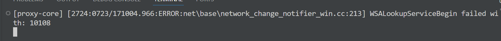

## Todo list

### Capture
9. ~~detail的mitm开启状态似乎在core restart之后和setting不一致，这两者最好用同一个status管理~~  
11. ~~proxy core的timeout最好是可以通过setting配置并保存的~~
12. ~~copy button的icon有点太小了，而且可以稍微往右往下一点，不需要跟文字齐平~~ 
13. ~~detail status的copy button有点问题~~ 
14. ~~proxy core重启，不知道和报错有没有关系~~ 