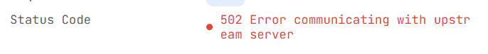
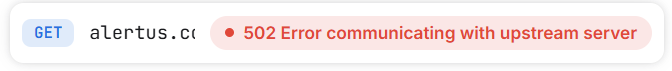
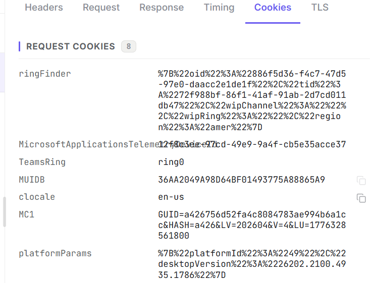
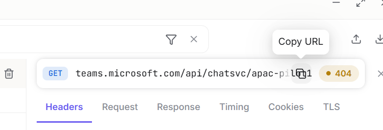
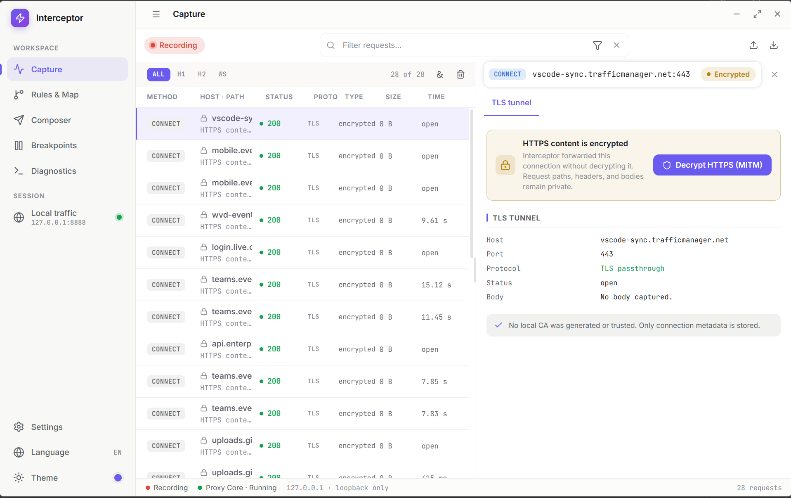

## Todo list

### Capture
1. ~~list里的每行要和title左对齐~~
2. ~~detail的status的圆点只和第一行对齐，不是和整体对齐~~ 
3. ~~detail顶部的status只需要跟list里的status一样的component就可以了，不需要那么多文字~~ 
4. ~~当前detail的KV似乎不会自动换行？~~ 
5. ~~detail这边的copy button在hover的时候似乎有点问题，背景色透明了~~ ，~~我在想button和iconbutton能用antd一比一的还原设计稿吗？包括icon和大小和样式？如果可以就用antd的component就可以了~~
6. ~~detail这边的copy button似乎还无效，没有复制到粘贴板~~
7. ~~detail这边的copy button复制成功后tooltip可以临时变为copied或其他文字告诉user已经copy成功了，或者用antd的通知~~
8. ~~一开始启动应用时，底部会显示proxy core starting和restarting反复来回几次，然后才是ready~~
9. detail的mitm开启状态似乎在core restart之后和setting不一致，这两者最好用同一个status管理  
10. ~~detail的copy button可以inline一样接在text后面，而不是整行的最右边~~
11. proxy core的timeout最好是可以通过setting配置并保存的
12. copy button的icon有点太小了，而且可以稍微往右往下一点，不需要跟文字齐平 
13. detail status的copy button有点问题 