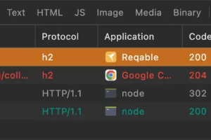
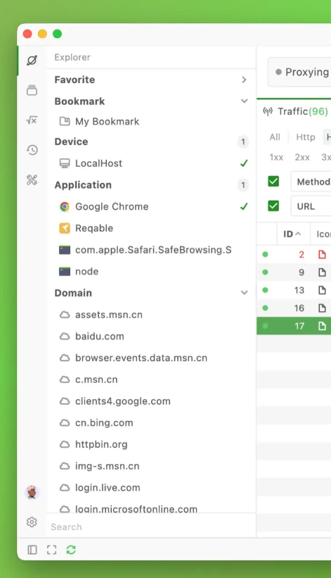
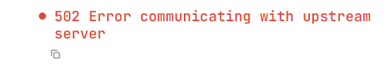

## 新的idea

- [x] **已完成**（2026-07-31，commit `cc11b5e`/`27bcd5f`/`5cdfc2a`）我们能不能加上application和图标？
- [x] **已完成**（2026-08-02 设计稿 `a8a484a`，2026-08-03 Renderer `3eaa14e`）我在想sidebar默认收起，然后顶部的filter全部换到左侧一个分栏，有各种filter，可以折叠，分栏可以收起，filter现状还是不够直观，最好和现在的all/h1/h2那样可以直接点，并且h1最好分为http1.1和其他版本。list和detail仍保持现状 
- [x] **已完成**（同 `a8a484a`/`3eaa14e`）list的host column，可以把path和host位置互换下，因为host可以用左侧来filter，所以path更显眼直观一点
- [ ] **设计稿已定稿，待实现**（2026-08-04）composer应该做成postman或proxyman这样的UI格式 
  - 设计稿：`design/app/` composer 视图 34 张截图；规范见 `design/design-system.md` 的「Composer 工作区」；架构与新增范围见 `architecture/feature-composer.md` 第 5 节。
  - 形态：左 `216px` Collection 分栏（可嵌套命名目录、chevron 折叠 / 名称选中、`⋮` 菜单、行内重命名、可收起）+ 工作区（文档标签条 · URL 行 · 请求编辑区 Query/Headers/Body/Auth · splitter · 响应区 Body/Headers/Cookies/Timing）。
  - **实现范围明显大于原 Composer**：Collection 需要 Core 新增持久化模块 + 4 条协议命令 + Preload 窄 API；编辑即生效（无保存动作）。Body 的 Form 档由 Renderer 编码成字符串，协议不变；`multipart/form-data` 不在本轮。
- [ ] request和response的body preview应该针对不同的type，提供不同的格式切换以及代码高亮，而不是固定的json，auto感觉也不需要，默认用默认的适配的格式比如HTML、json、javascript等，然后预留text和hex就行了，json应该还可以支持tree view，可以右键复制object或value。js和css等文件应该有formatter代码高亮，png图片等应该有预览等等，针对每个格式应该有对应的preview，这个也要详细的记录进feature架构里。现在的组件如果不支持有什么比较权威的好的三方库可以支持display？
- [ ] 进入时做一个酷炫的加载界面等待proxy ready
- [ ] **部分完成**（2026-08-03，commit `b326bc3`）MCP server，先写package，不接入main或core，另外要落地详细架构文档
  - 已完成：`packages/mcp-server/` 认证 + 11 只读 / 7 写工具 + MCP 协议状态机（45 tests，零运行时依赖）；架构文档 `architecture/feature-mcp.md`。
  - 未完成：Main 侧 transport（named pipe / unix socket）、runtime 文件、`bridge.mjs`、Preload 窄 API、Settings 面板与审批弹层——即整条"接入 Main/Core"的链路。

- [ ] Breakpoint 交互重构（配置在 Rules、调试在 Breakpoints 两处分家，很别扭）。**依赖的 filter 重构已于 2026-08-03 落地（`3eaa14e`），此项已解锁。**

  - 现状问题：
    - 断点规则配置在 Rules 的一种 action；HTTP 总开关在 Breakpoints 页的 `Break on match`；WebSocket 断点开关却在 Capture 的 WS 消息面板 —— 同一能力三个入口、两种范式。
    - **命中完全无感知**：`useBreakpoints` 的轮询只在 `BreakpointsMain` 挂载时启动，侧栏无 badge。用户在 Capture 页时，真实流量被挂起 30s（默认 `timeoutMs: 30_000` + `onTimeout: 'continue'`）却零提示，表现为浏览器莫名卡死再自己恢复。这是事故级问题。
    - `PendingBreakpoint` 没有 `exchangeId`，断点和 Capture 行无法关联。但 `applyRulesToRequest` 里已有 `request.id`（正传给 `tracker.recordRuleOutcome`），顺着传进 `awaitBreakpoint` 即可。
    - Core 侧已有 `onBreakpointHit` 推送钩子，Renderer 没用，退化成 1s 轮询。
    - 右键建断点只生成 `enabled:false` 草稿并跳到 Rules 等用户手动 Apply —— 把"临时拦一下"做成了配置流程。

  - 主流工具参考：
    - Fiddler / mitmproxy：**主流量列表原地调试**，命中行变色标记，右侧 Inspector 直接编辑放行。
    - Burp：Proxy 工作区内 Intercept 子标签，与 HTTP history 并列，醒目的 `Intercept is on`。
    - Charles / Proxyman：断点是**独立于 Rewrite 的一类工具**，有自己的规则列表，命中弹独立窗口；流量右键可快捷加断点。
    - 共识：① 断点是独立工具而非混在 rewrite action 里；② 无论配置在哪，"有流量被挂住"必须在主流量视图立刻可见，没有工具让用户去另一个页面查岗；③ 总开关是工具栏级一等公民且唯一；④ 从流量右键一键加断点且**立即生效**。

  - UI 方案（引擎层保持 breakpoint 作为 RuleAction 不变，只改呈现层）：
    - **方案 A（推荐）断点是流量的一个状态，不是一个页面**：删侧栏 Breakpoints 导航；挂起的 exchange 在 Capture 列表原地显示 `Paused`（琥珀色 + 倒计时）；选中该行时 Inspector 切换为断点编辑模式（复用 `BreakpointEditor`，底部 Continue / Drop）；总开关升到 Capture Workbar 与 Record 同级并带 pending 计数，WS 开关合并进来。代价：Inspector 双模式复杂度上升，多断点的"队列感"要靠列表过滤补。
    - 方案 B（保守）：保留 Breakpoints 页，只补 App 级轮询 + 侧栏 badge + 通知跳转 + Workbar 开关。改动小但两处分家的困惑只被缓解。
    - 方案 C（Burp 模式）：Capture 工作区内 `Traffic | Paused (2)` 双 tab，共用工作区与选中态，Inspector 不用改双模式。

  - 快速创建断点的匹配粒度（**不为 filter 弹新界面**）：
    - 现状 matcher 是 `{ type:'url', mode:'exact', value: scheme+host+path }`（`toEndpointUrl` 剥掉 query，避免 token 明文落 `rules.sqlite` 且换 token 后失配 —— 这个决定要保留）。盲区：REST 路径参数 `/users/123` → `/users/456` 不命中；同 host 其他接口不命中；不区分 method 可能过宽。
    - 主流工具都在**创建那一刻让用户选粒度**（Charles path 支持 `*`，Proxyman 预填可编辑，Fiddler `bpu` 子串，Burp regex）。
    - 建议右键级联子菜单，一次点击直接生效：`This endpoint` / `This path prefix (…/*)` / `This host (host/*)` / `Custom…`（通往已有的 Rules 编辑器做多条件 AND、method 限定、超时策略、Request+Response 成对）。分层是"子菜单快捷 → Rules 编辑器精细"，不引入第三个界面。
    - 断点规则应**创建即 enabled 即 Apply**：rewrite 规则默认不启用是因为字段没填完，而断点 matcher 是从真实请求填出来的，不存在未填完。
    - **待 filter 重构后再评估**：`Break on current filter` —— "在看哪些流量"和"想断哪些流量"在语义上是同一个表达式（Burp intercept rules、mitmproxy `i <filter>` 本质如此），复用 Omnibox 最省 UI。风险是切换 filter 会静默改变断点范围，造成"只想换视角却改了断点"的意外。filter 新设计定稿后一并决策。

  - pause 对后续请求的影响（固有代价，非 bug，但必须让用户看得见）：
    - Core 层不阻塞：`applyRulesToRequest` 是 per-request async 回调，`BreakpointQueue` 用 Map 存多个 pending，每条独立 timer + Promise，并发挂起原生支持。
    - 客户端层会阻塞：HTTP/1.1 同连接队头阻塞；浏览器每 host 6 个并发连接，6 个请求被挂起后第 7 个根本发不出来（Capture 里连影子都没有）；挂住 HTML/关键 JS 时后续请求压根不产生；HTTP/2 稍好但依赖链照样停。用户看到的是"整站卡死"，这正是无感知挂起危险的原因。

  - 多断点处理（现在只有列表 + Continue all）：
    - **并发上限（必须）**：pending 超阈值（如 10）时新命中自动放行，状态栏提示 `Breakpoint queue full — N requests auto-continued`。否则一个命中埋点/轮询接口的断点就能把浏览器打死。
    - **Break once（最实用）**：命中一次后自动禁用该断点规则，专治高频接口，建议作为右键 Break 的默认。
    - 逐个放行节奏：Continue 后自动选中队列下一条（类似调试器连按 F5）。
    - 批量分层：`Continue all` / `Drop all` 之外加 `Continue all from this rule`。
    - 超时可见：倒计时已有 `formatCountdown`，但超时自动 continue 后要在状态栏/Diagnostics 留痕，不能静默。
    - Request + Response 成对断（Charles/Proxyman 默认行为）：模型是两条独立 action（`phase: request` / `response`），UI 要能表达"这个 exchange 断两次"且第二次能关联回同一行 —— 又指回 `exchangeId`。

  - 可先行、不受 filter 重构影响、不改导航结构的三件事（做完不返工）：
    1. 断点感知全局化：轮询/推送提到 App 级 + pending 计数 + 状态栏提示。
    2. 并发上限保护 + 超时留痕。
    3. `PendingBreakpoint` 增加 `exchangeId`，为后续任何方案铺路。