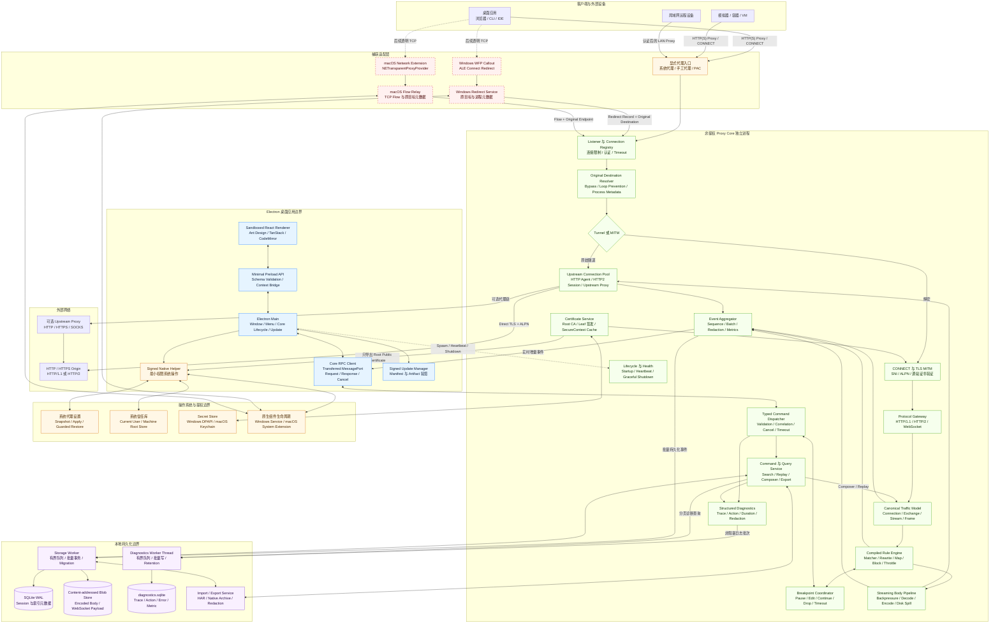
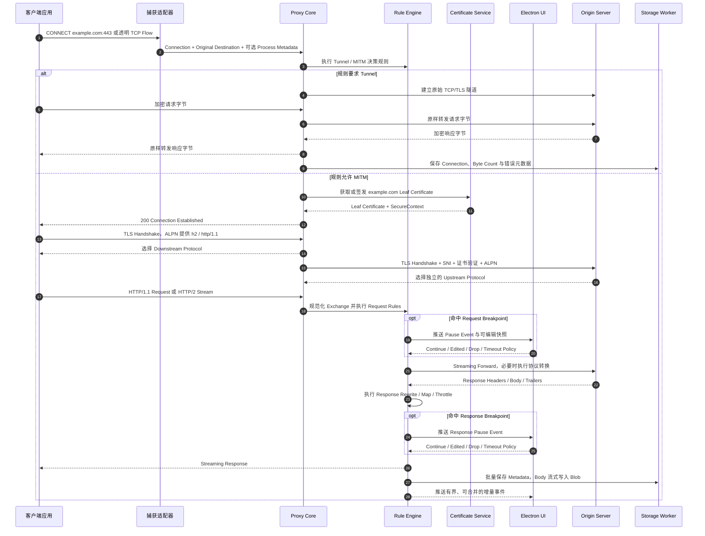
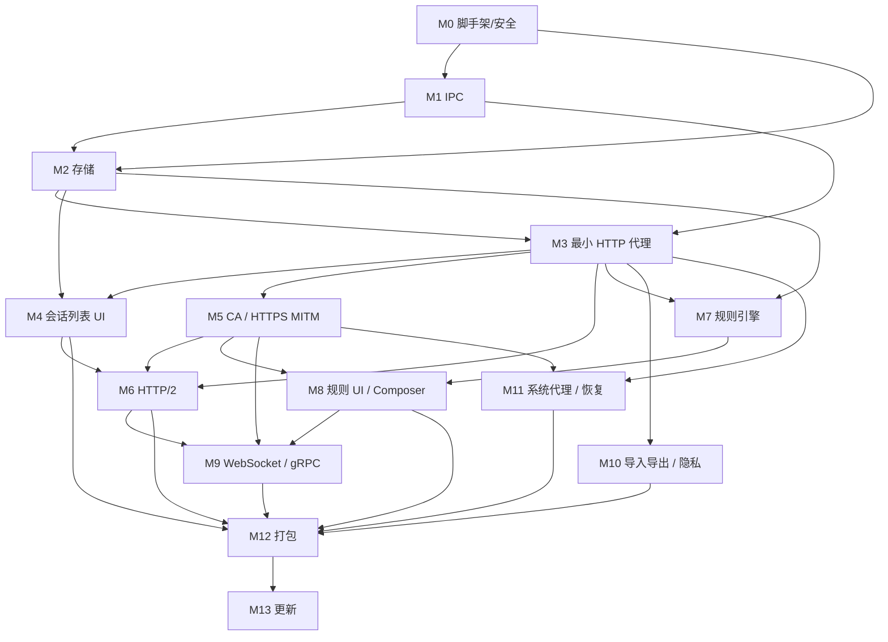

# 跨平台桌面 HTTP 网络调试代理完整方案

## 文档状态

- 状态：提案
- 最后更新：2026-07-12
- 目标平台：Windows、macOS
- 产品类型：类似 Charles、Fiddler 的本地桌面 HTTP 网络调试工具
- 分发方式：签名后的直接下载和侧载，不强制通过应用商店
- repo: https://github.com/zhxmt-xm/Interceptor

## 一、执行摘要

产品采用 Electron 桌面应用、独立代理核心进程和平台捕获适配器三层架构。首版代理核心优先使用 TypeScript，直接基于 Mockttp 实现 HTTP(S) 拦截、改写和断点，并使用 Node.js 的 `http`、`http2`、`tls`、`net` 模块补充需要底层控制的协议路径。

作为个人项目，首版直接依赖 Mockttp 的能力，不为将来可能的迁移预先构建隔离抽象层。Main 与 Proxy Core 随同一个桌面应用一起安装和升级，Core 当前不接受外部客户端，因此控制面使用 Electron UtilityProcess 的专用 MessagePort，并以产品自有的 TypeScript 判别联合和运行时校验定义 Command、Response 与 Event。规则、会话和存储格式仍保持独立、可版本化，因为它们需要存盘、迁移和在 UI 中编辑；远期 Node 原生或 Rust 数据面不作为当前 IPC 的设计约束。

首个可发布版本使用显式 HTTP(S) 代理。该模式无需内核驱动或系统扩展，即可捕获浏览器、命令行工具、模拟器、远程设备以及遵循系统代理设置的应用。透明捕获在后续阶段通过平台原生适配器实现：

- Windows：Windows Filtering Platform（WFP）ALE Connect Redirect callout 驱动和配套服务。
- macOS：Swift 编写的 `NETransparentProxyProvider` Network Extension 系统扩展。

产品完全在用户本机运行，不依赖后端服务、账户系统或大语言模型。

## 二、产品目标

- 捕获、检查、搜索并导出 HTTP/1.1 和 HTTP/2 流量。
- 通过本地生成的 CA 动态签发站点证书，实现 HTTPS MITM。
- 支持请求和响应重写、Map Local、Map Remote、断点、阻断、限速、重放和 Composer。
- 在 Windows 和 macOS 上提供一致的会话与规则行为。
- 将高吞吐数据路径隔离在 Electron renderer 和 main process 之外。
- 捕获大型正文和流式正文时保持内存有界。
- 在正常退出、崩溃、升级和卸载后恢复代理及证书相关设置。
- 为持久化格式、规则模型和 Main/Core Command Schema 定义清晰边界，使会话数据和规则能够跨版本升级；是否更换底层代理实现留待将来评估，不作为当前设计约束。

## 三、首版非目标

- HTTP/3 或 QUIC 解密与拦截。
- 绕过 TLS certificate pinning。
- 解密使用私有证书库且不信任系统 CA 的应用。
- 在没有用户提供客户端凭据的情况下通用拦截 mTLS。
- 类似 Wireshark 的原始数据包或 HTTP/2 帧分析。
- 移动端应用或基于移动 VPN 的捕获。
- 在代理核心进程内执行任意 JavaScript 插件。
- 静默安装根 CA 或未经用户明确授权开始捕获。

## 四、产品范围

### 4.1 MVP 功能

- 接收 absolute-form 请求的显式 HTTP 代理。
- 使用 `CONNECT` 建立 HTTPS 隧道。
- CA 受信任后，可按域名选择或全局启用 TLS MITM。
- 客户端侧和源站侧分别支持 HTTP/1.1 与 HTTP/2。
- 会话列表、结构视图、过滤、全文搜索、检查器和时间线。
- Header、Query、Cookie、表单、JSON、文本、图片、二进制和证书检查器。
- Map Local、Map Remote、Rewrite、Block、Breakpoint、延迟和带宽规则。
- 基于捕获会话的 Composer 和 Replay。
- HAR 导入与导出。
- 自有无损会话格式，用于保存 HTTP/2、WebSocket、规则和 TLS 元数据。
- 本地 CA 生成、信任状态检测、安装和移除。
- 系统代理快照、自动配置和受保护的恢复流程。
- 已签名 Windows 安装包和已 notarize 的 macOS 安装包。
- 英文与简体中文界面,界面文案全部外部化,架构支持后续扩展更多语言。

### 4.2 MVP 后功能

- WebSocket 消息检查和编辑。
- HTTP/2 Extended CONNECT 和 WebSocket over HTTP/2。
- gRPC framing、reflection 和基于 Protobuf descriptor 的解码。
- 上游 HTTP、HTTPS 和 SOCKS 代理。
- Reverse Proxy 和 Port Forwarding。
- 带身份验证的局域网远程设备捕获。
- 平台捕获适配器可提供时的进程归因。
- macOS 透明捕获。
- Windows WFP 透明捕获。
- 沙箱化的独立进程插件。
- 更多界面语言与 RTL(从右到左)布局支持。

## 五、总体架构

### 5.1 完整组件架构图



图中实线表示 MVP 或通用路径，红色虚线组件表示透明捕获阶段才启用的原生能力。Proxy Core 在普通用户权限下运行；只有 Native Helper、Windows Service、WFP Driver 和 macOS System Extension 跨越系统权限边界。

### 5.2 HTTPS 与 HTTP/2 请求生命周期



### 5.3 关键数据路径

1. **显式捕获路径**：浏览器、CLI、模拟器或远程设备通过系统代理、手工代理或 PAC 连接 Proxy Core。这是 MVP 的默认路径，不需要 Driver 或 System Extension。
2. **透明捕获路径**：WFP 或 `NETransparentProxyProvider` 只负责截获连接和提供原始目标，HTTP/TLS 解析、规则和存储仍由同一个 Proxy Core 完成。
3. **网络数据面**：正文始终在 Proxy Core、Origin 和 Blob Store 之间流式传输，不经过 Electron Main 或 Renderer。UI 只按需获取 Body Chunk。
4. **控制面**：Renderer 只能通过 Preload 暴露的类型化 API 发送 Query、Rule、Breakpoint、Replay 和 Composer Command；Main 与 Core 通过 Main 创建并转交的专用 MessagePort 通信，Renderer 不能直接访问 MessagePort、Socket 或文件系统。
5. **持久化路径**：Event Aggregator 将高频捕获事件批量发送给 Storage Worker；SQLite 保存可搜索元数据，Blob Store 保存正文原始编码字节和 WebSocket Payload。结构化诊断日志经独立有界队列发送给 Diagnostics Worker，并写入独立的 `diagnostics.sqlite`，不与捕获写入争用同一个 Writer。
6. **权限路径**：系统代理、Root Trust、DPAPI/Keychain、WFP 和 Network Extension 由最小权限 Native Component 管理。Root Private Key 不进入 Renderer，也不进入 Session Archive。

### 5.4 进程职责

| 进程或组件 | 主要职责 | 禁止承担的职责 |
| --- | --- | --- |
| Electron Renderer | 渲染会话、检查器、规则、Composer 和设置 | 直接访问文件、Socket、证书或系统 API |
| Electron Preload | 暴露最小化类型 API，校验 IPC 参数 | 暴露 Node.js 原语或无限制 IPC |
| Electron Main | 管理窗口、应用生命周期、核心进程、更新和权限请求 | 在正常数据路径中搬运请求或响应正文 |
| Proxy Core | 接收流量、MITM、规则执行、流式传输、元数据采集和持久化 | 依赖 Renderer 状态或 Electron UI 类型 |
| Storage Worker | 串行化 SQLite 写入、执行保留策略和管理正文 Blob | 阻塞代理网络事件循环 |
| Diagnostics Worker | 批量持久化结构化 Trace、Action、Error 和 Metric，执行日志保留策略 | 阻塞 Core Command 或网络数据面；保存 Secret、Header 或 Body 原文 |
| Native Helper | 配置系统代理、信任库、Keychain/DPAPI 和系统扩展 | 解析或重写 HTTP 正文 |
| WFP/Network Extension Adapter | 重定向或中继流量并附加原始目标信息 | 实现产品规则或长期会话存储 |

## 六、建议工程结构

```text
apps/
  desktop/                 Electron main、preload 和 renderer
  proxy-core/              TypeScript 代理核心可执行进程
packages/
  core-protocol/           Main/Core Command、Response、Event 类型与运行时校验
  domain/                  统一会话与规则类型
  rules/                   Matcher 编译器和 Action 执行规划
  storage/                 SQLite schema、migration 和 blob store
  inspectors/              UI 与 Worker 共享的内容解码器
  test-fixtures/            HTTP/1.1、HTTP/2、TLS、WebSocket、gRPC 测试服务
native/
  windows-helper/          Win32 代理和证书操作
  windows-wfp/             后续 WDK 驱动和 Windows Service
  macos-helper/            SystemConfiguration 和 Keychain Helper
  macos-transparent-proxy/ 后续 Network Extension 系统扩展
```

## 七、技术栈

### 7.1 选型原则

所有依赖先通过以下硬门槛：许可证允许商业分发、持续维护、Windows/macOS 可用、安全边界清晰、能够覆盖本产品的必要功能。通过硬门槛后，再按以下权重比较候选方案：

| 维度 | 权重 | 判断方法 |
| --- | ---: | --- |
| 产品适配度与功能完整性 | 30% | 是否直接覆盖桌面调试器的真实工作流，是否减少自研协议或 UI 基础设施 |
| 权威性与维护能力 | 25% | 官方或成熟组织维护、发布纪律、安全响应、生产项目验证和 Bus Factor |
| 流行度与生态 | 20% | npm/crates.io 下载、依赖项目、社区规模、招聘和问题检索资源 |
| 性能与可扩展性 | 15% | Benchmark、Streaming、虚拟化、背压和高频更新能力 |
| 集成成本与可替换性 | 10% | Electron 集成、TypeScript 体验、升级成本和 Adapter 隔离能力 |

流行度是重要的风险指标，但不是正确性证明。下载量跨 npm、crates.io 等不同生态时不能直接等比例比较；项目必须同时满足功能和安全硬门槛。

### 7.2 最终技术栈

| 模块 | 首选技术 | 选择原因 |
| --- | --- | --- |
| 桌面容器 | 当前稳定版 Electron、TypeScript | Windows/macOS 打包成熟，适合复杂桌面 UI |
| Renderer | 当前稳定版 React、Ant Design v6 | React 生态和采用度领先；Ant Design 的官方实现是 React，组件完整且明确支持 Electron |
| Renderer 构建 | Vite、官方 React Plugin | React 官方文档列出的 SPA Build Tool，开发反馈快；Vue 和 React 均有 Vite 官方 Plugin |
| 打包发布 | Electron Forge | Electron 官方文档推荐的一体化 Packaging、Signing 和 Maker 工具 |
| 会话列表 | TanStack Table、TanStack Virtual | 高采用度、MIT、Headless，可完全控制实时 Session Table 和 Structure View，不依赖商业 Grid Feature |
| 正文编辑器 | CodeMirror 6 | 采用度高、MIT、适合嵌入、支持超大文本与无障碍；比完整 IDE 型编辑器更符合请求/响应编辑场景 |
| UI 状态 | Zustand | 高采用度、Selector 和 Transient Subscription 适合桌面 View State；捕获数据仍不得进入全局 Store |
| 单元与组件测试 | Vitest | 与 Vite 共用解析和转换配置，TypeScript/ESM 原生，社区活跃 |
| UI 端到端测试 | Playwright | Microsoft 维护，覆盖 Chromium、WebKit 和 Electron 自动化，具备 Trace 与可靠 Locator |
| Node 代理基线 | Mockttp | 活跃的 TypeScript MITM 项目，Apache-2.0，支持 HTTPS 和 HTTP/2 |
| Node 底层网络 | `node:http`、`node:http2`、`node:tls`、`node:net` | 提供稳定的 Server、Client、ALPN、SNI、CONNECT 和 Stream API |
| 规则 | 产品自有可序列化规则描述，运行时编译为 Mockttp 规则 | 规则要存盘、在 UI 编辑和版本化，不能直接持久化 JS Callback；这是存储需要，不是为隔离代理库 |
| IPC | Electron `MessageChannelMain` / UtilityProcess MessagePort + TypeScript 判别联合 | Core 仅由 Main 管理且同版本发布；无监听端口、认证和自定义分帧，同时保留类型化命令、批处理和背压 |
| 结构化诊断 | Core Trace Context + Diagnostics Worker Thread + 独立 SQLite WAL | Command 全生命周期可查询、可导出；批量异步写入不阻塞网络数据面 |
| 元数据 | SQLite WAL | 可搜索、事务化、可移植 |
| 正文 | Content-addressed 文件 | 支持大正文流式写入、去重、配额和延迟加载 |
| Windows 原生代码 | C++/Win32、C++ WDK | 系统代理、证书、Service 和 WFP 所需 |
| macOS 原生代码 | Swift、SystemConfiguration、Security、NetworkExtension | Keychain、系统代理、签名和透明流量所需 |
| 未来 Todo（不在首版） | Node 原生自建数据面；Rust（Hudsucker、Hyper/Tokio、rustls、rcgen） | 前者用于吃透底层，后者用于突破 Node 性能上限；均为远期可选项，详见第二十六章 |

项目启动时固定依赖版本，并通过受控流程更新。Command Schema 保留简单协议版本用于发现打包错配；规则、数据库和 Archive 使用各自独立的版本及 migration，不把它们绑定为同一个版本号。

### 7.3 React + Vite 与 Vue + Vite 决策

React 搭配 Vite 不弱于 Vue。Vite 是 Framework-agnostic Build Tool，分别提供官方 React 和 Vue Plugin；Vue 官方 Scaffold 默认使用 Vite，React 官方文档也将 Vite 列为从零构建 Client-only App 的推荐工具之一。

截至 2026-07-10，React 约有 1.22 亿 npm 周下载、30M GitHub Dependents、246K Stars；Vue 约有 1300 万 npm 周下载、54K Stars。Vue 的响应式模型在部分合成 Benchmark 中更快，模板和 Composition API 也很成熟，但本产品的主要 UI 性能瓶颈是 DOM 数量、IPC 数据量、正文解析和实时列表更新，而不是 React 与 Vue 的基础渲染差异。

选择 React 的决定因素：

- 市场采用度、第三方生态和招聘池明显更大。
- Ant Design 的官方实现是 React；Ant Design Vue 在官方文档中属于 Community Implementation。
- TanStack、Playwright、Monaco/CodeMirror 等配套工具对 React 的资料与集成最完整。
- 使用 Virtualization、Stable Selector 和 Batched Event 后，React 可以满足本产品性能门槛。

因此最终选择 React + Vite，不采用 Vue。只有团队现有 Vue 经验显著强于 React，且愿意改用 Community UI Implementation 时，才重新评估 Vue。

### 7.4 Ant Design 与 Fluent UI 决策

| 维度 | Ant Design v6 | Fluent UI React v9 |
| --- | --- | --- |
| 维护方 | Ant Design Team，企业产品设计体系 | Microsoft，Microsoft 365 使用 |
| 采用度快照 | 约 352 万 npm 周下载、98.6K Stars、750K GitHub Dependents | 约 31 万 npm 周下载、20.1K Stars |
| 产品定位 | 明确面向复杂企业 Web App，并在官方文档列出 Electron | Microsoft 产品和 Windows/Office 视觉体系 |
| 组件广度 | Form、Tree、Table、Splitter、Menu、Popover 等覆盖完整 | 基础组件质量高，但复杂业务组件覆盖相对有限 |
| 优势 | 流行度、组件完整性、中文资料、密集操作界面 | Microsoft 背书、无障碍基础、Windows 视觉一致性 |
| 主要风险 | 默认风格容易像通用管理后台，需定制 Token；无障碍仍需独立验收 | 生态和采用度较小，macOS 上 Microsoft 视觉特征较强 |

本产品同时面向 Windows 和 macOS，属于高密度、重复操作、数据检查型工具，并不需要复刻 Microsoft 365。因此选择 Ant Design v6。使用策略如下：

- Ant Design 负责 Layout、Button、Input、Form、Menu、Tabs、Dialog、Tooltip、Splitter 等通用控件。
- 主 Session Grid 不使用 Ant Design Table，改用 TanStack Table + TanStack Virtual，以控制十万级数据和高频增量更新。
- 建立产品自有 Design Token，使用紧凑、克制、中性的视觉语言，不直接套用默认蓝色后台模板。
- Windows 和 macOS 分别适配 Title Bar、Shortcut Symbol、Context Menu 和 Window Spacing。
- 通过 Playwright、axe 和纯键盘流程独立验证可访问性，不把组件库声明视为验收结果。

### 7.5 其他前端候选说明

- **Zustand 与 Redux Toolkit**：Redux Toolkit 是 Redux 官方标准，约 2270 万 npm 周下载；Zustand 约 3470 万周下载，API 更小，并支持 Selector 与不触发 React Render 的 Transient Subscription。本产品只用它保存 Workspace/View State，因此保留 Zustand。复杂 Capture 数据保存在 Core/SQLite，通过分页查询进入 UI。
- **CodeMirror 与 Monaco**：Monaco 由 Microsoft 维护并源自 VS Code，适合完整 IDE；CodeMirror 的核心 View Package 约 976 万 npm 周下载，支持超大文本、无障碍和模块化嵌入。请求/响应 Inspector 不需要完整 Language Service，因此保留 CodeMirror。若后续需要 Schema IntelliSense 或高级 Diff，再以 Lazy-loaded Adapter 引入 Monaco。
- **TanStack Virtual 与 AG Grid**：AG Grid 对高频交易更新有成熟支持，但 Tree Data、Context Menu、Master/Detail 等功能属于 Enterprise Commercial License。TanStack React Virtual 约 1380 万 npm 周下载、MIT 且保持 Markup 所有权，更适合自定义 Session Tree。若未来采购 AG Grid Enterprise，可通过 Grid Adapter 替换，不改变 Session Query Contract。

### 7.6 Electron Forge 与 Vite 风险

Electron Forge 是 Electron 官方文档推荐的打包工具，并提供第一方 Vite Template；但 `@electron-forge/plugin-vite` 当前仍标记为 Experimental，未来 Forge Minor Release 可能包含 Breaking Change。

处理方式：

- 精确锁定 Electron Forge 和 Vite Plugin 版本，不使用宽松 Minor Range。
- CI 必须在 Windows 与 macOS 生成并启动最终 Package，而不是只测试 Dev Server。
- Main、Preload 和 Renderer 分别设置明确 Build Entry，并将 Native Module Externalize。
- Phase 0 验证 HMR、Sandboxed Preload、Worker、Code Signing 和 Packaged Asset Path。
- 若第一方 Vite Plugin 阻断发布，回退到 Forge Stable Webpack Plugin；React、Ant Design 和领域代码无需改变。

### 7.7 国际化与多语言（i18n）

界面从第一天起为多语言设计,首版提供英文与简体中文,架构支持后续扩展。

- **语言范围**:首版 `en`(English)与 `zh-CN`(简体中文);架构支持后续增加 `zh-TW`、`ja`、`ko` 等,以及远期 RTL 语言。
- **Renderer i18n 库**:`i18next` + `react-i18next`。理由:React 生态事实标准、采用度高、与 UI 库解耦,支持命名空间、按需懒加载、插值与复数规则。语言切换即时生效,无需重启。
- **Ant Design 文案联动**:组件级文案通过 `ConfigProvider` 的 `locale`(`antd/locale/en_US`、`zh_CN`)提供,并与应用语言、文档 `lang`/`dir` 同步切换。
- **资源组织**:locale 资源按命名空间 JSON(`common`、`traffic`、`rules`、`composer`、`settings`、`errors` 等)随功能模块组织,按需懒加载,避免首屏加载全部语言;资源随 ASAR 本地打包,不从远程加载,符合生产 CSP `connect-src 'none'`。
- **文案外部化**:所有面向用户的文本必须走 i18n key,禁止硬编码字面量;设计稿(`design/app/`)用英文占位,落地时接 key。技术标识(HTTP 方法、header 名、状态码、协议名、URL)保持原文不翻译。
- **语言检测与持久化**:首启跟随系统 locale(`app.getLocale()` / `navigator.language`),用户可在 Settings 覆盖并持久化到本地设置。
- **Main 与原生层**:Electron 应用菜单、原生对话框、Tray 与通知等 Main 侧文案单独本地化(共享同一 locale 资源或其子集);Renderer 不可用时的系统级错误对话框回退到 Main 文案。
- **Proxy Core 与诊断**:Core 的日志、诊断 Trace 和错误码保持稳定英文(机器可读、便于检索与上报);面向用户展示时在 Renderer 按 error code 映射为本地化文案,不在数据面做翻译。
- **格式化**:日期、时间、相对时间、数字、字节大小与时延统一用 `Intl`(`Intl.DateTimeFormat`、`Intl.NumberFormat`、`Intl.RelativeTimeFormat`)按当前 locale 格式化,不手写与 locale 绑定的格式。
- **布局与方向**:文本使用弹性布局避免定宽截断;预留 RTL 能力(Ant Design `direction="rtl"` 与 `:dir()`),首版不含 RTL 语言。
- **质量保障**:CI 校验各语言 key 对齐(无缺失/冗余);用伪本地化(pseudo-localization,加长文本 + 重音字符)在 Playwright 截图中检测溢出与截断;关键界面在 `en` 与 `zh-CN` 下各跑一次布局验收。

## 八、代理核心设计

### 8.1 显式代理 Listener

- 默认只绑定 loopback。
- 接受 HTTP/1.1 absolute-form 请求和 `CONNECT host:port`。
- 绑定局域网地址前必须明确开启、配置认证并显示醒目警告。
- 排除 loopback 地址、代理 Listener、本产品更新请求和核心自身建立的源站连接，避免捕获循环。
- 支持可配置的 host 和 CIDR bypass。
- 默认始终验证上游源站证书。

### 8.2 HTTPS MITM 流程

1. 解析并校验 CONNECT authority。
2. 在确认隧道前执行 Tunnel 或 Intercept 规则。
3. 在需要时准备源站连接并检查源站证书。
4. 加载或签发与目标 DNS 名称/IP 匹配的 leaf certificate。
5. 通过 ALPN 完成客户端侧 TLS，支持 `h2` 和 `http/1.1`。
6. 独立协商源站侧协议。
7. 将每个请求统一转换为规范 Exchange 模型。
8. 执行请求规则、转发 Stream、执行响应规则并持久化事件。

客户端侧协议与源站侧协议彼此独立，必须支持并测试以下四种语义路径：

| 下游协议 | 上游协议 | 必须实现的行为 |
| --- | --- | --- |
| HTTP/1.1 | HTTP/1.1 | 保持普通代理语义和流式传输 |
| HTTP/1.1 | HTTP/2 | 转换为 pseudo-header 并流式转发正文 |
| HTTP/2 | HTTP/1.1 | 规范化 pseudo-header，移除 connection-specific header |
| HTTP/2 | HTTP/2 | 保留 Stream 语义、Trailer、取消和状态 |

### 8.3 HTTP/2 行为

- 下游 ALPN 使用 `http2.createSecureServer({ allowHTTP1: true })` 或 Mockttp 等效实现。
- 按源站和安全上下文池化 `http2.connect()` Session。
- 使用 Stream ID 将同一 TCP/TLS Connection 上的多个 Exchange 分开建模。
- 记录本地/远端 Settings、协议版本、Stream ID、Trailer、RST Code、GOAWAY 和各阶段时间点。
- 在 Stream 和 Session 两级实施背压。
- 限制并发 Stream、Header 数量、Header 大小、Session 内存和未确认 Ping。
- Socket 一旦归属 `Http2Session`，不得再直接读写原始 Socket。
- 运行时允许时保存 raw header array，但不承诺输出与原始 HPACK 编码完全一致。
- 支持时将 Server Push 保存为子 Exchange；不支持时应干净拒绝并记录原因。
- 将 malformed frame 和 protocol error 保存为 Session Event，不允许其导致核心进程崩溃。

Mockttp 当前源码包含入站 HTTP/2 Server、上游 HTTP/2、ALPN 处理和相关集成测试。首版直接依赖它；Phase 0 验证它对本产品所需 HTTP/2 组合的覆盖程度，不足的路径用 Node 原生 `http2`/`tls`/`net` 模块补齐，而不是重新造一套隔离层。

### 8.4 Content Encoding 与正文

- 在展示层解码前保存 content-encoded 正文 bytes。
- gzip、deflate、Brotli 仅在检查器或正文规则需要时延迟解码。
- 正文修改后重新计算 `content-length`、transfer encoding 和 content encoding。
- 仅修改 Header 的规则必须保持全程 Streaming。
- 正文 Matcher 和 Rewrite 必须受明确的单正文大小限制。
- 超过较小内存阈值后，将缓冲正文 Spill 到磁盘。
- 在会话中显式标记 truncated、unavailable、aborted 和 decode-failed。

### 8.5 WebSocket 与 gRPC

- MVP 的 WebSocket 目标为 HTTP/1.1 Upgrade。
- WebSocket Message 作为有序子记录保存，包含方向、Opcode、时间和 PayloadRef。
- HTTP/2 Extended CONNECT 需单独兼容性 Spike。
- 首版将 gRPC 作为 HTTP/2 处理，展示原始 length-prefixed Message。
- 后续增加 Descriptor 和 Server Reflection 解码；Schema 不可用时仍必须能以二进制查看。

## 九、CA 与 TLS

### 9.1 Root CA 生命周期

- 每个安装或用户 Profile 生成唯一 Root CA。
- 默认采用兼容性优先的 RSA Root 和 Leaf；ECDSA 在兼容性 Spike 中评估。
- 使用 SHA-256、随机 Serial、正确 CA Constraint、Server Auth Key Usage 和有限有效期。
- Root Private Key 不得进入 Renderer、日志、导出文件、崩溃报告或遥测。
- Windows 使用 DPAPI、macOS 使用 Keychain 加密保存 Private Key。
- 只在 Proxy Core 内解密，并尽可能清理临时 Buffer。
- 按 Host 和证书 Profile 缓存 Leaf Certificate 及 `SecureContext`。

### 9.2 信任库行为

- 首选安装到当前用户信任库。
- 安装到机器级信任库必须明确提权。
- 安装时记录证书 SHA-256 Fingerprint 和目标 Store。
- 卸载时仅删除 Fingerprint、Subject 和 Public Key 均符合记录的证书。
- 启动时只检测信任状态，不自动修改。
- HTTPS MITM 开启期间持续显示明确的捕获状态。

### 9.3 源站 TLS 策略

- 使用平台信任库验证源站证书链和 Hostname，包括企业 Root CA。
- 禁止全局使用 `rejectUnauthorized: false`。
- 如确有需要，只允许显式、按 Host 配置的不安全例外，并在 UI 中持续标记。
- DNS Name 连接保留 SNI，IP 地址不得发送无效 SNI。
- 记录协商的 TLS Version、Cipher、ALPN、证书链、Fingerprint、验证状态和错误。
- 对证书 Pinning、私有 CA Store 和不支持的 mTLS 应用默认使用 Tunnel。

## 十、捕获适配器

### 10.1 Windows 显式模式

- 通过小型 Native Helper 配置当前用户 WinINet Proxy。
- 将 WinHTTP Proxy 作为独立、可选且需要管理员权限的操作。
- 修改前分别保存 Proxy Server、Bypass List、PAC URL 和 Auto Detect 状态。
- 修改后发送 Windows 文档规定的设置变更通知。
- 仅当当前值仍等于本产品写入值时执行恢复，避免覆盖用户后续修改。
- 始终提供手动代理配置作为回退。

可行性：高。无需驱动，但只能捕获遵循代理设置的应用。

### 10.2 Windows WFP 透明模式

- 使用 C/C++ WDK 在 `FWPM_LAYER_ALE_CONNECT_REDIRECT_V4` 和 `FWPM_LAYER_ALE_CONNECT_REDIRECT_V6` 实现 Callout。
- 将符合条件的 TCP Connection 重定向到本地 Proxy Service。
- 使用文档化 WFP Socket Control 附加或查询 Redirect Record 与 Original Destination。
- 排除 Proxy Core、Service、Helper、Updater 和已重定向 Socket。
- Policy 和生命周期管理放在 User-mode Windows Service 中。
- 第一阶段仅处理 TCP，UDP 和 QUIC 单独立项。
- Service 不可用时必须 Fail Open，避免用户网络被锁死。

可行性：中。普通生产 Windows 环境必须使用正确签名的驱动。Test Signing 只能用于开发，不能作为产品分发方式。正式投入前必须具备 EV Certificate、Hardware Dev Center 和 Attestation/WHQL 签名方案。

### 10.3 macOS 显式模式

- 使用签名 Swift Helper 和 SystemConfiguration Framework 枚举并更新活动 Network Service。
- 分别保存 HTTP、HTTPS、SOCKS、PAC、Bypass 和 Auto Discovery 设置。
- 使用与 Windows 相同的受保护比较逻辑恢复设置。
- 用户拒绝授权时提供手动配置。

可行性：高。

### 10.4 macOS 透明模式

- 将 Swift `NETransparentProxyProvider` 作为 Network Extension 系统扩展打包。
- Developer ID 分发使用 `app-proxy-provider-systemextension` entitlement。
- Include/Exclude Rule 必须排除扩展本身、桌面应用、Core 和 Updater。
- 通过私有 Unix Domain Socket 协议将已接受的 TCP Flow 和 Original Endpoint 元数据中继给 Proxy Core。
- HTTP Parsing、规则、正文和存储必须留在系统扩展进程之外。
- 扩展被禁用、升级、崩溃或用户拒绝授权时，不得破坏无关网络。
- 在制定明确 QUIC 策略前，UDP Flow 直接透传。

可行性：中高。需要 Apple Developer Program、Provisioning Profile、Developer ID 签名、Notarization 和首次用户批准。必须在 Phase 0 使用实际开发者账户验证 Entitlement 和 Profile。

## 十一、规则引擎

### 11.1 规范规则格式

规则是带版本的产品自有数据，需要存盘、在 UI 中编辑和跨版本迁移，因此保存为可序列化的结构化描述而非 JS Callback；捕获启动时再把它编译成 Mockttp 规则执行。每条规则包含：

- 稳定 ID、名称、启用状态、优先级和 Revision。
- 一个或多个类型化 Matcher。
- 一个或多个类型化 Action。
- 编译器计算出的 Buffering Requirement。
- 可选 Capture Mode 或 Session Scope。
- 校验诊断和编译状态。

### 11.2 首批 Matcher

- Scheme、Host、Port、Method、Path 和 URL Pattern。
- Query Key/Value 和 Cookie Key/Value。
- Header Presence、Equality、Wildcard 和 Regular Expression。
- 请求或响应 MIME Type 与 Status。
- 有大小限制的 Text 或 JSON Body Matching。
- Native Adapter 提供时的 Process Identity。

### 11.3 首批 Action

- Tunnel 或启用 MITM。
- 设置、追加、替换或移除 Header 和 Query Parameter。
- 替换有大小限制的 Text 或 JSON Body。
- 返回 Synthetic Response。
- 映射到本地文件或目录。
- 映射到另一 Origin、Scheme、Port 或 Path。
- Block、Reset 或返回配置的 Status。
- 延迟 Header 或 Body Chunk。
- 限制上传或下载带宽。
- 在请求或响应阶段暂停。
- 路由到 Upstream Proxy。

### 11.4 执行模型

- 捕获前编译 Matcher，并以完整 Rule Set 为单位原子替换。
- 按 Priority 和 Stable ID 确定性执行。
- 请求阶段和响应阶段分离。
- 读取正文前计算该 Exchange 是否仍可 Streaming。
- Map Local 必须执行路径规范化和允许目录校验。
- 保存 Rule Hit 及 Mutation 摘要作为审计记录。
- 第一方规则格式不得支持任意代码执行。

### 11.5 Breakpoint 状态机

```text
waiting -> continued
waiting -> edited -> continued
waiting -> dropped
waiting -> timed_out -> policy_default
```

所有 Breakpoint 必须设置 Timeout，并在 UI 断开或桌面应用退出时执行确定性的关闭策略。

## 十二、会话与存储模型

### 12.1 核心实体

| 实体 | 关键字段 |
| --- | --- |
| CaptureSession | ID、名称、开始/结束时间、Capture Mode、App Version、Rule Set Revision |
| Connection | ID、Client Endpoint、Original Destination、Process、TLS、ALPN、Timing |
| Exchange | ID、Connection ID、Stream ID、Method、URL、Protocol、Status、Timing、Byte Count |
| MessageHeaders | 有序 Raw Pair、规范化查找结构、Trailer、Pseudo-header |
| BodyRef | Blob Hash/Path、Encoded Size、Decoded Size、Encoding、Truncation、Decode Status |
| WebSocketFrame | Exchange ID、Sequence、Direction、Opcode、Timestamp、PayloadRef |
| RuleHit | Exchange ID、Rule Revision、Phase、Action、Before/After Summary |
| ErrorEvent | Scope、Code、Message、Timestamp、Protocol Detail、Recoverability |

### 12.2 SQLite 策略

- 启用 WAL Mode 和 Foreign Key。
- 通过专用 Storage Worker 串行化写入。
- 批量写入事件，同时保留 Sequence Number。
- 为 Time、Host、Method、Status、MIME、Process 和全文搜索建立索引。
- Migration 只向前执行，并使用 Fixture Test 覆盖。
- 创建 Archive 时通过 SQLite API 生成一致 Snapshot，不直接复制活动数据库文件。

### 12.3 正文 Blob 策略

- 将正文流写入临时文件，完成后按 Content Hash 原子 Rename。
- SQLite 只保存引用。
- 应用 Per Body、Per Session 和 Global Quota。
- 正文省略或被淘汰时仍保留元数据。
- 通过 Crash-safe Garbage Collection 删除未引用 Blob。
- Renderer 只按需、分块读取正文。

### 12.4 导入和导出

- 支持 HAR 1.2 以兼容现有生态。
- 明确说明 HAR 无法无损表达 HTTP/2 Settings、Stream Error、WebSocket Message、TLS Detail 和 Rule History。
- 定义版本化 ZIP 原生 Archive，其中包含 Manifest、SQLite Snapshot 和 Body Blob。
- 解压前校验 Path、Size、Hash、Schema Version 和 Compression Ratio。
- 导入内容不得执行脚本或插件。

### 12.5 诊断日志

- Core 使用结构化日志记录 Command 的 `received`、`validated`、`handler.started`、关键 `action.started/completed`、`response.sent` 与最终 `completed/failed/cancelled/timed_out` 状态。
- 每个 Command 携带 `traceId` 和 `requestId`；Core 使用 `AsyncLocalStorage` 在异步调用链中传播上下文，但跨进程边界仍显式传递 ID。
- 普通日志调用只写入有界内存 Ring Buffer，不等待数据库。日志由 Diagnostics Worker Thread 通过 MessagePort 接收并批量写入独立的 `diagnostics.sqlite`；Capture 数据与诊断日志不得共享 SQLite Writer。
- Diagnostics Worker 使用 WAL、批量事务、容量/时间保留策略，并为 Timestamp、Trace ID、Request ID、Command、Level、Outcome 和 Duration 建索引。
- 队列压力下可采样 Debug、合并重复 Progress；Command 完成/失败、Fatal、安全和数据损坏事件优先保留。发生丢弃时必须写入聚合的 dropped-count 记录。
- Sink 不可用时回退到 Core `stderr` 和内存 Ring Buffer；日志失败不得递归调用同一个 Sink，也不得阻塞代理数据面。
- 日志只保存按 Command 定义的安全摘要，不保存 Body、Authorization、Cookie、认证 Token、CA 私钥或完整敏感 URL Query。
- Renderer 通过分页 Command 查询诊断记录；M10 提供筛选分析与脱敏 JSONL 导出。数据库 Schema Version、Command Protocol Version 和 Archive Version 相互独立。

## 十三、IPC 协议

### 13.1 Transport

- Proxy Core 是由 Electron Main 通过 `utilityProcess.fork()` 启动、监督并随应用退出的 Node UtilityProcess，不提供外部接入。
- Main 使用 `MessageChannelMain` 创建专用 RPC 通道，并通过 UtilityProcess `parentPort` 一次性转交其中一个 MessagePort；parent port 只承载 ready、heartbeat、rpc-port transfer、shutdown 和 stopped 生命周期消息。
- 业务 Request、Response 和 Cancel 只走转交后的 MessagePort，不监听 localhost、Named Pipe 或 UDS，因此不需要端口发现、启动 Token、自定义长度前缀或重连认证。
- Main 与 Core 同包发布、同版本升级；每条 Request 校验简单 `protocolVersion`，不增加 channel init/ready 或跨版本协商状态机。
- heartbeat 只检测 Core Event Loop 是否仍可调度；Renderer 的 `CoreProcessStatus.running` 不代表代理、数据库等业务健康。
- 如果未来出现外部客户端、Core 独立发布或跨语言进程，再在保持 Command 语义的前提下增加新的 Transport Adapter；当前阶段不为该假设承担复杂度。

### 13.2 Message 类型

- Protocol Version、带 Correlation/Trace ID 的 Request，以及 Success/Error Response 和 Cancel。
- 分页 Session Query。
- Body Range Request 和 Streamed Chunk。
- Rule Validation、Replacement 和 Revision Result。
- Breakpoint Lifecycle 和 Edit Command。
- Diagnostic Query；Graceful Shutdown 继续属于生命周期 parent port。

### 13.3 Flow Control

- RPC request 必须有 timeout、AbortSignal/Cancel、late response、duplicate ID 和断线清理。
- 真实 Capture Event 的有界 Queue、批处理、合并和 sequence/ack 在 M3/T3.4 随 Exchange 模型实现；M1 不为占位事件提前构建队列。
- M3 的事件流仍必须满足：重复 Progress 可合并，最终 Exchange State、Error 和 RuleHit 不得静默丢弃，慢消费者不得阻塞网络 Stream。

### 13.4 Command 与可观测性

- `packages/core-protocol` 只包含传输无关的 Command、Response、错误码和运行时校验，不导入 Electron、React、Mockttp 或数据库实现类型。
- Main 和 Core 在接收边界都执行运行时校验；Preload 继续只暴露面向意图的窄 API，不提供通用 `send`、`invoke` 或 MessagePort。
- Dispatcher 统一处理 correlation、结构化错误、timeout、cancel、late response、duplicate ID 和连接关闭清理。独立只读 Command 可以并发，需要确定顺序的变更通过所属 Service 显式串行化。
- 分页查询只返回有限 Metadata 和 opaque keyset cursor；大列表不通过单个 Response 全量传输。Body 只通过范围请求返回有限 Chunk，正文的捕获和落盘数据面不经过 Main。
- 每个 Command 自动创建 Trace Context 并记录验证、Handler、关键 Action、响应和最终结果；Handler 不手工拼接整条日志，也不把完整 Command 序列化入库。
- Echo Command 只用于 M1 验证 RPC 与日志链路，不演化为任意消息逃生口。

## 十四、桌面 UI

### 14.1 主要视图

- Capture Workspace：Toolbar、Filter、Session Table/Structure 切换、Inspector 和 Status Bar。
- Rules Workspace：有序 Rule List、Matcher/Action Editor、Validation 和 Hit Counter。
- Composer：Method、URL、Header、Body、Protocol Preference 和发送历史。
- Connection 与 TLS Detail View。
- Settings：Listener、系统代理、CA、Storage、Privacy、Update 和 Advanced Adapter。
- First-run Setup：显式代理配置和 CA Trust 引导。

### 14.2 UI 性能原则

- Session Row 和 Tree Node 使用 TanStack Virtual，主 Session Grid 不使用 Ant Design Table。
- Metadata 分页查询，选择会话后才加载 Inspector。
- Body Buffer 和全部 Session 不得放入 React State。
- Zustand 仅保存 Workspace/View State；使用 Stable ID、Selector 和 Incremental Patch，避免替换大数组。
- Syntax Highlighting 和 Structured Parsing 必须按 Size 限制，并提供 Raw/Hex 回退。
- 保证键盘导航、Focus Order、字体缩放和 Screen Reader Label。

## 十五、Electron 安全

- 开启 Renderer Sandbox 和 `contextIsolation`。
- 禁用 `nodeIntegration`。
- 设置严格 Content Security Policy。
- UI 只加载打包后的本地资源。
- 禁止导航到或嵌入捕获到的远程 HTML。
- IPC 两端都必须校验每条消息。
- Preload 只暴露面向意图的窄 API，不提供通用 Send 或 Filesystem API。
- 拒绝意外的 Permission、New Window、Download 和 External Protocol Launch。
- CA 私钥和捕获 Secret 不得进入 Renderer。
- 更新包应用前必须校验签名。

## 十六、隐私与运行安全

- 安装完成后默认不捕获，必须由用户主动开始。
- 显示明确的 Recording Indicator 和当前 Listener Address。
- 默认仅绑定 Loopback。
- Remote Capture 必须启用认证，并允许快速轮换凭据。
- 遥测不得包含 URL、Header、Body、Certificate 或 Rule Content。
- Screenshot、结构化日志和 Diagnostic 导出中默认遮罩 Authorization、Cookie、URL Query 和常见 Token；不得记录 Body 或 CA 私钥。
- 导出未脱敏 Capture 前显示警告。
- 使用 Startup Journal 在崩溃后恢复 Proxy Setting。
- 只恢复仍由本产品持有的设置，避免覆盖用户修改。
- 提供一键 Emergency Repair，关闭捕获并恢复已知代理设置。
- Transparent Adapter 在 User-mode Core 不可用时必须 Fail Open。

## 十七、打包与分发

### 17.1 Windows

- 使用 Electron Forge 打包 Electron 应用和 Node Core；精确锁定当前仍为 Experimental 的第一方 Vite Plugin。
- 对应用、Helper、Service 和 Installer 全部签名。
- 包含 Service 或 WFP Driver 时使用 WiX Toolset 4。
- 显式代理模式应支持 Per-user Installation。
- 仅 Machine Trust、WinHTTP、Service 或 WFP 安装需要提权。
- 在开启 Secure Boot 的干净环境测试 Install、Upgrade、Repair 和 Uninstall。

### 17.2 macOS

- Native Helper 和 Network Extension 使用 Xcode 构建。
- CI 必须验证 Forge + Vite 生成的 Packaged Renderer、Preload 和 Worker 路径，不以 Dev Server 成功代替打包验收。
- 将 System Extension 嵌入 App Bundle 要求的位置。
- 使用一致 Team ID 和 Entitlement，按由内到外顺序签名嵌套代码。
- 开启 Hardened Runtime。
- 对最终 App、DMG 或 PKG 执行 Notarize 和 Staple。
- 用户拒绝 System Extension 时，显式代理模式仍必须完全可用。
- 更新时协调 Desktop App 和 Extension Version。

### 17.3 更新

通用原则：

- 仅通过 HTTPS 发布签名 Update Manifest 和 Artifact。
- 替换 Proxy Core 前停止接受新 Capture。
- Session Database 与应用文件分开保存和迁移。
- Desktop App 保留 Rollback 路径，但不得自动回滚不兼容 Storage Schema。
- Driver 或 System Extension 更新可在下一次干净启动时激活。

首选整包自动更新：

- Windows：使用 Electron Forge 的 `update-electron-app` 或 electron-updater，以公开 GitHub Releases 作为更新源；NSIS/blockmap 支持差量下载，只传变化的块，不必每次下整包。
- macOS：自动更新走 Squirrel.Mac，要求应用已用 Apple Developer ID 签名（约 99 美元/年）。签名后即可自动更新，且 Squirrel.Mac 本身基于 bsdiff 增量，只下载变化部分。

macOS 无签名时的增量热更新（免费替代）：

- 分层更新：把改动频繁的 Renderer 和纯 JS 主进程逻辑放进「可热更资源包」，与 Electron 本体、Node 原生模块、Native Helper 分离。
- 应用启动时向更新源查询版本，只下载有变化的 JS/HTML/CSS 资源包（通常几 MB），加载后即生效，不触碰原生二进制，因此不需要 Apple 签名，也不必重新下载整个应用。思路等同于 React Native CodePush / Expo OTA。
- 覆盖范围：绝大多数功能迭代（UI、规则逻辑、交互）都在 JS 层，可通过热更新交付；只有 Electron 升级、Node 原生模块或 Native Helper 变化才需要整包更新，这类改动低频，退化为提示用户手动下载新版本。
- 安全红线：热更资源包必须用产品自有密钥签名并在应用内校验后才能加载。本产品是网络代理工具，未校验的远程代码加载等于给自己开了远程执行后门，绝不能省。
- 可选实现：也可只替换 `app.asar`（未签名的个人构建可行；已签名应用替换会破坏签名），粒度是整个 JS bundle，比资源包分层简单但每次传输更大。

## 十八、测试策略

### 18.1 单元测试

- 使用 Vitest 运行 TypeScript Domain、Rule、Storage 和 UI Component Test。
- Rule Matcher 和 Action 语义。
- HTTP/1.1 与 HTTP/2 Header 转换。
- URL、CONNECT Authority、IPv4 和 IPv6 Parsing。
- Certificate Cache Key 和 Leaf Certificate Field。
- Storage Migration、Retention 和 Blob Reference Count。
- IPC Compatibility 和 Malformed Message Rejection。
- Proxy Setting Ownership 和 Restoration Decision。

### 18.2 协议集成测试

- 四种下游/上游 HTTP Version 组合。
- ALPN Fallback 以及错误宣称协议支持的 Server。
- Multiplexed HTTP/2 Stream、Cancellation、Trailer、GOAWAY 和 Server Push。
- 大型 Upload、Download、Slow Stream、Half-close、Timeout 和 Abrupt Reset。
- gzip、deflate、Brotli、Chunked、Unknown Length 和 Malformed Encoding。
- 非 HTTP TLS 和 Plain TCP 的 CONNECT Tunnel。
- TLS 1.2、TLS 1.3、SNI、IP Host、无效证书链、过期证书和 Hostname Mismatch。
- HTTP/1.1 WebSocket Upgrade 和双向 Message。
- 作为原始 HTTP/2 Message 捕获的基础 gRPC Unary/Streaming 请求。
- Rule 组合、顺序、Breakpoint、Timeout 和 UI Disconnect。

### 18.3 平台测试

- 在开启 Secure Boot 的当前受支持 Windows VM 上测试。
- 在覆盖目标 macOS Version 和 System Extension Approval 状态的机器或 VM 上测试。
- 在 Kill、Crash、模拟断电、Upgrade 和 Uninstall 后检查 Proxy Snapshot 与恢复。
- 测试 Current-user 和 Machine Trust 安装与移除。
- 测试 Corporate Proxy、PAC、VPN、IPv6-only、Dual-stack 和 Captive Network。
- 在干净机器上验证签名 Installer 和 Notarization。

### 18.4 UI 测试

- 使用 Playwright 覆盖 Capture、Search、Inspector、Rule、Breakpoint Edit、Composer 和 Settings。
- 对最终 Packaged Electron Artifact 执行 Smoke Test，不能只连接 Vite Dev Server。
- 在常见桌面尺寸和字体缩放下执行 Visual Check。
- 检查纯键盘操作和 Screen Reader 可访问性。
- 使用 100,000 条纯元数据 Exchange 和大型选中 Body 做性能测试。

## 十九、性能门槛

Phase 0 必须在命名的参考硬件上建立可重复的 Direct 与 Proxy 对比基准。初始门槛如下：

- 稳定处理 500 个并发 HTTP/2 Stream，不发生数据错误或 Queue 无界增长。
- 传输 1 GiB 正文时 Core Memory 增量有界，不将完整正文缓存在内存。
- 大型本地传输吞吐达到 Direct 的 70% 以上。
- 在约定负载下，小型本地请求的 Proxy p95 附加延迟不超过 10 ms。
- 展示和过滤 100,000 条 Exchange 时，不预加载全部 Body，也不为每条记录创建 DOM Node。
- 强制终止进程后能够恢复 Capture，不损坏 SQLite，也不会长期遗留活动系统代理。

参考硬件和工作负载确定后可调整具体数值，但必须在查看实现结果前完成门槛约定。

### 19.1 TypeScript 优化顺序

1. 保持 Streaming 并正确处理 Backpressure。
2. 将 SQLite、Certificate Generation、Compression 和高成本 Decode 移出网络 Event Loop。
3. 池化 HTTP/1.1 Agent 和 HTTP/2 Session，并设置严格生命周期上限。
4. 批量处理 Storage、Diagnostics 和 MessagePort Event。
5. Renderer 请求前不传输 Body。
6. 分析 Allocation、Garbage Collection、Event-loop Delay 和 TLS/HTTP2 Metric。

### 19.2 Rust 数据面（远期 Todo，非当前计划）

Rust 数据面是远期可选项，仅在完成 Profiling 和针对性优化后、Node 数据面仍未通过两个或以上已约定性能门槛，或存在阻断需求且无法修复的协议限制时才考虑。作为个人项目，当前不为它做前期设计，详细动机和现实成本见第二十六章 Todo。

需要说明的是，这不是「替换一个模块」那么轻——规则执行、证书签发、协议转换和正文管道就是数据面的主体，用 Rust 重做约等于重写整个后端。持久化格式、Archive 格式和 Command 语义可以作为迁移输入，但 Electron MessagePort Transport 与 TypeScript 运行时校验需要替换；Electron、UI 和 Native Capture Adapter 不受影响。

## 二十、实施阶段

以下估算假设两名高级工程师投入，并可按需获得 Windows Driver 和 Apple Signing 专家的支持。

| 阶段 | 时间 | 交付物与退出条件 |
| --- | ---: | --- |
| Phase 0：技术验证 | 2 周 | HTTP/2 Matrix、Mockttp 覆盖度验证、CA 验证、IPC Benchmark、开发账户检查 |
| Phase 1：基础架构 | 3 周 | 安全 Electron Shell、Core Lifecycle、Typed Command Schema、Storage、基础 Capture List |
| Phase 2：可用 MVP | 5 至 6 周 | HTTP(S)、TLS MITM、HTTP/2、Inspector、Filter、Replay、HAR、Proxy 恢复 |
| Phase 3：调试工具 | 4 至 5 周 | Rewrite、Map、Block、Throttle、Breakpoint、Composer、WebSocket |
| Phase 4：发布加固 | 3 至 4 周 | Installer、Signing、Update、Crash Recovery、安全审查和性能测试 |
| Phase 5：macOS 透明捕获 | 额外 4 至 6 周 | Network Extension、授权 UX、Flow Relay、可用的 Process Metadata |
| Phase 6：Windows WFP | 额外 8 至 12 周 | Driver、Service、Redirect Policy、Signing、Secure Boot 和 Upgrade Test |

按上述团队规模，显式代理公开 Beta 预计需要约 17 至 20 个自然周。达到新版 Charles/Fiddler 的广泛功能深度，现实投入为小团队 9 至 15 个月，不应把它作为 MVP 里程碑。

## 二十一、可行性评估

| 能力 | 可行性 | 主要约束 |
| --- | --- | --- |
| 显式 HTTP/1.1 Proxy | 高 | Node 和 Mockttp 支持成熟 |
| HTTPS MITM 与本地 CA | 高 | 信任库 UX 和私钥保护 |
| 双向 HTTP/2 | 中高 | 必须通过完整协议矩阵和边界测试 |
| HTTP/1.1 WebSocket | 高 | Message Storage 和 Breakpoint UX |
| WebSocket over HTTP/2 | 中 | Extended CONNECT 兼容性存在差异 |
| 原始 gRPC Capture | 高 | 该层面本质是 HTTP/2 Framing |
| Descriptor-based gRPC Decode | 中 | 依赖 Reflection 或 Schema Availability |
| Windows 系统代理 | 高 | 无法影响忽略 Proxy Setting 的应用 |
| Windows WFP 透明捕获 | 中 | 内核驱动开发和 Microsoft Signing |
| macOS 系统代理 | 高 | Authorization 和多 Network Service 恢复 |
| macOS 透明捕获 | 中高 | Entitlement、Signing、用户批准和 Extension Lifecycle |
| HTTP/3/QUIC MITM | 首版低 | UDP、QUIC TLS 和透明路由复杂度高 |
| Certificate-pinned App 解密 | 不支持 | 目标应用的主动安全属性 |
| 通用 mTLS 解密 | 有限 | Proxy 无法获得客户端私钥 |

## 二十二、主要风险与缓解措施

| 风险 | 影响 | 缓解措施 |
| --- | --- | --- |
| Mockttp HTTP/2 边界问题阻断需求 | 影响排期和协议支持 | Phase 0 完成矩阵，保留 Custom Node 和 Rust 方案 |
| Body Rule 或 Storage 阻塞 Node Event Loop | 延迟升高或会话丢失 | Streaming、Worker、有界 Buffer、Profiling、Rust 迁移门槛 |
| 崩溃后系统代理仍处于启用状态 | 用户网络中断 | Ownership Journal、Guarded Restore、Startup Repair、Emergency Reset |
| CA Private Key 泄露 | 本地信任体系受损 | DPAPI/Keychain、进程隔离、禁止 Renderer/Log/Export 访问 |
| 产品成为开放局域网代理 | 安全和滥用风险 | Loopback Default、显式开启、认证、Allowlist、醒目标记 |
| WFP Driver 无法签名 | Windows 透明模式无法发布 | 显式模式独立完整，投入前验证签名资格 |
| macOS Entitlement 或授权失败 | macOS 透明模式不可用 | 尽早验证 Profile，显式模式不依赖 System Extension |
| Body Capture 消耗过多磁盘或内存 | 产品不稳定 | Streaming File、Quota、Truncation、Retention、GC |
| HTTP/2 语义转换改变异常流量 | 应用行为错误 | Raw Header、兼容性 Fixture、Tunnel Fallback、清晰诊断 |
| 恶意 Archive 导致 Path Traversal 或磁盘耗尽 | 本地安全漏洞 | 校验 Path、Hash、Count、Compression Ratio 和解压大小 |

## 二十三、Phase 0 技术验证计划

### 23.1 Spike A：Mockttp 与 HTTP/2

构建命令行测试 Harness，覆盖：

- HTTP/1.1 Downstream 到 HTTP/1.1 和 HTTP/2 Origin。
- HTTP/2 Downstream 到 HTTP/1.1 和 HTTP/2 Origin。
- CONNECT 后的 Downstream ALPN Negotiation。
- Multiplexing、Cancellation、Trailer、GOAWAY、大正文和 Backpressure。
- gzip、Brotli、WebSocket Upgrade 和基础 gRPC。
- 每条支持路径中的 Request/Response Mutation。

退出条件：全部 MVP 必需路径通过确定性集成测试；否则在产品代码依赖 Mockttp 前，选择 Custom Node Bridge 或 Rust Core。

### 23.2 Spike B：CA 与平台信任

- 本地生成 CA 和 Leaf Certificate。
- 在 Windows 和 macOS 安装及移除 Current-user Trust。
- 验证 Chromium、使用系统信任的 Node Client 和代表性 Native Client 接受 Leaf。
- 验证源站检查使用企业/系统 Root。
- 验证 Fingerprint-based Uninstall 和 Crash-safe Key Handling。

退出条件：实现不需要任何全局 TLS 验证绕过。

### 23.3 Spike C：Core IPC 与 Storage

- 通过 Main 转交的 UtilityProcess MessagePort 批量发送 Metadata Event，并验证有界队列、慢消费者和取消清理。
- 使用 SQLite WAL 和 File-backed Body 持久化 Benchmark Workload。
- 通过 Diagnostics Worker Thread 将结构化 Command Trace 批量写入独立日志数据库，验证日志压力不阻塞 Core Event Loop。
- 在不 Hydrate Body 的情况下查询并渲染 100,000 条 Exchange。
- 写入过程中 Kill Core，验证 Restart 和 Archive Integrity。

退出条件：MessagePort 与 Storage 在参考 Workload 下保持有界，强制终止不损坏 Capture 或 Diagnostics 数据库；不以未来 Rust 迁移作为当前退出条件。

### 23.4 Spike D：分发前置条件

- 生成包含所需 Network Extension Entitlement 的 Developer ID Provisioning Profile。
- 在干净测试机器签名并启动最小 macOS System Extension。
- 确认 Windows EV Certificate 和 Hardware Dev Center 归属，或记录获取时间表。
- 独立于透明模式验证显式模式 Installer。

退出条件：透明模式具备已验证的分发路径，或被明确延期且不阻断主产品。

## 二十四、Go/No-Go 条件

只有满足以下条件才进入 TypeScript-first MVP：

- 必需 HTTP/2 Matrix 已通过，或剩余缺口范围明确且已排期。
- CA 安装、源站验证和卸载无需不安全的全局绕过。
- IPC 和 Storage 在参考 Workload 下保持有界。
- 强制终止后能够恢复显式 Proxy Setting。

只有实际 Apple Developer Account 能签发所需 Developer ID Profile，并且最小 Notarized System Extension 可在干净机器运行时，才进入 macOS 透明捕获开发。

只有具备正式 Driver Signing 条件和 Driver 专家时，才进入 Windows WFP 实现。不得将 Windows Test Signing Mode 作为产品分发方案。

## 二十五、MVP 验收标准

- Windows 或 macOS 干净安装后，可启动显式捕获、在用户同意后信任生成的 CA，并恢复原有代理配置。
- HTTPS 请求可通过已批准的全部 HTTP Version 组合捕获，且不关闭源站证书验证。
- Multiplexed HTTP/2 Exchange 分别显示，并关联正确 Connection 和 Stream。
- 大正文流式写入磁盘，UI 保持响应，Core Memory 保持有界。
- Map Local、Map Remote、Rewrite、Block、Breakpoint、Throttle、Composer 和 Replay 通过集成测试。
- HAR 导出可由其他兼容工具打开，Native Export 可无损 Round-trip 产品元数据。
- Core 或 Desktop Crash 不损坏已保存 Session，也不会永久破坏系统网络配置。
- Renderer 无 Node Integration，无法访问 CA Key、任意文件或无限制 IPC。
- 签名 Windows Artifact 和 Notarized macOS Artifact 可在无开发设置的干净机器安装运行。

## 二十六、未来演进（Todo）

以下方向当前不实现，仅作为个人项目成熟后的可选演进记录在此。首版不为它们增加前期抽象或设计负担。

### 26.1 Todo：Node 原生自建数据面（路线 B）

- 动机：吃透 HTTPS 代理的底层——TLS MITM、动态签发站点证书、HTTP/1.1 与 HTTP/2 双向转换、流控与背压。这些是本产品最核心的知识，自己实现一遍收益最大。
- 范围：用 `node:http`、`node:http2`、`node:tls`、`node:net` 逐步替换 Mockttp 承担的拦截职责，规则/会话/存储/IPC 边界保持不变。
- 现状不做的原因：学习和实现曲线陡峭，当前阶段优先做出可用产品，不想被它阻塞。
- 与 Mockttp 的性能关系：Mockttp 本身就是纯 TypeScript、构建在同样的 `node:*` 模块之上，因此自建不会带来数量级性能提升，两者上限都受 Node 运行时限制。自建的价值是掌控与理解，不是性能。
- 建议做法：以 Mockttp 的实际行为作为「正确性参照物」，一次只用原生实现一个子模块（如先做 HTTP/1.1，再做 HTTP/2），与 Mockttp 对照验证。可用 LLM 辅助生成代码，但必须逐行读懂、自己 debug，否则只是搬运而非理解；MITM 的边界情况（Trailer、GOAWAY、畸形帧、ALPN、证书链、编码组合）需要主动补齐，LLM 默认只给 happy path。

### 26.2 Todo：Rust 高性能数据面

- 触发条件：真实遇到 Node 数据面无法通过的性能门槛，或想借项目系统学习 Rust。
- 技术选型：Hudsucker 作 MITM 基础，Hyper/Tokio 负责 HTTP 与调度，rustls 负责 TLS，rcgen 负责动态证书。
- 现实成本：Rust 语言 + Tokio 异步 + 系统级网络编程三重难度叠加；且如 19.2 所述，等于重写整个数据面，不是平滑替换。前置条件是先掌握 Rust，不建议在不熟悉的情况下作为首个实现。
- 可复用资产：持久化格式、Archive 格式、规则模型和传输无关的 Command 语义可作为迁移基础；Electron MessagePort 与 TypeScript Schema 不直接复用，届时按真实约束新增跨语言 Transport 和编码层。

## 二十七、分阶段实现任务清单（Session 级）

本清单把首版（显式代理 + HTTPS/HTTP2 + 规则 + UI + 打包更新）拆成可在单个编码 Session 内独立完成的任务。使用方式：每次开一个新 Session，挑一行任务，把该行、它「参考章节」指向的正文、以及其依赖任务的产出一起作为输入；以「交付物与完成标准」作为该 Session 的验收。里程碑按依赖顺序推进——M3 + M4 完成后即可实时查看 HTTP 流量，随后逐步叠加 HTTPS、HTTP/2、规则与打包。远期演进（macOS 透明捕获、Windows WFP、HTTP/3、Node 原生自建、Rust）见第二十六章与第三章，不在本清单细化。

### 里程碑依赖总览



- 发布关键路径（最长依赖链，决定最短完成顺序，应优先打通）：M0 → M1 → M2 → M3 → M7 → M8 → M9 → M12 → M13；M5 → M6 → M9 与 M5 → M11 是并行汇合路径。
- 可并行分支：M3 完成后 M4（UI 展示）可与 M5（HTTPS）并行；M7（规则引擎）在 M2 + M3 后即可启动，与 M5/M6 并行；M10（导入导出/隐私）依赖少，可在任意空档插入。
- 最早可用节点：M0 → M1 → M2 → M3 → M4 打通后，即得到一个「能实时看 HTTP 流量」的可用雏形（尚无 HTTPS 解密）。

### M0 项目脚手架与工具链

参考章节：五、六、七、十五。

| 任务 ID | 任务 | 交付物与完成标准 | 依赖 |
| --- | --- | --- | --- |
| T0.1 | Electron Forge + Vite + React + TS 骨架 | main/preload/renderer 三入口就绪；启动空白窗口，HMR 生效 | — |
| T0.2 | Ant Design v6 外壳布局 | Toolbar、侧栏、中部占位、状态栏空壳 + 产品 Design Token；可切明暗 | T0.1 |
| T0.3 | Electron 安全基线 | 开启 sandbox/contextIsolation、禁 nodeIntegration、设 CSP、preload 仅暴露窄 API；renderer 无法访问 Node 全局 | T0.1 |
| T0.4 | 测试工具链 | Vitest 跑通一个单测；Playwright 对打包产物跑通一个启动 smoke | T0.1 |
| T0.5 | 代理核心进程骨架 | core 以独立子进程启动；main 管理启动/停止/健康检查/崩溃重启 | T0.1 |

### M1 IPC 通信基座

参考章节：十三。

| 任务 ID | 任务 | 交付物与完成标准 | 依赖 |
| --- | --- | --- | --- |
| T1.1 | Typed RPC Schema | TypeScript 判别联合 + 运行时校验覆盖 request/response/error/cancel、分页、body range、rule/breakpoint、diagnostics；非法消息被拒 | T0.5 |
| T1.2 | MessagePort 业务通道 | Main 创建 `MessageChannelMain` 并向 UtilityProcess 转交专用 port；生命周期和业务通道分离，关闭/重启无 listener 泄漏 | T1.1 |
| T1.3 | RPC correlation + cancel | request/response correlation、timeout、AbortSignal/cancel、late/duplicate/disconnect 清理；并发 Promise 正确完成 | T1.2 |
| T1.4 | 结构化诊断基础 | `AsyncLocalStorage` Trace Context + Command/Action 生命周期日志 + 有界 Ring Buffer + stderr 后备；日志失败不阻塞 Command | T1.3 |
| T1.5 | 端到端打通 | renderer→preload→main→core echo 往返、脱敏 Trace、Core 强杀重启后新 MessagePort RPC 和退出清理 | T1.4、T0.3 |

### M2 存储层

参考章节：十二。

| 任务 ID | 任务 | 交付物与完成标准 | 依赖 |
| --- | --- | --- | --- |
| T2.0 | M0/M1 Renderer design baseline | 现有 Shell、Capture 空态、Inspector 占位、Appearance/主题、禁用控制和真实 CoreProcessStatus 与 `design/app` 一对一；light/dark、1280×800、900×600 screenshot/package smoke 通过；不伪造未来能力 | T0.2、T1.5 |
| T2.1 | SQLite schema + 迁移 | WAL + 外键 + 全部核心实体表 + 只向前迁移框架；fixture 建库成功 | T0.5 |
| T2.2 | Storage Worker | 专用 worker 串行化写入 + 批量事件 + sequence number；并发写不阻塞事件循环 | T2.1 |
| T2.3 | Content-addressed blob store | 流式写临时文件→按 hash 原子 rename + 配额 + crash-safe GC；大文件流式落盘并去重 | T2.1 |
| T2.4 | 分页查询 API | 按 time/host/method/status/mime/process + 全文索引查询，不 hydrate body；10 万行分页稳定 | T2.2 |
| T2.5 | Diagnostics Worker + 日志库 | Worker Thread 批量写独立 `diagnostics.sqlite`，支持索引、保留、丢弃计数和分页查询；压力下不阻塞 Core | T1.4、T2.1 |
| T2.6 | Storage Settings / status | 通过窄 API 展示 usage/quota/cleanup 状态并执行确认后的清理；Storage Settings 与 `design/app` 一对一，不暴露数据库或 Blob 路径 | T2.0、T2.3、T2.4 |

### M3 最小显式代理（HTTP/1.1）

参考章节：八、十。

| 任务 ID | 任务 | 交付物与完成标准 | 依赖 |
| --- | --- | --- | --- |
| T3.1 | Mockttp 显式代理 | loopback 代理转发 HTTP/1.1 absolute-form + CONNECT 直通，排除自身回环；浏览器设代理可正常上网 | T1.5 |
| T3.2 | 规范 Exchange 模型 | 统一采集 method/url/protocol/status/timing/字节数/headers；一次请求落一条完整 Exchange | T3.1、T2.2 |
| T3.3 | 正文流式管道 | streaming 写 blob + 内存阈值 spill + truncated/aborted/decode-failed 标记；大正文不进内存 | T3.2、T2.3 |
| T3.4 | 增量事件推送 + 背压 | 按真实 Exchange 事件实现有界队列、批处理、合并、sequence/ack 和慢消费者策略；订阅端收到实时事件 | T3.2、T1.3 |

### M4 会话列表 UI

参考章节：十四。

| 任务 ID | 任务 | 交付物与完成标准 | 依赖 |
| --- | --- | --- | --- |
| T4.1 | 虚拟化主列表 | TanStack Table + Virtual，固定行高；注入 10 万条 metadata 滚动流畅、不每行建 DOM | T0.2、T3.4 |
| T4.2 | 增量 append + view state | Zustand 存 view（stable id/selector/增量 patch，body 不进 state）；高频新增不整表重渲染 | T4.1 |
| T4.3 | 过滤/搜索栏 | 走 core 分页查询，按 host/method/status/关键词过滤生效 | T4.1、T2.4 |
| T4.4 | Inspector | 选中行按需拉 headers/body，CodeMirror 6 展示 raw + hex 回退 + 大小限制 | T4.1、T3.3 |

### M5 CA 与 HTTPS MITM

参考章节：九。

| 任务 ID | 任务 | 交付物与完成标准 | 依赖 |
| --- | --- | --- | --- |
| T5.1 | CA 与 leaf 签发 | 生成 Root CA + 动态 leaf（RSA、SHA-256、随机 serial、正确 constraint）；按 host 缓存 leaf 与 SecureContext | T0.5 |
| T5.2 | 私钥保护 | DPAPI(Win)/Keychain(mac) 加密存储 root key，仅 core 解密，禁进 renderer/log/export | T5.1 |
| T5.3 | 信任库安装/卸载 | current-user 安装 + 记录 SHA-256 fingerprint + 启动只检测；卸载按 fingerprint 精确移除 | T5.1 |
| T5.4 | 打通 HTTPS MITM | CONNECT→校验 authority→leaf→下游 ALPN→解密为 Exchange；HTTPS 明文进列表且不关源站校验 | T5.3、T3.2 |
| T5.5 | 源站 TLS 策略 | 平台信任库验证链 + hostname；per-host 不安全例外并持续标记；记录 TLS version/cipher/ALPN/链 | T5.4 |
| T5.6 | Certificates / HTTPS Settings | 证书状态、安装/移除确认、fingerprint 和不安全例外按 `design/app` 落地；私钥不进入 Renderer | T2.0、T5.3、T5.5 |

### M6 HTTP/2

参考章节：八。

| 任务 ID | 任务 | 交付物与完成标准 | 依赖 |
| --- | --- | --- | --- |
| T6.1 | h2 下游 + 上游 | `createSecureServer({allowHTTP1:true})`（或 Mockttp 等效）+ 上游 `http2.connect` 按源站池化；h2 端到端可通 | T5.4 |
| T6.2 | 四组协议转换 | pseudo-header 规范化、移除 connection-specific header、流式转发；H1/H2 四种下游×上游组合集成测试通过 | T6.1 |
| T6.3 | stream 建模与健壮性 | stream 级建模 + 背压 + 并发/header 限流 + trailer/GOAWAY/RST/settings 记录；畸形帧存事件不崩溃 | T6.2 |
| T6.4 | content-encoding | gzip/deflate/brotli 延迟解码；正文改写后重算 content-length/encoding | T6.2、T3.3 |
| T6.5 | HTTP/2 Inspector | Capture Inspector 展示协议、stream ID、pseudo-header、trailer、GOAWAY/RST 和受限正文状态 | T4.4、T6.3 |

### M7 规则引擎

参考章节：十一。

| 任务 ID | 任务 | 交付物与完成标准 | 依赖 |
| --- | --- | --- | --- |
| T7.1 | 可序列化规则模型 | 规则数据模型 + 版本 + 存/取 + 校验诊断；可存 SQLite、可加载、可迁移 | T2.1 |
| T7.2 | Matcher 编译器 | scheme/host/port/method/path/url、query、cookie、header、mime、status、限大小 body；单测通过 | T7.1 |
| T7.3 | Header/Query Action | 请求/响应 header 与 query 的 set/append/replace/remove；改写生效并落 rule hit 审计 | T7.2 |
| T7.4 | Body 与映射 Action | 限大小 text/json 替换、synthetic response、Map Local（路径规范化 + 允许目录校验）、Map Remote；无路径穿越 | T7.3 |
| T7.5 | 阻断/限速/延迟 | Block/Reset/Status、Throttle 带宽、delay、暂停；按规则生效 | T7.3 |
| T7.6 | Breakpoint 状态机 | waiting→continued/edited/dropped/timed_out + 强制 timeout + UI 断开确定性关闭 | T7.3 |
| T7.7 | 编译为 Mockttp 规则 | 运行时编译 + 完整 rule set 原子替换 + 按 priority/stable id 确定执行；热更新不丢流量 | T7.2、T3.1 |

### M8 规则 UI 与 Composer

参考章节：十四。

| 任务 ID | 任务 | 交付物与完成标准 | 依赖 |
| --- | --- | --- | --- |
| T8.1 | Rules workspace | 有序规则列表 + Matcher/Action 编辑器 + 校验 + hit counter；增删改即时生效 | T7.7、T0.2 |
| T8.2 | Composer | method/url/header/body/protocol preference + 发送历史；可手工构造请求并看响应 | T5.4 |
| T8.3 | Breakpoint 编辑 UI | 命中时暂停面板可改请求/响应后放行；编辑往返走通 | T7.6、T8.1 |
| T8.4 | Connection/TLS 详情 | 查看连接的 TLS/ALPN/证书链信息 | T5.5 |

### M9 WebSocket 与 gRPC

参考章节：八。

| 任务 ID | 任务 | 交付物与完成标准 | 依赖 |
| --- | --- | --- | --- |
| T9.1 | WebSocket 捕获 | HTTP/1.1 upgrade；帧作为有序子记录（方向/opcode/时间/payloadRef）存储 | T5.4、T2.3 |
| T9.2 | WebSocket UI | 逐帧查看 + 断点 | T9.1、T8.1 |
| T9.3 | gRPC 基础展示 | 作为 HTTP/2 raw length-prefixed message 展示；schema 不可用时二进制查看 | T6.3 |

### M10 导入导出与隐私

参考章节：十二、十六。

| 任务 ID | 任务 | 交付物与完成标准 | 依赖 |
| --- | --- | --- | --- |
| T10.1 | HAR 导入/导出 | HAR 1.2 导出可被其他工具打开；导入不执行脚本 | T3.2 |
| T10.2 | 原生 archive | 版本化 ZIP（manifest + SQLite snapshot + blob）+ 解压前校验 path/size/hash/schema/压缩比 | T2.1、T2.3 |
| T10.3 | 隐私与录制安全 | 默认不捕获 + 录制指示器 + loopback 默认 + 遥测脱敏 + 导出未脱敏警告 + token/cookie 遮罩 | T3.2 |
| T10.4 | Diagnostics 分析与导出 | 客户端按 trace/command/level/outcome/duration 分页筛选，查看 Action 时间线并导出脱敏 JSONL | T2.5、T10.3 |

### M11 系统代理适配与恢复

参考章节：十、十六。

| 任务 ID | 任务 | 交付物与完成标准 | 依赖 |
| --- | --- | --- | --- |
| T11.1 | Windows 系统代理 | native helper 设置/恢复 WinINet 代理 + 修改前保存原值 + guarded compare 恢复 + 变更通知 | T3.1 |
| T11.2 | macOS 系统代理 | swift helper 通过 SystemConfiguration 设置/恢复，覆盖多 network service | T3.1 |
| T11.3 | 首次运行引导 | 显式代理配置 + CA 信任引导；新用户按引导即可抓包 | T5.3、T11.1 |
| T11.4 | 崩溃恢复 | startup journal + guarded restore（仅恢复本产品仍持有的设置）+ 一键 emergency repair；kill core 后代理设置可恢复且 SQLite 不损坏 | T2.2、T11.1、T11.2 |
| T11.5 | Proxy Settings / repair | 展示真实系统代理状态、授权结果、启停/恢复和 emergency repair；危险操作确认，平台不支持时明确 unavailable | T2.0、T11.1、T11.2、T11.4 |

### M12 打包发布加固

参考章节：十七、十八。

| 任务 ID | 任务 | 交付物与完成标准 | 依赖 |
| --- | --- | --- | --- |
| T12.1 | Windows 打包 | Forge 打包 + 签名 + WiX 安装器（显式模式 per-user，仅系统代理/信任需提权）；干净机装/升/卸正常 | T11.1、T5.3 |
| T12.2 | macOS 打包 | 有开发者账号则 Developer ID 签名 + notarize + staple + DMG；否则 ad-hoc 自用构建；干净 mac 可运行 | T11.2、T5.3 |
| T12.3 | 发布前验收 | 对打包产物跑全工作流 Playwright smoke、全部已实现视图的 light/dark/最小窗口/i18n screenshot 回归 + 10 万行性能测试 | T4.4、T6.5、T8.4、T9.3、T10.4、T11.5 |

### M13 更新机制

参考章节：十七。

| 任务 ID | 任务 | 交付物与完成标准 | 依赖 |
| --- | --- | --- | --- |
| T13.1 | Windows 整包自动更新 | Forge `update-electron-app` + 公开 GitHub Releases，NSIS/blockmap 差量；发新版后自动增量更新 | T12.1 |
| T13.2 | macOS 免签名热更新 | 可热更资源包分层（renderer + 纯 JS 主逻辑）+ 启动版本检查 + 只下变化 JS + 自有密钥签名校验；未签名包被拒 | T0.3、T12.2 |
| T13.3 | 热更加载与回退 | 优先加载已验证热更包，失败回退内置版本；原生层变化提示手动整包 | T13.2 |
| T13.4 | Updates Settings / notification | 展示当前/可用版本、下载与验签进度、失败/回退和重启要求；release note 内容按不可信输入处理 | T2.0、T13.1、T13.3 |

## 二十八、关键参考资料

- [Electron Security Checklist](https://www.electronjs.org/docs/latest/tutorial/security)
- [Electron Forge](https://www.electronforge.io/)
- [Electron Forge Vite Plugin](https://www.electronforge.io/config/plugins/vite)
- [React Documentation](https://react.dev/)
- [Vite Documentation](https://vite.dev/)
- [Ant Design](https://ant.design/)
- [TanStack Virtual](https://tanstack.com/virtual/latest)
- [Zustand](https://github.com/pmndrs/zustand)
- [CodeMirror](https://codemirror.net/)
- [Vitest](https://vitest.dev/)
- [Playwright](https://playwright.dev/)
- [Mockttp Repository](https://github.com/httptoolkit/mockttp)
- [Node.js HTTP/2 Documentation](https://nodejs.org/api/http2.html)
- [Node.js TLS Documentation](https://nodejs.org/api/tls.html)
- [Node.js IPC Transport Documentation](https://nodejs.org/api/net.html#ipc-support)
- [Hudsucker Repository](https://github.com/omjadas/hudsucker)
- [Hyper Repository](https://github.com/hyperium/hyper)
- [rcgen Repository](https://github.com/rustls/rcgen)
- [Apple Network Extensions Entitlement](https://developer.apple.com/documentation/bundleresources/entitlements/com.apple.developer.networking.networkextension)
- [Apple NETransparentProxyProvider](https://developer.apple.com/documentation/networkextension/netransparentproxyprovider)
- [Microsoft WFP Connection Redirection](https://learn.microsoft.com/windows-hardware/drivers/network/using-bind-or-connect-redirection)
- [Microsoft Driver Signing Requirements](https://learn.microsoft.com/windows-hardware/drivers/dashboard/code-signing-reqs)
- [Charles Proxy Documentation](https://www.charlesproxy.com/documentation/)
